# ux-sim run `baseline-aisha-find-a-club`

> **AI simulation — hypotheses, not measured user behaviour.** One simulated persona; nothing here is a rate or a measurement of real students.

| | |
|---|---|
| Persona | **Aisha**, 18 — First-year (first in her family to go to college) · phone 390×844 · prefers en · tech medium (`aisha-firstgen-anxious`) |
| Scenario | **Find a club I'd actually like** — You want to find one student club or group you'd actually enjoy and feel welcome in. Use the app to find one that fits you and open its page to see how to join. (`find-a-club`) |
| Target | local · http://localhost:34607 · worktree commit `60c0cc288e13` |
| Outcome | **success** · ended by persona |
| Account | shared demo account (sample profile with someone else's data) |
| Goal check (fixed, by harness) | met at step 26 after 16 action(s) — _A club / organization page is open._ |
| Persona's reason | “I found a casual club that sounds welcoming (Berkeley Running Club, group runs Tue/Thu 5pm) and opened its page. I think joining means tapping 'Ask to join' or just showing up, but 'Not recruiting right now' makes me unsure, so I'd probably just go to a run instead of tapping anything.” |
| Effort | 18/50 actions · objective frustration 2.50/6 · 8 confused note(s) · ~325s simulated |
| Drop-off risk | **high** _(AI hypothesis, persona agent)_ — The app first showed me a stranger's face and fraternity rush, picked clubs for a 'Computer Science' major I'm not, a club tap did nothing, and the club page contradicts itself (not recruiting vs Ask to join, no events vs runs twice a week). I got there, but I don't trust it to tell me the rules, which is the whole reason I needed it. · basis: steps 1, 7, 16, 22, 26, 29, 30 |

Known environment limits (not UX findings)

- Dining menus and RSF gym crowd levels need live campus sources (the local stack runs with CAMPUS_LIVE=0) — empty or missing data there is not a UX bug.
- AI features (Ask Lumi, AI profile draft on /start, conversation starters) need an OpenAI key; none is configured locally.
- Course catalog is the built-in sample list (~210 courses, typical times). Live has the real Berkeley Class Schedule from the data worker.
- Opportunities are only the CSV rows in server/data (deadline calendar). Live also has worker-fetched internships (Greenhouse/Lever/Ashby), Devpost hackathons and CalLink/campus events.
- No e-mail is sent: the sign-up / sign-in code is shown on screen in the hint (live sends a real e-mail).
- Real-time updates (SSE) work locally; other people never reply unless the stack was started with --autoreply.

## Friction

| # | step | type | sev | persona says | screen | element | env-limited | evidence |
|---|---|---|---|---|---|---|---|---|
| f1 | 0 | Confusing UI | 2 | “Wait, the first thing I see is a big photo of a stranger named Maya and an 'I'm in' button. I came to find a club… is this a dating thing? I don't want to accidentally tap 'I'm in' and sign up for coffee with someone I don't know.” _wish: Tell me what this home screen is for, and that 'I'm in' joins a coffee meetup, not something public_ | `/` | I'm in | no | [shot](shots/000-start.jpg) [marked](shots/000-start-som.jpg) |
| f2 | 6 | No reason to stay | 2 | “Fraternity rush, sorority 'formal recruitment', and below it 'fall recruiting' for the indie music club… Wait, does that mean every club makes you try out or apply? That's exactly what I was scared of. And 'Go together' with 'Maya going' — would that message Maya?” _wish: Show me clubs that are open to anyone, and say clearly which ones need an application_ | `/discover?tab=activities` | 🌸 Kappa Delta Chi fall formal recruitment Wed, Nov 4 5 PM · D-9 · Sproul Plaza | no | [shot](shots/006-scroll.jpg) [marked](shots/006-scroll-som.jpg) |
| f3 | 9 | Bug | 1 | “Oh, this is like a feed. And I'm somehow at the bottom already? I don't see a title or anything. There's a club post from Cal Indie Collective though. Let me scroll up and see what's on top.” _wish: Open Campus at the top so I can see what the page is_ | `/community` | Campus | no | [shot](shots/009-click.jpg) [marked](shots/009-click-som.jpg) |
| f4 | 13 | Trust / privacy worry | 1 | “There's a 'Clubs' button, okay good. But wait — 'Your saved'? I didn't save a scholarship or a lab. Did someone set this up for me? Weird, but I'll ignore it and tap Clubs.” _wish: Don't show me saved things I never saved_ | `/community?tab=opportunities` | D-5 Cal Alumni Leadership Scholarship Cal Alumni Association | no | [shot](shots/013-click.jpg) [marked](shots/013-click-som.jpg) |
| f5 | 15 | Trust / privacy worry | 2 | “Okay, a club list, good. But wait — 'Fits your major (Computer Science)'? I'm Public Health. Where did it get that? And the 'For you' picks are all fraternities and résumé clubs. That's literally the opposite of what I want.” _wish: Use my real major, or ask me what I'm into, instead of guessing wrong_ | `/community?tab=opportunities` | 💻 Codebase Software consulting club shipping projects for startups and industry partners. | no | [shot](shots/015-click.jpg) [marked](shots/015-click-som.jpg) |
| f6 | 17 | Unclear wording | 1 | “Okay, that worked — though there are two buttons both called 'Clubs' right on top of each other, which threw me for a second. Still mostly consulting and VC stuff at the top. Let me scroll.” _wish: Call the second one something different, like 'Student clubs (not Greek)'_ | `/community?tab=opportunities` | Clubs | no | [shot](shots/017-click.jpg) [marked](shots/017-click-som.jpg) |
| f7 | 20 | Hard to find | 2 | “Nothing for Public Health or health equity, which is what I'd have searched for if there was a search box. But 'Berkeley Running Club — casual runners, group runs from Sather Gate' sounds low-pressure. 'Casual' is the word I needed. Let me just open it — I hope tapping the row only opens the page and doesn't join me.” _wish: A search box or interest filter (like health, volunteering, beginner-friendly / no application) instead of scrolling 39 clubs_ | `/community?tab=opportunities` | 🏃 Berkeley Running Club Casual and competitive runners; group runs from Sather Gate. ✨ Ma | no | [shot](shots/020-scroll.jpg) [marked](shots/020-scroll-som.jpg) |
| f8 | 23 | Bug | 3 | “Wait, did that do something? Nothing opened. Did I just join it by accident?? There's no message either way. That's exactly what makes me nervous.” _wish: Tapping a club should open its page, or at least show something happened_ | `/community?tab=opportunities` | 🏃 Berkeley Running Club Casual and competitive runners; group runs from Sather Gate. ✨ Ma | no | [shot](shots/023-wait.jpg) [marked](shots/023-wait-som.jpg) |
| f9 | 26 | Confusing UI | 2 | “Oh good, this is the page. Group runs Tue/Thu at 5pm — that sounds like I could just show up? But then why is it 'Ask to join'… does that mean I have to apply? Would it message someone? And 'Unverified' — is this even the real club?” _wish: Say plainly: 'Open to everyone — just show up to a group run' or 'Requires application', and what 'Ask to join' sends and to whom_ | `/orgs/:id` | Ask to join | no | [shot](shots/026-tap.jpg) [marked](shots/026-tap-som.jpg) |
| f10 | 28 | Unclear wording | 3 | “Wait, so they're not recruiting… but I can ask to join? Does that mean I'm too late for this year? Or that it's open anyway? I really don't want to send a request to a club that's closed and look dumb.” _wish: Explain what 'not recruiting' means for a casual running club — can I still just come to a group run?_ | `/orgs/:id?tab=recruit` | Recruiting | no | [shot](shots/028-click.jpg) [marked](shots/028-click-som.jpg) |
| f11 | 30 | Missing / empty content | 2 | “No events, but they run twice a week? And 'events you post' — I'm not in charge of this club, why is it talking to me like I am? Members says 3 on Lumi… it feels kind of empty.” _wish: Show the regular Tue/Thu group runs as events I can see, and who's going_ | `/orgs/:id?tab=events` | Events | no | [shot](shots/030-click.jpg) [marked](shots/030-click-som.jpg) |

Severity: 1 = Minor — noticed it, cosmetic or a small annoyance; did not slow me down. · 2 = Moderate — slowed me down or made me hesitate; I recovered on my own. · 3 = Major — real confusion, a wrong path or many extra steps; I nearly gave up or only got through by guessing. · 4 = Blocker — I could not continue, gave up, or would stop using the app here.

## Timeline

| step | what | screen | ms | signals / notes | shot |
|---|---|---|---|---|---|
| 0 | start | `/` | 2405 | _confused_: “Wait, the first thing I see is a big photo of a stranger named Maya and an 'I'm in' button. I came to find a club… is this a dating thing? I don't want to accidentally tap 'I'm in' and sign up for coffee with someone I don't know.” → f1 | <a href="shots/000-start-som.jpg">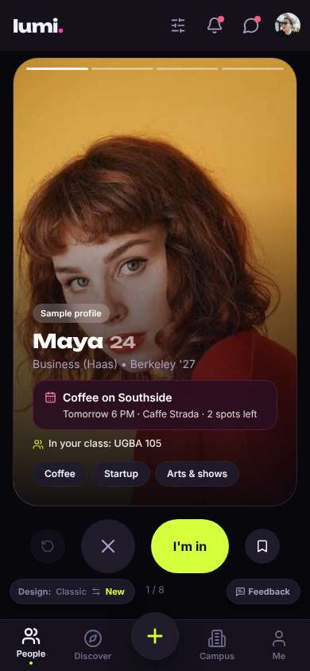</a> |
| 2 | click “Discover” | `/discover` | 1040 | expects: “A place to browse things on campus, maybe clubs and groups” (0.5) **mismatch**: Discover is rides, timetable, 'ask friends with one link', dining/gym, and faces of people 'free right now'. No clubs anywhere I can see. ⚑ mismatch _confused_: “Hmm, this is more like hanging out right now. There are 'Activities' and 'Teams' tabs though — wait, does 'Teams' mean sports teams or clubs? I'll try Activities first.” | <a href="shots/002-click-som.jpg">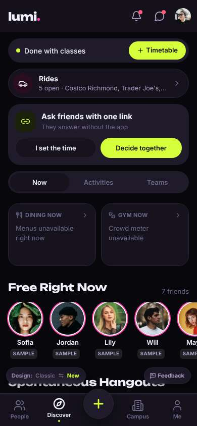</a> |
| 4 | click “Activities” | `/discover?tab=activities` | 957 | expects: “A list of activities, maybe including clubs or club events” (0.4) as expected _curious_: “Okay, 'Club recruiting tables' — that's something. But it's a person's meetup with a big yellow Join button. Wait, does Join mean I'm going with a stranger? I'll scroll first before tapping anything.” | <a href="shots/004-click-som.jpg">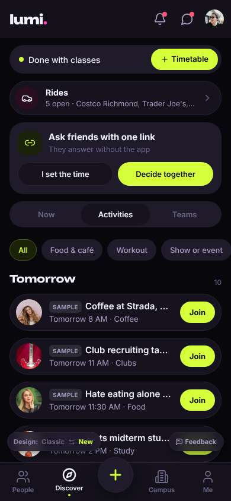</a> |
| 6 | scroll down | `/discover?tab=activities` | 1313 | _frustrated_: “Fraternity rush, sorority 'formal recruitment', and below it 'fall recruiting' for the indie music club… Wait, does that mean every club makes you try out or apply? That's exactly what I was scared of. And 'Go together' with 'Maya going' — would that message Maya?” → f2 | <a href="shots/006-scroll-som.jpg">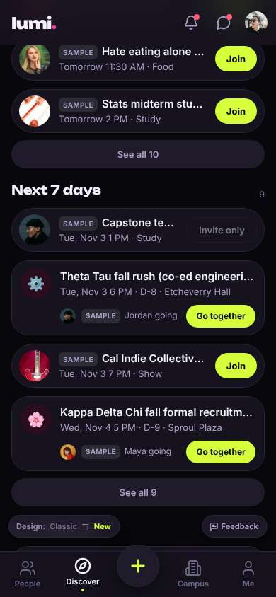</a> |
| 8 | scroll down | `/discover?tab=activities` | 1323 |  | <a href="shots/008-scroll-som.jpg">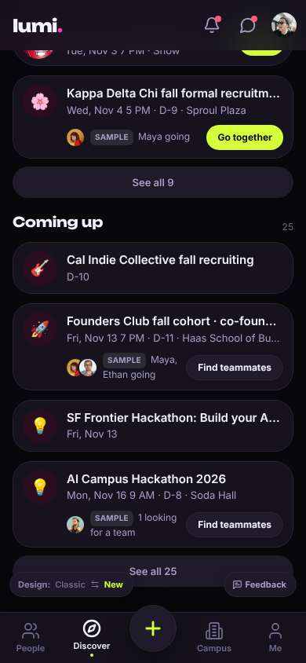</a> |
| 9 | click “Campus” | `/community` | 860 | expects: “Campus info — maybe a list of clubs and organizations” (0.55) **mismatch**: Campus is a social feed of posts (Maya, Anonymous, Cal Indie Collective news). It opened already scrolled to the bottom of the feed, so I landed in the middle of posts without a header. ⚑ mismatch _confused_: “Oh, this is like a feed. And I'm somehow at the bottom already? I don't see a title or anything. There's a club post from Cal Indie Collective though. Let me scroll up and see what's on top.” → f3 | <a href="shots/009-click-som.jpg">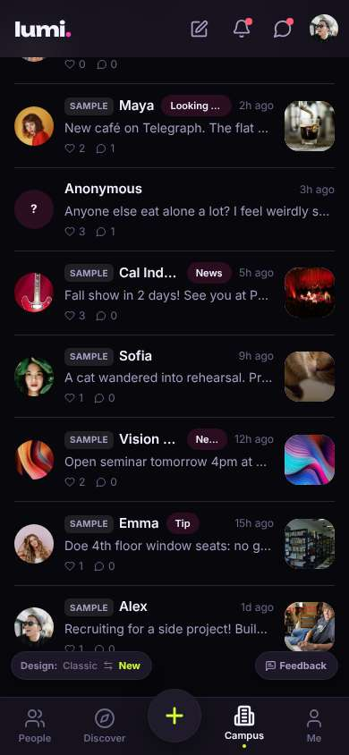</a> |
| 11 | scroll up | `/community` | 1313 |  | <a href="shots/011-scroll-som.jpg">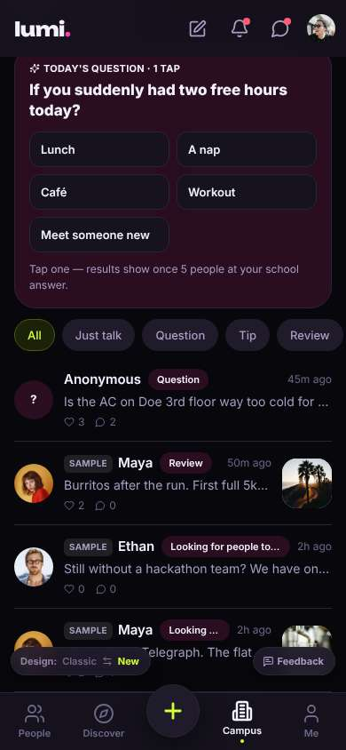</a> |
| 12 | scroll up | `/community` | 1317 |  | <a href="shots/012-scroll-som.jpg">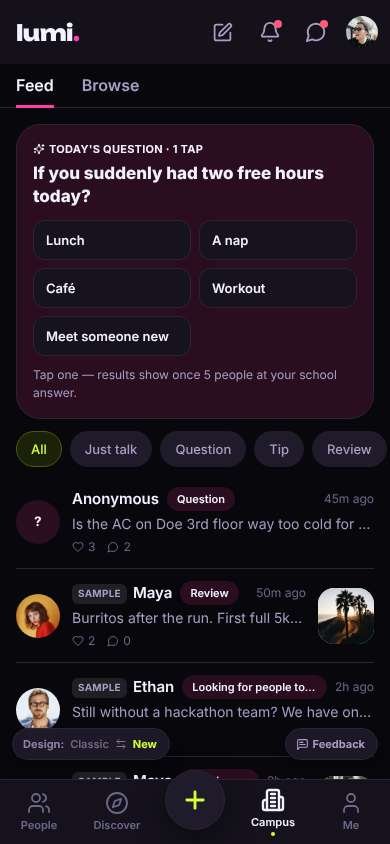</a> |
| 13 | click “Browse” | `/community?tab=opportunities` | 1068 | expects: “A directory to browse — hopefully clubs and groups” (0.5) as expected _curious_: “There's a 'Clubs' button, okay good. But wait — 'Your saved'? I didn't save a scholarship or a lab. Did someone set this up for me? Weird, but I'll ignore it and tap Clubs.” → f4 | <a href="shots/013-click-som.jpg">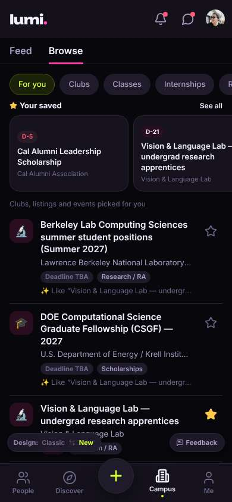</a> |
| 15 | click “Clubs” | `/community?tab=opportunities` | 867 | expects: “A list of student clubs I can browse” (0.8) as expected _frustrated_: “Okay, a club list, good. But wait — 'Fits your major (Computer Science)'? I'm Public Health. Where did it get that? And the 'For you' picks are all fraternities and résumé clubs. That's literally the opposite of what I want.” → f5 | <a href="shots/015-click-som.jpg">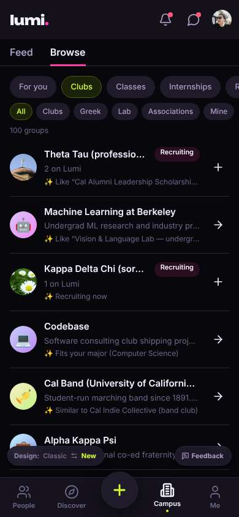</a> |
| 17 | click “Clubs” | `/community?tab=opportunities` | 841 | expects: “Filters out the fraternities and sororities so I just see regular clubs” (0.6) as expected _neutral_: “Okay, that worked — though there are two buttons both called 'Clubs' right on top of each other, which threw me for a second. Still mostly consulting and VC stuff at the top. Let me scroll.” → f6 | <a href="shots/017-click-som.jpg">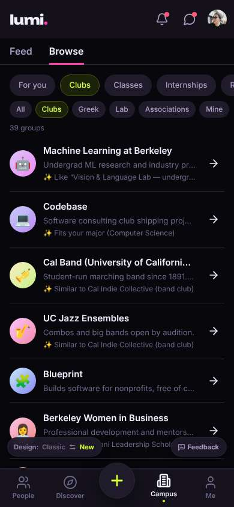</a> |
| 19 | scroll down | `/community?tab=opportunities` | 1316 |  | <a href="shots/019-scroll-som.jpg">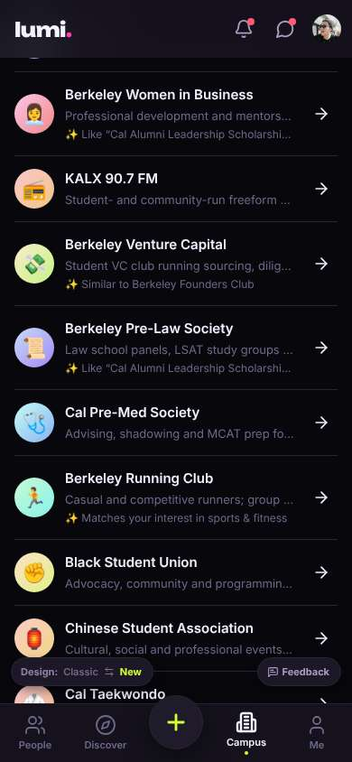</a> |
| 20 | scroll down | `/community?tab=opportunities` | 1315 | _neutral_: “Nothing for Public Health or health equity, which is what I'd have searched for if there was a search box. But 'Berkeley Running Club — casual runners, group runs from Sather Gate' sounds low-pressure. 'Casual' is the word I needed. Let me just open it — I hope tapping the row only opens the page and doesn't join me.” → f7 | <a href="shots/020-scroll-som.jpg">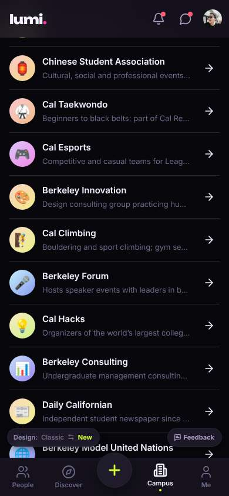</a> |
| 22 | click “🏃 Berkeley Running Club Casual and comp” | `/community?tab=opportunities` | 840 | expects: “Opens the Running Club's page with info on how to join, without signing me up” (0.6) **mismatch**: Tapping Berkeley Running Club did nothing visible — no page opened; the list just shifted so the running club row is half-hidden under the top bar. ⚑ mismatch |  |
| 23 | wait | `/community?tab=opportunities` | 2304 | _confused_: “Wait, did that do something? Nothing opened. Did I just join it by accident?? There's no message either way. That's exactly what makes me nervous.” → f8 | <a href="shots/023-wait-som.jpg">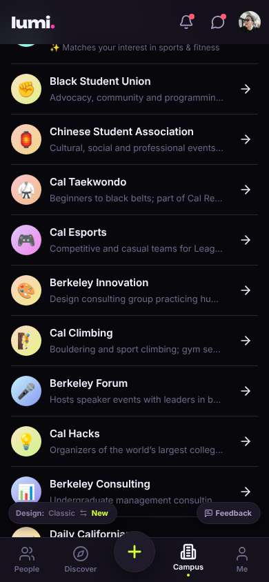</a> |
| 25 | scroll up | `/community?tab=opportunities` | 1317 |  | <a href="shots/025-scroll-som.jpg">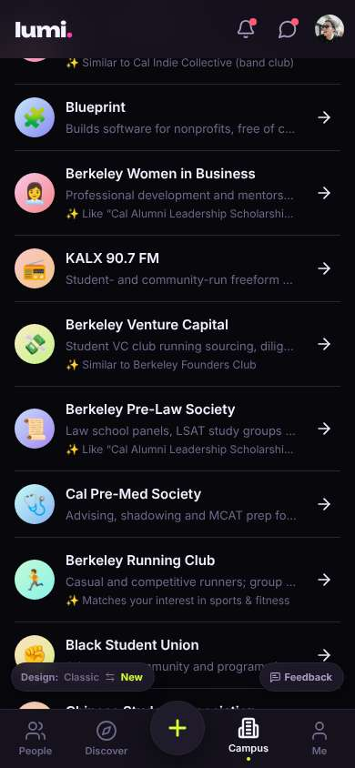</a> |
| 26 | tap “🏃 Berkeley Running Club Casual and comp” | `/orgs/:id` | 814 | expects: “The arrow opens the Running Club's page” (0.6) as expected _curious_: “Oh good, this is the page. Group runs Tue/Thu at 5pm — that sounds like I could just show up? But then why is it 'Ask to join'… does that mean I have to apply? Would it message someone? And 'Unverified' — is this even the real club?” → f9 | <a href="shots/026-tap-som.jpg">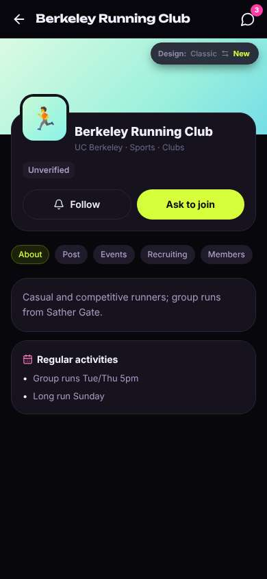</a> |
| 28 | click “Recruiting” | `/orgs/:id?tab=recruit` | 839 | expects: “Shows how recruiting works — whether there's an application or I can just come” (0.5) **mismatch**: Recruiting tab just says 'Not recruiting right now' — no explanation of how to join, while the big 'Ask to join' button is still there. ⚑ mismatch _confused_: “Wait, so they're not recruiting… but I can ask to join? Does that mean I'm too late for this year? Or that it's open anyway? I really don't want to send a request to a club that's closed and look dumb.” → f10 | <a href="shots/028-click-som.jpg">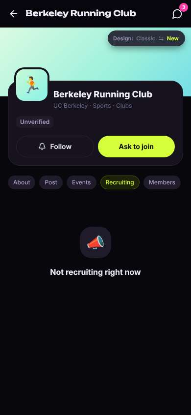</a> |
| 30 | click “Events” | `/orgs/:id?tab=events` | 853 | expects: “Upcoming group runs I could just show up to” (0.5) **mismatch**: Events tab: 'No upcoming events. Events you post also show in Discover > Activities.' Even though the About tab lists group runs Tue/Thu 5pm. ⚑ mismatch _frustrated_: “No events, but they run twice a week? And 'events you post' — I'm not in charge of this club, why is it talking to me like I am? Members says 3 on Lumi… it feels kind of empty.” → f11 |  |
| 32 | finish | `/orgs/:id?tab=events` |  |  |  |

## Automatic checks (harness, not persona)

| screen | tap targets < 44px | sideways overflow | broken images |
|---|---|---|---|
| `/` | 6 (Filters 40×40, Notifications 40×40, Messages 40×40, Me 32×32, Feedback 93×32) | — | — |
| `/discover` | 11 (Notifications 40×40, Messages 40×40, Me 32×32, Timetable 113×36, I set the time 161×40) | — | — |
| `/discover?tab=activities` | 18 (Notifications 40×40, Messages 40×40, Me 32×32, Timetable 113×36, I set the time 161×40) | — | — |
| `/community` | 16 (Notifications 40×40, Messages 40×40, Me 32×32, Feedback 93×32, Switch to the classic design 158×32) | — | — |
| `/community?tab=opportunities` | 17 (Notifications 40×40, Messages 40×40, Me 32×32, Feed 38×44, For you 76×36) | — | — |
| `/orgs/:id` | 8 (Back 40×40, Messages 40×40, About 56×28, Post 47×28, Events 61×28) | — | — |
| `/orgs/:id?tab=recruit` | 8 (Back 40×40, Messages 40×40, About 56×28, Post 47×28, Events 61×28) | — | — |
| `/orgs/:id?tab=events` | 8 (Back 40×40, Messages 40×40, About 56×28, Post 47×28, Events 61×28) | — | — |

## Timing (harness)

- Full page load (navigation timing): 948 ms
