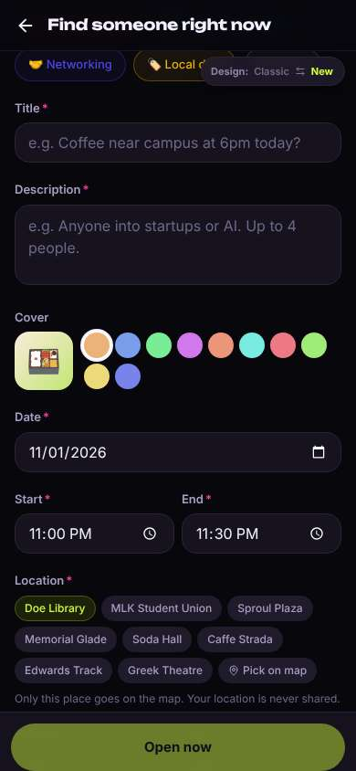
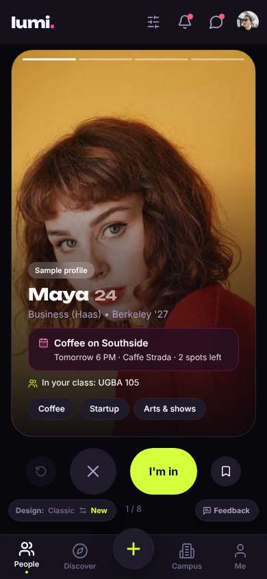
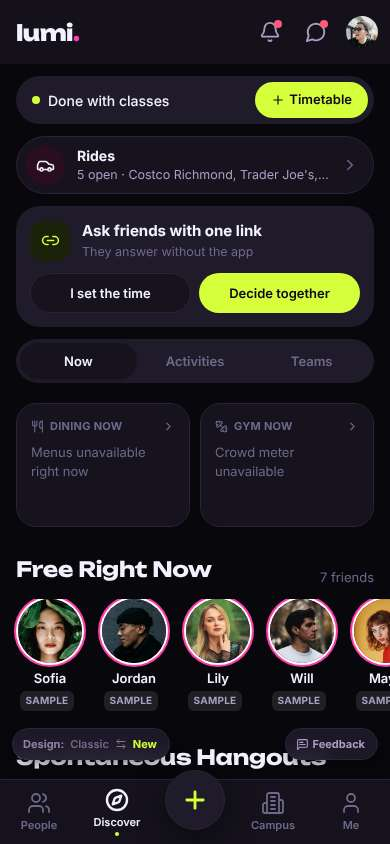
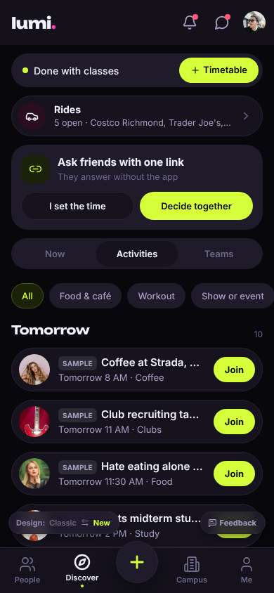
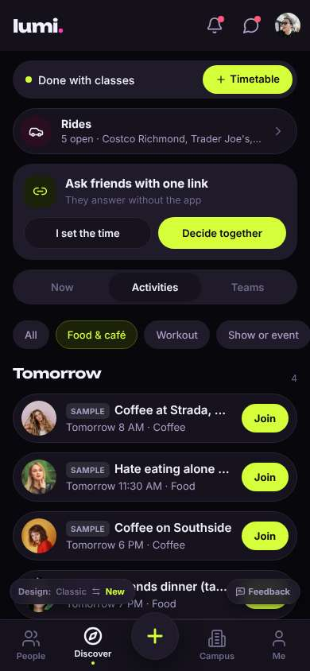
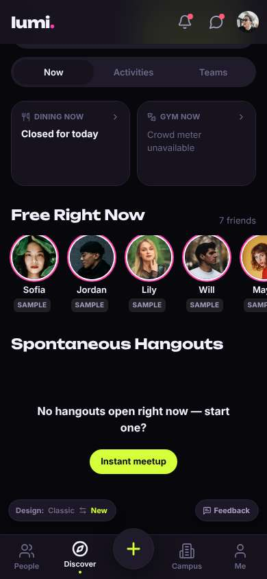

# ux-sim run `baseline-diego-lunch-today`

> **AI simulation — hypotheses, not measured user behaviour.** One simulated persona; nothing here is a rate or a measurement of real students.

| | |
|---|---|
| Persona | **Diego**, 21 — Junior (transfer from Laney College) · phone 390×844 · prefers en · tech medium (`diego-transfer-commuter`) |
| Scenario | **Find someone to get lunch with today** — It's a weekday and you'd rather not eat lunch alone again. Use the app to find someone (or a group) to get lunch with today, and let them know you're in. (`lunch-today`) |
| Target | local · http://localhost:46077 · worktree commit `60c0cc288e13` |
| Outcome | **abandoned** · ended by persona |
| Account | shared demo account (sample profile with someone else's data) |
| Goal check (fixed, by harness) | met at step 4 after 2 action(s) — _Joined or requested to join a meal plan / sent a lunch invite: the button now reads as joined/requested, or a chat with the plan opened._ |
| ⚠ unnoticed success | The check passed but the persona did not realise it had succeeded. |
| Persona's reason | “Everything food was tomorrow, the 'free now' people were samples, and 'Instant meetup' turned into a whole event form set to 11 PM. Class starts soon — I'm grabbing a burrito alone.” |
| Effort | 6/32 actions · objective frustration 2.50/4 · 6 confused note(s) · ~34s simulated |
| Drop-off risk | **high** _(AI hypothesis, persona agent)_ — Opened it between classes for lunch today; got a face card for tomorrow's coffee, an all-tomorrow list, an empty hangouts section and a long form. Rides caught my eye, but nothing proved there are real people around today. · basis: steps 4, 6, 10, 12 |

Known environment limits (not UX findings)

- Dining menus and RSF gym crowd levels need live campus sources (the local stack runs with CAMPUS_LIVE=0) — empty or missing data there is not a UX bug.
- AI features (Ask Lumi, AI profile draft on /start, conversation starters) need an OpenAI key; none is configured locally.
- Course catalog is the built-in sample list (~210 courses, typical times). Live has the real Berkeley Class Schedule from the data worker.
- Opportunities are only the CSV rows in server/data (deadline calendar). Live also has worker-fetched internships (Greenhouse/Lever/Ashby), Devpost hackathons and CalLink/campus events.
- No e-mail is sent: the sign-up / sign-in code is shown on screen in the hint (live sends a real e-mail).
- Real-time updates (SSE) work locally; other people never reply unless the stack was started with --autoreply.

## Friction

| # | step | type | sev | persona says | screen | element | env-limited | evidence |
|---|---|---|---|---|---|---|---|---|
| f1 | 0 | Confusing UI | 2 | “OK, a big face photo first thing. Coffee tomorrow at 6 isn't lunch today. Is this a dating thing or a plans thing? I just want lunch people.” _wish: show me what's happening today, not one person's face_ | `/` | I'm in | no | [shot](shots/000-start.jpg) [marked](shots/000-start-som.jpg) |
| f2 | 4 | Missing / empty content | 2 | “Tomorrow, tomorrow, tomorrow. I need lunch TODAY. 'Hate eating alone' is literally me, but it's tomorrow.” _wish: a Today section first, or tell me nothing is on today and let me start one_ | `/discover?tab=activities` | Join | caveat — Local stack has only CSV opportunities; live also has worker-fetched internships, hackathons and campus events — check on live before acting. | [shot](shots/004-click.jpg) [marked](shots/004-click-som.jpg) |
| f3 | 10 | Missing / empty content | 3 | “Empty. And '7 friends'? I don't have friends on here, those are sample people. Nobody's actually around. Fine, Instant meetup is right there, I'll give it one shot.” _wish: real people free for lunch near me today, or at least other transfers_ | `/discover` | Instant meetup | caveat — Local stack has only CSV opportunities; live also has worker-fetched internships, hackathons and campus events — check on live before acting. | [shot](shots/010-scroll.jpg) [marked](shots/010-scroll-som.jpg) |
| f4 | 12 | Onboarding friction | 4 | “'Instant'? This is a whole event form. Title, description, color, capacity... and it says 11 PM? I want lunch in 20 minutes. I don't have time for this, and nobody's even on here to see it.” _wish: one tap: 'Lunch now near me' with time and place prefilled, and show me who sees it_ | `/create/activity` | Open now | no | [shot](shots/012-click.jpg) [marked](shots/012-click-som.jpg) |
| f5 | 12 | Confusing UI | 2 | “Why's the start 11:00 PM on 11/01? It's lunchtime. Is this even today's date?” _wish: prefill the next half hour, today_ | `/create/activity` |  | no | [shot](shots/012-click.jpg) [marked](shots/012-click-som.jpg) |

Severity: 1 = Minor — noticed it, cosmetic or a small annoyance; did not slow me down. · 2 = Moderate — slowed me down or made me hesitate; I recovered on my own. · 3 = Major — real confusion, a wrong path or many extra steps; I nearly gave up or only got through by guessing. · 4 = Blocker — I could not continue, gave up, or would stop using the app here.

## Where it ended

Step 12 on `/create/activity`.

## Timeline

| step | what | screen | ms | signals / notes | shot |
|---|---|---|---|---|---|
| 0 | start | `/` | 1038 | _confused_: “OK, a big face photo first thing. Coffee tomorrow at 6 isn't lunch today. Is this a dating thing or a plans thing? I just want lunch people.” → f1 |  |
| 2 | click “Discover” | `/discover` | 1048 | expects: “a list of things happening today, maybe lunch plans” (0.6) **mismatch**: A busy dashboard: rides, ask-friends links, dining/gym (unavailable), Free Right Now people. No lunch plans visible yet. ⚑ mismatch _neutral_: “Lot of stuff. Rides is cool for me actually, but not now. Where's lunch? Maybe Activities.” |  |
| 4 | click “Activities” | `/discover?tab=activities` | 969 | expects: “list of activities/plans including a lunch today” (0.55) **mismatch**: Activities list starts at 'Tomorrow' — coffee, club tables, a Crossroads lunch, all tomorrow. Nothing today at the top. ⚑ mismatch _frustrated_: “Tomorrow, tomorrow, tomorrow. I need lunch TODAY. 'Hate eating alone' is literally me, but it's tomorrow.” → f2 |  |
| 6 | click “Food & café” | `/discover?tab=activities` | 871 | expects: “only food plans, hopefully one today” (0.4) **mismatch**: Food filter: 4 plans, all under 'Tomorrow'. Nothing for today. ⚑ mismatch _frustrated_: “Still all tomorrow. OK, one more try — the Now tab had 'Spontaneous Hangouts'. If that's empty I'm out.” |  |
| 8 | click “Now” | `/discover` | 848 | expects: “back to Now, then I scroll to Spontaneous Hangouts” (0.7) as expected _neutral_: “Fine. Scroll.” |  |
| 10 | scroll down | `/discover` | 1319 | expects: “Spontaneous Hangouts with something happening today” (0.4) **mismatch**: Spontaneous Hangouts: 'No hangouts open right now — start one?' with an Instant meetup button. 'Free Right Now 7 friends' are all SAMPLE people. ⚑ mismatch _frustrated_: “Empty. And '7 friends'? I don't have friends on here, those are sample people. Nobody's actually around. Fine, Instant meetup is right there, I'll give it one shot.” → f3 |  |
| 12 | click “Instant meetup” | `/create/activity` | 858 | expects: “quick form: lunch, now/12:30, place — then post” (0.5) **mismatch**: 'Instant meetup' opens a full create form: category, title*, description*, cover color, date*, start*, end*, location*, capacity, cost, who-can-join, visibility. Defaults to 11/01 at 11:00 PM–11:30 PM. ⚑ mismatch _frustrated_: “'Instant'? This is a whole event form. Title, description, color, capacity... and it says 11 PM? I want lunch in 20 minutes. I don't have time for this, and nobody's even on here to see it.” → f4 _confused_: “Why's the start 11:00 PM on 11/01? It's lunchtime. Is this even today's date?” → f5 |  |
| 15 | finish | `/create/activity` |  |  |  |

## Automatic checks (harness, not persona)

| screen | tap targets < 44px | sideways overflow | broken images |
|---|---|---|---|
| `/` | 6 (Filters 40×40, Notifications 40×40, Messages 40×40, Me 32×32, Feedback 93×32) | — | — |
| `/discover` | 11 (Notifications 40×40, Messages 40×40, Me 32×32, Timetable 113×36, I set the time 161×40) | — | — |
| `/discover?tab=activities` | 18 (Notifications 40×40, Messages 40×40, Me 32×32, Timetable 113×36, I set the time 161×40) | — | — |
| `/create/activity` | 27 (Back 40×40, 🏃 Workout 102×36, 🎸 Clubs 85×36, 🎤 Show 84×36, 🤝 Networking 122×36) | — | — |

## Timing (harness)

- Full page load (navigation timing): 126 ms
