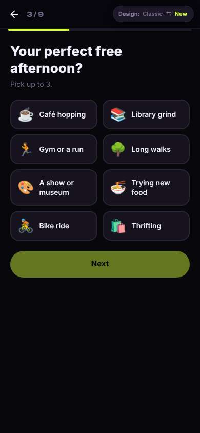
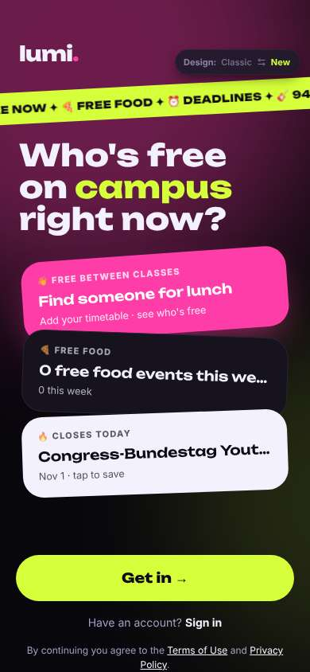
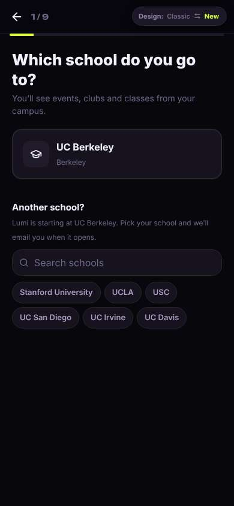
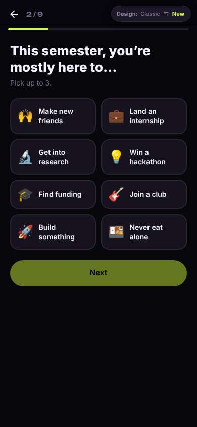
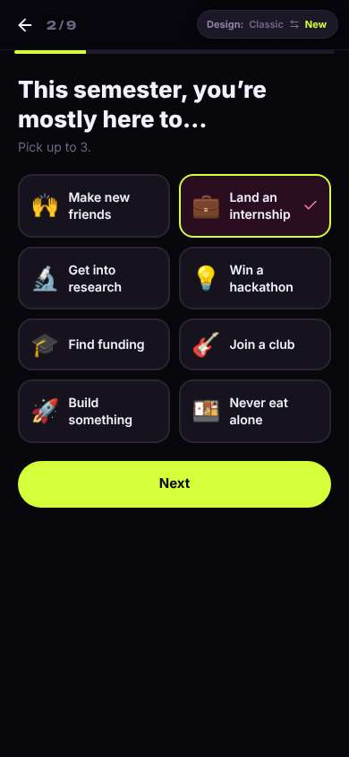

# ux-sim run `baseline-marcus-first-open-decide`

> **AI simulation — hypotheses, not measured user behaviour.** One simulated persona; nothing here is a rate or a measurement of real students.

| | |
|---|---|
| Persona | **Marcus**, 22 — Senior · phone 390×844 · prefers en · tech low (`marcus-senior-lowtech`) |
| Scenario | **First open: what is this app, and is it worth signing up?** — A friend sent you a link to this app. You have never seen it before. Figure out what it is for, and decide whether you want to make an account. If it seems worth it, sign up with your school e-mail. (`first-open-decide`) |
| Target | local · http://localhost:36669 · worktree commit `60c0cc288e13` |
| Outcome | **abandoned** · ended by persona |
| Account | signed out at start |
| Goal check (fixed, by harness) | not met — _Signed up and landed inside the app (the signed-in home or any main tab)._ |
| Persona's reason | “I came for internships and it's asking me about my perfect free afternoon and long walks, with 6 more screens to go and I still haven't seen a single internship. Feels like a dating or hangout app, so I'm not making an account.” |
| Effort | 4/36 actions · objective frustration 0.50/4 · 2 confused note(s) · ~51s simulated |
| Drop-off risk | **high** _(AI hypothesis, persona agent)_ — Never saw any internship content before being walked through personal-taste questions; front page pitches lunch buddies and shows '0 free food', and internships are only a ticker mention. Nothing gave him a reason to trust it or come back. · basis: steps 0, 3, 9 |

Known environment limits (not UX findings)

- Dining menus and RSF gym crowd levels need live campus sources (the local stack runs with CAMPUS_LIVE=0) — empty or missing data there is not a UX bug.
- AI features (Ask Lumi, AI profile draft on /start, conversation starters) need an OpenAI key; none is configured locally.
- Course catalog is the built-in sample list (~210 courses, typical times). Live has the real Berkeley Class Schedule from the data worker.
- Opportunities are only the CSV rows in server/data (deadline calendar). Live also has worker-fetched internships (Greenhouse/Lever/Ashby), Devpost hackathons and CalLink/campus events.
- No e-mail is sent: the sign-up / sign-in code is shown on screen in the hint (live sends a real e-mail).
- Real-time updates (SSE) work locally; other people never reply unless the stack was started with --autoreply.

## Friction

| # | step | type | sev | persona says | screen | element | env-limited | evidence |
|---|---|---|---|---|---|---|---|---|
| f1 | 0 | Confusing UI | 2 | “Who's free on campus right now? Find someone for lunch? Pink and black... this looks more like a hangout or dating thing than an internship app. I saw '4 internships' scroll by in that yellow strip, that's all.” _wish: Tell me plainly what this app is for before asking me to get in_ | `/welcome` |  | no | [shot](shots/000-start.jpg) [marked](shots/000-start-som.jpg) |
| f2 | 0 | Missing / empty content | 1 | “0 free food events this week. Why show me a zero? Makes it look like nobody uses it.” | `/welcome` |  | no | [shot](shots/000-start.jpg) [marked](shots/000-start-som.jpg) |
| f3 | 9 | Trust / privacy worry | 3 | “Your perfect free afternoon? Long walks? This is a dating profile question. I said I want an internship, why does it need my hobbies? And I can't skip it, Next is grayed out.” _wish: Let me skip this, or tell me why you need it for internships_ | `/start` | Next | no | [shot](shots/009-click.jpg) [marked](shots/009-click-som.jpg) |

Severity: 1 = Minor — noticed it, cosmetic or a small annoyance; did not slow me down. · 2 = Moderate — slowed me down or made me hesitate; I recovered on my own. · 3 = Major — real confusion, a wrong path or many extra steps; I nearly gave up or only got through by guessing. · 4 = Blocker — I could not continue, gave up, or would stop using the app here.

## Where it ended

Step 9 on `/start`.

## Timeline

| step | what | screen | ms | signals / notes | shot |
|---|---|---|---|---|---|
| 0 | start | `/welcome` | 2252 | _confused_: “Who's free on campus right now? Find someone for lunch? Pink and black... this looks more like a hangout or dating thing than an internship app. I saw '4 internships' scroll by in that yellow strip, that's all.” → f1 _neutral_: “0 free food events this week. Why show me a zero? Makes it look like nobody uses it.” → f2 |  |
| 3 | click “Get in →” | `/start` | 936 | expects: “It asks me for my email or to make an account right away” (0.7) **mismatch**: It asked which school I go to, not my email. Says 1/9 at the top. ⚑ mismatch _neutral_: “OK, school is fine, that's not personal. But 1 of 9? Nine screens before I even see the thing? Hmm.” |  |
| 5 | click “UC Berkeley Berkeley” | `/start` | 850 | expects: “Picks Berkeley and moves to the next question” (0.8) as expected _curious_: “Oh good, 'Land an internship' is right there. That's what I came for.” |  |
| 7 | click “💼 Land an internship” | `/start` | 837 | expects: “Internship gets selected” (0.85) as expected _neutral_: “Fine, that worked.” |  |
| 9 | click “Next” | `/start` | 881 | expects: “Next question” (0.8) as expected _frustrated_: “Your perfect free afternoon? Long walks? This is a dating profile question. I said I want an internship, why does it need my hobbies? And I can't skip it, Next is grayed out.” → f3 |  |
| 11 | finish | `/start` |  |  |  |

## Automatic checks (harness, not persona)

| screen | tap targets < 44px | sideways overflow | broken images |
|---|---|---|---|
| `/welcome` | 4 (Sign in 46×21, Terms of Use 76×15, Privacy Policy 180×33, Switch to the classic design 158×32) | — | — |
| `/start` | 8 (Back 40×40, Stanford University 148×36, UCLA 62×36, USC 54×36, UC San Diego 112×36) | — | — |

## Timing (harness)

- Full page load (navigation timing): 764 ms
