# ux-sim run `baseline-minji-cold-start-hangout`

> **AI simulation — hypotheses, not measured user behaviour.** One simulated persona; nothing here is a rate or a measurement of real students.

| | |
|---|---|
| Persona | **Minji**, 17 — First-year (started college a year early) · phone 390×844 · prefers ko · tech high (`minji-freshman-17`) |
| Scenario | **Brand-new account: find someone on campus to hang out with this week** — You just heard about this app and want someone on campus to hang out with this week. Make an account with your school e-mail, then use the app to find a person or plan you could join this week and tell them you're in. (`cold-start-hangout`) |
| Target | local · http://localhost:40213 · worktree commit `60c0cc288e13` |
| Outcome | **abandoned** · ended by persona |
| Goal check (fixed, by harness) | not met — _Signed up AND joined/requested a plan or sent a friend request / message to someone._ |
| Persona's reason | “9단계나 다 하고 계정 만들었는데 People은 텅 비었고, Discover엔 해커톤만, Food & café는 'No upcoming activities'. 같이 밥 먹을 사람이나 약속이 하나도 없어서 그만둠.” |
| Effort | 27/40 actions · objective frustration 4.50/4.5 · 5 confused note(s) · ~57s simulated |
| Drop-off risk | **high** _(AI hypothesis, persona agent)_ — The promise on the welcome screen ('Find someone for lunch') was what got her through a 9-step quiz; the payoff was three empty screens and a 'create one yourself' ask, which a shy 17-year-old won't do. Nothing to come back for. · basis: steps 37, 41, 43 |

Known environment limits (not UX findings)

- Dining menus and RSF gym crowd levels need live campus sources (the local stack runs with CAMPUS_LIVE=0) — empty or missing data there is not a UX bug.
- AI features (Ask Lumi, AI profile draft on /start, conversation starters) need an OpenAI key; none is configured locally.
- Course catalog is the built-in sample list (~210 courses, typical times). Live has the real Berkeley Class Schedule from the data worker.
- Opportunities are only the CSV rows in server/data (deadline calendar). Live also has worker-fetched internships (Greenhouse/Lever/Ashby), Devpost hackathons and CalLink/campus events.
- No e-mail is sent: the sign-up / sign-in code is shown on screen in the hint (live sends a real e-mail).
- Real-time updates (SSE) work locally; other people never reply unless the stack was started with --autoreply.

## Friction

| # | step | type | sev | persona says | screen | element | env-limited | evidence |
|---|---|---|---|---|---|---|---|---|
| f1 | 0 | Missing / empty content | 1 | “오 'Find someone for lunch' — 딱 내가 원하는 거. but '0 free food events' 좀 썰렁하고, 'Closes today' 인데 Nov 1? 뭐지. 한국어 옵션은 안 보임.” _wish: hide the free-food card when it's 0, not advertise emptiness_ | `/welcome` |  | no | [shot](shots/000-start.jpg) [marked](shots/000-start-som.jpg) |
| f2 | 2 | Onboarding friction | 2 | “학교 고르기 ok, 근데 1/9?? 9단계나... 아 귀찮아” _wish: fewer steps before I see anything_ | `/start` |  | no | [shot](shots/002-click.jpg) [marked](shots/002-click-som.jpg) |
| f3 | 12 | Onboarding friction | 2 | “4/9... 성격 테스트야 뭐야. 친구 찾으려고 왔는데 아직 아무 사람도 못 봄” _wish: show me people/plans before the personality quiz_ | `/start` |  | no | [shot](shots/012-click.jpg) [marked](shots/012-click-som.jpg) |
| f4 | 22 | Unclear wording | 1 | “오 얼굴사진 대신 이모지! 이건 좋다, 데이팅앱 느낌 없음. 근데 'Freshman in Undeclared' 문장 좀 이상함ㅋ” _wish: say 'Undeclared freshman'_ | `/start` |  | no | [shot](shots/022-click.jpg) [marked](shots/022-click-som.jpg) |
| f5 | 25 | Trust / privacy worry | 2 | “birth year 왜 필요해? 내가 17살인 거 다른 사람이 보면 좀... 누가 보는 건지 안 써있음” _wish: say who sees my age / why it's needed_ | `/start` | 2005 | no | [shot](shots/025-click.jpg) [marked](shots/025-click-som.jpg) |
| f6 | 37 | Missing / empty content | 3 | “헐 아무도 없어. 9단계 다 했는데 빈 화면... 초대할 친구가 없어서 이 앱 깐 건데” _wish: show plans or anyone at all, not ask me to bring friends I don't have_ | `/` | Invite friends | no | [shot](shots/037-click.jpg) [marked](shots/037-click-som.jpg) |
| f7 | 41 | No reason to stay | 3 | “해커톤...? 난 밥 같이 먹을 사람 찾는 건데. 'Food & café' 하나만 더 눌러보고 없으면 끝” _wish: show casual plans from real students (lunch, café) first, not competitions_ | `/discover?tab=activities` | 💡 ARC Prize 2026 D-1 | no | [shot](shots/041-click.jpg) [marked](shots/041-click-som.jpg) |
| f8 | 43 | Missing / empty content | 4 | “역시 없음. 내가 만들라고? 17살 신입이 모르는 사람들한테 먼저 밥 먹자고 하는 거 너무 어색해. 그만할래” _wish: at least one real plan from someone in my dorm/class I could say 'I'm in' to_ | `/discover?tab=activities` | Create activity | caveat — Local stack has only CSV opportunities; live also has worker-fetched internships, hackathons and campus events — check on live before acting. | [shot](shots/043-click.jpg) [marked](shots/043-click-som.jpg) |

Severity: 1 = Minor — noticed it, cosmetic or a small annoyance; did not slow me down. · 2 = Moderate — slowed me down or made me hesitate; I recovered on my own. · 3 = Major — real confusion, a wrong path or many extra steps; I nearly gave up or only got through by guessing. · 4 = Blocker — I could not continue, gave up, or would stop using the app here.

## Where it ended

Step 43 on `/discover?tab=activities`.

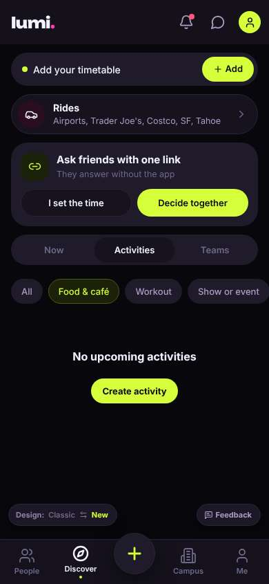

## Timeline

| step | what | screen | ms | signals / notes | shot |
|---|---|---|---|---|---|
| 0 | start | `/welcome` | 2638 | _curious_: “오 'Find someone for lunch' — 딱 내가 원하는 거. but '0 free food events' 좀 썰렁하고, 'Closes today' 인데 Nov 1? 뭐지. 한국어 옵션은 안 보임.” → f1 | <a href="shots/000-start-som.jpg">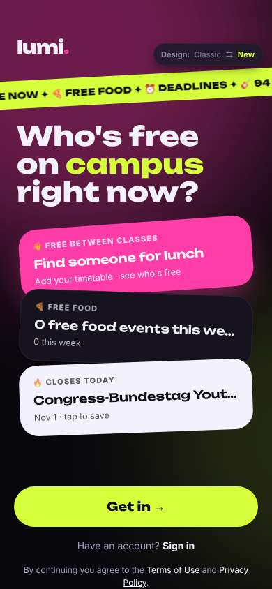</a> |
| 2 | click “Get in →” | `/start` | 970 | expects: “sign up screen asking for school email” (0.8) **mismatch**: school picker first, and it says 1/9 steps ⚑ mismatch _neutral_: “학교 고르기 ok, 근데 1/9?? 9단계나... 아 귀찮아” → f2 | <a href="shots/002-click-som.jpg">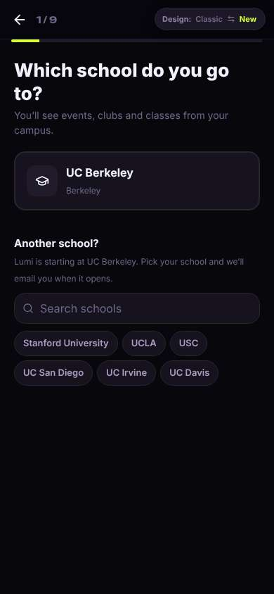</a> |
| 4 | click “UC Berkeley Berkeley” | `/start` | 859 | expects: “next step, maybe email” (0.7) **mismatch**: goals picker instead of email ⚑ mismatch _delighted_: “'Never eat alone' ㅋㅋ 이거 완전 나. ok 이건 괜찮아” | <a href="shots/004-click-som.jpg">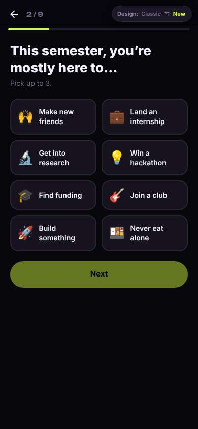</a> |
| 6 | click “🍱 Never eat alone” | `/start` | 860 |  | <a href="shots/006-click-som.jpg">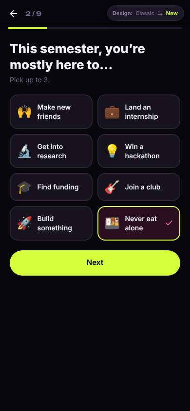</a> |
| 7 | click “🙌 Make new friends” | `/start` | 844 |  | <a href="shots/007-click-som.jpg">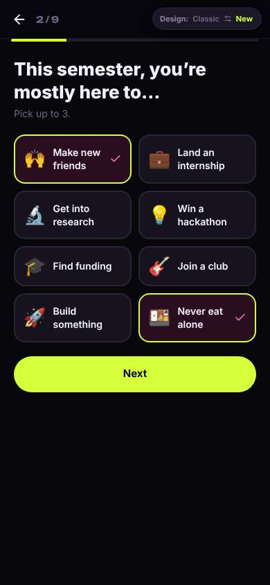</a> |
| 8 | click “Next” | `/start` | 846 | expects: “step 3, maybe email or year” (0.6) as expected _neutral_: “또 고르기. 빠르긴 한데 아직 이메일도 안 넣었는데 질문만 계속...” | <a href="shots/008-click-som.jpg">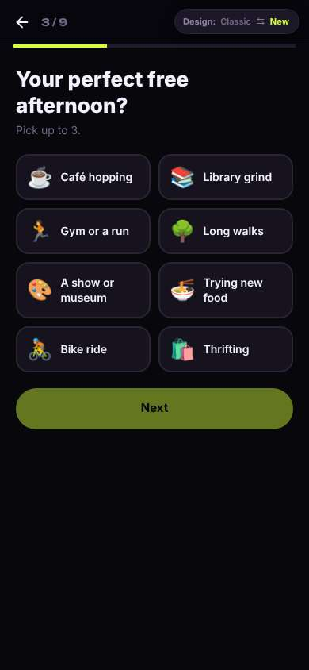</a> |
| 10 | click “☕ Café hopping” | `/start` | 859 |  | <a href="shots/010-click-som.jpg">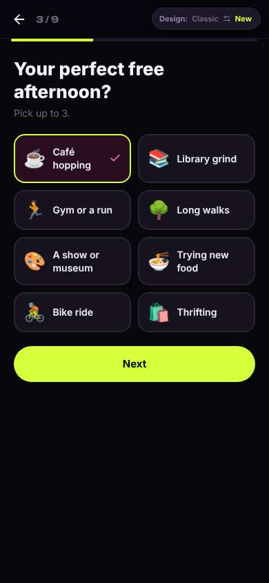</a> |
| 11 | click “🍜 Trying new food” | `/start` | 850 |  | <a href="shots/011-click-som.jpg">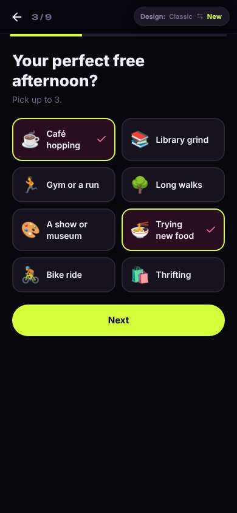</a> |
| 12 | click “Next” | `/start` | 870 | expects: “step 4” (0.7) as expected _bored_: “4/9... 성격 테스트야 뭐야. 친구 찾으려고 왔는데 아직 아무 사람도 못 봄” → f3 | <a href="shots/012-click-som.jpg">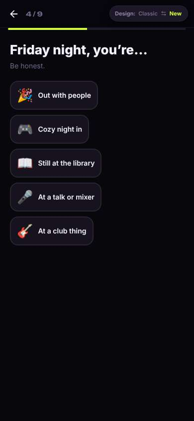</a> |
| 14 | click “🎮 Cozy night in” | `/start` | 845 | expects: “auto-advances to step 5” (0.6) as expected _neutral_: “ok. 'New friends' 또 묻네, 2번에서 이미 골랐는데” | <a href="shots/014-click-som.jpg">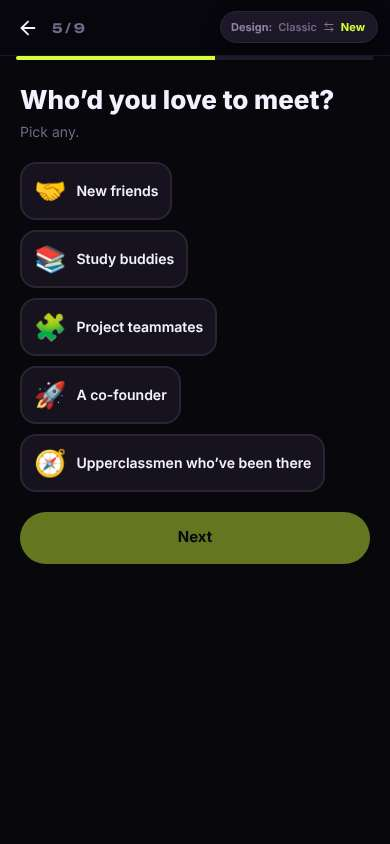</a> |
| 16 | click “🤝 New friends” | `/start` | 867 |  | <a href="shots/016-click-som.jpg">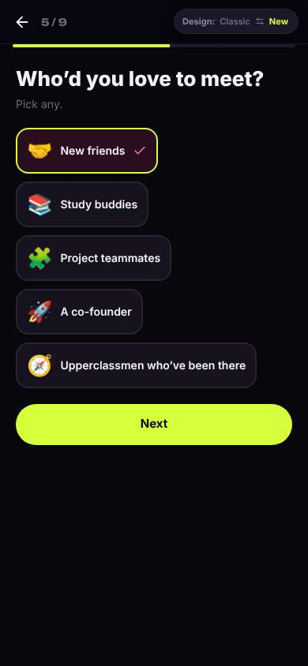</a> |
| 17 | click “Next” | `/start` | 875 | expects: “6/9, hopefully email soon” (0.5) **mismatch**: major + year, not email yet ⚑ mismatch _neutral_: “전공... 난 아직 undeclared인데. 그냥 써야지” | <a href="shots/017-click-som.jpg">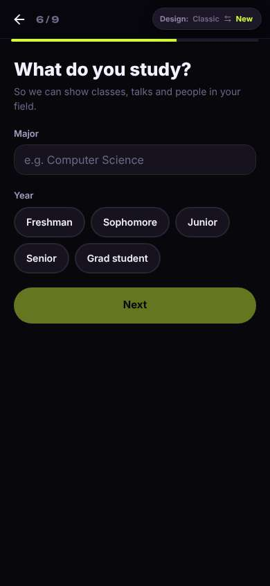</a> |
| 19 | type “e.g. Computer Science” ← “Undeclared” | `/start` | 863 | expects: “suggestions or accepts free text” (0.5) as expected _neutral_: “ok 들어감” | <a href="shots/019-type-som.jpg">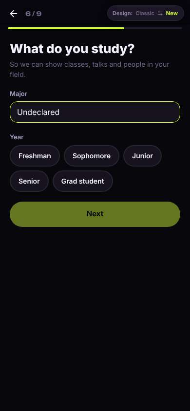</a> |
| 21 | click “Freshman” | `/start` | 849 |  | <a href="shots/021-click-som.jpg">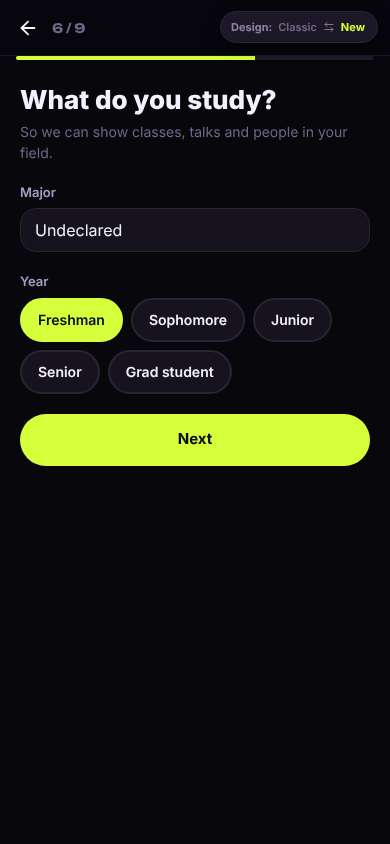</a> |
| 22 | click “Next” | `/start` | 890 | expects: “7/9, maybe email” (0.5) **mismatch**: auto-built profile card with emoji avatar, still no email ⚑ mismatch _delighted_: “오 얼굴사진 대신 이모지! 이건 좋다, 데이팅앱 느낌 없음. 근데 'Freshman in Undeclared' 문장 좀 이상함ㅋ” → f4 | <a href="shots/022-click-som.jpg">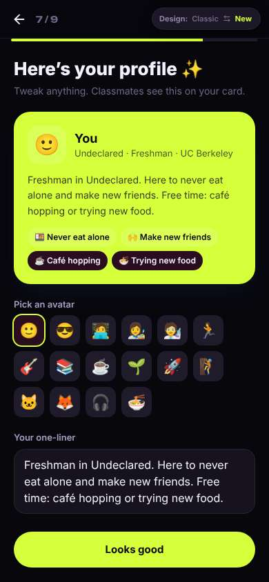</a> |
| 24 | click “🦊” | `/start` | 854 |  | <a href="shots/024-click-som.jpg">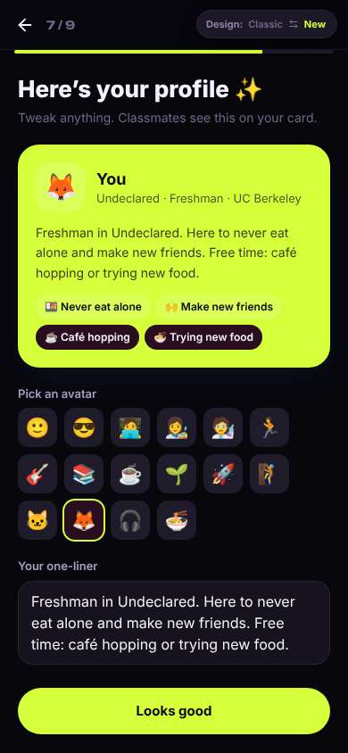</a> |
| 25 | click “Looks good” | `/start` | 844 | expects: “8/9, email sign up” (0.6) **mismatch**: name + birth year, no email yet ⚑ mismatch _confused_: “birth year 왜 필요해? 내가 17살인 거 다른 사람이 보면 좀... 누가 보는 건지 안 써있음” → f5 | <a href="shots/025-click-som.jpg">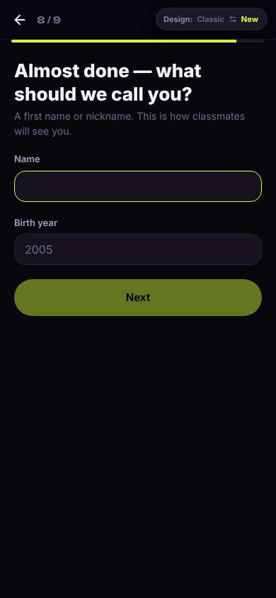</a> |
| 27 | type [66] ← “Minji” | `/start` | 855 |  | <a href="shots/027-type-som.jpg">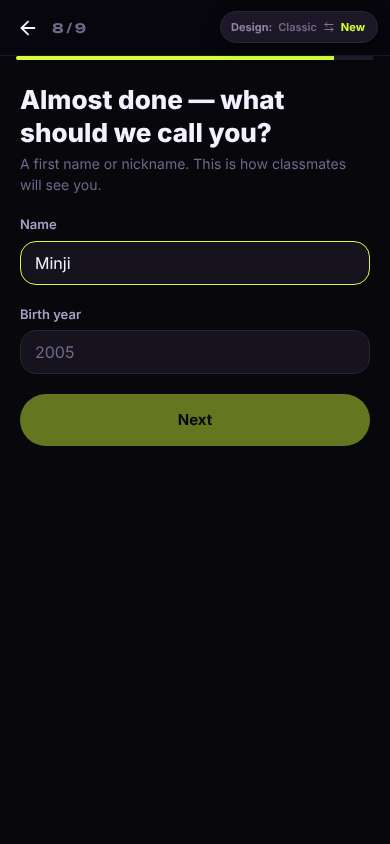</a> |
| 28 | type “2005” ← “2009” | `/start` | 868 |  | <a href="shots/028-type-som.jpg">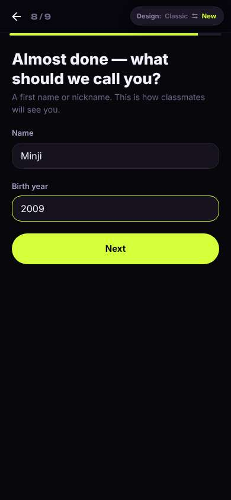</a> |
| 29 | click “Next” | `/start` | 852 | expects: “9/9 email verification” (0.7) as expected _neutral_: “드디어 이메일. 16살 이상 확인... 난 17이니까 괜찮” | <a href="shots/029-click-som.jpg">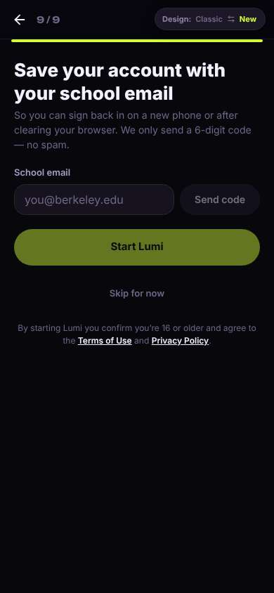</a> |
| 31 | type “you@berkeley.edu” ← “minji.kim@berkeley.edu” | `/start` | 859 |  | <a href="shots/031-type-som.jpg">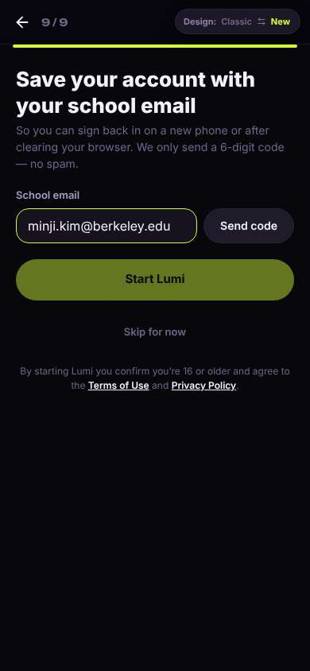</a> |
| 32 | click “Send code” | `/start` | 854 | expects: “code sent, a field to enter it” (0.8) as expected _neutral_: “ok 코드 넣자” | <a href="shots/032-click-som.jpg">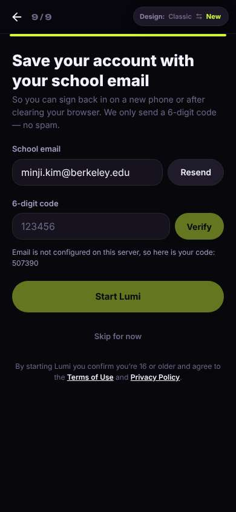</a> |
| 34 | type “123456” ← “507390” | `/start` | 851 |  | <a href="shots/034-type-som.jpg">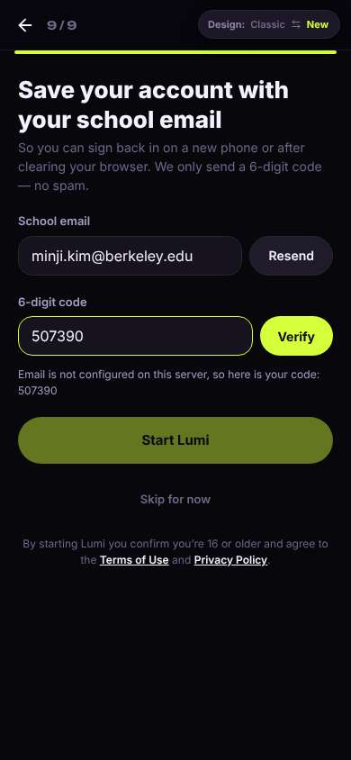</a> |
| 35 | click “Verify” | `/start` | 841 | expects: “verified, Start Lumi enabled” (0.8) as expected _curious_: “school badge 좋다 — 진짜 버클리 학생들이라는 거니까 좀 안심” | <a href="shots/035-click-som.jpg">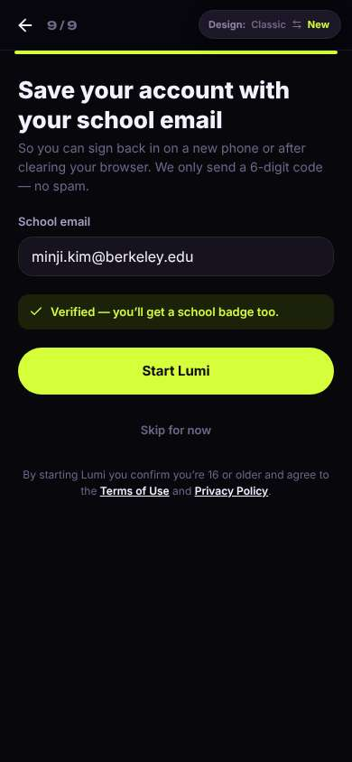</a> |
| 37 | click “Start Lumi” | `/` | 950 | expects: “home feed with people / plans this week” (0.7) **mismatch**: People tab is empty — 'Students from your campus show up here', only Invite friends ⚑ mismatch _frustrated_: “헐 아무도 없어. 9단계 다 했는데 빈 화면... 초대할 친구가 없어서 이 앱 깐 건데” → f6 | <a href="shots/037-click-som.jpg">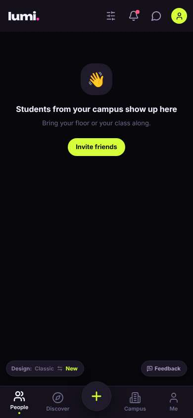</a> |
| 39 | click “Discover” | `/discover` | 845 | expects: “plans or events I could join this week” (0.5) **mismatch**: Discover is a busy dashboard; 'No hangouts open right now — start one?' ⚑ mismatch _confused_: “뭐가 많은데 다 비어있거나 내가 만들라는 거네. Activities 눌러보자, 거기 약속 있을 수도” | <a href="shots/039-click-som.jpg">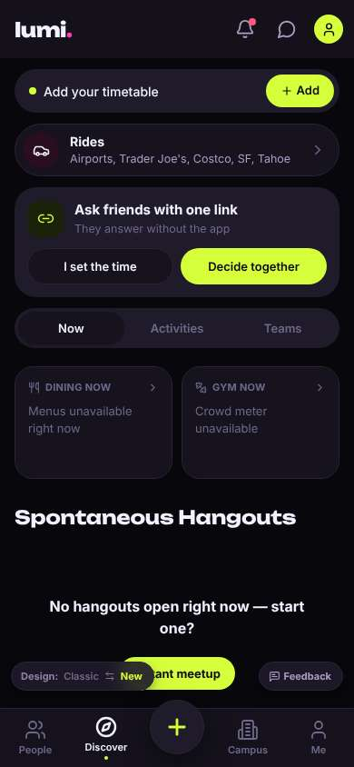</a> |
| 41 | click “Activities” | `/discover?tab=activities` | 856 | expects: “list of activities/plans this week to join” (0.5) **mismatch**: Activities = hackathons and prizes, no hangouts or meals with people ⚑ mismatch _frustrated_: “해커톤...? 난 밥 같이 먹을 사람 찾는 건데. 'Food & café' 하나만 더 눌러보고 없으면 끝” → f7 | <a href="shots/041-click-som.jpg">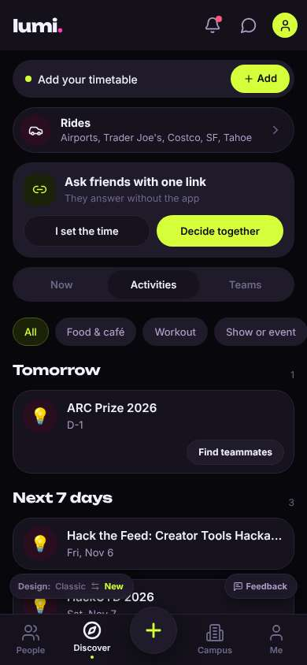</a> |
| 43 | click “Food & café” | `/discover?tab=activities` | 848 | expects: “food/café meetups to join” (0.3) **mismatch**: Food & café: 'No upcoming activities — Create activity' ⚑ mismatch _frustrated_: “역시 없음. 내가 만들라고? 17살 신입이 모르는 사람들한테 먼저 밥 먹자고 하는 거 너무 어색해. 그만할래” → f8 |  |
| 45 | finish | `/discover?tab=activities` |  |  |  |

## Automatic checks (harness, not persona)

| screen | tap targets < 44px | sideways overflow | broken images |
|---|---|---|---|
| `/welcome` | 4 (Sign in 46×21, Terms of Use 76×15, Privacy Policy 180×33, Switch to the classic design 158×32) | — | — |
| `/start` | 8 (Back 40×40, Stanford University 148×36, UCLA 62×36, USC 54×36, UC San Diego 112×36) | — | — |
| `/` | 7 (Filters 40×40, Notifications 40×40, Messages 40×40, Me 32×32, Invite friends 116×36) | — | — |
| `/discover` | 12 (Notifications 40×40, Messages 40×40, Me 32×32, Add 75×36, I set the time 161×40) | — | — |
| `/discover?tab=activities` | 16 (Notifications 40×40, Messages 40×40, Me 32×32, Add 75×36, I set the time 161×40) | — | — |

## Timing (harness)

- Full page load (navigation timing): 1149 ms
