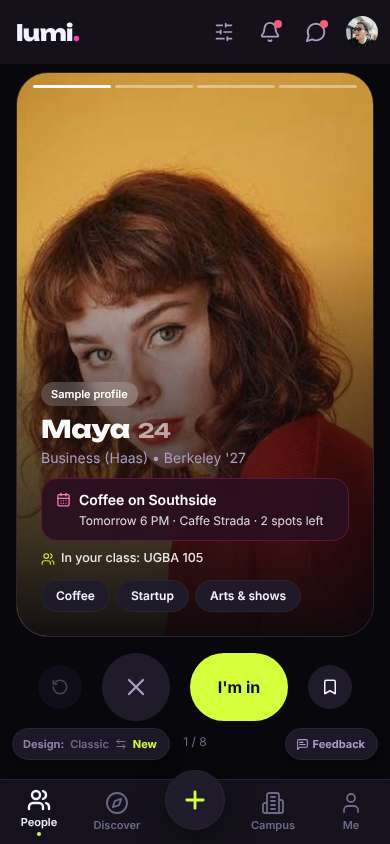
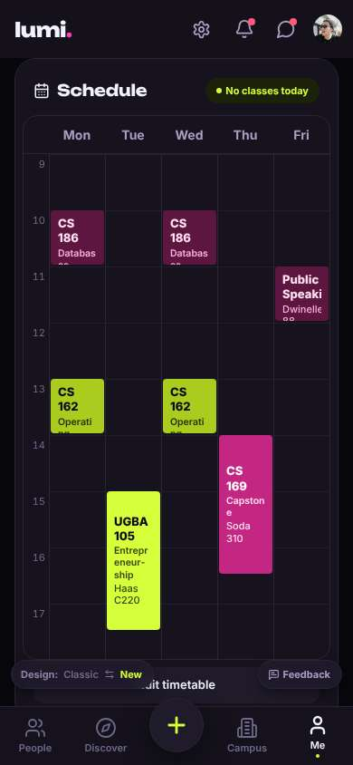
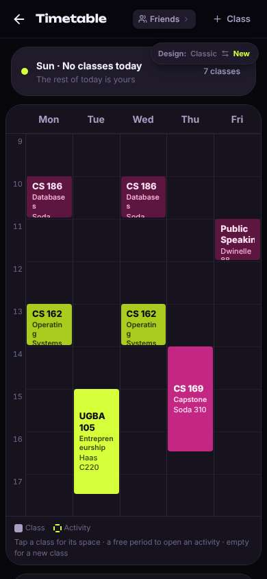
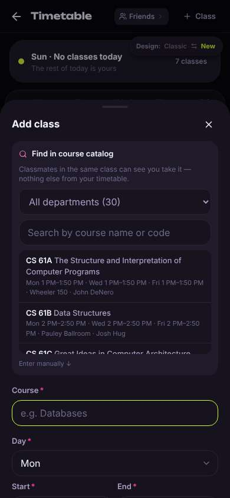
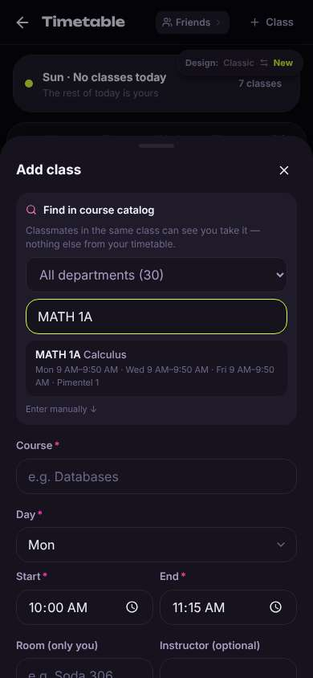
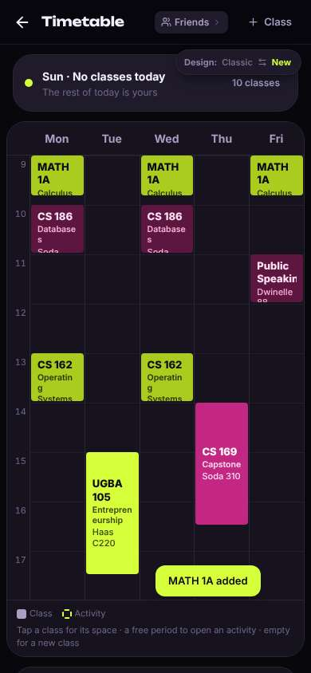
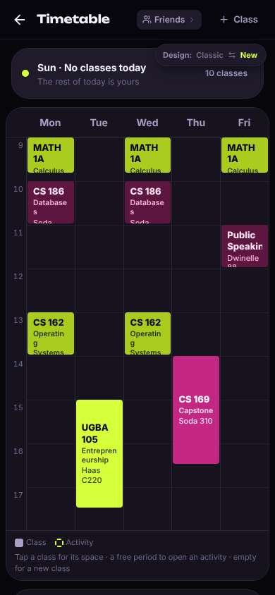

# ux-sim run `baseline-minji-timetable-add-classes`

> **AI simulation — hypotheses, not measured user behaviour.** One simulated persona; nothing here is a rate or a measurement of real students.

| | |
|---|---|
| Persona | **Minji**, 17 — First-year (started college a year early) · phone 390×844 · prefers ko · tech high (`minji-freshman-17`) |
| Scenario | **Put my classes into my timetable** — You want the app to know your schedule so it can show who's free when you are. Add MATH 1A (Calculus) to your timetable in the app. (`timetable-add-classes`) |
| Target | local · http://localhost:35021 · worktree commit `60c0cc288e13` |
| Outcome | **success** · ended by persona |
| Goal check (fixed, by harness) | met at step 11 after 5 action(s) — _MATH 1A shows up in the timetable grid (checked on /timetable with no search sheet open)._ |
| Persona's reason | “MATH 1A 넣었어 — 검색해서 한 번 누르니까 월수금 9시에 바로 들어감. 근데 처음부터 있던 CS 수업들은 내 거 아닌 것 같아서 좀 찝찝.” |
| Effort | 5/40 actions · objective frustration 0.00/4.5 · 3 confused note(s) · ~23s simulated |
| Drop-off risk | **medium** _(AI hypothesis, persona agent)_ — Adding the class was fast and the privacy line reassured her, but the first screen felt like a dating app (big face, age) and her timetable was pre-filled with someone else's upper-div CS classes, so she isn't sure the app is really 'hers' yet · basis: steps 1, 3, 11 |

Known environment limits (not UX findings)

- Dining menus and RSF gym crowd levels need live campus sources (the local stack runs with CAMPUS_LIVE=0) — empty or missing data there is not a UX bug.
- AI features (Ask Lumi, AI profile draft on /start, conversation starters) need an OpenAI key; none is configured locally.
- Course catalog is the built-in sample list (~210 courses, typical times). Live has the real Berkeley Class Schedule from the data worker.
- Opportunities are only the CSV rows in server/data (deadline calendar). Live also has worker-fetched internships (Greenhouse/Lever/Ashby), Devpost hackathons and CalLink/campus events.
- No e-mail is sent: the sign-up / sign-in code is shown on screen in the hint (live sends a real e-mail).
- Real-time updates (SSE) work locally; other people never reply unless the stack was started with --autoreply.

## Friction

| # | step | type | sev | persona says | screen | element | env-limited | evidence |
|---|---|---|---|---|---|---|---|---|
| f1 | 0 | Trust / privacy worry | 2 | “헐 첫 화면이 큰 얼굴 사진에 'Maya 24'... 데이팅앱이야? 나 시간표 넣으러 온 건데 어디서 하지” _wish: first screen should not feel like a dating app; show where my schedule goes_ | `/` | I'm in | no | [shot](shots/000-start.jpg) [marked](shots/000-start-som.jpg) |
| f2 | 2 | Confusing UI | 2 | “뭐지? 이거 내 시간표 아닌데... CS 169 Capstone? 나 1학년인데. 누구 시간표야” _wish: start me with an empty timetable or tell me these are sample classes_ | `/profile` | CS 186 Databases Soda 306 | no | [shot](shots/002-click.jpg) [marked](shots/002-click-som.jpg) |
| f3 | 2 | Bug | 2 | “아래 'Edit timetable' 버튼이 Design/Feedback 버튼에 가려져서 글자가 'timetable'만 보여” _wish: floating Design/Feedback pills should not cover the Edit timetable button_ | `/profile` | Edit timetable | no | [shot](shots/002-click.jpg) [marked](shots/002-click-som.jpg) |

Severity: 1 = Minor — noticed it, cosmetic or a small annoyance; did not slow me down. · 2 = Moderate — slowed me down or made me hesitate; I recovered on my own. · 3 = Major — real confusion, a wrong path or many extra steps; I nearly gave up or only got through by guessing. · 4 = Blocker — I could not continue, gave up, or would stop using the app here.

## Timeline

| step | what | screen | ms | signals / notes | shot |
|---|---|---|---|---|---|
| 0 | start | `/` | 1332 | _confused_: “헐 첫 화면이 큰 얼굴 사진에 'Maya 24'... 데이팅앱이야? 나 시간표 넣으러 온 건데 어디서 하지” → f1 |  |
| 2 | click “Me” | `/profile` | 964 | expects: “my profile page, maybe my classes/schedule there” (0.5) as expected _confused_: “뭐지? 이거 내 시간표 아닌데... CS 169 Capstone? 나 1학년인데. 누구 시간표야” → f2 _frustrated_: “아래 'Edit timetable' 버튼이 Design/Feedback 버튼에 가려져서 글자가 'timetable'만 보여” → f3 |  |
| 5 | click “Edit timetable” | `/timetable` | 861 | expects: “an editor where I can search and add MATH 1A” (0.7) as expected _neutral_: “오 '+ Class' 있네. 이거 누르면 될 듯” |  |
| 7 | click “Class” | `/timetable` | 901 | expects: “a form or search box to add a class” (0.8) as expected _delighted_: “검색창 있다! 그리고 같은 수업 사람만 본다고 써 있어서 좀 안심됨” |  |
| 9 | type “Search by course name or code” ← “MATH 1A” | `/timetable` | 868 | expects: “list filters to MATH 1A Calculus” (0.7) as expected _delighted_: “바로 나옴 ㅎㅎ 이거 맞아” |  |
| 11 | click “MATH 1A Calculus Mon 9 AM–9:50 AM · Wed ” | `/timetable` | 860 | expects: “MATH 1A gets added to my timetable (or fills the form)” (0.6) as expected _delighted_: “오 한 번 누르니까 월수금 다 들어감. 편하다! 근데 다른 CS 수업들은 여전히 내 거 아닌데...” |  |
| 13 | finish | `/timetable` |  |  |  |

## Automatic checks (harness, not persona)

| screen | tap targets < 44px | sideways overflow | broken images |
|---|---|---|---|
| `/` | 6 (Filters 40×40, Notifications 40×40, Messages 40×40, Me 32×32, Feedback 93×32) | — | — |
| `/profile` | 6 (Notifications 40×40, Messages 40×40, Me 32×32, Edit timetable 316×40, Feedback 93×32) | — | — |
| `/timetable` | 4 (Back 40×40, Friends 92×28, Class 88×36, Switch to the classic design 158×32) | — | — |

## Timing (harness)

- Full page load (navigation timing): 426 ms
