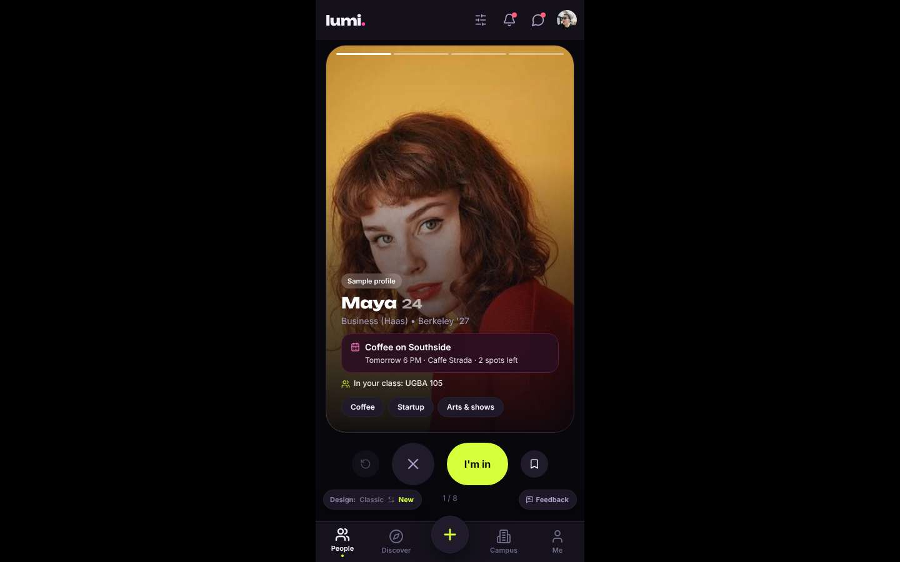
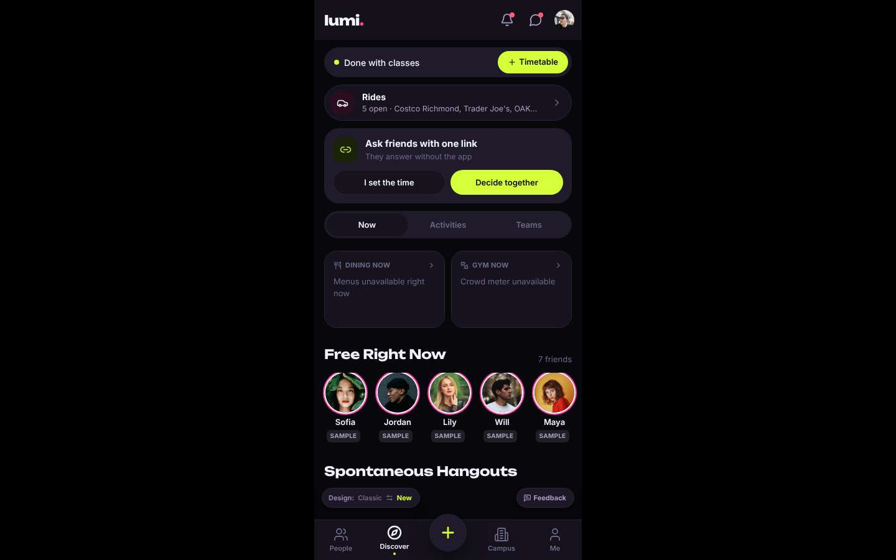
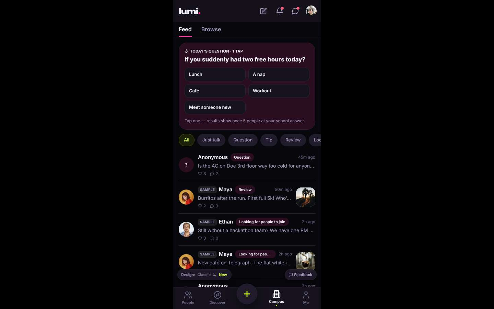
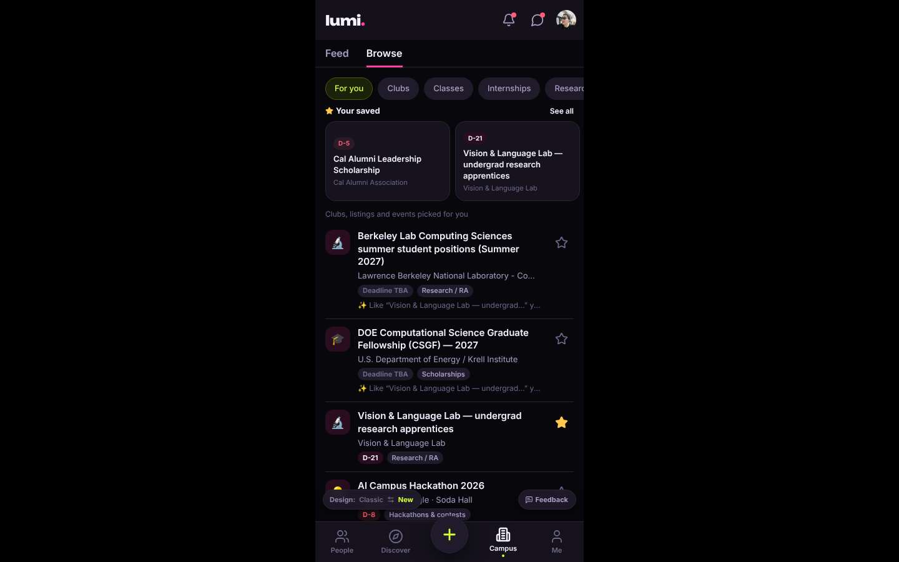
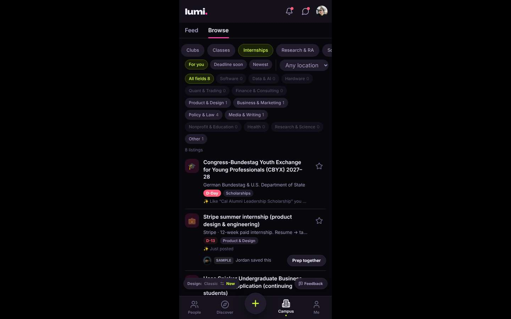
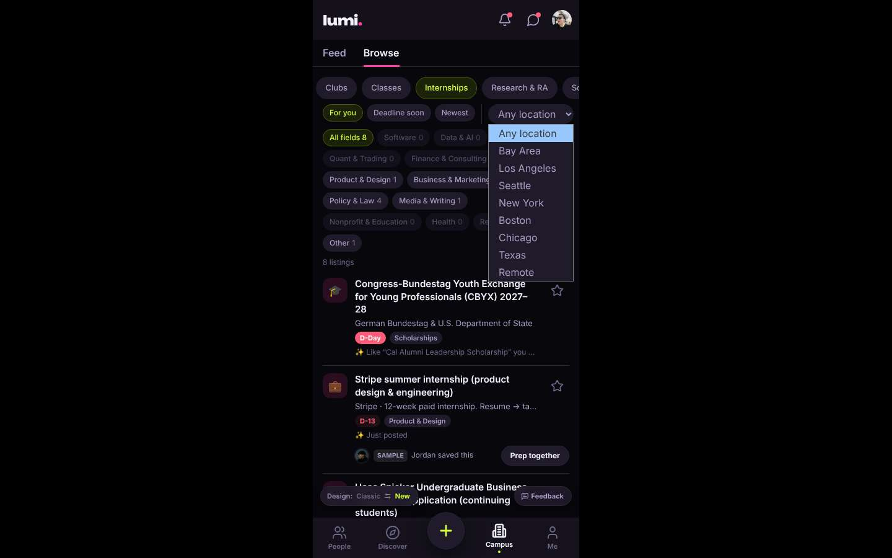
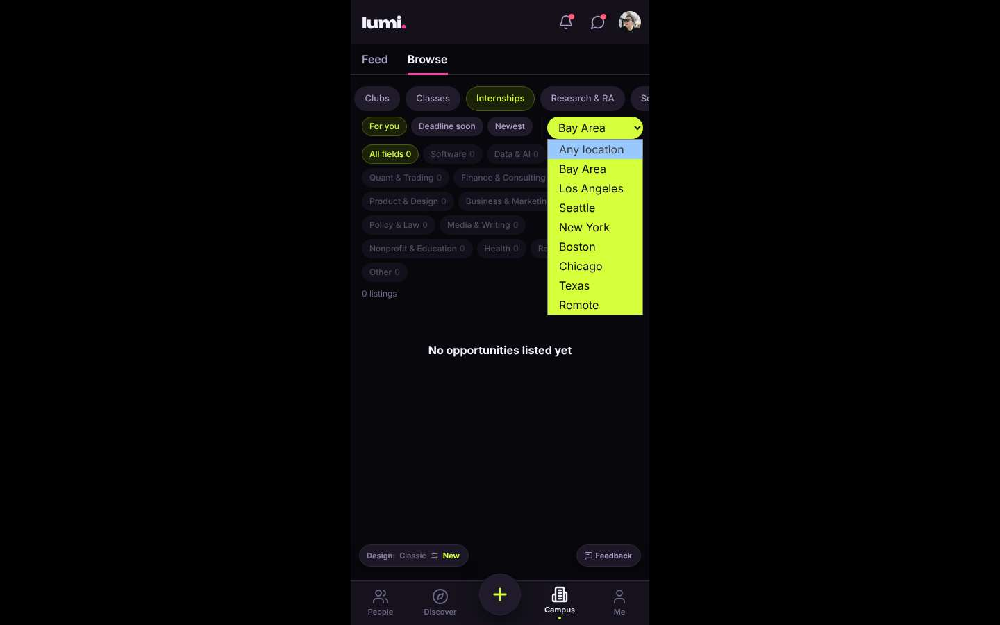
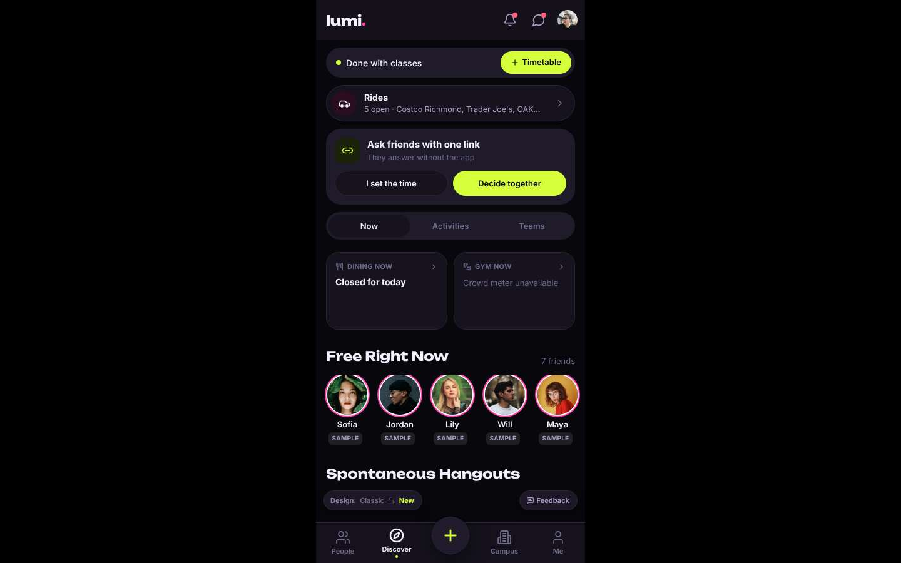

# ux-sim run `baseline-priya-internship-near-berkeley`

> **AI simulation — hypotheses, not measured user behaviour.** One simulated persona; nothing here is a rate or a measurement of real students.

| | |
|---|---|
| Persona | **Priya**, 26 — Second-year PhD student · desktop 1440×900 · prefers en · tech high (`priya-phd-desktop`) |
| Scenario | **Find an internship near Berkeley** — You need a paid internship (summer or part-time) somewhere near Berkeley / the Bay Area. Use the app to find one that looks real and open, and open its details so you know how to apply. (`internship-near-berkeley`) |
| Target | local · http://localhost:44215 · worktree commit `60c0cc288e13` |
| Outcome | **abandoned** · ended by persona |
| Goal check (fixed, by harness) | not met — _An internship listing's detail page is open._ |
| Persona's reason | “Internships are buried under Campus > Browse, there are 8 of them with zero software or research roles, the Bay Area filter returns nothing, and Back threw me out of the section. The one plausible listing is an undergrad-style Stripe design internship; not worth re-clicking three levels between experiments.” |
| Effort | 7/40 actions · objective frustration 3.50/5 · 6 confused note(s) · ~124s simulated |
| Drop-off risk | **high** _(AI hypothesis, persona agent)_ — First screen is a dating-style swipe card in a phone column on my laptop; the career content is hidden and thin, and the location filter is empty for the Bay Area. Nothing signals this app is for grad students. · basis: steps 0, 9, 14, 16 |

Known environment limits (not UX findings)

- Dining menus and RSF gym crowd levels need live campus sources (the local stack runs with CAMPUS_LIVE=0) — empty or missing data there is not a UX bug.
- AI features (Ask Lumi, AI profile draft on /start, conversation starters) need an OpenAI key; none is configured locally.
- Course catalog is the built-in sample list (~210 courses, typical times). Live has the real Berkeley Class Schedule from the data worker.
- Opportunities are only the CSV rows in server/data (deadline calendar). Live also has worker-fetched internships (Greenhouse/Lever/Ashby), Devpost hackathons and CalLink/campus events.
- No e-mail is sent: the sign-up / sign-in code is shown on screen in the hint (live sends a real e-mail).
- Real-time updates (SSE) work locally; other people never reply unless the stack was started with --autoreply.

## Friction

| # | step | type | sev | persona says | screen | element | env-limited | evidence |
|---|---|---|---|---|---|---|---|---|
| f1 | 0 | Confusing UI | 2 | “I'm on a 1440px laptop and I get a phone-width column with a giant face photo and an 'I'm in' button. Is this a dating app? I came for internships.” _wish: A desktop layout and a home screen that tells me what this app is for, not a swipe card_ | `/` | I'm in | no | [shot](shots/000-start.jpg) [marked](shots/000-start-som.jpg) |
| f2 | 0 | No reason to stay | 2 | “Phone layout floating in black on my laptop. Not a great sign, but I'll give it a minute.” | `/` |  | no | [shot](shots/000-start.jpg) [marked](shots/000-start-som.jpg) |
| f3 | 3 | Hard to find | 2 | “'Done with classes', Costco rides, spontaneous hangouts. This is an undergrad social app. Where would career stuff even live?” _wish: Discover should surface opportunities (internships, fellowships), not just hangouts_ | `/discover` | Discover | no | [shot](shots/003-click.jpg) [marked](shots/003-click-som.jpg) |
| f4 | 5 | Unclear wording | 2 | “'Campus' is a gossip feed, not campus resources. Label is misleading. Maybe 'Browse' has the actual directory.” _wish: Call it Feed/Community if it's a feed; put career resources somewhere labelled_ | `/community` | Campus | no | [shot](shots/005-click.jpg) [marked](shots/005-click-som.jpg) |
| f5 | 9 | Missing / empty content | 3 | “Eight listings, zero software, zero research — for an EECS PhD at Berkeley. And why is a Bundestag exchange the top 'internship'? It's tagged Scholarships.” _wish: Real software/research internships, and category filters that match what's in the list_ | `/community?tab=opportunities` | Software 0 | caveat — Local stack has only CSV opportunities; live also has worker-fetched internships, hackathons and campus events — check on live before acting. | [shot](shots/009-click.jpg) [marked](shots/009-click-som.jpg) |
| f6 | 14 | Bug | 3 | “Zero in the Bay Area? Stripe is literally in SF. Either the filter is broken or nothing has a location. Either way I can't trust it.” _wish: Listings tagged with real locations so the Bay Area filter actually returns Bay Area roles_ | `/community?tab=opportunities` | Location | no | [shot](shots/014-select.jpg) [marked](shots/014-select-som.jpg) |
| f7 | 16 | Bug | 2 | “Back took me out of the whole section. Now I have to click through Campus, Browse, Internships again. Sloppy.” _wish: Back should return to the previous filter state, not two sections ago_ | `/discover` |  | no | [shot](shots/016-back.jpg) [marked](shots/016-back-som.jpg) |

Severity: 1 = Minor — noticed it, cosmetic or a small annoyance; did not slow me down. · 2 = Moderate — slowed me down or made me hesitate; I recovered on my own. · 3 = Major — real confusion, a wrong path or many extra steps; I nearly gave up or only got through by guessing. · 4 = Blocker — I could not continue, gave up, or would stop using the app here.

## Where it ended

Step 16 on `/discover`.

## Timeline

| step | what | screen | ms | signals / notes | shot |
|---|---|---|---|---|---|
| 0 | start | `/` | 2221 | _confused_: “I'm on a 1440px laptop and I get a phone-width column with a giant face photo and an 'I'm in' button. Is this a dating app? I came for internships.” → f1 _neutral_: “Phone layout floating in black on my laptop. Not a great sign, but I'll give it a minute.” → f2 |  |
| 3 | click “Discover” | `/discover` | 919 | expects: “A browse page of events/opportunities, maybe including internships” (0.5) **mismatch**: Discover is rides, hangouts, dining/gym, 'Free Right Now' friends. Nothing about internships or careers. ⚑ mismatch _frustrated_: “'Done with classes', Costco rides, spontaneous hangouts. This is an undergrad social app. Where would career stuff even live?” → f3 |  |
| 5 | click “Campus” | `/community` | 850 | expects: “Campus resources: courses, maybe career center / internships / deadlines” (0.6) **mismatch**: Campus is a social feed: AC complaints, burritos, 'anyone eat alone'. There's a Browse sub-tab. ⚑ mismatch _frustrated_: “'Campus' is a gossip feed, not campus resources. Label is misleading. Maybe 'Browse' has the actual directory.” → f4 |  |
| 7 | click “Browse” | `/community?tab=opportunities` | 964 | expects: “A directory of clubs/resources, maybe careers/internships” (0.4) as expected _curious_: “Finally. DOE CSGF is actually relevant to me. Though 'Browse' under 'Campus' under a feed is a strange place to bury it — and it's mostly undergrad REUs.” |  |
| 9 | click “Internships” | `/community?tab=opportunities` | 862 | expects: “A list of internships, ideally paid and with location filters” (0.7) **mismatch**: Only 8 internships total; Software 0, Data & AI 0, Research & Science 0. First item is a German exchange fellowship tagged 'Scholarships' with a D-Day deadline. There is a Location dropdown. ⚑ mismatch _frustrated_: “Eight listings, zero software, zero research — for an EECS PhD at Berkeley. And why is a Bundestag exchange the top 'internship'? It's tagged Scholarships.” → f5 |  |
| 11 | observe | `/community?tab=opportunities` |  |  |  |
| 12 | click “Location” | `/community?tab=opportunities` | 870 | expects: “Dropdown opens with locations like Bay Area / Remote” (0.7) **mismatch**: Clicking the Location select showed nothing new on screen; options are not visible. ⚑ mismatch _neutral_: “Native dropdown. I'll just pick the Bay Area option if there is one.” |  |
| 14 | select “Location” | `/community?tab=opportunities` | 826 | expects: “List narrows to Bay Area internships, Stripe among them” (0.5) **mismatch**: Bay Area filter gives 0 listings, 'No opportunities listed yet' — even though Stripe (SF-based) was in the unfiltered list. ⚑ mismatch _frustrated_: “Zero in the Bay Area? Stripe is literally in SF. Either the filter is broken or nothing has a location. Either way I can't trust it.” → f6 |  |
| 16 | back | `/discover` | 831 | expects: “Back to the 8 unfiltered internships” (0.7) **mismatch**: Browser Back jumped all the way to Discover, losing the Campus > Browse > Internships view entirely. ⚑ backtrack ⚑ mismatch _frustrated_: “Back took me out of the whole section. Now I have to click through Campus, Browse, Internships again. Sloppy.” → f7 |  |
| 18 | finish | `/discover` |  |  |  |

## Timing (harness)

- Full page load (navigation timing): 913 ms
