# ux-sim run `baseline-seoyeon-ride-sfo-thanksgiving`

> **AI simulation — hypotheses, not measured user behaviour.** One simulated persona; nothing here is a rate or a measurement of real students.

| | |
|---|---|
| Persona | **Seoyeon**, 20 — Exchange student (one semester, from Yonsei) · phone 390×844 · prefers ko · tech medium (`seoyeon-exchange-korean`) |
| Scenario | **Share a ride to SFO for Thanksgiving** — You fly out of SFO the Wednesday before Thanksgiving (Nov 25) in the morning. Find other students to split a ride to the airport with — join one, or post yours so others can find you. (`ride-sfo-thanksgiving`) |
| Target | local · http://localhost:33897 · worktree commit `60c0cc288e13` |
| Outcome | **success** · ended by persona |
| Account | shared demo account (sample profile with someone else's data) |
| Goal check (fixed, by harness) | met at step 17 after 8 action(s) — _Joined/requested an SFO ride or posted one (a ride page to SFO is open, or the list shows you in a ride)._ |
| Persona's reason | “SFO 수요일 아침 7시 라이드를 Sproul Plaza에서 출발로 올렸어요. 진짜 같이 갈 사람은 아직 없고, 메모가 사라지고 내 라이드에도 '예시'가 붙어서 좀 불안해요.” |
| Effort | 16/45 actions · objective frustration 1.50/5 · 5 confused note(s) · ~188s simulated |
| Drop-off risk | **medium** _(AI hypothesis, persona agent)_ — Korean switch and the Thanksgiving airport banner made posting easy, but the Rides screens fall back to English, every visible ride is fake, and my own post is labelled 'Sample' with my note lost — I'd check back once to see if anyone joined, and leave if nobody does. · basis: steps 13, 18, 30, 31 |

Known environment limits (not UX findings)

- Dining menus and RSF gym crowd levels need live campus sources (the local stack runs with CAMPUS_LIVE=0) — empty or missing data there is not a UX bug.
- AI features (Ask Lumi, AI profile draft on /start, conversation starters) need an OpenAI key; none is configured locally.
- Course catalog is the built-in sample list (~210 courses, typical times). Live has the real Berkeley Class Schedule from the data worker.
- Opportunities are only the CSV rows in server/data (deadline calendar). Live also has worker-fetched internships (Greenhouse/Lever/Ashby), Devpost hackathons and CalLink/campus events.
- No e-mail is sent: the sign-up / sign-in code is shown on screen in the hint (live sends a real e-mail).
- Real-time updates (SSE) work locally; other people never reply unless the stack was started with --autoreply.

## Friction

| # | step | type | sev | persona says | screen | element | env-limited | evidence |
|---|---|---|---|---|---|---|---|---|
| f1 | 0 | Confusing UI | 2 | “어... 큰 얼굴 사진? 데이트 앱인가? 공항 가는 차 찾으려고 왔는데 커피 약속이 나와요. 영어만 있고... 한국어 설정 어디 있지?” _wish: 첫 화면에 '무엇을 찾나요?' 같은 선택이나 라이드 쉐어 바로가기_ | `/` | I'm in | no | [shot](shots/000-start.jpg) [marked](shots/000-start-som.jpg) |
| f2 | 6 | Hard to find | 1 | “한국어로 바뀌었어요! 이제 훨씬 편해요. 근데 언어 설정이 설정 안쪽 깊이 있어서 처음엔 몰랐을 거예요.” _wish: 첫 화면이나 가입할 때 언어 선택_ | `/settings` | 한국어 | no | [shot](shots/006-click.jpg) [marked](shots/006-click-som.jpg) |
| f3 | 10 | Unclear wording | 1 | “Rides! 자동차 아이콘. 이거다! 근데 'Rides'만 영어로 남아 있네요. OAK는... 오클랜드 공항?” _wish: '라이드/카풀'로 번역_ | `/discover` | Rides 5 open · Costco Richmond, Trader Joe's, OAK… | no | [shot](shots/010-click.jpg) [marked](shots/010-click-som.jpg) |
| f4 | 12 | Unclear wording | 2 | “어... 한국어로 바꿨는데 여기는 다 영어예요. 'Thanksgiving break... Split a ride to the airport' 이건 알겠어요. 바로 내 상황! 근데 '±90 min'... 90분 앞뒤로 매칭해준다는 뜻인가?” _wish: 라이드 화면도 한국어로_ | `/rides` | Post my ride | no | [shot](shots/012-click.jpg) [marked](shots/012-click-som.jpg) |
| f5 | 12 | Bug | 1 | “'My rides' 버튼 위에 'Design: Classic New' 같은 게 겹쳐서 가려져 있어요.” _wish: 겹치지 않게_ | `/rides` | My rides | no | [shot](shots/012-click.jpg) [marked](shots/012-click-som.jpg) |
| f6 | 15 | Trust / privacy worry | 2 | “오! 수요일 11월 25일, SFO 두 개 있어요. Lily 9:30am, 30달러씩. 근데 '예시'라고 써 있는데... 진짜 사람이 아니고 예시라는 건가요? 헷갈려요.” _wish: '예시'가 무슨 뜻인지 (샘플 게시물인지) 설명_ | `/rides` | 🚕 Lily → SFO 예시Wed 9:30am · from Unit 2 ≈ $30 each with 2 people Join 3 seats left | no | [shot](shots/015-click.jpg) [marked](shots/015-click-som.jpg) |
| f7 | 17 | Missing / empty content | 2 | “아... 'made up'? 가짜 예시였어요. 정보는 깔끔한데 진짜 사람이 아니면 같이 못 가요. 진짜 수요일 SFO 가는 사람은 아무도 없는 거네요. 그럼 내가 올려야겠어요.” _wish: 진짜 학생 라이드, 아니면 처음부터 '예시'임을 목록에서 분명히_ | `/rides/:id` | Lily Host | no | [shot](shots/017-click.jpg) [marked](shots/017-click-som.jpg) |
| f8 | 27 | Unclear wording | 1 | “좋아요. 'People to split with 3'... 나 빼고 3명? 나 포함? 잘 모르겠지만 그냥 둘게요. 가격은 모르니까 비워요 — 'We never guess prices' 좋네요.” _wish: '나를 포함해서 몇 명'인지 명확하게_ | `/rides/new` | Fewer | no | [shot](shots/027-type.jpg) [marked](shots/027-type-som.jpg) |
| f9 | 29 | Bug | 3 | “어?! 메모 쓰고 있었는데 'Post ride' 안 눌렀는데 벌써 올라갔어요. 그리고 제 메모(비행기 11시, 짐 하나)가 화면에 안 보여요. 저장 안 된 건가?” _wish: 메모 입력 중에는 제출되지 않고, 'Post ride'를 눌러야 올라가게_ | `/rides/:id` |  | no | [shot](shots/029-type.jpg) [marked](shots/029-type-som.jpg) |
| f10 | 29 | Bug | 3 | “그리고 내 라이드인데 '예시'랑 'Sample ride — made up to show how rides work'라고 써 있어요. 내 게 진짜로 올라간 거 맞아요? 다른 사람들도 가짜라고 생각할 것 같아요.” _wish: 내가 올린 라이드에는 '예시/Sample' 표시가 없어야 함_ | `/rides/:id` | You Host | no | [shot](shots/029-type.jpg) [marked](shots/029-type-som.jpg) |

Severity: 1 = Minor — noticed it, cosmetic or a small annoyance; did not slow me down. · 2 = Moderate — slowed me down or made me hesitate; I recovered on my own. · 3 = Major — real confusion, a wrong path or many extra steps; I nearly gave up or only got through by guessing. · 4 = Blocker — I could not continue, gave up, or would stop using the app here.

## Timeline

| step | what | screen | ms | signals / notes | shot |
|---|---|---|---|---|---|
| 0 | start | `/` | 896 | _confused_: “어... 큰 얼굴 사진? 데이트 앱인가? 공항 가는 차 찾으려고 왔는데 커피 약속이 나와요. 영어만 있고... 한국어 설정 어디 있지?” → f1 | <a href="shots/000-start-som.jpg">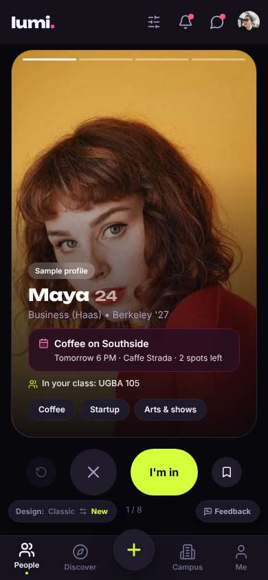</a> |
| 2 | click “Me” | `/profile` | 907 | expects: “my profile and settings, maybe language option” (0.6) as expected _neutral_: “시간표네요. 톱니바퀴 = 설정. 여기서 언어 바꿀 수 있을 것 같아요.” | <a href="shots/002-click-som.jpg">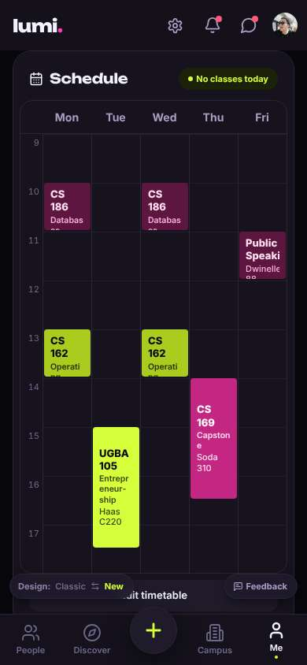</a> |
| 4 | click “Settings” | `/settings` | 858 | expects: “settings with language option” (0.7) as expected _delighted_: “와! 한국어 있다! 다행이에요.” | <a href="shots/004-click-som.jpg">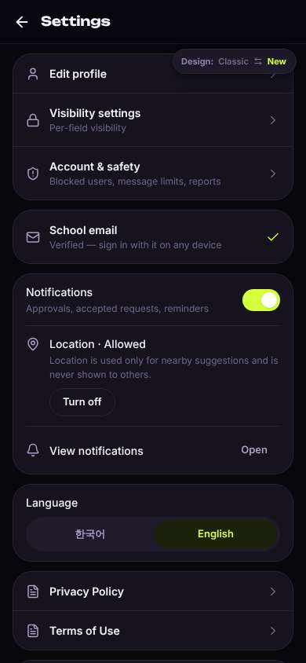</a> |
| 6 | click “한국어” | `/settings` | 1058 | expects: “app switches to Korean” (0.85) as expected _delighted_: “한국어로 바뀌었어요! 이제 훨씬 편해요. 근데 언어 설정이 설정 안쪽 깊이 있어서 처음엔 몰랐을 거예요.” → f2 | <a href="shots/006-click-som.jpg">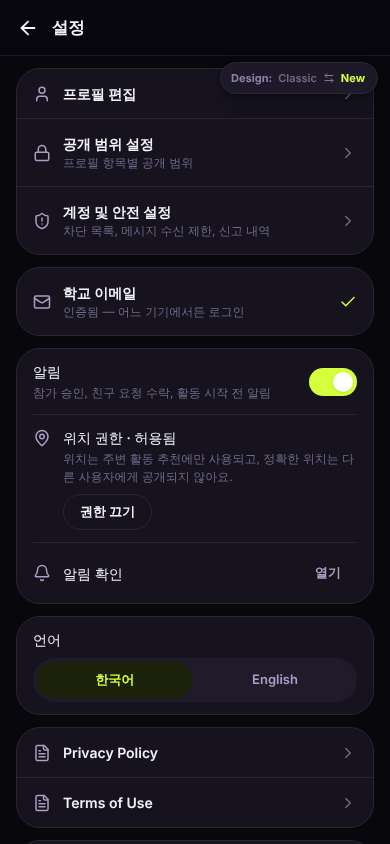</a> |
| 8 | click “뒤로” | `/profile` | 1028 | expects: “back to Me page in Korean” (0.8) as expected _neutral_: “좋아요. 이제 공항 가는 차 같이 탈 사람... '발견'에 있을까요?” |  |
| 10 | click “발견” | `/discover` | 949 | expects: “a list of activities/posts, maybe rides” (0.5) as expected _curious_: “Rides! 자동차 아이콘. 이거다! 근데 'Rides'만 영어로 남아 있네요. OAK는... 오클랜드 공항?” → f3 | <a href="shots/010-click-som.jpg">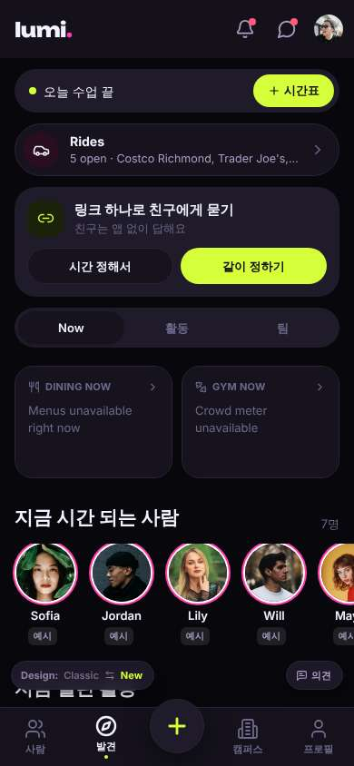</a> |
| 12 | click “Rides 5 open · Costco Richmond, Trader J” | `/rides` | 865 | expects: “list of shared rides, maybe one to SFO” (0.75) as expected _confused_: “어... 한국어로 바꿨는데 여기는 다 영어예요. 'Thanksgiving break... Split a ride to the airport' 이건 알겠어요. 바로 내 상황! 근데 '±90 min'... 90분 앞뒤로 매칭해준다는 뜻인가?” → f4 _neutral_: “'My rides' 버튼 위에 'Design: Classic New' 같은 게 겹쳐서 가려져 있어요.” → f5 | <a href="shots/012-click-som.jpg">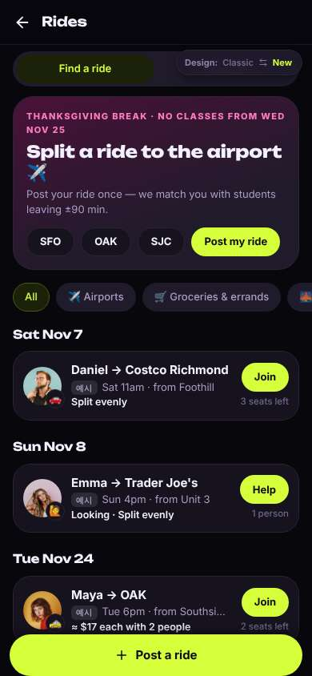</a> |
| 15 | click “SFO” | `/rides` | 852 | expects: “list filters to rides going to SFO” (0.6) as expected _curious_: “오! 수요일 11월 25일, SFO 두 개 있어요. Lily 9:30am, 30달러씩. 근데 '예시'라고 써 있는데... 진짜 사람이 아니고 예시라는 건가요? 헷갈려요.” → f6 | <a href="shots/015-click-som.jpg">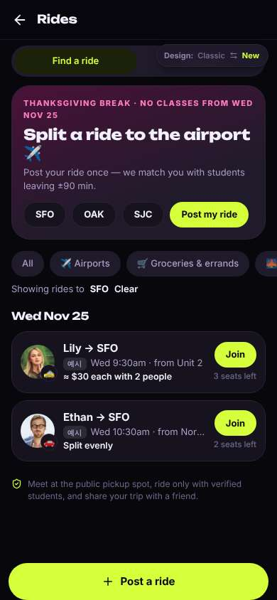</a> |
| 17 | click “🚕 Lily → SFO 예시Wed 9:30am · from Unit 2” | `/rides/:id` | 853 | expects: “details of Lily's ride: pickup spot, time, cost, who else” (0.6) **mismatch**: Details are clear (time, public pickup Unit 2, $30 split, note) but it says 'Sample ride — made up to show how rides work.' ⚑ mismatch _frustrated_: “아... 'made up'? 가짜 예시였어요. 정보는 깔끔한데 진짜 사람이 아니면 같이 못 가요. 진짜 수요일 SFO 가는 사람은 아무도 없는 거네요. 그럼 내가 올려야겠어요.” → f7 | <a href="shots/017-click-som.jpg">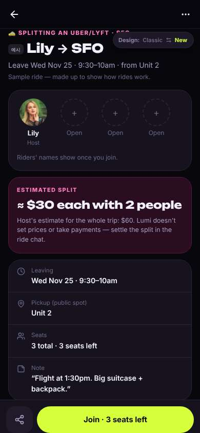</a> |
| 19 | back | `/rides` | 826 | ⚑ backtrack |  |
| 20 | click “Post my ride” | `/rides/new` | 845 | expects: “a form to post my own airport ride, hopefully SFO already chosen” (0.65) as expected _delighted_: “SFO 이미 선택돼 있어요! 그리고 'Public spots only — never share a home address' — 주소 안 써도 돼서 안심이에요. 영어지만 버튼이 짧아서 이해돼요. 우버 나눠 타기로 할게요.” | <a href="shots/020-click-som.jpg">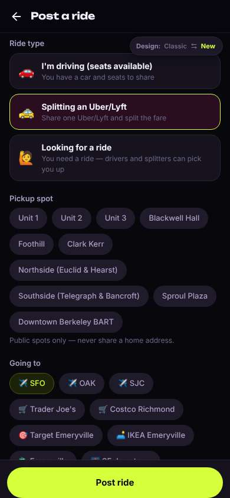</a> |
| 22 | click “Sproul Plaza” | `/rides/new` | 857 | expects: “Sproul Plaza selected as pickup” (0.8) as expected _neutral_: “Sproul Plaza 선택됐어요. 시간도 확인해야 해요.” | <a href="shots/022-click-som.jpg">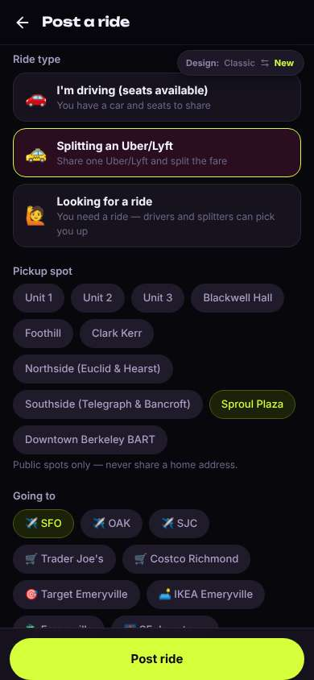</a> |
| 24 | scroll down | `/rides/new` | 1324 |  | <a href="shots/024-scroll-som.jpg">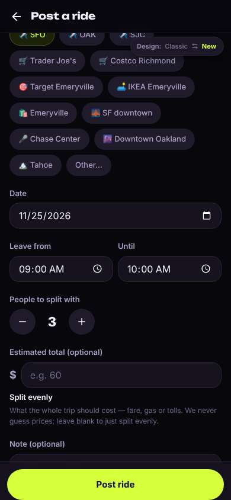</a> |
| 25 | type [143] ← “07:00” | `/rides/new` | 853 | expects: “leave time becomes 7:00 AM” (0.7) as expected _neutral_: “7시 출발. 'Until'은... 몇 시까지 출발 가능한지인 것 같아요. 8시로 할게요.” | <a href="shots/025-type-som.jpg">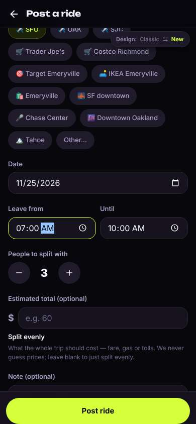</a> |
| 27 | type [144] ← “08:00” | `/rides/new` | 857 | expects: “until time 8:00 AM” (0.7) as expected _neutral_: “좋아요. 'People to split with 3'... 나 빼고 3명? 나 포함? 잘 모르겠지만 그냥 둘게요. 가격은 모르니까 비워요 — 'We never guess prices' 좋네요.” → f8 | <a href="shots/027-type-som.jpg">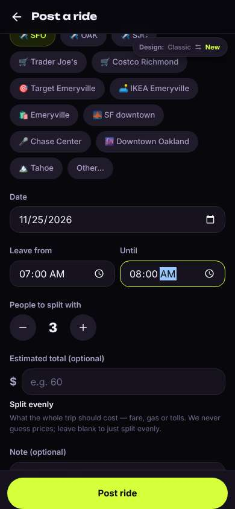</a> |
| 29 | type “Flight at 1:30pm, one big suitcase” ← “Flight at 11am, one suitcase. Exchange student :)” | `/rides/:id` | 882 | _frustrated_: “어?! 메모 쓰고 있었는데 'Post ride' 안 눌렀는데 벌써 올라갔어요. 그리고 제 메모(비행기 11시, 짐 하나)가 화면에 안 보여요. 저장 안 된 건가?” → f9 _frustrated_: “그리고 내 라이드인데 '예시'랑 'Sample ride — made up to show how rides work'라고 써 있어요. 내 게 진짜로 올라간 거 맞아요? 다른 사람들도 가짜라고 생각할 것 같아요.” → f10 | <a href="shots/029-type-som.jpg">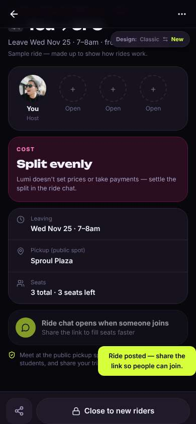</a> |
| 32 | back | `/rides` | 829 | expects: “rides list showing my SFO ride” (0.5) as expected ⚑ backtrack _neutral_: “목록에 제 라이드 있어요. 'Yours'. 올라간 건 맞네요. 근데 아직 같이 갈 사람은 없고, '예시' 표시 때문에 사람들이 진짜인지 의심할 것 같아요. 일단 여기까지 할게요.” |  |
| 34 | finish | `/rides` |  |  | <a href="shots/034-finish-som.jpg">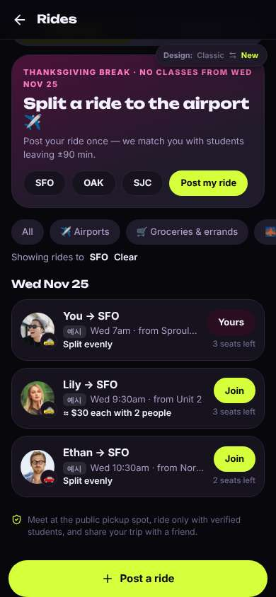</a> |

## Automatic checks (harness, not persona)

| screen | tap targets < 44px | sideways overflow | broken images |
|---|---|---|---|
| `/` | 6 (Filters 40×40, Notifications 40×40, Messages 40×40, Me 32×32, Feedback 93×32) | — | — |
| `/profile` | 6 (Notifications 40×40, Messages 40×40, Me 32×32, Edit timetable 316×40, Feedback 93×32) | — | — |
| `/settings` | 6 (Back 40×40, Turn off 84×36, Open 66×36, 한국어 156×36, English 156×36) | — | — |
| `/discover` | 11 (알림 40×40, 메시지 40×40, 프로필 32×32, 시간표 89×36, 시간 정해서 161×40) | — | — |
| `/rides` | 13 (뒤로 40×40, Find a ride 173×36, My rides 173×36, SFO 60×36, OAK 63×36) | — | — |
| `/rides/:id` | 3 (뒤로 40×40, More 40×40, Switch to the classic design 158×32) | — | — |
| `/rides/new` | 21 (뒤로 40×40, Unit 1 64×36, Unit 2 67×36, Unit 3 67×36, Blackwell Hall 116×36) | — | — |

## Timing (harness)

- Full page load (navigation timing): 90 ms, 157 ms
