# ux-sim run `cmp1-base-cold-start-hangout-minji`

> **AI simulation — hypotheses, not measured user behaviour.** One simulated persona; nothing here is a rate or a measurement of real students.

| | |
|---|---|
| Persona | **Minji**, 17 — First-year (started college a year early) · phone 390×844 · prefers ko · tech high (`minji-freshman-17`) |
| Scenario | **Brand-new account: find someone on campus to hang out with this week** — You just heard about this app and want someone on campus to hang out with this week. Make an account with your school e-mail, then use the app to find a person or plan you could join this week and tell them you're in. (`cold-start-hangout`) |
| Target | local · http://localhost:34563 · worktree commit `7af1c8ef2cfd` |
| Outcome | **abandoned** · ended by persona |
| Account | signed out at start |
| Goal check (fixed, by harness) | not met — _Signed up during the run AND, as that new account, joined/requested a plan, hosted one, sent a friend request or sent a chat message._ |
| Patience | exhausted at step 33; 0 action(s) after |
| Persona's reason | “9단계나 내 정보 다 넣었는데 들어오니까 아무도 없고 '친구 초대하기'만 있어. 친구 없어서 깐 건데... 그냥 닫을래.” |
| Effort | 24/40 actions · objective frustration 2.00/4.5 · 3 confused note(s) · ~51s simulated |
| Drop-off risk | **high** _(AI hypothesis, persona agent)_ — Long 9-step onboarding (major, birth year) before seeing anything, then an empty People feed whose only action is inviting friends she doesn't have — hits her 'nobody around' quit trigger right at first impression. · basis: steps 15, 22, 32 |

Known environment limits (not UX findings)

- Dining menus and RSF gym crowd levels need live campus sources (the local stack runs with CAMPUS_LIVE=0) — empty or missing data there is not a UX bug.
- AI features (Ask Lumi, AI profile draft on /start, conversation starters) need an OpenAI key; none is configured locally.
- Course catalog is the real Berkeley Class Schedule (6588 courses, Fall 2026 + Spring 2027), fetched 2026-11-02 with the worker's adapter. Seat counts and very recent changes may differ from live.
- Campus events, free food, internships, hackathons and scholarships are a read-only snapshot of live (1119 real items, 103 events this week, taken 2026-11-02 07:25 UTC) plus the CSV calendar. Nothing new appears during the run; Q&A and reviews are empty.
- No e-mail is sent: the sign-up / sign-in code is shown on screen in the hint (live sends a real e-mail).
- Real-time updates (SSE) work locally; other people never reply unless the stack was started with --autoreply.

## Friction

| # | step | type | sev | persona says | screen | element | env-limited | evidence |
|---|---|---|---|---|---|---|---|---|
| f1 | 15 | Onboarding friction | 2 | “6단계째인데 아직 아무것도 못 봤어. 전공까지? 난 아직 undeclared인데...” _wish: show me who's around first, ask about me later_ | `/start` | e.g. Computer Science | no | [shot](shots/015-click.jpg) [marked](shots/015-click-som.jpg) |
| f2 | 19 | Unclear wording | 1 | “오 얼굴 사진 말고 이모지! 이거 좋다. 프로필 자동으로 써줬네. 'Freshman in Undeclared'는 좀 어색하지만 ㅋㅋ” _wish: 'Undeclared freshman' reads more natural_ | `/start` |  | no | [shot](shots/019-click.jpg) [marked](shots/019-click-som.jpg) |
| f3 | 22 | Trust / privacy worry | 2 | “생년? 나 2009년생인데... 이거 다른 사람들한테 보여? 나만 17살인 거 티 나면 싫은데. 왜 필요한지 안 써있음.” _wish: say why birth year is needed and whether classmates see it_ | `/start` | 2005 | no | [shot](shots/022-click.jpg) [marked](shots/022-click-som.jpg) |
| f4 | 32 | Missing / empty content | 3 | “헐 9단계 다 했는데 아무도 없어?? 친구 초대하라고... 친구가 없어서 깔았는데 ㅠ 뭐지 이거.” _wish: show me at least some plans or people this week, or let me start a lunch plan right here instead of inviting friends I don't have_ | `/` | Invite friends | no | [shot](shots/032-click.jpg) [marked](shots/032-click-som.jpg) |

Severity: 1 = Minor — noticed it, cosmetic or a small annoyance; did not slow me down. · 2 = Moderate — slowed me down or made me hesitate; I recovered on my own. · 3 = Major — real confusion, a wrong path or many extra steps; I nearly gave up or only got through by guessing. · 4 = Blocker — I could not continue, gave up, or would stop using the app here.

## Where it ended

Step 32 on `/`.

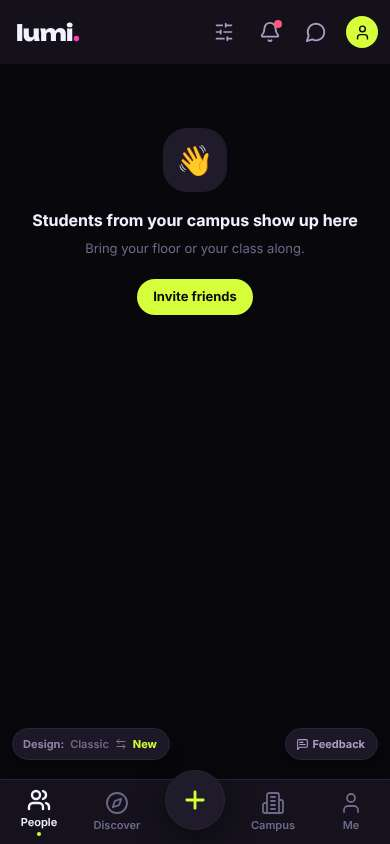

## Timeline

| step | what | screen | ms | signals / notes | shot |
|---|---|---|---|---|---|
| 0 | start | `/welcome` | 3138 | _curious_: “오 'Find someone for lunch' — 딱 내가 원하는 거. 근데 한국어는 없나? 일단 Get in.” | <a href="shots/000-start-som.jpg">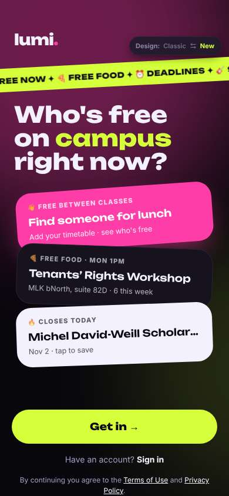</a> |
| 2 | click “Get in →” | `/start` | 1479 | expects: “sign up screen asking for school email” (0.7) **mismatch**: school picker, step 1 of 9 ⚑ mismatch _neutral_: “1/9...? 9단계나 돼? 아 귀찮아. 그래도 UC Berkeley 바로 있네.” | <a href="shots/002-click-som.jpg">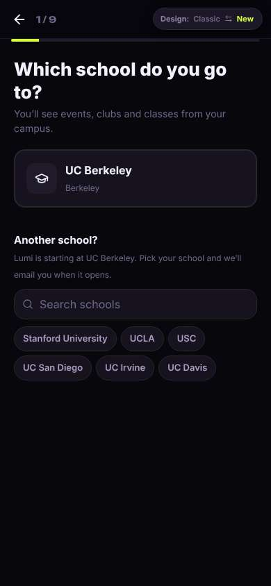</a> |
| 4 | click “UC Berkeley Berkeley” | `/start` | 872 | expects: “next step, maybe email” (0.6) **mismatch**: goals picker instead of email ⚑ mismatch _curious_: “'Never eat alone' ㅋㅋ 이거 나잖아. 이건 괜찮은 질문.” | <a href="shots/004-click-som.jpg">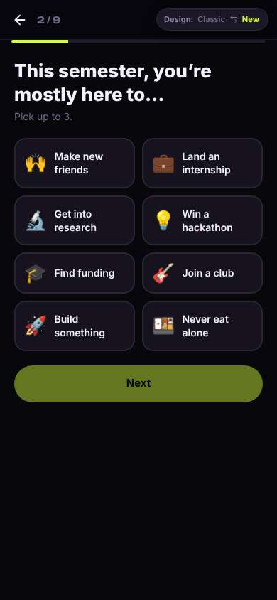</a> |
| 6 | click “🍱 Never eat alone” | `/start` | 902 |  | <a href="shots/006-click-som.jpg">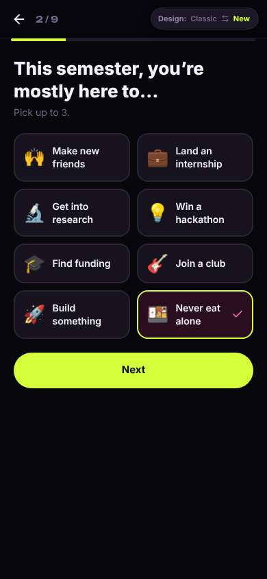</a> |
| 7 | click “🙌 Make new friends” | `/start` | 848 |  | <a href="shots/007-click-som.jpg">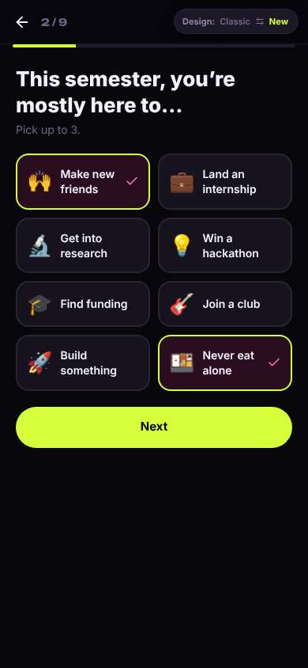</a> |
| 8 | click “Next” | `/start` | 884 | expects: “step 3” (0.8) as expected | <a href="shots/008-click-som.jpg">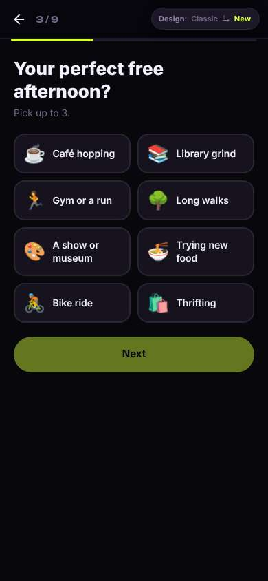</a> |
| 9 | click “☕ Café hopping” | `/start` | 850 |  | <a href="shots/009-click-som.jpg">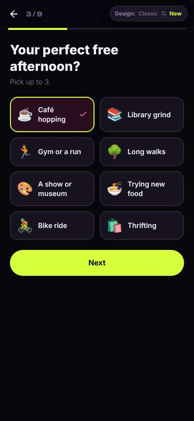</a> |
| 10 | click “🍜 Trying new food” | `/start` | 868 | _neutral_: “취향 질문 또. 빠르긴 한데 언제 이메일 넣어?” | <a href="shots/010-click-som.jpg">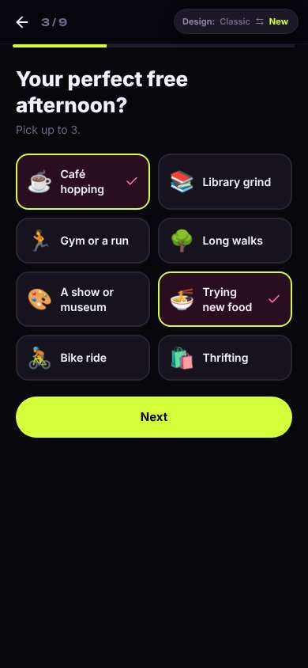</a> |
| 12 | click “Next” | `/start` | 862 | expects: “step 4” (0.8) | <a href="shots/012-click-som.jpg">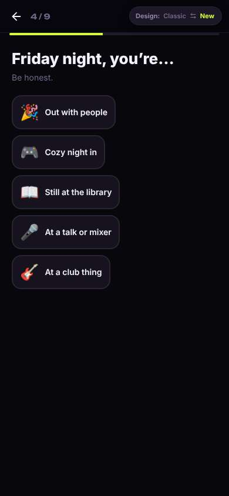</a> |
| 13 | click “🎮 Cozy night in” | `/start` | 874 | expects: “step 5” (0.7) | <a href="shots/013-click-som.jpg">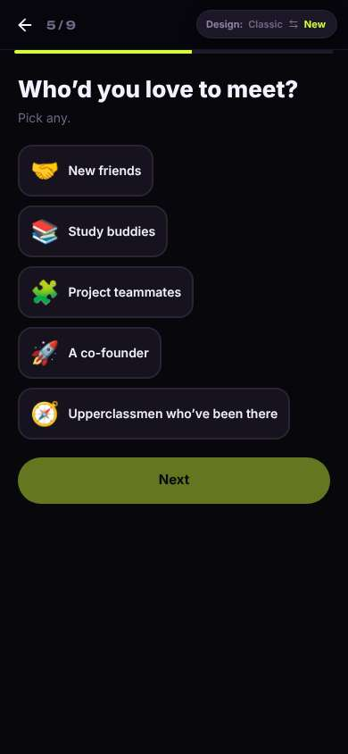</a> |
| 14 | click “🤝 New friends” | `/start` | 851 |  | <a href="shots/014-click-som.jpg">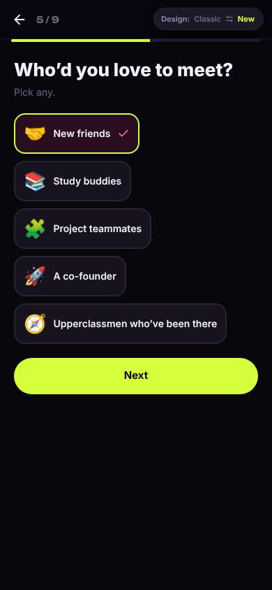</a> |
| 15 | click “Next” | `/start` | 886 | expects: “step 6, hopefully email soon” (0.6) as expected _frustrated_: “6단계째인데 아직 아무것도 못 봤어. 전공까지? 난 아직 undeclared인데...” → f1 | <a href="shots/015-click-som.jpg">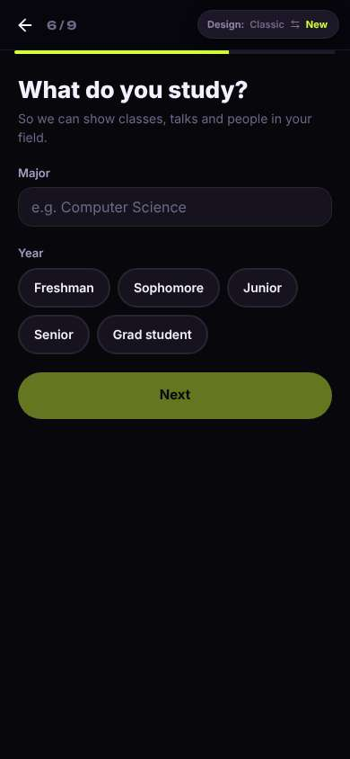</a> |
| 17 | type “e.g. Computer Science” ← “Undeclared” | `/start` | 915 |  | <a href="shots/017-type-som.jpg">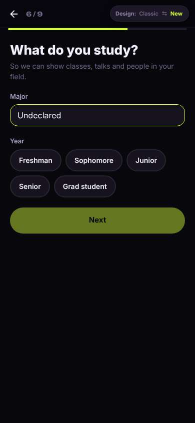</a> |
| 18 | click “Freshman” | `/start` | 860 |  | <a href="shots/018-click-som.jpg">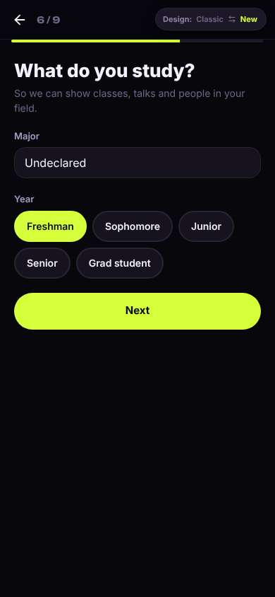</a> |
| 19 | click “Next” | `/start` | 888 | expects: “step 7” (0.8) as expected _delighted_: “오 얼굴 사진 말고 이모지! 이거 좋다. 프로필 자동으로 써줬네. 'Freshman in Undeclared'는 좀 어색하지만 ㅋㅋ” → f2 | <a href="shots/019-click-som.jpg">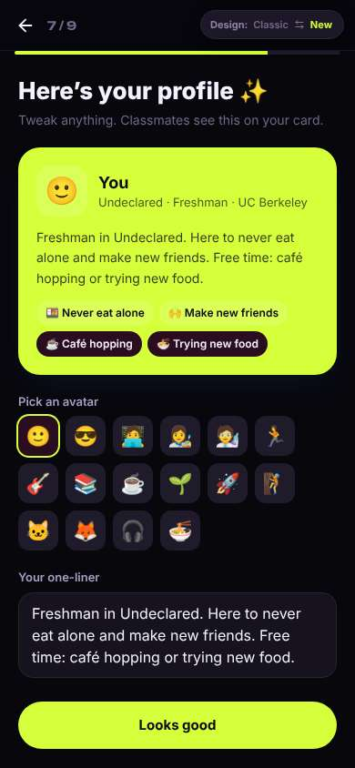</a> |
| 21 | click “🦊” | `/start` | 848 |  | <a href="shots/021-click-som.jpg">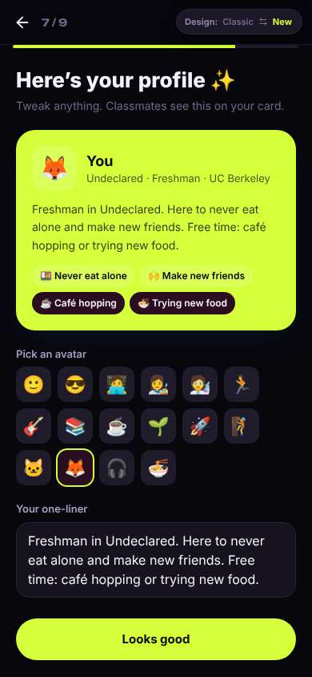</a> |
| 22 | click “Looks good” | `/start` | 845 | expects: “step 8, maybe email now” (0.6) **mismatch**: step 8: name + birth year, no email yet ⚑ mismatch _confused_: “생년? 나 2009년생인데... 이거 다른 사람들한테 보여? 나만 17살인 거 티 나면 싫은데. 왜 필요한지 안 써있음.” → f3 | <a href="shots/022-click-som.jpg">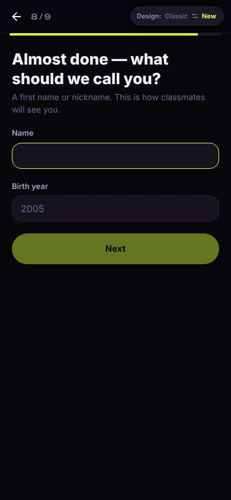</a> |
| 24 | type [66] ← “Minji” | `/start` | 857 |  | <a href="shots/024-type-som.jpg">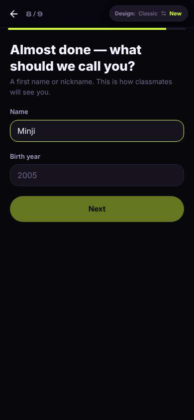</a> |
| 25 | type “2005” ← “2009” | `/start` | 891 |  | <a href="shots/025-type-som.jpg">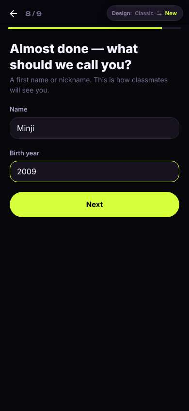</a> |
| 26 | click “Next” | `/start` | 848 | expects: “step 9: school email” (0.7) as expected _neutral_: “드디어 이메일. 16세 이상이면 된다니 다행. 6자리 코드면 금방이겠다.” | <a href="shots/026-click-som.jpg">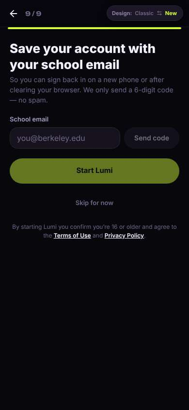</a> |
| 28 | type “you@berkeley.edu” ← “minji.k@berkeley.edu” | `/start` | 904 |  | <a href="shots/028-type-som.jpg">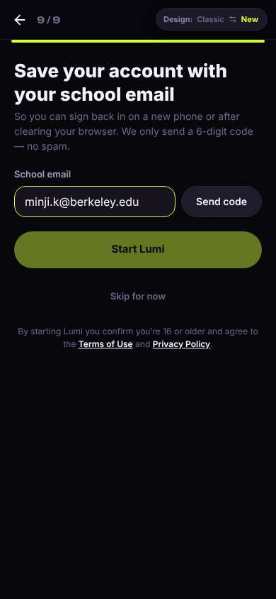</a> |
| 29 | click “Send code” | `/start` | 847 | expects: “code input appears” (0.8) | <a href="shots/029-click-som.jpg">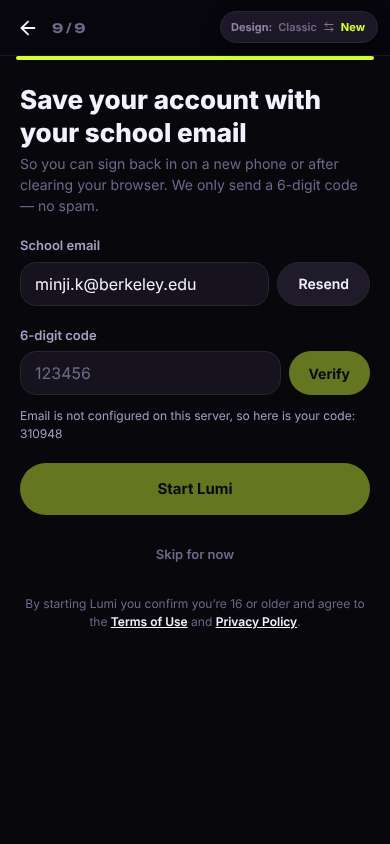</a> |
| 30 | type “123456” ← “310948” | `/start` | 880 |  | <a href="shots/030-type-som.jpg">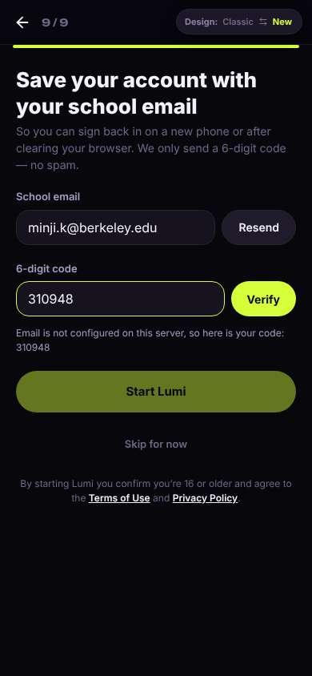</a> |
| 31 | click “Verify” | `/start` | 852 | expects: “verified, Start Lumi enabled” (0.8) | <a href="shots/031-click-som.jpg">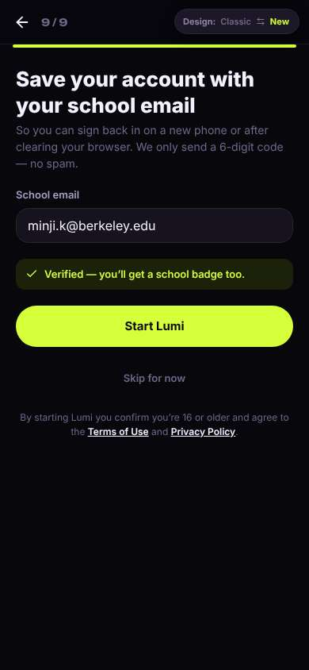</a> |
| 32 | click “Start Lumi” | `/` | 1064 | expects: “home feed with people / plans this week” (0.6) **mismatch**: People tab is empty: 'Students from your campus show up here' + Invite friends; no people, no plans ⚑ mismatch _frustrated_: “헐 9단계 다 했는데 아무도 없어?? 친구 초대하라고... 친구가 없어서 깔았는데 ㅠ 뭐지 이거.” → f4 |  |
| 34 | finish | `/` |  |  |  |

## Automatic checks (harness, not persona)

| screen | tap targets < 44px | sideways overflow | broken images |
|---|---|---|---|
| `/welcome` | 4 (Sign in 46×21, Terms of Use 76×15, Privacy Policy 180×33, Switch to the classic design 158×32) | — | — |
| `/start` | 8 (Back 40×40, Stanford University 148×36, UCLA 62×36, USC 54×36, UC San Diego 112×36) | — | — |
| `/` | 7 (Filters 40×40, Notifications 40×40, Messages 40×40, Me 32×32, Invite friends 116×36) | — | — |

## Timing (harness)

- Full page load (navigation timing): 1098 ms
- Step 0 `start` took 3138 ms until the network was quiet on `/welcome`
