# ux-sim run `cmp1-base-find-a-club-aisha`

> **AI simulation — hypotheses, not measured user behaviour.** One simulated persona; nothing here is a rate or a measurement of real students.

| | |
|---|---|
| Persona | **Aisha**, 18 — First-year (first in her family to go to college) · phone 390×844 · prefers en · tech medium (`aisha-firstgen-anxious`) |
| Scenario | **Find a club I'd actually like** — You want to find one student club or group you'd actually enjoy and feel welcome in. Use the app to find one that fits you and open its page to see how to join. (`find-a-club`) |
| Target | local · http://localhost:46125 · worktree commit `7af1c8ef2cfd` |
| Outcome | **success** · ended by persona |
| Account | fresh real account `aisha.ishal77u@berkeley.edu` (Aisha, Public Health, born 2008; sample: false) |
| Goal check (fixed, by harness) | met at step 9 after 4 action(s) — evidence: {"urlMatches":"^/orgs/[^/?]+"} — _A club / organization page is open (reached by the persona — the run starts on /)._ |
| Persona's reason | “I found the Cal Board Game Club — weekly Thursday game nights sounds like somewhere I'd fit — and opened its page; the way to join seems to be 'Ask to join', though I'm not sure what tapping it sends or why it says 'Not recruiting right now'.” |
| Effort | 15/50 actions · objective frustration 2.50/6 · 3 confused note(s) · ~279s simulated |
| Drop-off risk | **medium** _(AI hypothesis, persona agent)_ — I did find a club I like, but every club page said Unverified, Not recruiting, no events and 0 followers, and nothing explains what 'Ask to join' does — so I'd probably look up the club elsewhere instead of joining through Lumi. · basis: steps 9, 11, 13, 15, 27, 29 |

Known environment limits (not UX findings)

- Dining menus and RSF gym crowd levels need live campus sources (the local stack runs with CAMPUS_LIVE=0) — empty or missing data there is not a UX bug.
- AI features (Ask Lumi, AI profile draft on /start, conversation starters) need an OpenAI key; none is configured locally.
- Course catalog is the real Berkeley Class Schedule (6588 courses, Fall 2026 + Spring 2027), fetched 2026-11-02 with the worker's adapter. Seat counts and very recent changes may differ from live.
- Campus events, free food, internships, hackathons and scholarships are a read-only snapshot of live (1119 real items, 103 events this week, taken 2026-11-02 07:25 UTC) plus the CSV calendar. Nothing new appears during the run; Q&A and reviews are empty.
- No e-mail is sent: the sign-up / sign-in code is shown on screen in the hint (live sends a real e-mail).
- Real-time updates (SSE) work locally; other people never reply unless the stack was started with --autoreply.
- Signed in as a brand-new real (non-sample, e-mail-verified) account made for this run. Other students exist only if the scenario seeds peers (local fixtures); sample profiles are hidden from real accounts, as on live.

## Friction

| # | step | type | sev | persona says | screen | element | env-limited | evidence |
|---|---|---|---|---|---|---|---|---|
| f1 | 0 | Missing / empty content | 2 | “Wait, it's just empty? 'Students from your campus show up here'... so nobody's here yet? I don't know anyone to invite, I'm literally trying to find people.” _wish: show me something to do even if I have no friends on here yet_ | `/` | Invite friends | no | [shot](shots/000-start.jpg) [marked](shots/000-start-som.jpg) |
| f2 | 5 | No reason to stay | 1 | “Okay, there IS a Clubs tab, phew. But 'For you' is all fellowships with deadlines... D-93? That's a lot of résumé stuff. I'm a first-year, I just want a group. Let me tap Clubs.” _wish: For a first-year, show welcoming clubs first, not summer research fellowships_ | `/community?tab=opportunities` | For you | no | [shot](shots/005-observe.jpg) [marked](shots/005-observe-som.jpg) |
| f3 | 7 | Unclear wording | 1 | “Okay this is the list. Wait, there's 'Clubs' and then another 'Clubs' under it? Which one am I in? Also it's a lot of Greek life, which I don't know the rules for. The hiking one sounds friendly — weekend hikes, gear rentals, I don't need my own gear.” _wish: don't repeat 'Clubs' in both rows; make it clear what 'All' vs 'Clubs' means_ | `/community?tab=opportunities` | Clubs | no | [shot](shots/007-click.jpg) [marked](shots/007-click-som.jpg) |
| f4 | 9 | Trust / privacy worry | 3 | “Wait, 'Unverified' — does that mean it's not a real club? Or that Lumi hasn't checked it? And 'Ask to join'... who am I asking? Does it send them my profile? Is there an application? I don't want to accidentally send something before I know what it does.” _wish: Tell me what 'Ask to join' does (who sees it, is it an application, can I undo it) and what 'Unverified' means_ | `/orgs/:id` | Ask to join | no | [shot](shots/009-click.jpg) [marked](shots/009-click-som.jpg) |
| f5 | 11 | Confusing UI | 3 | “Wait, so they're not taking members... but I can still ask to join? Does that mean I missed the window? Is this one of those clubs where you have to apply during a certain week? Nobody told me about that.” _wish: If they're not recruiting, tell me whether I can still just show up to hikes, and when the next chance to join is_ | `/orgs/:id?tab=recruit` | Recruiting | no | [shot](shots/011-click.jpg) [marked](shots/011-click-som.jpg) |
| f6 | 13 | Missing / empty content | 2 | “No events either. And 'events you post'? I'm not posting events, I'm a first-year. Not recruiting, no events, unverified... is this club even active? Let me see if anyone's actually in it.” _wish: show the club's real meeting times or a 'newcomers welcome' event so I know it's alive_ | `/orgs/:id?tab=events` | Events | no | [shot](shots/013-click.jpg) [marked](shots/013-click-som.jpg) |
| f7 | 15 | Missing / empty content | 2 | “Zero followers. So nobody from this club is actually on here? If I tap 'Ask to join' would anyone even see it? I'd rather look for a group that feels more like people like me.” _wish: some sign real students are in this club on Lumi_ | `/orgs/:id?tab=members` | Members | no | [shot](shots/015-click.jpg) [marked](shots/015-click-som.jpg) |
| f8 | 19 | Unclear wording | 1 | “Oh, it's just student government. Not what I meant. I'll filter to only Clubs so I don't have to scroll past all the sororities.” _wish: a label that says what 'Associations' means; also '1 groups' is a typo_ | `/community?tab=opportunities` | Associations | no | [shot](shots/019-click.jpg) [marked](shots/019-click-som.jpg) |
| f9 | 21 | Confusing UI | 1 | “Better. Wait, Machine Learning fits Public Health? That's weird — makes me trust the 'fits your major' tags less. Let me scroll and actually read the names.” _wish: only say 'fits your major' when it actually does_ | `/community?tab=opportunities` | 🤖 Machine Learning at Berkeley Undergrad ML research and industry projects; runs an intro | no | [shot](shots/021-click.jpg) [marked](shots/021-click-som.jpg) |
| f10 | 25 | Hard to find | 2 | “So many of these are consulting, VC, debate... résumé clubs. I was hoping for a first-gen students group, but there's no search box to look for one. The Board Game Club says 'every week' — that sounds low-pressure, like I could just show up.” _wish: a search box or a 'beginner-friendly / no application' filter, and first-gen / community groups_ | `/community?tab=opportunities` | Show more (7) | no | [shot](shots/025-scroll.jpg) [marked](shots/025-scroll-som.jpg) |
| f11 | 27 | Missing / empty content | 2 | “Okay, this one I'd actually go to. Game night Thursday! But... Thursday when? Where? It doesn't say a time or a room. Let me check if they're taking people right now.” _wish: time and place for game night, and 'newcomers welcome — just show up' if that's true_ | `/orgs/:id` | About | no | [shot](shots/027-click.jpg) [marked](shots/027-click-som.jpg) |

Severity: 1 = Minor — noticed it, cosmetic or a small annoyance; did not slow me down. · 2 = Moderate — slowed me down or made me hesitate; I recovered on my own. · 3 = Major — real confusion, a wrong path or many extra steps; I nearly gave up or only got through by guessing. · 4 = Blocker — I could not continue, gave up, or would stop using the app here.

## Timeline

| step | what | screen | ms | signals / notes | shot |
|---|---|---|---|---|---|
| 0 | start | `/` | 2189 | _confused_: “Wait, it's just empty? 'Students from your campus show up here'... so nobody's here yet? I don't know anyone to invite, I'm literally trying to find people.” → f1 | <a href="shots/000-start-som.jpg">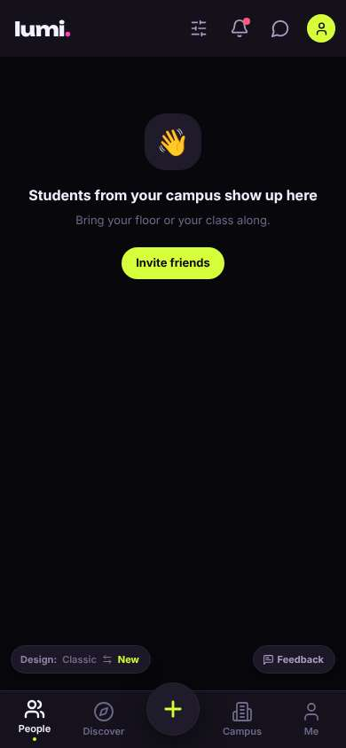</a> |
| 2 | click “Campus” | `/community` | 904 | expects: “campus stuff like clubs and organizations” (0.55) **mismatch**: It's a feed with a poll and one event, no clubs visible. There's a 'Browse' tab though. ⚑ mismatch _neutral_: “Hmm, it's more like a social feed. Maybe 'Browse' is where the clubs are? I don't want to tap 'Go together' — I don't know what that does, it might message someone.” | <a href="shots/002-click-som.jpg">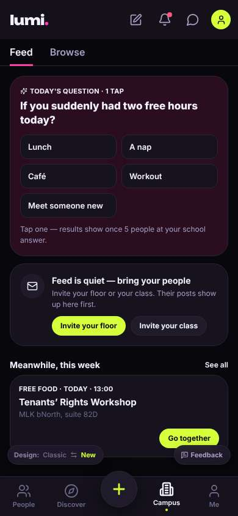</a> |
| 4 | click “Browse” | `/community?tab=opportunities` | 844 | expects: “a list of clubs or organizations to browse” (0.5) as expected | <a href="shots/004-click-som.jpg">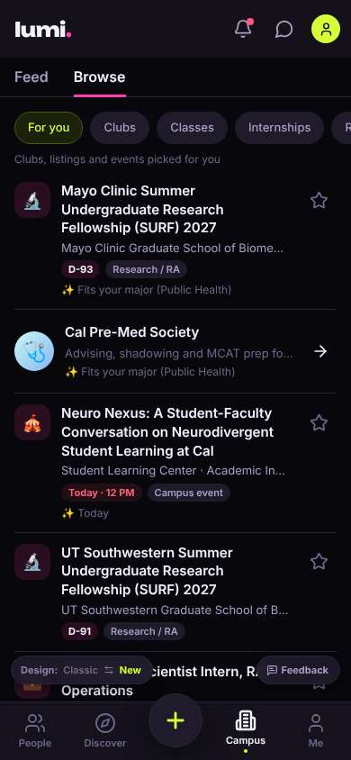</a> |
| 5 | observe | `/community?tab=opportunities` |  | _curious_: “Okay, there IS a Clubs tab, phew. But 'For you' is all fellowships with deadlines... D-93? That's a lot of résumé stuff. I'm a first-year, I just want a group. Let me tap Clubs.” → f2 |  |
| 7 | click “Clubs” | `/community?tab=opportunities` | 920 | expects: “a list of only student clubs” (0.8) as expected _neutral_: “Okay this is the list. Wait, there's 'Clubs' and then another 'Clubs' under it? Which one am I in? Also it's a lot of Greek life, which I don't know the rules for. The hiking one sounds friendly — weekend hikes, gear rentals, I don't need my own gear.” → f3 | <a href="shots/007-click-som.jpg">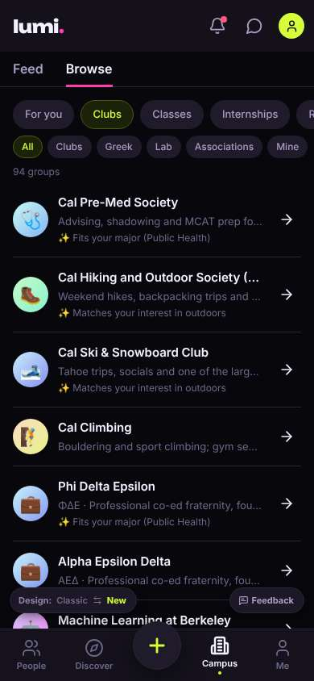</a> |
| 9 | click “🥾 Cal Hiking and Outdoor Society (CHAOS” | `/orgs/:id` | 859 | expects: “the hiking club's page with what they do and how to join” (0.7) as expected _confused_: “Wait, 'Unverified' — does that mean it's not a real club? Or that Lumi hasn't checked it? And 'Ask to join'... who am I asking? Does it send them my profile? Is there an application? I don't want to accidentally send something before I know what it does.” → f4 | <a href="shots/009-click-som.jpg">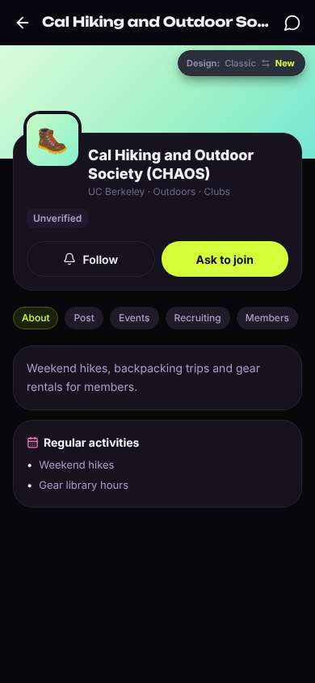</a> |
| 11 | click “Recruiting” | `/orgs/:id?tab=recruit` | 844 | expects: “info on how/when they take new members, maybe whether there's an application” (0.6) **mismatch**: Recruiting tab just says 'Not recruiting right now' — but the 'Ask to join' button is still right there. ⚑ mismatch _confused_: “Wait, so they're not taking members... but I can still ask to join? Does that mean I missed the window? Is this one of those clubs where you have to apply during a certain week? Nobody told me about that.” → f5 | <a href="shots/011-click-som.jpg">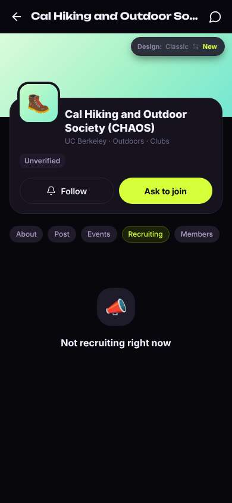</a> |
| 13 | click “Events” | `/orgs/:id?tab=events` | 843 | expects: “upcoming hikes I could just show up to” (0.4) **mismatch**: 'No upcoming events' and a line 'Events you post also show in Discover › Activities.' ⚑ mismatch _neutral_: “No events either. And 'events you post'? I'm not posting events, I'm a first-year. Not recruiting, no events, unverified... is this club even active? Let me see if anyone's actually in it.” → f6 | <a href="shots/013-click-som.jpg">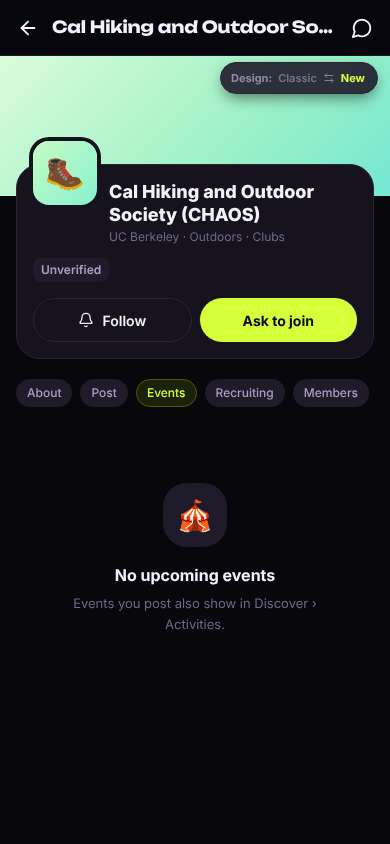</a> |
| 15 | click “Members” | `/orgs/:id?tab=members` | 877 | expects: “a list of members, maybe people in my year” (0.4) **mismatch**: Followers 0, and 'Member lists may be private'. Nobody visible. ⚑ mismatch _neutral_: “Zero followers. So nobody from this club is actually on here? If I tap 'Ask to join' would anyone even see it? I'd rather look for a group that feels more like people like me.” → f7 | <a href="shots/015-click-som.jpg">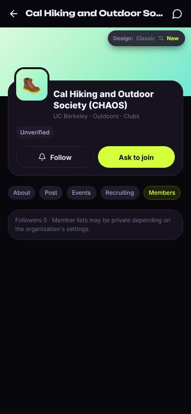</a> |
| 17 | click “Back” | `/community?tab=opportunities` | 849 | expects: “back to the clubs list” (0.8) as expected _neutral_: “Good, didn't lose my place. Maybe 'Associations' has something like a first-gen or student community group?” |  |
| 19 | click “Associations” | `/community?tab=opportunities` | 864 | expects: “community / identity groups, maybe a first-gen student association” (0.4) **mismatch**: 'Associations' is just one entry: ASUC student government. '1 groups'. ⚑ mismatch _neutral_: “Oh, it's just student government. Not what I meant. I'll filter to only Clubs so I don't have to scroll past all the sororities.” → f8 | <a href="shots/019-click-som.jpg">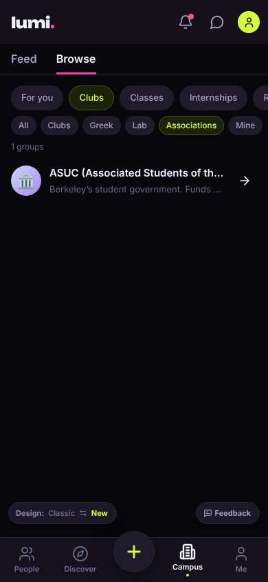</a> |
| 21 | click “Clubs” | `/community?tab=opportunities` | 852 | expects: “only regular clubs, no Greek life” (0.7) as expected _neutral_: “Better. Wait, Machine Learning fits Public Health? That's weird — makes me trust the 'fits your major' tags less. Let me scroll and actually read the names.” → f9 | <a href="shots/021-click-som.jpg">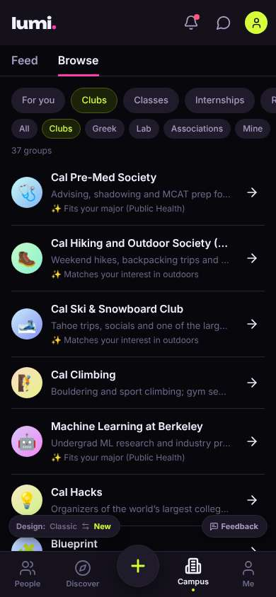</a> |
| 23 | scroll down | `/community?tab=opportunities` | 1320 |  | <a href="shots/023-scroll-som.jpg">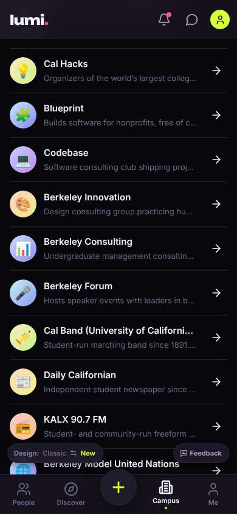</a> |
| 24 | scroll down | `/community?tab=opportunities` | 1312 |  | <a href="shots/024-scroll-som.jpg">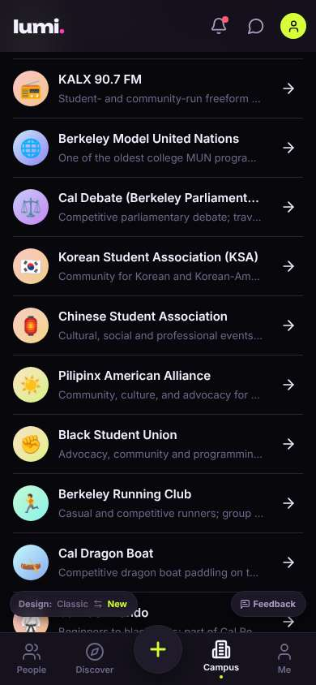</a> |
| 25 | scroll down | `/community?tab=opportunities` | 1326 | _neutral_: “So many of these are consulting, VC, debate... résumé clubs. I was hoping for a first-gen students group, but there's no search box to look for one. The Board Game Club says 'every week' — that sounds low-pressure, like I could just show up.” → f10 | <a href="shots/025-scroll-som.jpg">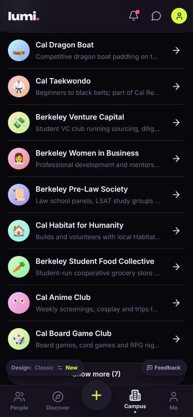</a> |
| 27 | click “🎲 Cal Board Game Club Board games, card” | `/orgs/:id` | 860 | expects: “Board Game Club page, hopefully with when they meet and that anyone can come” (0.6) as expected _curious_: “Okay, this one I'd actually go to. Game night Thursday! But... Thursday when? Where? It doesn't say a time or a room. Let me check if they're taking people right now.” → f11 | <a href="shots/027-click-som.jpg">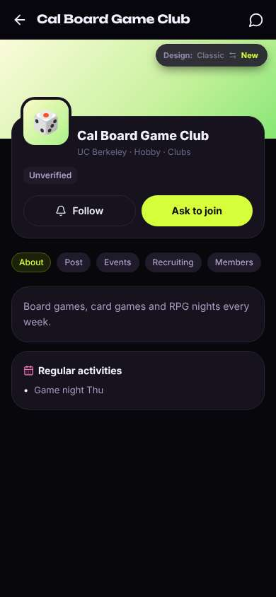</a> |
| 29 | click “Recruiting” | `/orgs/:id?tab=recruit` | 856 | expects: “probably 'not recruiting' again, but maybe it says how to join” (0.5) as expected _neutral_: “Okay, it says that for every club, so I guess it doesn't really mean anything? That's not reassuring though. I think 'Ask to join' is how you join, but I'm not tapping it until I know if it sends them my profile. At least I found one I'd like — Thursday game nights.” |  |
| 31 | finish | `/orgs/:id?tab=recruit` |  |  | <a href="shots/031-finish-som.jpg">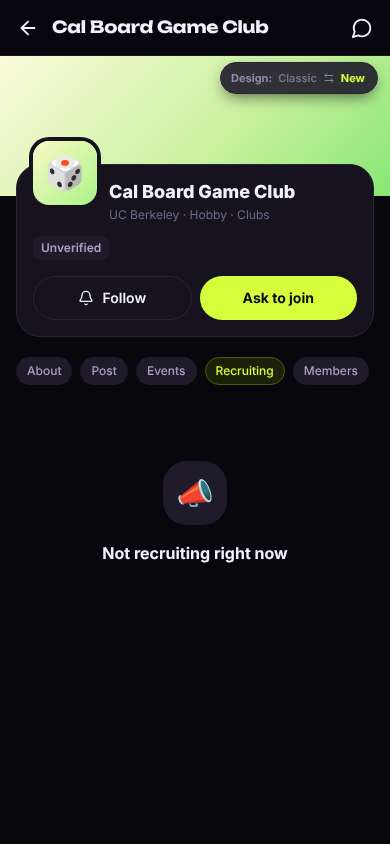</a> |

## Automatic checks (harness, not persona)

| screen | tap targets < 44px | sideways overflow | broken images |
|---|---|---|---|
| `/` | 7 (Filters 40×40, Notifications 40×40, Messages 40×40, Me 32×32, Invite friends 116×36) | — | — |
| `/community` | 15 (Notifications 40×40, Messages 40×40, Me 32×32, Feed 38×44, Lunch 158×40) | — | — |
| `/community?tab=opportunities` | 17 (Notifications 40×40, Messages 40×40, Me 32×32, Feed 38×44, Lunch 158×40) | — | — |
| `/orgs/:id` | 8 (Back 40×40, Messages 40×40, About 56×28, Post 47×28, Events 61×28) | — | — |
| `/orgs/:id?tab=recruit` | 8 (Back 40×40, Messages 40×40, About 56×28, Post 47×28, Events 61×28) | — | — |
| `/orgs/:id?tab=events` | 8 (Back 40×40, Messages 40×40, About 56×28, Post 47×28, Events 61×28) | — | — |
| `/orgs/:id?tab=members` | 8 (Back 40×40, Messages 40×40, About 56×28, Post 47×28, Events 61×28) | — | — |

## Timing (harness)

- Full page load (navigation timing): 737 ms
