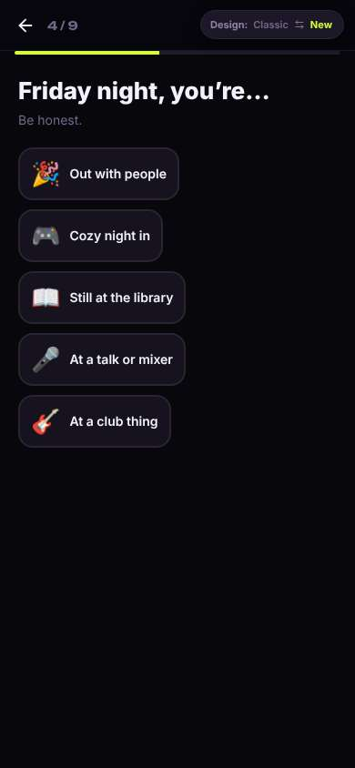
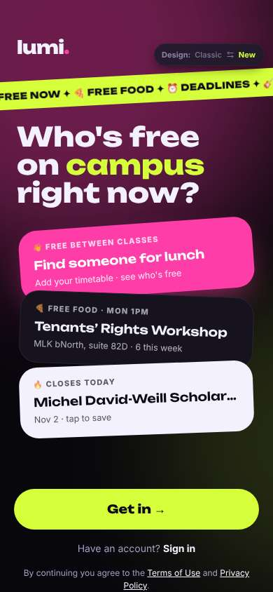
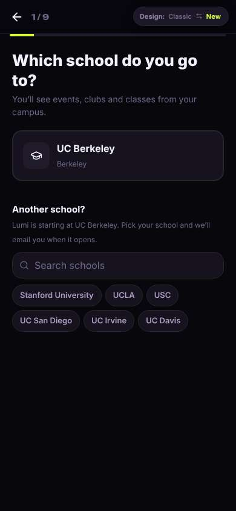
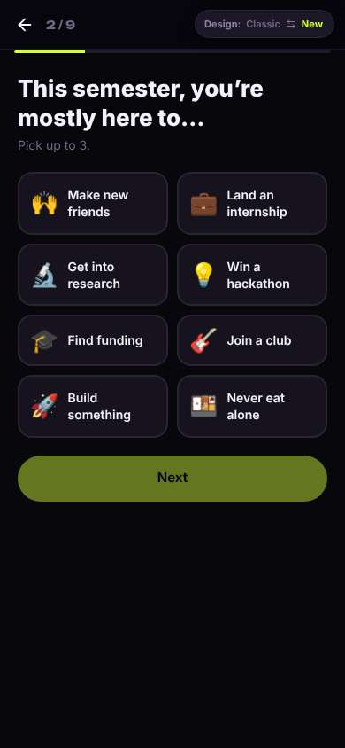
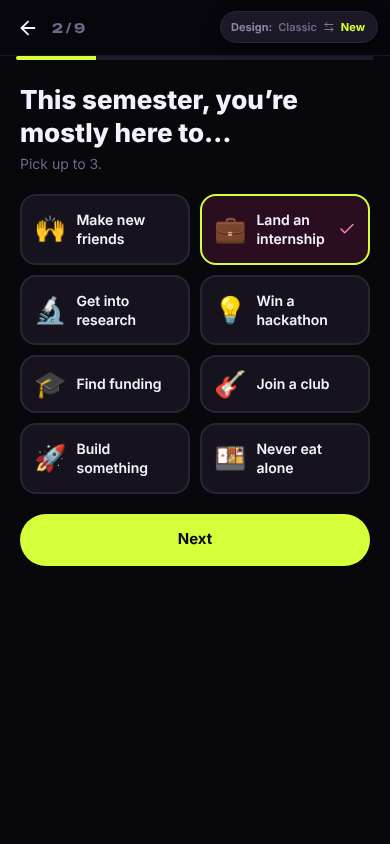
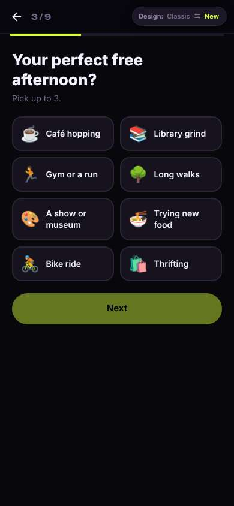
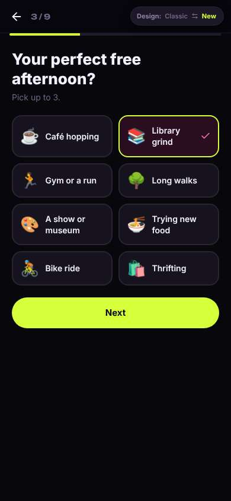

# ux-sim run `cmp1-base-first-open-decide-marcus`

> **AI simulation — hypotheses, not measured user behaviour.** One simulated persona; nothing here is a rate or a measurement of real students.

| | |
|---|---|
| Persona | **Marcus**, 22 — Senior · phone 390×844 · prefers en · tech low (`marcus-senior-lowtech`) |
| Scenario | **First open: what is this app, and is it worth signing up?** — A friend sent you a link to this app. You have never seen it before. Figure out what it is for, and decide whether you want to make an account. If it seems worth it, sign up with your school e-mail. (`first-open-decide`) |
| Target | local · http://localhost:39759 · worktree commit `7af1c8ef2cfd` |
| Outcome | **abandoned** · ended by persona |
| Account | signed out at start |
| Goal check (fixed, by harness) | not met — _Signed up during the run (a new account exists and the browser is signed in to it) and landed inside the app (signed-in home or a main tab)._ |
| Patience | exhausted at step 12; 0 action(s) after |
| Persona's reason | “I told it I want an internship and it kept quizzing me about my free afternoons and Friday nights. Feels like a dating or party app, and I never saw one job, so I'm not giving it my school email.” |
| Effort | 6/36 actions · objective frustration 1.00/4 · 2 confused note(s) · ~60s simulated |
| Drop-off risk | **high** _(AI hypothesis, persona agent)_ — The welcome screen sells 'who's free right now' and the setup reads like a personality/dating quiz; the internship promise was only a moving ticker and nothing job-related was shown before asking for more setup, so a skeptical job-seeker won't come back. · basis: steps 0, 8, 11 |

Known environment limits (not UX findings)

- Dining menus and RSF gym crowd levels need live campus sources (the local stack runs with CAMPUS_LIVE=0) — empty or missing data there is not a UX bug.
- AI features (Ask Lumi, AI profile draft on /start, conversation starters) need an OpenAI key; none is configured locally.
- Course catalog is the real Berkeley Class Schedule (6588 courses, Fall 2026 + Spring 2027), fetched 2026-11-02 with the worker's adapter. Seat counts and very recent changes may differ from live.
- Campus events, free food, internships, hackathons and scholarships are a read-only snapshot of live (1119 real items, 103 events this week, taken 2026-11-02 07:25 UTC) plus the CSV calendar. Nothing new appears during the run; Q&A and reviews are empty.
- No e-mail is sent: the sign-up / sign-in code is shown on screen in the hint (live sends a real e-mail).
- Real-time updates (SSE) work locally; other people never reply unless the stack was started with --autoreply.

## Friction

| # | step | type | sev | persona says | screen | element | env-limited | evidence |
|---|---|---|---|---|---|---|---|---|
| f1 | 0 | Trust / privacy worry | 2 | “Big headline is 'Who's free on campus right now?' and 'Find someone for lunch' — kind of sounds like a meet-people app. I only caught '457 internships' in that scrolling banner. That's the part I care about but it's tiny and moving.” _wish: Tell me plainly up front that it has internships and jobs, not just a moving ticker_ | `/welcome` |  | no | [shot](shots/000-start.jpg) [marked](shots/000-start-som.jpg) |
| f2 | 2 | Onboarding friction | 2 | “OK, just picking my school, that's fine. But 1 of 9? Nine screens before I even see what's in here? I still haven't seen an internship.” _wish: Let me look around before a 9-step setup_ | `/start` |  | no | [shot](shots/002-click.jpg) [marked](shots/002-click-som.jpg) |
| f3 | 8 | Trust / privacy worry | 3 | “Wait, 'perfect free afternoon', 'long walks'... this is starting to read like a dating profile. What does my afternoon have to do with internships? Is this legit?” _wish: Explain why you're asking, or let me skip the personal stuff if I'm here for jobs_ | `/start` | Next | no | [shot](shots/008-click.jpg) [marked](shots/008-click-som.jpg) |
| f4 | 11 | Trust / privacy worry | 4 | “'Friday night, be honest'? Come on. This is a dating or party app quiz. I picked 'Land an internship' two screens ago and it's asking about my Friday nights. Five more of these and I still haven't seen a single job.” _wish: After I pick internships, show me internships, not a personality quiz_ | `/start` | 🎉 Out with people | no | [shot](shots/011-click.jpg) [marked](shots/011-click-som.jpg) |

Severity: 1 = Minor — noticed it, cosmetic or a small annoyance; did not slow me down. · 2 = Moderate — slowed me down or made me hesitate; I recovered on my own. · 3 = Major — real confusion, a wrong path or many extra steps; I nearly gave up or only got through by guessing. · 4 = Blocker — I could not continue, gave up, or would stop using the app here.

## Where it ended

Step 11 on `/start`.

## Timeline

| step | what | screen | ms | signals / notes | shot |
|---|---|---|---|---|---|
| 0 | start | `/welcome` | 3427 | _neutral_: “Big headline is 'Who's free on campus right now?' and 'Find someone for lunch' — kind of sounds like a meet-people app. I only caught '457 internships' in that scrolling banner. That's the part I care about but it's tiny and moving.” → f1 |  |
| 2 | click “Get in →” | `/start` | 1384 | expects: “It asks me for email and a password right away” (0.6) **mismatch**: It asked which school I go to, not my email. Top says 1/9. ⚑ mismatch _neutral_: “OK, just picking my school, that's fine. But 1 of 9? Nine screens before I even see what's in here? I still haven't seen an internship.” → f2 |  |
| 4 | click “UC Berkeley Berkeley” | `/start` | 949 | expects: “Goes to the next question” (0.8) as expected _curious_: “Land an internship — that's me. Good, at least they have it as an option.” |  |
| 6 | click “💼 Land an internship” | `/start` | 873 | expects: “Internship gets selected” (0.8) as expected _neutral_: “Next lit up, so I guess it took it.” |  |
| 8 | click “Next” | `/start` | 855 | expects: “Another setup question” (0.7) as expected _confused_: “Wait, 'perfect free afternoon', 'long walks'... this is starting to read like a dating profile. What does my afternoon have to do with internships? Is this legit?” → f3 |  |
| 10 | click “📚 Library grind” | `/start` | 872 |  |  |
| 11 | click “Next” | `/start` | 894 | expects: “Another question, hopefully about jobs” (0.5) **mismatch**: Not about jobs at all: 'Friday night, you're… Be honest.' Out with people / cozy night in / mixer. Still 4 of 9. ⚑ mismatch _frustrated_: “'Friday night, be honest'? Come on. This is a dating or party app quiz. I picked 'Land an internship' two screens ago and it's asking about my Friday nights. Five more of these and I still haven't seen a single job.” → f4 |  |
| 13 | finish | `/start` |  |  |  |

## Automatic checks (harness, not persona)

| screen | tap targets < 44px | sideways overflow | broken images |
|---|---|---|---|
| `/welcome` | 4 (Sign in 46×21, Terms of Use 76×15, Privacy Policy 180×33, Switch to the classic design 158×32) | — | — |
| `/start` | 8 (Back 40×40, Stanford University 148×36, UCLA 62×36, USC 54×36, UC San Diego 112×36) | — | — |

## Timing (harness)

- Full page load (navigation timing): 1402 ms
- Step 0 `start` took 3427 ms until the network was quiet on `/welcome`
