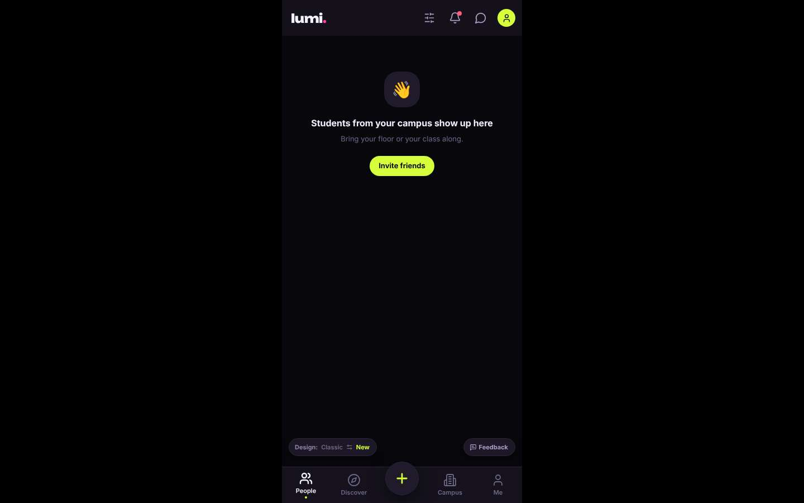
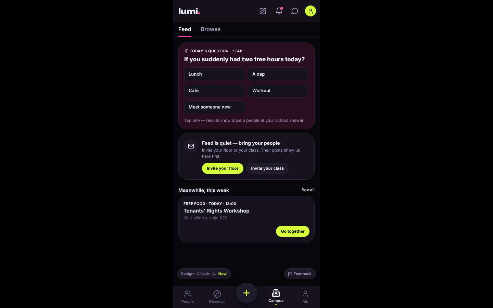
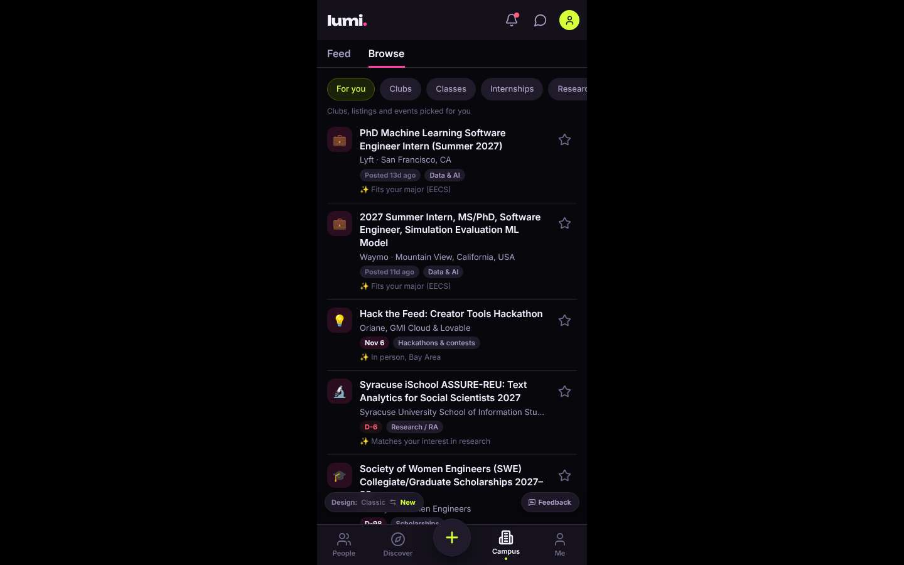
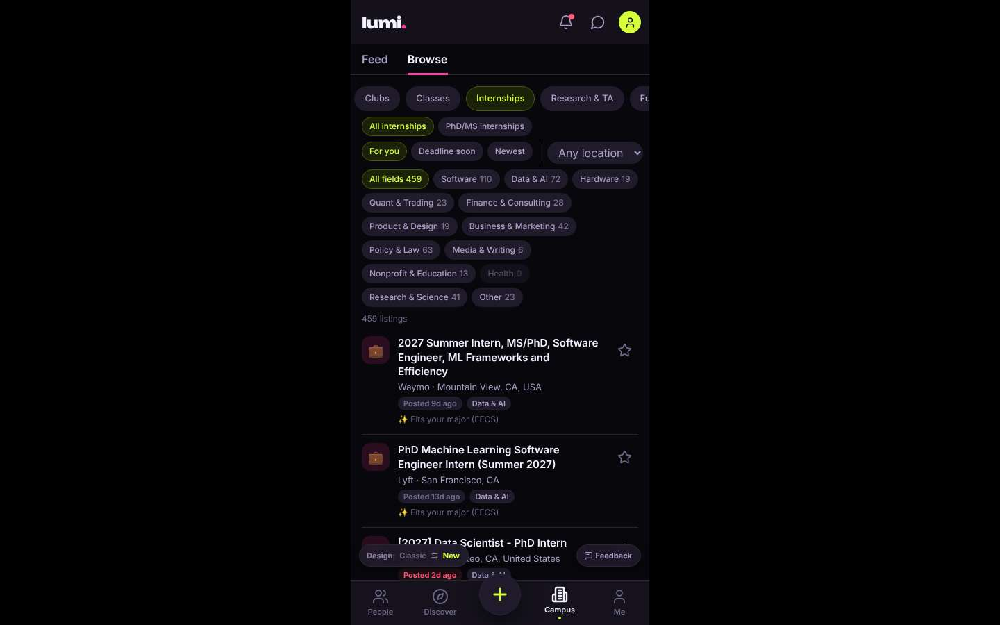
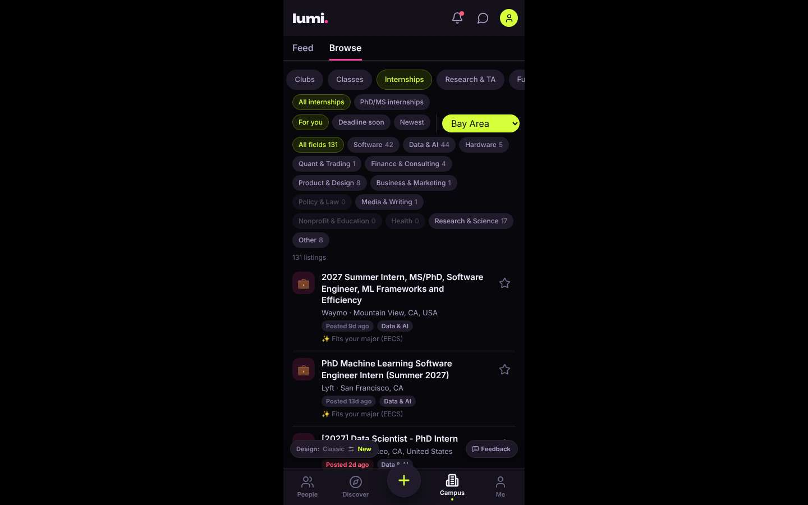
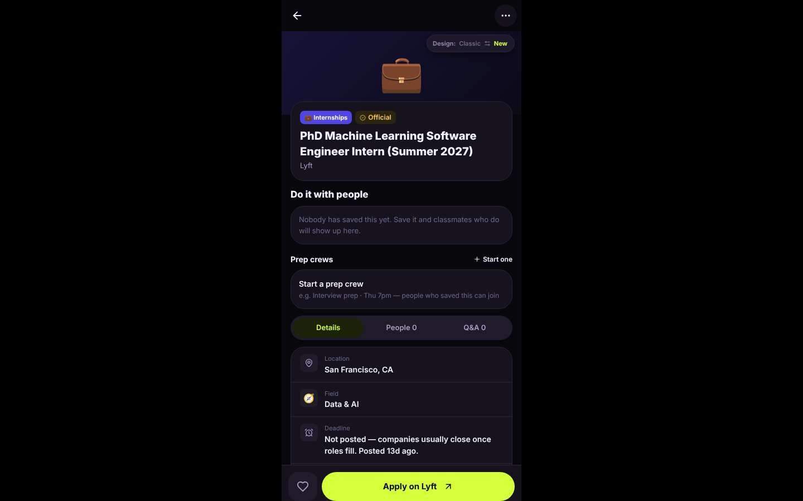

# ux-sim run `cmp1-base-internship-near-berkeley-priya`

> **AI simulation — hypotheses, not measured user behaviour.** One simulated persona; nothing here is a rate or a measurement of real students.

| | |
|---|---|
| Persona | **Priya**, 26 — Second-year PhD student · desktop 1440×900 · prefers en · tech high (`priya-phd-desktop`) |
| Scenario | **Find an internship near Berkeley** — You need a paid internship (summer or part-time) somewhere near Berkeley / the Bay Area. Use the app to find one that looks real and open, and open its details so you know how to apply. (`internship-near-berkeley`) |
| Target | local · http://localhost:35167 · worktree commit `7af1c8ef2cfd` |
| Outcome | **success** · ended by persona |
| Account | fresh real account `priya.riyale4d@berkeley.edu` (Priya, EECS, born 2000; sample: false) |
| Goal check (fixed, by harness) | met at step 12 after 5 action(s) — evidence: {"urlMatches":"^/opportunities/[^/?]+"}; {"textMatches":"\\bintern(ship)?s?\\b"} — _An internship listing's detail page is open (reached by the persona — the run starts on /)._ |
| Persona's reason | “Found Lyft's PhD ML SWE intern (Summer 2027) in SF via Campus > Browse > Internships > Bay Area; it's verified yesterday from Lyft careers and has an Apply on Lyft link. No pay listed, but it's clearly a real, open role.” |
| Effort | 6/40 actions · objective frustration 1.50/5 · 1 confused note(s) · ~89s simulated |
| Drop-off risk | **medium** _(AI hypothesis, persona agent)_ — The Browse/Internships list with a Bay Area filter and PhD roles is genuinely useful and better than the career site, but I only found it by guessing past an empty invite screen and a nap/café poll, on a phone-width column on my laptop; I'd come back for funding deadlines only if I remember the Browse tab exists. · basis: steps 0, 2, 4, 10 |

Known environment limits (not UX findings)

- Dining menus and RSF gym crowd levels need live campus sources (the local stack runs with CAMPUS_LIVE=0) — empty or missing data there is not a UX bug.
- AI features (Ask Lumi, AI profile draft on /start, conversation starters) need an OpenAI key; none is configured locally.
- Course catalog is the real Berkeley Class Schedule (6588 courses, Fall 2026 + Spring 2027), fetched 2026-11-02 with the worker's adapter. Seat counts and very recent changes may differ from live.
- Campus events, free food, internships, hackathons and scholarships are a read-only snapshot of live (1119 real items, 103 events this week, taken 2026-11-02 07:25 UTC) plus the CSV calendar. Nothing new appears during the run; Q&A and reviews are empty.
- No e-mail is sent: the sign-up / sign-in code is shown on screen in the hint (live sends a real e-mail).
- Real-time updates (SSE) work locally; other people never reply unless the stack was started with --autoreply.
- Signed in as a brand-new real (non-sample, e-mail-verified) account made for this run. Other students exist only if the scenario seeds peers (local fixtures); sample profiles are hidden from real accounts, as on live.

## Friction

| # | step | type | sev | persona says | screen | element | env-limited | evidence |
|---|---|---|---|---|---|---|---|---|
| f1 | 0 | No reason to stay | 2 | “A phone-width column in the middle of my 1440 screen with black bars on both sides. And the first thing it asks is to invite my floor. I don't have a floor. Not promising.” _wish: a proper desktop layout and something useful on the first screen instead of an empty invite prompt_ | `/` |  | no | [shot](shots/000-start.jpg) [marked](shots/000-start-som.jpg) |
| f2 | 6 | Missing / empty content | 1 | “Mixed bag. Lyft and Waymo PhD interns are great, but why is a Syracuse REU — an undergrad program — 'matching my interest in research'? Same feed has free-food chips. I'll filter to Internships.” _wish: don't recommend undergrad-only REUs to a PhD student_ | `/community?tab=opportunities` | 🔬 Syracuse iSchool ASSURE-REU: Text Analytics for Social Scientists 2027 Syracuse Univers | no | [shot](shots/006-observe.jpg) [marked](shots/006-observe-som.jpg) |
| f3 | 12 | No reason to stay | 1 | “Apply link and an honest 'deadline not posted' — fine. But nothing about pay, which is the one thing I asked for, and 'Start a prep crew' sits above the actual details. I don't need a crew to apply to Lyft.” _wish: put the job facts (pay, deadline, location) first; social stuff below_ | `/opportunities/:id` | Start a prep crew e.g. Interview prep · Thu 7pm — people who saved this can join | no | [shot](shots/012-click.jpg) [marked](shots/012-click-som.jpg) |
| f4 | 14 | Missing / empty content | 1 | “'Last verified yesterday' with a link to Lyft's own careers page — that's what I need to trust it's open. No pay stated; I know Lyft PhD interns are paid, but an undergrad wouldn't. Thin, but enough to apply.” _wish: show pay range and a short description when the posting has them_ | `/opportunities/:id` | Official source Lyft careers Last verified Sun, Nov 1 View posting | no | [shot](shots/014-scroll.jpg) [marked](shots/014-scroll-som.jpg) |

Severity: 1 = Minor — noticed it, cosmetic or a small annoyance; did not slow me down. · 2 = Moderate — slowed me down or made me hesitate; I recovered on my own. · 3 = Major — real confusion, a wrong path or many extra steps; I nearly gave up or only got through by guessing. · 4 = Blocker — I could not continue, gave up, or would stop using the app here.

## Timeline

| step | what | screen | ms | signals / notes | shot |
|---|---|---|---|---|---|
| 0 | start | `/` | 1749 | _frustrated_: “A phone-width column in the middle of my 1440 screen with black bars on both sides. And the first thing it asks is to invite my floor. I don't have a floor. Not promising.” → f1 |  |
| 2 | click “Campus” | `/community` | 1149 | expects: “campus resources: maybe careers, internships, deadlines” (0.5) **mismatch**: Campus is a social feed: a 'nap or café' poll, invite prompts and a free-food workshop. No careers or deadlines visible. ⚑ mismatch _bored_: “Today's question: nap or café. Right. 'Browse' might be the actual directory; I'll try that before writing this off.” |  |
| 4 | click “Browse” | `/community?tab=opportunities` | 1740 | expects: “a list of categories, maybe jobs/internships or deadlines” (0.4) as expected _curious_: “OK, this is actually relevant. 'PhD Machine Learning Software Engineer Intern' at Lyft in SF. Someone thought about grad students.” |  |
| 6 | observe | `/community?tab=opportunities` |  | _neutral_: “Mixed bag. Lyft and Waymo PhD interns are great, but why is a Syracuse REU — an undergrad program — 'matching my interest in research'? Same feed has free-food chips. I'll filter to Internships.” → f2 |  |
| 8 | click “Internships” | `/community?tab=opportunities` | 869 | expects: “list narrows to internships only, hopefully with location info” (0.8) as expected _curious_: “A Location dropdown and a PhD/MS filter — good. The chip wall is a lot, but fine. Nothing says paid vs unpaid though.” |  |
| 10 | select “Location” | `/community?tab=opportunities` | 831 | expects: “list filters to Bay Area internships” (0.6) as expected _delighted_: “Bay Area is an actual option and the counts update. This is better than the career-center site. Lyft in SF is a BART ride away — opening that.” |  |
| 12 | click “💼 PhD Machine Learning Software Enginee” | `/opportunities/:id` | 863 | expects: “details page for the Lyft PhD ML intern role with pay, deadline and an apply link” (0.6) **mismatch**: Detail page shows location, field, deadline ('Not posted') and an 'Apply on Lyft' button, but no pay/compensation. Above the facts is a 'Do it with people' / 'Prep crews' block. ⚑ mismatch _neutral_: “Apply link and an honest 'deadline not posted' — fine. But nothing about pay, which is the one thing I asked for, and 'Start a prep crew' sits above the actual details. I don't need a crew to apply to Lyft.” → f3 |  |
| 14 | scroll down | `/opportunities/:id` | 1356 | expects: “more details: description, maybe pay, the official source” (0.5) **mismatch**: Bottom shows 'Who it's for: see the posting', Official source: Lyft careers, Last verified Sun Nov 1, View posting link. No description or pay. ⚑ mismatch _neutral_: “'Last verified yesterday' with a link to Lyft's own careers page — that's what I need to trust it's open. No pay stated; I know Lyft PhD interns are paid, but an undergrad wouldn't. Thin, but enough to apply.” → f4 |  |
| 16 | finish | `/opportunities/:id` |  |  |  |

## Timing (harness)

- Full page load (navigation timing): 768 ms
