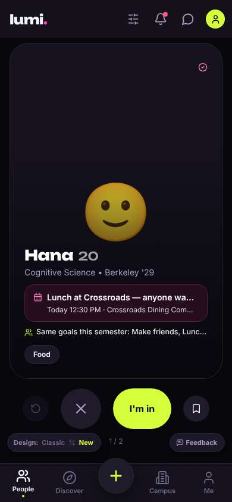
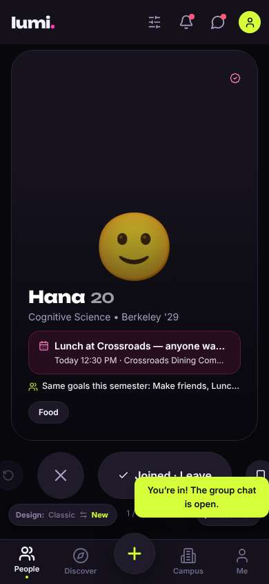
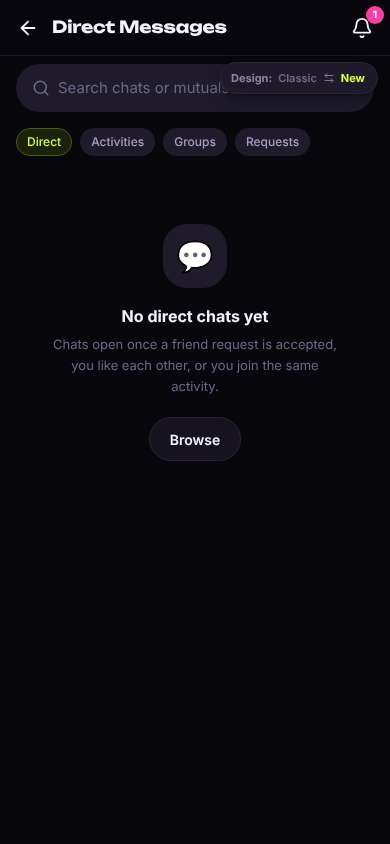
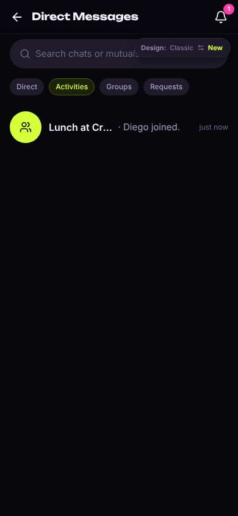
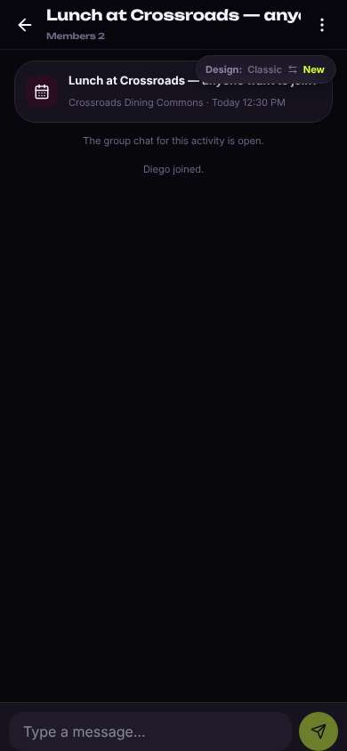
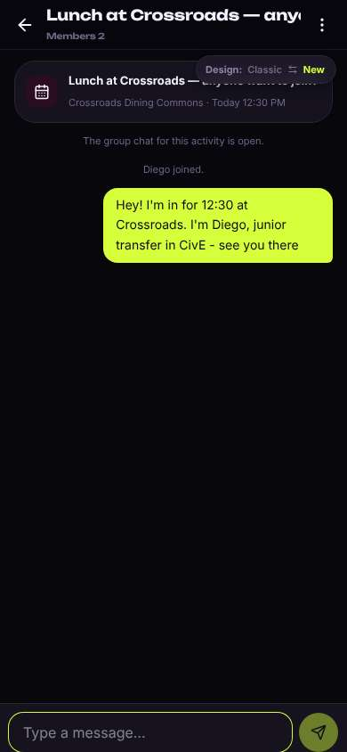

# ux-sim run `cmp1-base-lunch-today-diego`

> **AI simulation — hypotheses, not measured user behaviour.** One simulated persona; nothing here is a rate or a measurement of real students.

| | |
|---|---|
| Persona | **Diego**, 21 — Junior (transfer from Laney College) · phone 390×844 · prefers en · tech medium (`diego-transfer-commuter`) |
| Scenario | **Find someone to get lunch with today** — It's a weekday and you'd rather not eat lunch alone again. Use the app to find someone (or a group) to get lunch with today, and let them know you're in. (`lunch-today`) |
| Target | local · http://localhost:42393 · worktree commit `7af1c8ef2cfd` |
| Outcome | **success** · ended by persona |
| Account | fresh real account `diego.iegokuvm@berkeley.edu` (Diego, Civil Engineering, born 2005; sample: false) · peers seeded: Hana, Leo |
| Goal check (fixed, by harness) | met at step 2 after 1 action(s) — evidence: joined or asked to join a peer's lunch plan; joined or asked to join a plan — _During the run the persona's own account joined/requested one of today's lunch plans, posted its own meal plan for today, or messaged in a lunch plan's chat._ |
| Persona's reason | “Joined Hana's 12:30 lunch at Crossroads and posted in the group chat that I'm coming. Took about a minute.” |
| Effort | 5/32 actions · objective frustration 0.50/4 · 1 confused note(s) · ~22s simulated |
| Drop-off risk | **medium** _(AI hypothesis, persona agent)_ — Lunch was fast, but the only lunch was a freshman's and it's just me and her; if it keeps feeling like freshman stuff and I can't find study partners for my classes, I won't open it between classes. · basis: steps 0, 4, 8 |

Known environment limits (not UX findings)

- Dining menus and RSF gym crowd levels need live campus sources (the local stack runs with CAMPUS_LIVE=0) — empty or missing data there is not a UX bug.
- AI features (Ask Lumi, AI profile draft on /start, conversation starters) need an OpenAI key; none is configured locally.
- Course catalog is the real Berkeley Class Schedule (6588 courses, Fall 2026 + Spring 2027), fetched 2026-11-02 with the worker's adapter. Seat counts and very recent changes may differ from live.
- Campus events, free food, internships, hackathons and scholarships are a read-only snapshot of live (1119 real items, 103 events this week, taken 2026-11-02 07:25 UTC) plus the CSV calendar. Nothing new appears during the run; Q&A and reviews are empty.
- No e-mail is sent: the sign-up / sign-in code is shown on screen in the hint (live sends a real e-mail).
- Real-time updates (SSE) work locally; other people never reply unless the stack was started with --autoreply.
- Signed in as a brand-new real (non-sample, e-mail-verified) account made for this run. Other students exist only if the scenario seeds peers (local fixtures); sample profiles are hidden from real accounts, as on live.

## Friction

| # | step | type | sev | persona says | screen | element | env-limited | evidence |
|---|---|---|---|---|---|---|---|---|
| f1 | 0 | No reason to stay | 1 | “OK, lunch at Crossroads today 12:30 — that's literally what I need. Kind of a big emoji face like a dating card though, and '29 means she's a freshman. Whatever, it's lunch.” _wish: show it's a group lunch, not a one-on-one profile card_ | `/` | I'm in | no | [shot](shots/000-start.jpg) [marked](shots/000-start-som.jpg) |
| f2 | 4 | Confusing UI | 2 | “Wait, it says chats open when you join an activity — I just did. Where is it? Probably that Activities tab. Should've opened there.” _wish: after joining, open straight on the Activities tab or the lunch chat itself_ | `/chats` | Direct | no | [shot](shots/004-click.jpg) [marked](shots/004-click-som.jpg) |
| f3 | 8 | Bug | 1 | “OK, chat's here. That Design pill is sitting on top of the lunch card title, kind of sloppy. I'll just say I'm coming.” _wish: pill shouldn't cover the activity card_ | `/chats/:id` | Switch to the classic design | no | [shot](shots/008-click.jpg) [marked](shots/008-click-som.jpg) |

Severity: 1 = Minor — noticed it, cosmetic or a small annoyance; did not slow me down. · 2 = Moderate — slowed me down or made me hesitate; I recovered on my own. · 3 = Major — real confusion, a wrong path or many extra steps; I nearly gave up or only got through by guessing. · 4 = Blocker — I could not continue, gave up, or would stop using the app here.

## Timeline

| step | what | screen | ms | signals / notes | shot |
|---|---|---|---|---|---|
| 0 | start | `/` | 1220 | _curious_: “OK, lunch at Crossroads today 12:30 — that's literally what I need. Kind of a big emoji face like a dating card though, and '29 means she's a freshman. Whatever, it's lunch.” → f1 |  |
| 2 | click “I'm in” | `/` | 1435 | expects: “I join Hana's lunch at Crossroads and she gets told I'm coming” (0.7) as expected _neutral_: “Cool, I'm in. Toast says chat is open but I'm still looking at her card. Toast also covers the Feedback/save buttons. I'll drop a quick message so they know I'm coming.” |  |
| 4 | click “Messages” | `/chats` | 982 | expects: “Messages list with the Crossroads lunch group chat” (0.7) **mismatch**: Opened on Direct tab: 'No direct chats yet', even though it says chats open when you join an activity, which I just did ⚑ mismatch _confused_: “Wait, it says chats open when you join an activity — I just did. Where is it? Probably that Activities tab. Should've opened there.” → f2 |  |
| 6 | click “Activities” | `/chats?tab=activity` | 864 | expects: “the Lunch at Crossroads chat shows up here” (0.8) as expected _neutral_: “There it is. Header still says 'Direct Messages' though, a little off.” |  |
| 8 | click “Lunch at Crossroads — anyone want to joi” | `/chats/:id` | 939 | expects: “group chat opens with a message box” (0.85) as expected _neutral_: “OK, chat's here. That Design pill is sitting on top of the lunch card title, kind of sloppy. I'll just say I'm coming.” → f3 |  |
| 10 | type “Type a message…” ← “Hey! I'm in for 12:30 at Crossroads. I'm Diego, junior transfer in CivE - see you there” | `/chats/:id` | 862 | expects: “message posts in the chat” (0.85) as expected _delighted_: “Done in under a minute. Joined lunch, told them I'm coming. That's what I needed between classes.” |  |
| 12 | finish | `/chats/:id` |  |  |  |

## Automatic checks (harness, not persona)

| screen | tap targets < 44px | sideways overflow | broken images |
|---|---|---|---|
| `/` | 6 (Filters 40×40, Notifications 40×40, Messages 40×40, Me 32×32, Feedback 93×32) | — | — |
| `/chats` | 7 (Back 40×40, Notifications 40×40, Direct 56×28, Activities 75×28, Groups 64×28) | — | — |
| `/chats?tab=activity` | 7 (Back 40×40, Notifications 40×40, Direct 56×28, Activities 75×28, Groups 64×28) | — | — |
| `/chats/:id` | 3 (Back 40×40, Menu 40×40, Switch to the classic design 158×32) | — | — |

## Timing (harness)

- Full page load (navigation timing): 291 ms
