# ux-sim run `cmp1-base-ride-sfo-thanksgiving-seoyeon`

> **AI simulation — hypotheses, not measured user behaviour.** One simulated persona; nothing here is a rate or a measurement of real students.

| | |
|---|---|
| Persona | **Seoyeon**, 20 — Exchange student (one semester, from Yonsei) · phone 390×844 · prefers ko · tech medium (`seoyeon-exchange-korean`) |
| Scenario | **Share a ride to SFO for Thanksgiving** — You fly out of SFO the Wednesday before Thanksgiving (Nov 25) in the morning. Find other students to split a ride to the airport with — join one, or post yours so others can find you. (`ride-sfo-thanksgiving`) |
| Target | local · http://localhost:36671 · worktree commit `7af1c8ef2cfd` |
| Outcome | **success** · ended by persona |
| Account | fresh real account `seoyeon.yeonlfor@berkeley.edu` (Seoyeon, Business Administration, born 2006; sample: false) · peers seeded: Jun |
| Goal check (fixed, by harness) | met at step 17 after 8 action(s) — evidence: joined someone's SFO ride — _During the run the persona posted an SFO ride on Nov 25, or joined/requested someone's SFO ride (server-side)._ |
| Persona's reason | “Jun의 수요일 아침 SFO 라이드에 참여했고 채팅에서 인사했어요. 한국어 설정은 쉬웠는데 Rides 화면은 다 영어라 천천히 읽어야 했어요.” |
| Effort | 10/45 actions · objective frustration 0.00/5 · 1 confused note(s) · ~108s simulated |
| Drop-off risk | **low** _(AI hypothesis, persona agent)_ — Found and joined a matching SFO ride in ~10 actions with no phone number asked; the Korean toggle worked, though English-only Rides screens are a lingering annoyance. · basis: steps 6, 12, 17 |

Known environment limits (not UX findings)

- Dining menus and RSF gym crowd levels need live campus sources (the local stack runs with CAMPUS_LIVE=0) — empty or missing data there is not a UX bug.
- AI features (Ask Lumi, AI profile draft on /start, conversation starters) need an OpenAI key; none is configured locally.
- Course catalog is the real Berkeley Class Schedule (6588 courses, Fall 2026 + Spring 2027), fetched 2026-11-02 with the worker's adapter. Seat counts and very recent changes may differ from live.
- Campus events, free food, internships, hackathons and scholarships are a read-only snapshot of live (1119 real items, 103 events this week, taken 2026-11-02 07:25 UTC) plus the CSV calendar. Nothing new appears during the run; Q&A and reviews are empty.
- No e-mail is sent: the sign-up / sign-in code is shown on screen in the hint (live sends a real e-mail).
- Real-time updates (SSE) work locally; other people never reply unless the stack was started with --autoreply.
- Signed in as a brand-new real (non-sample, e-mail-verified) account made for this run. Other students exist only if the scenario seeds peers (local fixtures); sample profiles are hidden from real accounts, as on live.

## Friction

| # | step | type | sev | persona says | screen | element | env-limited | evidence |
|---|---|---|---|---|---|---|---|---|
| f1 | 8 | Unclear wording | 1 | “대부분 한국어인데 'Seat alerts' 부분은 영어 그대로네. 뭐 괜찮아.” _wish: translate everything when I pick 한국어_ | `/profile` | Find a class to watch | no | [shot](shots/008-click.jpg) [marked](shots/008-click-som.jpg) |
| f2 | 12 | Unclear wording | 2 | “어... 한국어로 바꿨는데 여기는 전부 영어네. 천천히 읽어보니 Jun이라는 사람이 수요일 8:30에 SFO 간대. 내 날짜랑 같아!” _wish: Rides 화면도 한국어로 보여줬으면_ | `/rides` | Find a ride | no | [shot](shots/012-click.jpg) [marked](shots/012-click-som.jpg) |
| f3 | 12 | Bug | 1 | “'Design: Classic New' 버튼이 'My rides' 탭 위에 겹쳐 있어서 탭 글씨가 안 보여.” | `/rides` | My rides | no | [shot](shots/012-click.jpg) [marked](shots/012-click-som.jpg) |

Severity: 1 = Minor — noticed it, cosmetic or a small annoyance; did not slow me down. · 2 = Moderate — slowed me down or made me hesitate; I recovered on my own. · 3 = Major — real confusion, a wrong path or many extra steps; I nearly gave up or only got through by guessing. · 4 = Blocker — I could not continue, gave up, or would stop using the app here.

## Timeline

| step | what | screen | ms | signals / notes | shot |
|---|---|---|---|---|---|
| 0 | start | `/` | 1209 | _confused_: “어... 사람 카드? 친구 찾기 앱인가? 공항 라이드는 어디 있지. 영어만 있네, 한국어 설정 먼저 찾아볼래.” | <a href="shots/000-start-som.jpg">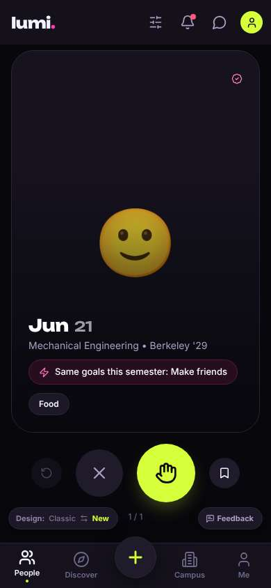</a> |
| 2 | click “Me” | `/profile` | 932 | expects: “my profile and settings, maybe language” (0.6) as expected _neutral_: “내 프로필이다. 톱니바퀴가 설정이겠지, 언어 바꿔보자.” | <a href="shots/002-click-som.jpg">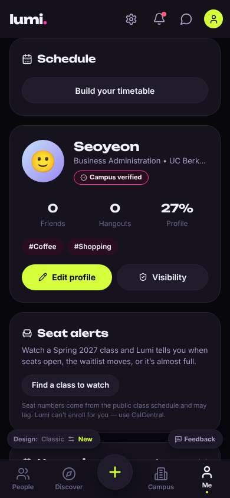</a> |
| 4 | click “Settings” | `/settings` | 881 | expects: “settings with a language option” (0.6) as expected _delighted_: “와 한국어 있다! 다행이다.” | <a href="shots/004-click-som.jpg">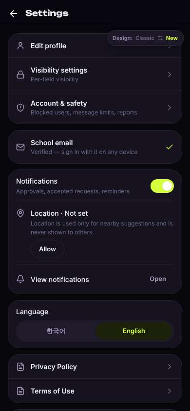</a> |
| 6 | click “한국어” | `/settings` | 1158 | expects: “app switches to Korean” (0.85) as expected _delighted_: “바로 한국어로 바뀌었어. 이제 공항 가는 차 같이 탈 사람 찾자.” | <a href="shots/006-click-som.jpg">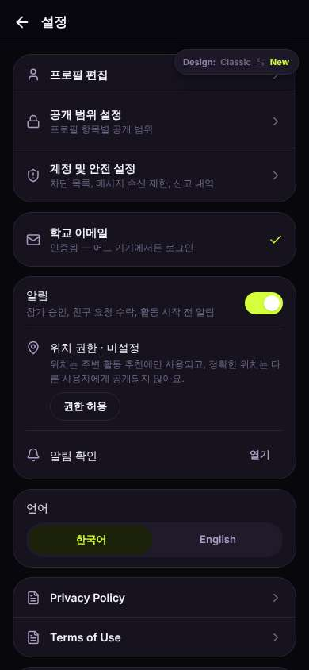</a> |
| 8 | click “뒤로” | `/profile` | 927 | expects: “back to my profile in Korean” (0.8) as expected _neutral_: “대부분 한국어인데 'Seat alerts' 부분은 영어 그대로네. 뭐 괜찮아.” → f1 | <a href="shots/008-click-som.jpg">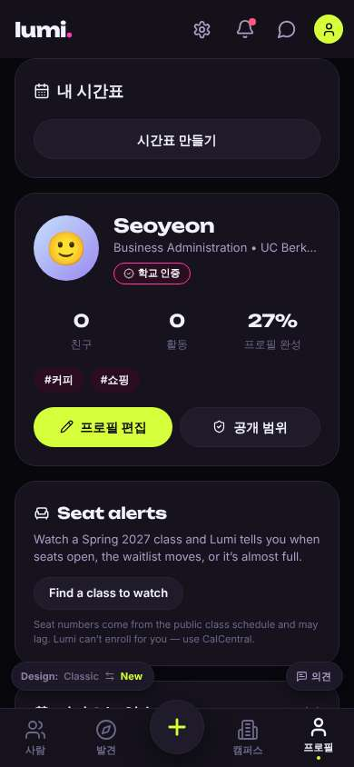</a> |
| 10 | click “발견” | `/discover` | 864 | expects: “list of activities, maybe rides or boards” (0.5) as expected _curious_: “Rides... SFO! 이거다. 'Rides'는 영어지만 SFO는 알겠어.” | <a href="shots/010-click-som.jpg">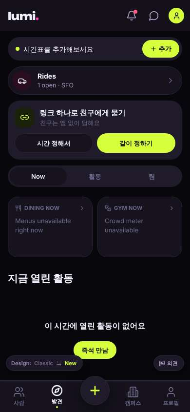</a> |
| 12 | click “Rides 1 open · SFO” | `/rides` | 865 | expects: “list of ride shares to SFO” (0.8) as expected _neutral_: “어... 한국어로 바꿨는데 여기는 전부 영어네. 천천히 읽어보니 Jun이라는 사람이 수요일 8:30에 SFO 간대. 내 날짜랑 같아!” → f2 _neutral_: “'Design: Classic New' 버튼이 'My rides' 탭 위에 겹쳐 있어서 탭 글씨가 안 보여.” → f3 | <a href="shots/012-click-som.jpg">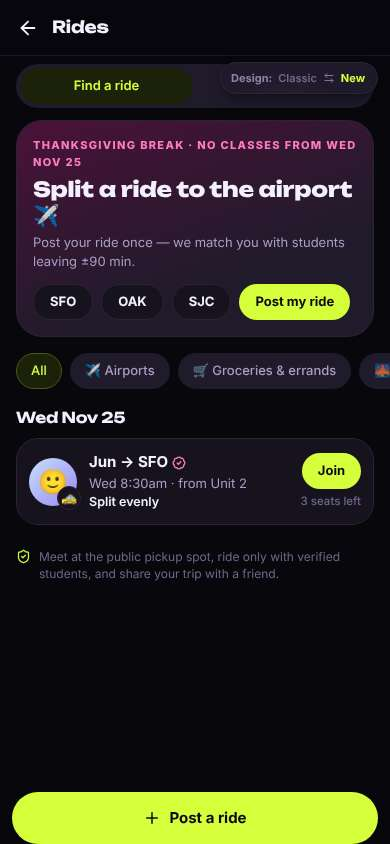</a> |
| 15 | click “🙂 🚕 Jun → SFO Wed 8:30am · from Unit 2” | `/rides/:id` | 844 | expects: “details of Jun's ride: where to meet, cost, who else” (0.6) as expected _curious_: “Jun도 오전 비행기네, 시간 비슷해. 전화번호 안 물어보고 돈은 채팅에서 나눈대. 괜찮아 보여. 근데 여전히 다 영어라 천천히 읽었어.” | <a href="shots/015-click-som.jpg">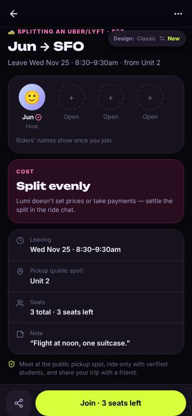</a> |
| 17 | click “Join · 3 seats left” | `/rides/:id` | 865 | expects: “I join Jun's ride and a ride chat opens or I get confirmation” (0.7) as expected _delighted_: “됐다! 'You + Jun'. 생각보다 쉬웠어. 채팅에서 인사하고 만날 장소 정하자.” | <a href="shots/017-click-som.jpg">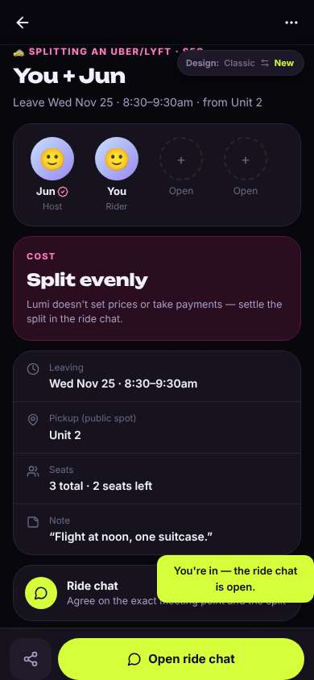</a> |
| 19 | click “Open ride chat” | `/chats/:id` | 959 | expects: “group chat with Jun opens” (0.85) as expected _neutral_: “채팅방이다. 메뉴는 한국어인데 안내 메시지는 영어. 간단히 인사할게.” | <a href="shots/019-click-som.jpg">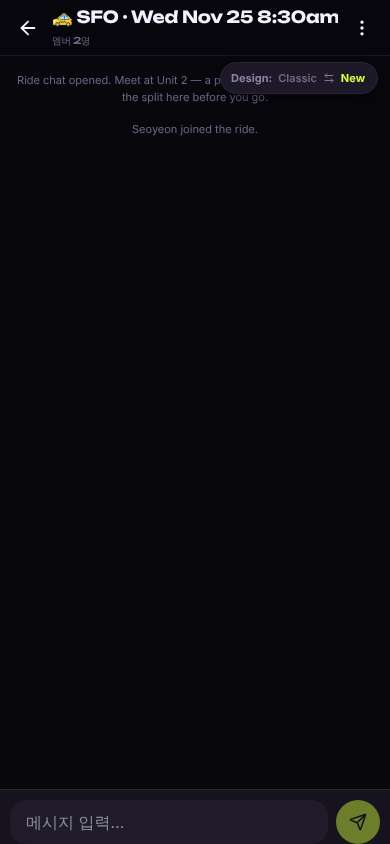</a> |
| 21 | type “메시지 입력…” ← “Hi Jun! I'm Seoyeon, flying from SFO Wed morning too. Meet at Unit 2 at 8:30?” | `/chats/:id` | 983 | expects: “message appears in chat” (0.85) as expected _delighted_: “메시지 보냈어. 이제 Jun이 답하면 돼. 에브리타임보다 오히려 편하네.” |  |
| 23 | finish | `/chats/:id` |  |  | <a href="shots/023-finish-som.jpg">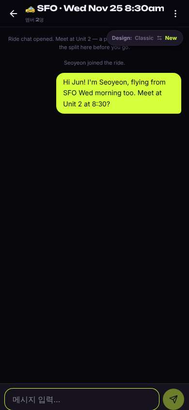</a> |

## Automatic checks (harness, not persona)

| screen | tap targets < 44px | sideways overflow | broken images |
|---|---|---|---|
| `/` | 6 (Filters 40×40, Notifications 40×40, Messages 40×40, Me 32×32, Feedback 93×32) | — | — |
| `/profile` | 6 (Notifications 40×40, Messages 40×40, Me 32×32, Find a class to watch 165×36, Feedback 93×32) | — | — |
| `/settings` | 6 (Back 40×40, Allow 69×36, Open 66×36, 한국어 156×36, English 156×36) | — | — |
| `/discover` | 12 (알림 40×40, 메시지 40×40, 프로필 32×32, 추가 76×36, 시간 정해서 161×40) | — | — |
| `/rides` | 12 (뒤로 40×40, Find a ride 173×36, My rides 173×36, SFO 60×36, OAK 63×36) | — | — |
| `/rides/:id` | 3 (뒤로 40×40, More 40×40, Switch to the classic design 158×32) | — | — |
| `/chats/:id` | 3 (뒤로 40×40, 메뉴 40×40, Switch to the classic design 158×32) | — | — |

## Timing (harness)

- Full page load (navigation timing): 279 ms, 150 ms
