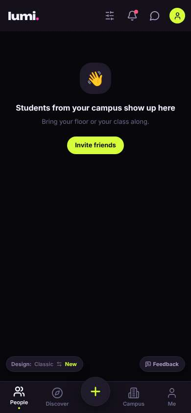
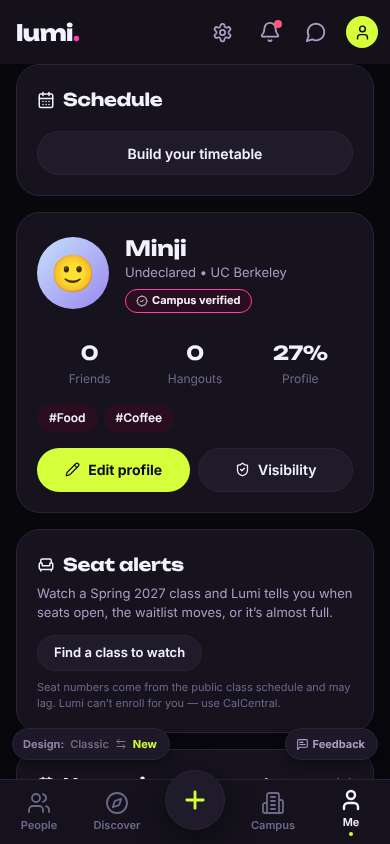
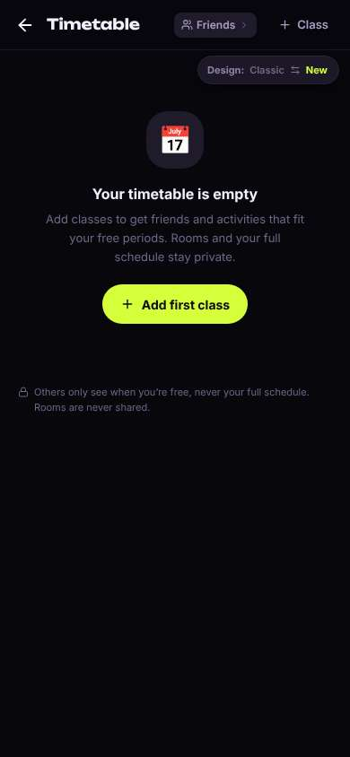
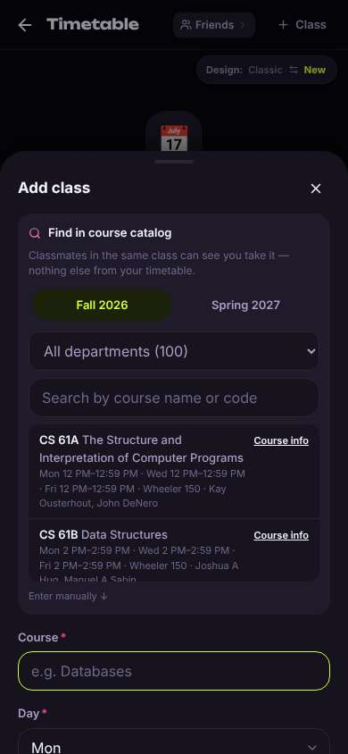
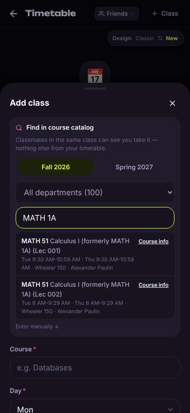
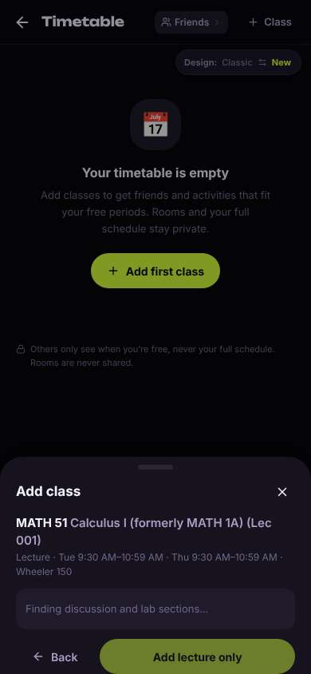
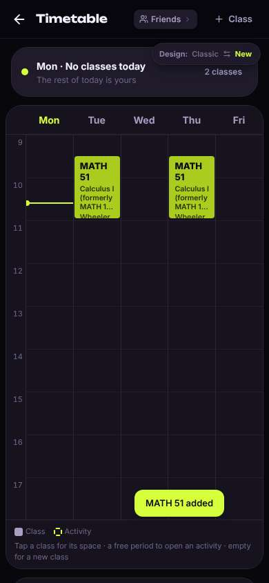
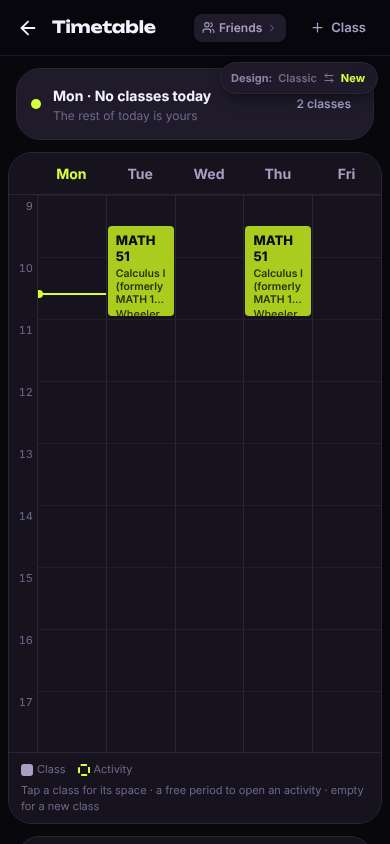

# ux-sim run `cmp1-base-timetable-add-classes-minji`

> **AI simulation — hypotheses, not measured user behaviour.** One simulated persona; nothing here is a rate or a measurement of real students.

| | |
|---|---|
| Persona | **Minji**, 17 — First-year (started college a year early) · phone 390×844 · prefers ko · tech high (`minji-freshman-17`) |
| Scenario | **Put my classes into my timetable** — You want the app to know your schedule so it can show who's free when you are. Add your calculus class — Calculus I, which you know as MATH 1A — to your timetable in the app. (`timetable-add-classes`) |
| Target | local · http://localhost:45239 · worktree commit `7af1c8ef2cfd` |
| Outcome | **success** · ended by persona |
| Account | fresh real account `minji.injila5l@berkeley.edu` (Minji, Undeclared, born 2009; sample: false) |
| Goal check (fixed, by harness) | met at step 14 after 7 action(s) — evidence: Calculus I is in my saved timetable — _The persona's own timetable (server-side) gained Calculus I (MATH 51 / MATH 1A) during the run._ |
| Persona's reason | “MATH 1A(이제 MATH 51) 화목 9:30 수업 시간표에 들어간 거 확인했어. 섹션 찾는다고 좀 오래 기다린 거 빼면 쉬웠음.” |
| Effort | 7/40 actions · objective frustration 1.00/4.5 · 1 confused note(s) · ~50s simulated |
| Drop-off risk | **medium** _(AI hypothesis, persona agent)_ — Timetable was easy and felt private, but the home People screen was empty and nothing showed anyone free when I am, so no reason yet to come back for finding meal friends. · basis: steps 0, 14 |

Known environment limits (not UX findings)

- Dining menus and RSF gym crowd levels need live campus sources (the local stack runs with CAMPUS_LIVE=0) — empty or missing data there is not a UX bug.
- AI features (Ask Lumi, AI profile draft on /start, conversation starters) need an OpenAI key; none is configured locally.
- Course catalog is the real Berkeley Class Schedule (6588 courses, Fall 2026 + Spring 2027), fetched 2026-11-02 with the worker's adapter. Seat counts and very recent changes may differ from live.
- Campus events, free food, internships, hackathons and scholarships are a read-only snapshot of live (1119 real items, 103 events this week, taken 2026-11-02 07:25 UTC) plus the CSV calendar. Nothing new appears during the run; Q&A and reviews are empty.
- No e-mail is sent: the sign-up / sign-in code is shown on screen in the hint (live sends a real e-mail).
- Real-time updates (SSE) work locally; other people never reply unless the stack was started with --autoreply.
- Signed in as a brand-new real (non-sample, e-mail-verified) account made for this run. Other students exist only if the scenario seeds peers (local fixtures); sample profiles are hidden from real accounts, as on live.

## Friction

| # | step | type | sev | persona says | screen | element | env-limited | evidence |
|---|---|---|---|---|---|---|---|---|
| f1 | 8 | Unclear wording | 1 | “MATH 51? 뭐지… 아 formerly MATH 1A 써있네 다행. 근데 Lec 001/002 두 개… 나 화목 9:30 거 맞지?” _wish: say 'same class, two time slots — pick yours'_ | `/timetable` | MATH 51 Calculus I (formerly MATH 1A) (Lec 001) Tue 9:30 AM–10:59 AM · Thu 9:30 AM–10:59 A | no | [shot](shots/008-type.jpg) [marked](shots/008-type-som.jpg) |
| f2 | 12 | Slow | 2 | “아직도 Finding…? 버튼도 회색이라 'lecture only'도 못 누름. 아 귀찮아” _wish: let me add the lecture now while it loads sections_ | `/timetable` | Add lecture only | no | [shot](shots/012-wait.jpg) [marked](shots/012-wait-som.jpg) |
| f3 | 14 | Confusing UI | 1 | “오 들어갔다! 화·목 MATH 51 보이네. 근데 나 아무것도 안 눌렀는데 혼자 추가됨? 그리고 '2 classes'… 수학 하나인데” _wish: tell me it'll add automatically if there are no sections; count it as 1 class_ | `/timetable` | MATH 51 Calculus I (formerly MATH 1A) (Lec 001) Wheeler 150 | no | [shot](shots/014-wait.jpg) [marked](shots/014-wait-som.jpg) |

Severity: 1 = Minor — noticed it, cosmetic or a small annoyance; did not slow me down. · 2 = Moderate — slowed me down or made me hesitate; I recovered on my own. · 3 = Major — real confusion, a wrong path or many extra steps; I nearly gave up or only got through by guessing. · 4 = Blocker — I could not continue, gave up, or would stop using the app here.

## Timeline

| step | what | screen | ms | signals / notes | shot |
|---|---|---|---|---|---|
| 0 | start | `/` | 2237 | _neutral_: “아무도 없네… empty. 시간표는 어디 있지? Me 아니면 Campus?” |  |
| 2 | click “Me” | `/profile` | 1108 | expects: “my profile, maybe schedule/timetable there” (0.5) as expected _delighted_: “오 바로 있네 Schedule. 좋아” |  |
| 4 | click “Build your timetable” | `/timetable` | 867 | expects: “timetable editor where I can search for a class” (0.8) as expected _neutral_: “ok 비어있고 Add first class. privacy 문구 좋네, 내 시간표 다 안 보인대” |  |
| 6 | click “Add first class” | `/timetable` | 865 | expects: “a search box to type MATH 1A” (0.7) as expected _curious_: “검색창 있다. MATH 1A 치면 되겠지” |  |
| 8 | type “Search by course name or code” ← “MATH 1A” | `/timetable` | 1124 | expects: “Calculus I / MATH 1A shows in the list” (0.75) **mismatch**: Shows MATH 51 'Calculus I (formerly MATH 1A)' — two lectures, Lec 001 and Lec 002 ⚑ mismatch _neutral_: “MATH 51? 뭐지… 아 formerly MATH 1A 써있네 다행. 근데 Lec 001/002 두 개… 나 화목 9:30 거 맞지?” → f1 |  |
| 10 | click “MATH 51 Calculus I (formerly MATH 1A) (L” | `/timetable` | 7416 | expects: “MATH 51 Lec 001 gets added to my timetable (or fills the form)” (0.6) **mismatch**: Not added yet — sheet says 'Finding discussion and lab sections…', Add button greyed out, took a while ⚑ mismatch _neutral_: “아 섹션 찾는 중… 좀 느리네. discussion 섹션도 고르라는 건가” |  |
| 12 | wait | `/timetable` | 9338 | _frustrated_: “아직도 Finding…? 버튼도 회색이라 'lecture only'도 못 누름. 아 귀찮아” → f2 |  |
| 14 | wait | `/timetable` | 6419 | _delighted_: “오 들어갔다! 화·목 MATH 51 보이네. 근데 나 아무것도 안 눌렀는데 혼자 추가됨? 그리고 '2 classes'… 수학 하나인데” → f3 |  |
| 16 | finish | `/timetable` |  |  |  |

## Automatic checks (harness, not persona)

| screen | tap targets < 44px | sideways overflow | broken images |
|---|---|---|---|
| `/` | 7 (Filters 40×40, Notifications 40×40, Messages 40×40, Me 32×32, Invite friends 116×36) | — | — |
| `/profile` | 6 (Notifications 40×40, Messages 40×40, Me 32×32, Find a class to watch 165×36, Feedback 93×32) | — | — |
| `/timetable` | 7 (Back 40×40, Friends 92×28, Class 88×36, Switch to the classic design 158×32) | — | — |

## Timing (harness)

- Full page load (navigation timing): 452 ms
- Step 10 `click` took 7416 ms until the network was quiet on `/timetable`
- Step 12 `wait` took 9338 ms until the network was quiet on `/timetable`
- Step 14 `wait` took 6419 ms until the network was quiet on `/timetable`
