# ux-sim run `cmp1-fix-cold-start-hangout-minji`

> **AI simulation — hypotheses, not measured user behaviour.** One simulated persona; nothing here is a rate or a measurement of real students.

| | |
|---|---|
| Persona | **Minji**, 17 — First-year (started college a year early) · phone 390×844 · prefers ko · tech high (`minji-freshman-17`) |
| Scenario | **Brand-new account: find someone on campus to hang out with this week** — You just heard about this app and want someone on campus to hang out with this week. Make an account with your school e-mail, then use the app to find a person or plan you could join this week and tell them you're in. (`cold-start-hangout`) |
| Target | local · http://localhost:36665 · worktree commit `1a1a69501453` |
| Outcome | **success** · ended by persona |
| Account | signed out at start |
| Goal check (fixed, by harness) | met at step 39 after 26 action(s) — evidence: the account the browser is signed in to was created during this run; posted a plan — _Signed up during the run AND, as that new account, joined/requested a plan, hosted one, sent a friend request or sent a chat message._ |
| Persona's reason | “Made my account with berkeley email and said I'm in for MUSIC IN MLK Thursday noon, left a hi in the group chat. But it's only me going — no actual person yet.” |
| Effort | 28/40 actions · objective frustration 3.50/4.5 · 2 confused note(s) · ~68s simulated |
| Drop-off risk | **medium** _(AI hypothesis, persona agent)_ — Sign-up was 9 steps of quizzes before email, and the People tab had zero people — just events. If nobody joins my Thursday plan or shows up from my dorm/year in a day or two, I'd stop opening it. · basis: steps 8, 17, 36, 39, 41 |

Known environment limits (not UX findings)

- Dining menus and RSF gym crowd levels need live campus sources (the local stack runs with CAMPUS_LIVE=0) — empty or missing data there is not a UX bug.
- AI features (Ask Lumi, AI profile draft on /start, conversation starters) need an OpenAI key; none is configured locally.
- Course catalog is the real Berkeley Class Schedule (6588 courses, Fall 2026 + Spring 2027), fetched 2026-11-02 with the worker's adapter. Seat counts and very recent changes may differ from live.
- Campus events, free food, internships, hackathons and scholarships are a read-only snapshot of live (1119 real items, 103 events this week, taken 2026-11-02 07:25 UTC) plus the CSV calendar. Nothing new appears during the run; Q&A and reviews are empty.
- No e-mail is sent: the sign-up / sign-in code is shown on screen in the hint (live sends a real e-mail).
- Real-time updates (SSE) work locally; other people never reply unless the stack was started with --autoreply.

## Friction

| # | step | type | sev | persona says | screen | element | env-limited | evidence |
|---|---|---|---|---|---|---|---|---|
| f1 | 2 | Onboarding friction | 1 | “school pick, ok easy. but 1/7?? 7 steps... 아 귀찮아 a bit” _wish: fewer steps, or tell me why 7_ | `/start` |  | no | [shot](shots/002-click.jpg) [marked](shots/002-click-som.jpg) |
| f2 | 8 | Onboarding friction | 2 | “뭐지, it was 7 steps and now 9?? the more I pick the longer it gets... still no email yet” _wish: don't grow the step count, or say why_ | `/start` |  | no | [shot](shots/008-click.jpg) [marked](shots/008-click-som.jpg) |
| f3 | 16 | Onboarding friction | 2 | “아 귀찮아... friday night quiz? I just wanna find someone to eat with. skip” _wish: let me see people first, ask this later_ | `/start` | Skip | no | [shot](shots/016-click.jpg) [marked](shots/016-click-som.jpg) |
| f4 | 18 | Onboarding friction | 1 | “ok this one is useful at least. new friends. but I already said 'make new friends' on step 2...” _wish: don't ask the same thing twice_ | `/start` |  | no | [shot](shots/018-click.jpg) [marked](shots/018-click-som.jpg) |
| f5 | 36 | Missing / empty content | 3 | “뭐지... it says People but it's all events. where are the people? nobody's here?” _wish: show me at least a few people or open plans this week_ | `/` | People | no | [shot](shots/036-click.jpg) [marked](shots/036-click-som.jpg) |
| f6 | 39 | Missing / empty content | 2 | “ok I'm in for thursday lunch music. but 'together' with... just me? ㅋㅋ 좀 쓸쓸하다. hope someone joins” _wish: show me someone else going, or someone from my dorm/year_ | `/` | 🐱 You going | no | [shot](shots/039-click.jpg) [marked](shots/039-click-som.jpg) |

Severity: 1 = Minor — noticed it, cosmetic or a small annoyance; did not slow me down. · 2 = Moderate — slowed me down or made me hesitate; I recovered on my own. · 3 = Major — real confusion, a wrong path or many extra steps; I nearly gave up or only got through by guessing. · 4 = Blocker — I could not continue, gave up, or would stop using the app here.

## Timeline

| step | what | screen | ms | signals / notes | shot |
|---|---|---|---|---|---|
| 0 | start | `/welcome` | 3027 | _curious_: “오 'Find someone for lunch' — 딱 내가 원하는 거. no big face photos, good.” | <a href="shots/000-start-som.jpg">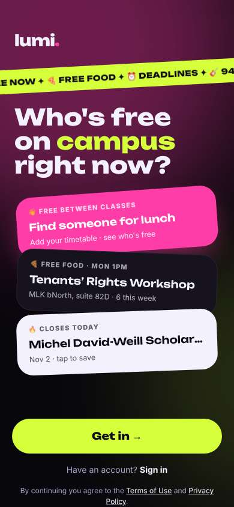</a> |
| 2 | click “Get in →” | `/start` | 1432 | expects: “sign-up screen asking for school email” (0.7) **mismatch**: asks which school first, step 1 of 7 ⚑ mismatch _neutral_: “school pick, ok easy. but 1/7?? 7 steps... 아 귀찮아 a bit” → f1 | <a href="shots/002-click-som.jpg">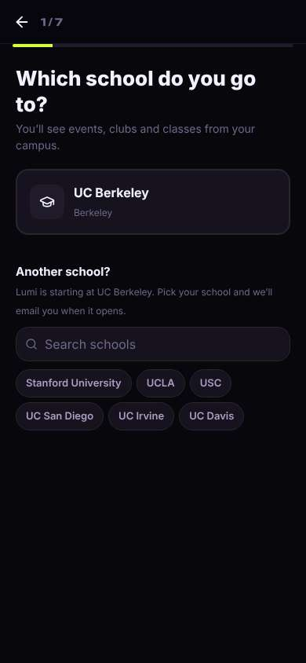</a> |
| 4 | click “UC Berkeley Berkeley” | `/start` | 917 | expects: “next step, probably email” (0.6) **mismatch**: goals picker instead of email ⚑ mismatch _delighted_: “'Never eat alone' ㅋㅋ that's literally me. ok this is fine, quick taps” | <a href="shots/004-click-som.jpg">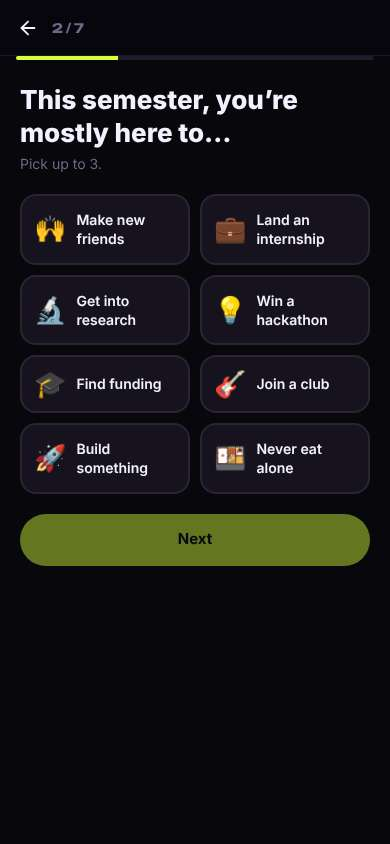</a> |
| 6 | click “🍱 Never eat alone” | `/start` | 897 |  | <a href="shots/006-click-som.jpg">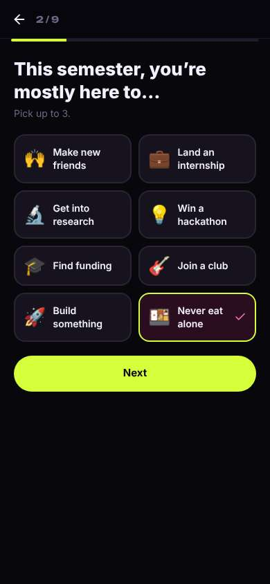</a> |
| 7 | click “🙌 Make new friends” | `/start` | 838 |  | <a href="shots/007-click-som.jpg">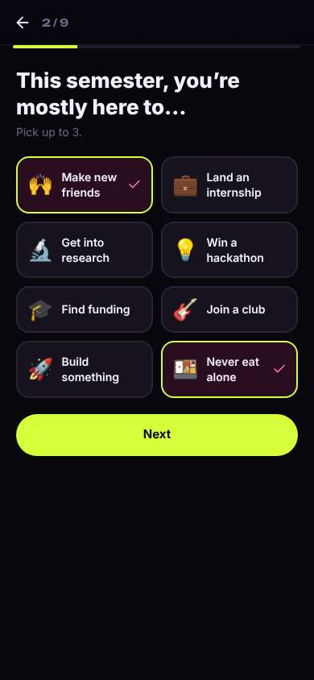</a> |
| 8 | click “Next” | `/start` | 856 | expects: “step 3” (0.8) as expected _confused_: “뭐지, it was 7 steps and now 9?? the more I pick the longer it gets... still no email yet” → f2 | <a href="shots/008-click-som.jpg">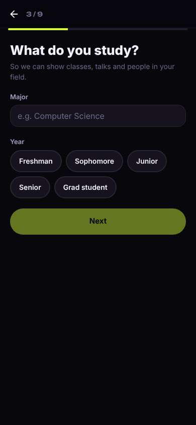</a> |
| 10 | type “e.g. Computer Science” ← “Undeclared” | `/start` | 890 |  | <a href="shots/010-type-som.jpg">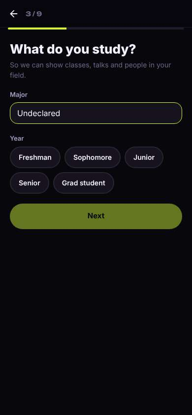</a> |
| 11 | click “Freshman” | `/start` | 862 |  | <a href="shots/011-click-som.jpg">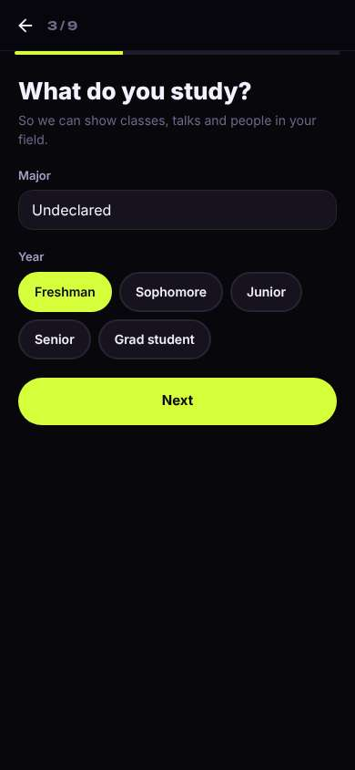</a> |
| 12 | click “Next” | `/start` | 863 | expects: “email finally” (0.4) **mismatch**: hobbies screen, step 4/9, still no email ⚑ mismatch _neutral_: “'shows on your card'... what card, like a profile card? a little tinder-ish but it's just emoji chips so ok. at least it says optional” | <a href="shots/012-click-som.jpg">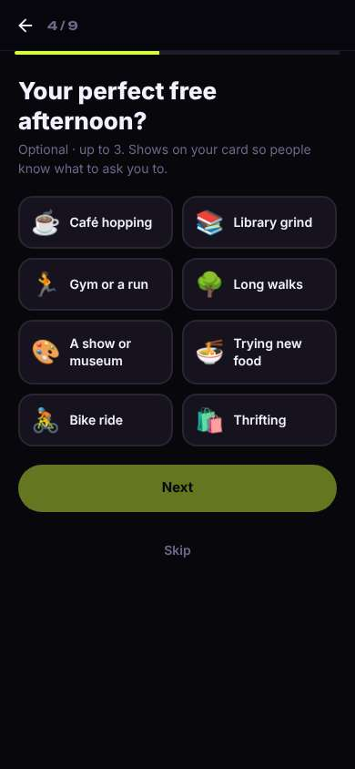</a> |
| 14 | click “🍜 Trying new food” | `/start` | 943 |  | <a href="shots/014-click-som.jpg">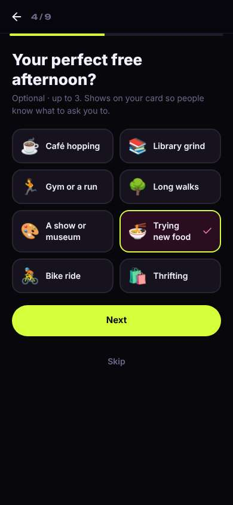</a> |
| 15 | click “☕ Café hopping” | `/start` | 860 |  | <a href="shots/015-click-som.jpg">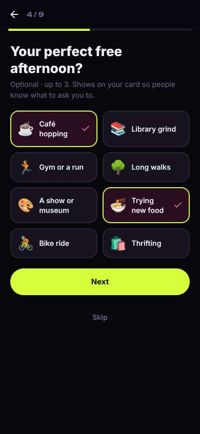</a> |
| 16 | click “Next” | `/start` | 853 | expects: “next onboarding step” (0.7) as expected _bored_: “아 귀찮아... friday night quiz? I just wanna find someone to eat with. skip” → f3 | <a href="shots/016-click-som.jpg">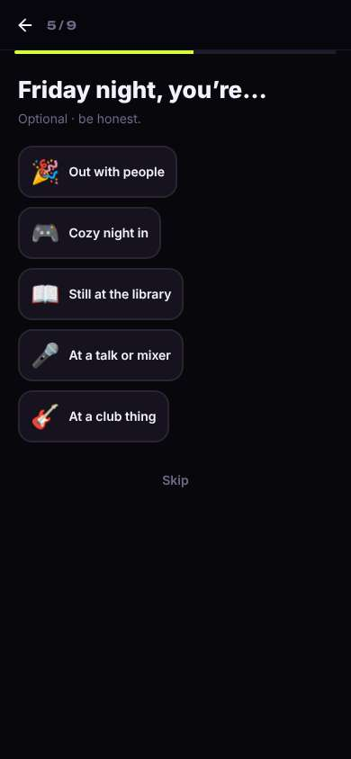</a> |
| 18 | click “Skip” | `/start` | 848 | expects: “next step, hopefully email” (0.5) **mismatch**: who'd you love to meet, 6/9, still no email ⚑ mismatch _neutral_: “ok this one is useful at least. new friends. but I already said 'make new friends' on step 2...” → f4 | <a href="shots/018-click-som.jpg">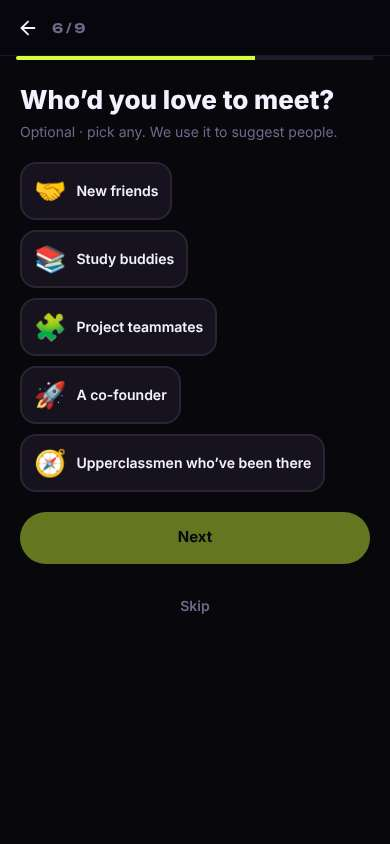</a> |
| 20 | click “🤝 New friends” | `/start` | 852 |  | <a href="shots/020-click-som.jpg">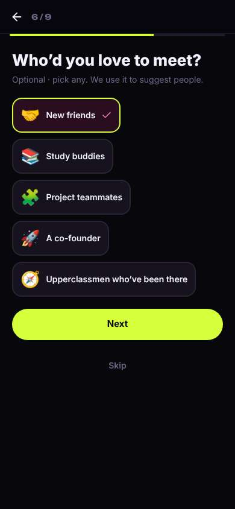</a> |
| 21 | click “Next” | `/start` | 869 | expects: “step 7” (0.7) **mismatch**: auto-made profile card with emoji avatar, 7/9 ⚑ mismatch _delighted_: “오 emoji avatar, no face photo 👍 it wrote my bio for me. 'Freshman in Undeclared' sounds weird lol but whatever” | <a href="shots/021-click-som.jpg">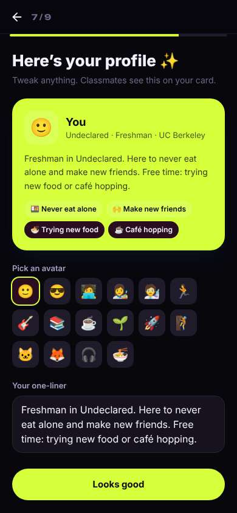</a> |
| 23 | click “🐱” | `/start` | 863 |  | <a href="shots/023-click-som.jpg">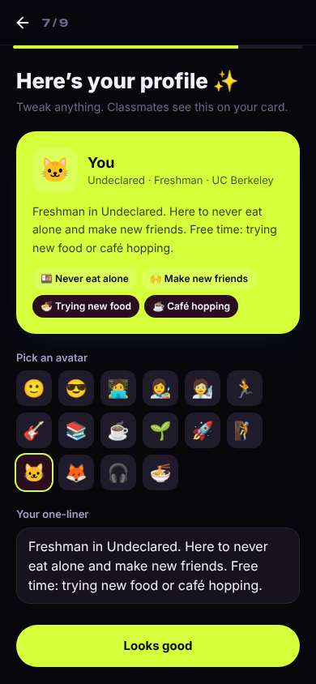</a> |
| 24 | click “Looks good” | `/start` | 834 | expects: “email sign up now” (0.6) **mismatch**: name + birth year, 8/9 ⚑ mismatch _neutral_: “birth year... I'm 17, will people see? oh 'only you see this' — ok 다행이다. good they say that” | <a href="shots/024-click-som.jpg">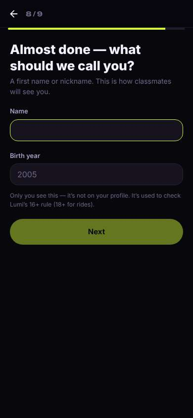</a> |
| 26 | type [66] ← “Minji” | `/start` | 864 |  | <a href="shots/026-type-som.jpg">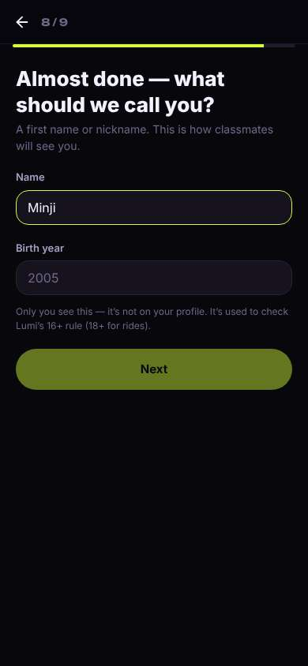</a> |
| 27 | type “2005” ← “2009” | `/start` | 866 |  | <a href="shots/027-type-som.jpg">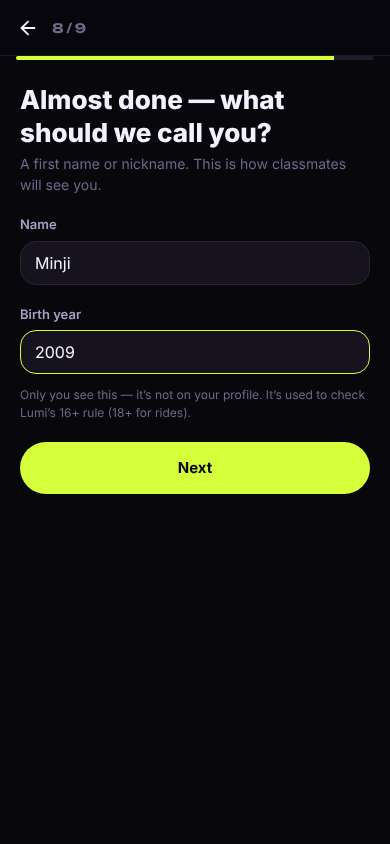</a> |
| 28 | click “Next” | `/start` | 844 | expects: “email verification, last step” (0.7) as expected _neutral_: “finally email. ok berkeley email, code, done” | <a href="shots/028-click-som.jpg">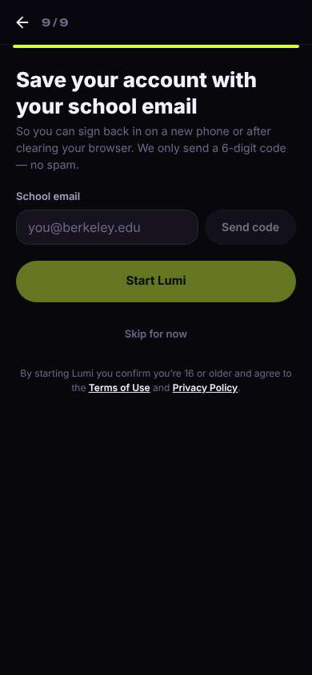</a> |
| 30 | type “you@berkeley.edu” ← “minji.kim@berkeley.edu” | `/start` | 904 |  | <a href="shots/030-type-som.jpg">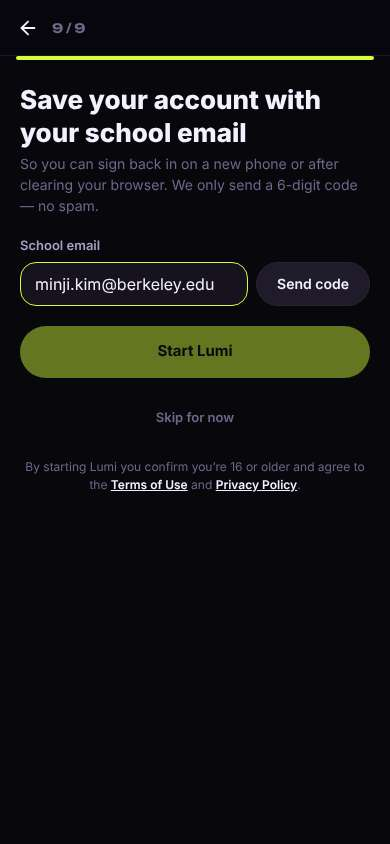</a> |
| 31 | click “Send code” | `/start` | 861 | expects: “code is sent, a box to type it appears” (0.8) as expected _neutral_: “ok code box. type it” | <a href="shots/031-click-som.jpg">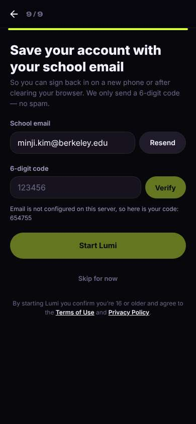</a> |
| 33 | type “123456” ← “654755” | `/start` | 890 |  | <a href="shots/033-type-som.jpg">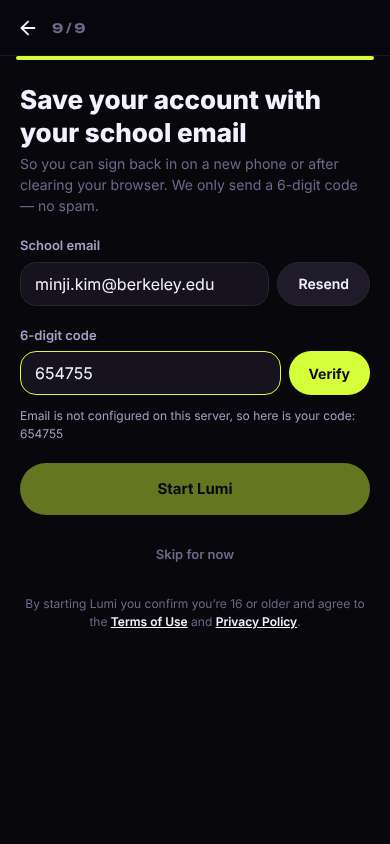</a> |
| 34 | click “Verify” | `/start` | 867 | expects: “verified, Start Lumi unlocks” (0.8) as expected _delighted_: “school badge 좋다 — means people are actually berkeley, not randoms” | <a href="shots/034-click-som.jpg">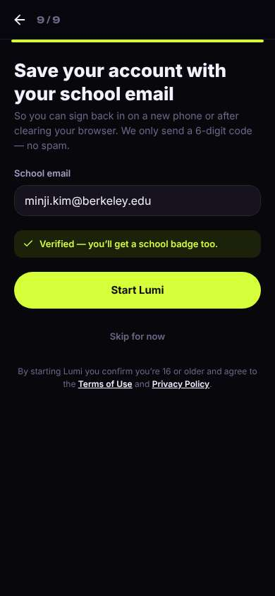</a> |
| 36 | click “Start Lumi” | `/` | 1148 | expects: “home feed with people free / lunch plans” (0.6) **mismatch**: tab is called People but it's a list of events; no people, 'classmates show up here as they join' ⚑ mismatch _confused_: “뭐지... it says People but it's all events. where are the people? nobody's here?” → f5 | <a href="shots/036-click-som.jpg">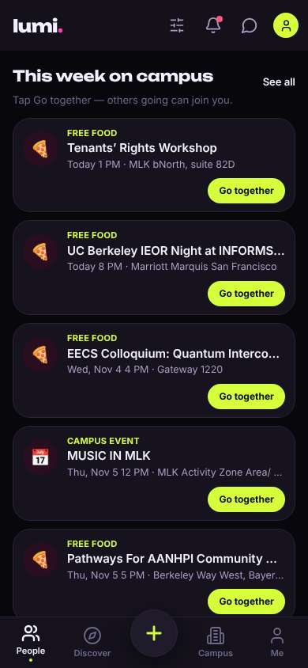</a> |
| 38 | scroll down | `/` | 1328 |  | <a href="shots/038-scroll-som.jpg">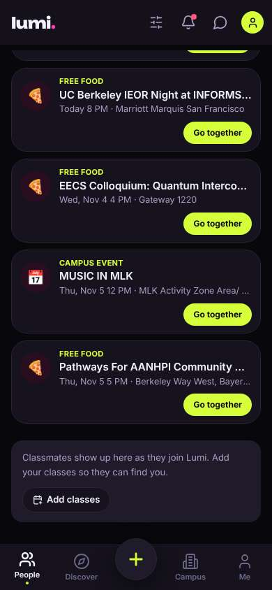</a> |
| 39 | click “Go together” | `/` | 961 | expects: “I mark I'm going to Music in MLK Thursday noon and others can join me, maybe a group chat” (0.5) as expected _neutral_: “ok I'm in for thursday lunch music. but 'together' with... just me? ㅋㅋ 좀 쓸쓸하다. hope someone joins” → f6 | <a href="shots/039-click-som.jpg">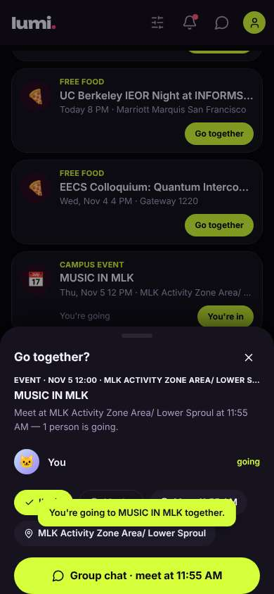</a> |
| 41 | click “Group chat · meet at 11:55 AM” | `/chats/:id` | 868 | expects: “group chat for Music in MLK, probably empty except me” (0.6) as expected _neutral_: “yep just me. I'll leave a hi so whoever joins sees it” | <a href="shots/041-click-som.jpg">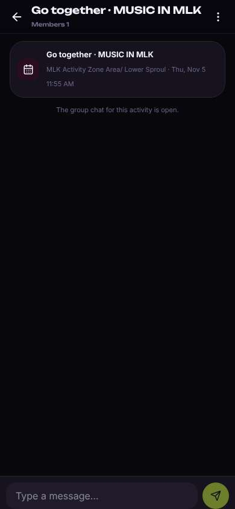</a> |
| 43 | type “Type a message…” ← “hi! I'm in for thursday 🙂 anyone wanna grab lunch after?” | `/chats/:id` | 888 | expects: “message posts in the chat” (0.8) as expected _neutral_: “posted. talking to nobody rn but ok, I'm in for thursday. that's what I came for I guess” | <a href="shots/043-type-som.jpg">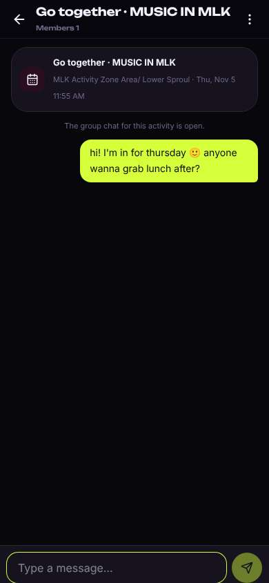</a> |
| 45 | finish | `/chats/:id` |  |  |  |

## Automatic checks (harness, not persona)

| screen | tap targets < 44px | sideways overflow | broken images |
|---|---|---|---|
| `/welcome` | 3 (Sign in 46×21, Terms of Use 76×15, Privacy Policy 180×33) | — | — |
| `/start` | 7 (Back 40×40, Stanford University 148×36, UCLA 62×36, USC 54×36, UC San Diego 112×36) | — | — |
| `/` | 10 (Filters 40×40, Notifications 40×40, Messages 40×40, Me 32×32, See all 41×20) | — | — |
| `/chats/:id` | 2 (Back 40×40, Menu 40×40) | — | — |

## Timing (harness)

- Full page load (navigation timing): 1053 ms
- Step 0 `start` took 3027 ms until the network was quiet on `/welcome`
