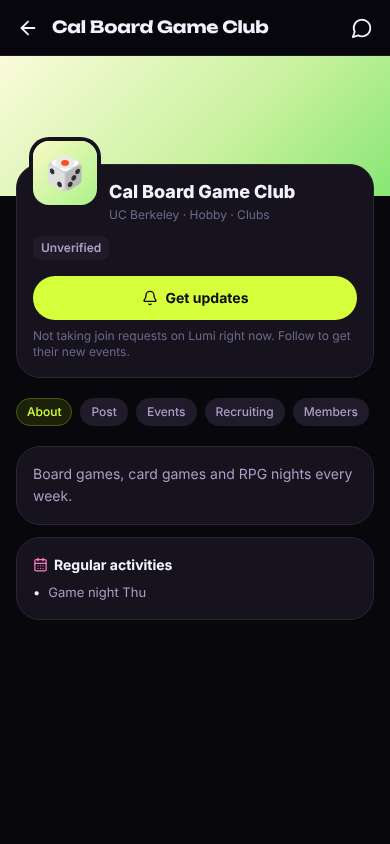
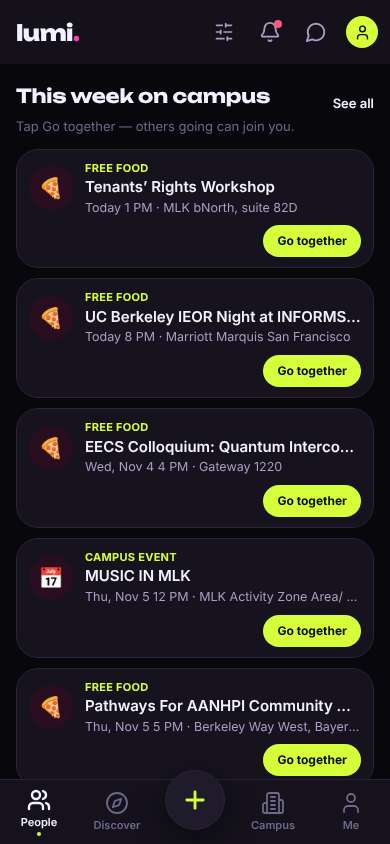
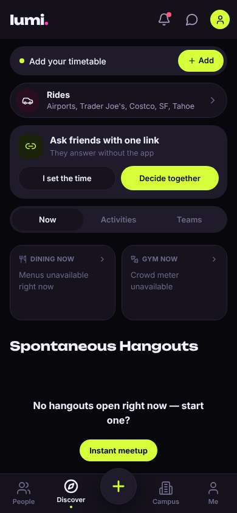
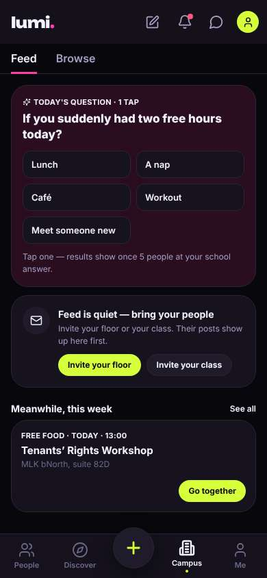
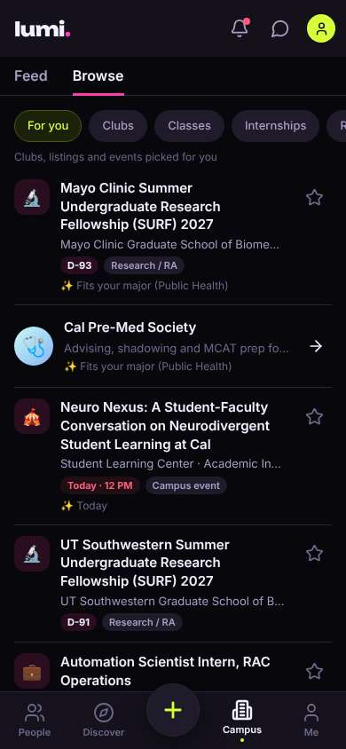
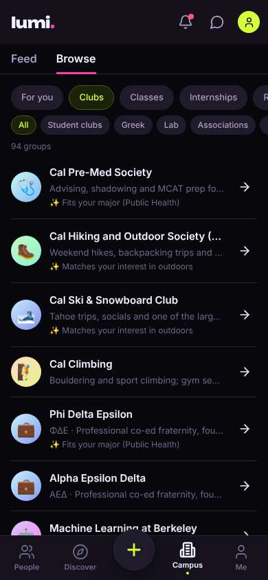
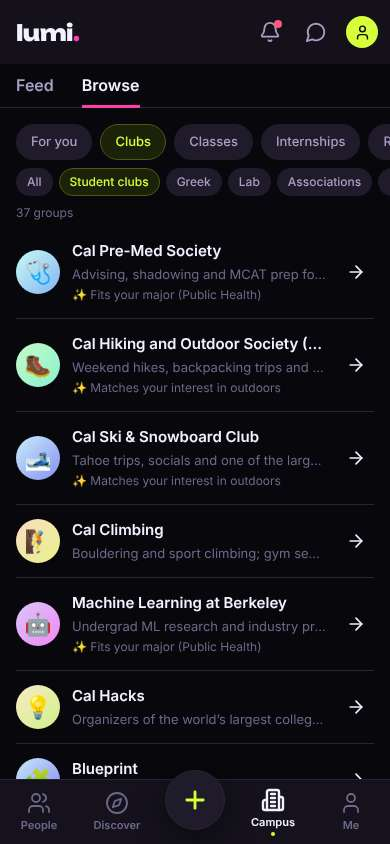
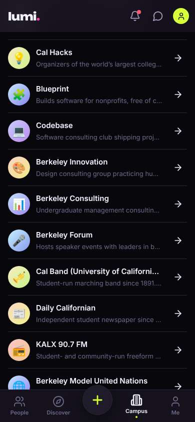
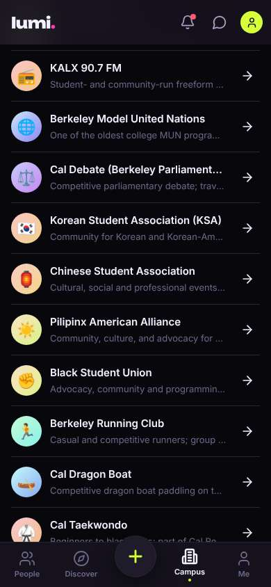
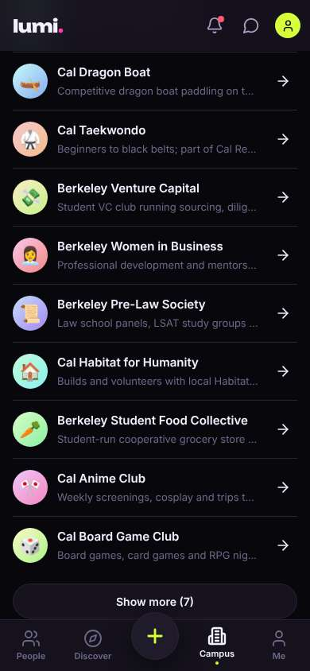

# ux-sim run `cmp1-fix-find-a-club-aisha`

> **AI simulation — hypotheses, not measured user behaviour.** One simulated persona; nothing here is a rate or a measurement of real students.

| | |
|---|---|
| Persona | **Aisha**, 18 — First-year (first in her family to go to college) · phone 390×844 · prefers en · tech medium (`aisha-firstgen-anxious`) |
| Scenario | **Find a club I'd actually like** — You want to find one student club or group you'd actually enjoy and feel welcome in. Use the app to find one that fits you and open its page to see how to join. (`find-a-club`) |
| Target | local · http://localhost:46365 · worktree commit `1a1a69501453` |
| Outcome | **abandoned** · ended by persona |
| Account | fresh real account `aisha.ishal8r3@berkeley.edu` (Aisha, Public Health, born 2008; sample: false) |
| Goal check (fixed, by harness) | met at step 16 after 9 action(s) — evidence: {"urlMatches":"^/orgs/[^/?]+"} — _A club / organization page is open (reached by the persona — the run starts on /)._ |
| Patience | exhausted at step 17; 0 action(s) after |
| ⚠ unnoticed success | The check passed but the persona did not realise it had succeeded. |
| Persona's reason | “I finally found a club that felt like me (Board Game Club, game night Thursday), but the page says it's 'not taking join requests on Lumi' and 'Unverified', so I still don't know if I'm allowed to just go or how to join. I don't want to do it wrong, so I'll stop here and maybe ask someone in person.” |
| Effort | 9/50 actions · objective frustration 1.50/6 · 4 confused note(s) · ~234s simulated |
| Drop-off risk | **medium** _(AI hypothesis, persona agent)_ — The club list itself was good and had friendly options, but it took three tabs to find it, nothing says which clubs are open vs application-only, and the one page I opened didn't answer 'how do I join'. She might come back for the list, but won't trust it to tell her the rules. · basis: steps 4, 14, 17 |

Known environment limits (not UX findings)

- Dining menus and RSF gym crowd levels need live campus sources (the local stack runs with CAMPUS_LIVE=0) — empty or missing data there is not a UX bug.
- AI features (Ask Lumi, AI profile draft on /start, conversation starters) need an OpenAI key; none is configured locally.
- Course catalog is the real Berkeley Class Schedule (6588 courses, Fall 2026 + Spring 2027), fetched 2026-11-02 with the worker's adapter. Seat counts and very recent changes may differ from live.
- Campus events, free food, internships, hackathons and scholarships are a read-only snapshot of live (1119 real items, 103 events this week, taken 2026-11-02 07:25 UTC) plus the CSV calendar. Nothing new appears during the run; Q&A and reviews are empty.
- No e-mail is sent: the sign-up / sign-in code is shown on screen in the hint (live sends a real e-mail).
- Real-time updates (SSE) work locally; other people never reply unless the stack was started with --autoreply.
- Signed in as a brand-new real (non-sample, e-mail-verified) account made for this run. Other students exist only if the scenario seeds peers (local fixtures); sample profiles are hidden from real accounts, as on live.

## Friction

| # | step | type | sev | persona says | screen | element | env-limited | evidence |
|---|---|---|---|---|---|---|---|---|
| f1 | 0 | Confusing UI | 1 | “These are all events, not clubs. And 'Go together' — wait, would tapping that tell people I'm going? I don't want to accidentally sign up for something. I'll look for clubs somewhere else.” _wish: say what Go together actually does before I tap it_ | `/` | Go together | no | [shot](shots/000-start.jpg) [marked](shots/000-start-som.jpg) |
| f2 | 2 | Hard to find | 2 | “Hmm, 'Teams' — is that sports teams? Or like study teams? I don't see the word 'club' anywhere. Maybe 'Campus' is where student orgs live.” _wish: a clear 'Clubs' entry_ | `/discover` | Teams | no | [shot](shots/002-click.jpg) [marked](shots/002-click-som.jpg) |
| f3 | 4 | Hard to find | 2 | “Wait, this is like a posting feed. No clubs here either. There's a 'Browse' tab at the top though — maybe that's where the groups are?” _wish: Campus tab to show clubs/orgs up front_ | `/community` | Campus | no | [shot](shots/004-click.jpg) [marked](shots/004-click-som.jpg) |
| f4 | 8 | Trust / privacy worry | 1 | “Okay this is what I wanted. Hiking club sounds friendly. But wait — 'Matches your interest in outdoors'? I never told it I like the outdoors. Where did it get that? Also there are tons of sororities mixed in; I'll narrow to 'Student clubs'.” _wish: tell me why it thinks I like outdoors / let me set interests_ | `/community?tab=opportunities` | 🥾 Cal Hiking and Outdoor Society (CHAOS) Weekend hikes, backpacking trips and gear rental | no | [shot](shots/008-click.jpg) [marked](shots/008-click-som.jpg) |
| f5 | 10 | Confusing UI | 1 | “Good. But wait — 'Machine Learning at Berkeley — Fits your major (Public Health)'? That doesn't make sense, it's an ML club. Makes me trust the 'fits you' tags less. Let me scroll and actually read the list.” _wish: only say 'fits your major' when it actually does_ | `/community?tab=opportunities` | 🤖 Machine Learning at Berkeley Undergrad ML research and industry projects; runs an intro | no | [shot](shots/010-click.jpg) [marked](shots/010-click-som.jpg) |
| f6 | 13 | Missing / empty content | 2 | “Wait, how do I know which of these I can just show up to and which ones you have to apply for? Consulting, Codebase, Venture Capital sound like the scary application ones, but nothing in the list actually says. I'm guessing from the descriptions.” _wish: a tag like 'open to all / no application' vs 'applications required' on each card_ | `/community?tab=opportunities` | 📊 Berkeley Consulting Undergraduate management consulting for Bay Area companies and nonp | no | [shot](shots/013-scroll.jpg) [marked](shots/013-scroll-som.jpg) |
| f7 | 16 | Confusing UI | 3 | “Wait, does 'not taking join requests on Lumi' mean they aren't accepting new people at all, or just that I join some other way? And 'Unverified' — is this even the real club? It doesn't tell me if I can just show up to game night Thursday, or where.” _wish: tell me plainly how to join: e.g. 'Open to everyone — just show up Thu 7pm at X' or a link to their real sign-up_ | `/orgs/:id` | Get updates | no | [shot](shots/016-click.jpg) [marked](shots/016-click-som.jpg) |

Severity: 1 = Minor — noticed it, cosmetic or a small annoyance; did not slow me down. · 2 = Moderate — slowed me down or made me hesitate; I recovered on my own. · 3 = Major — real confusion, a wrong path or many extra steps; I nearly gave up or only got through by guessing. · 4 = Blocker — I could not continue, gave up, or would stop using the app here.

## Where it ended

Step 16 on `/orgs/:id`.

## Timeline

| step | what | screen | ms | signals / notes | shot |
|---|---|---|---|---|---|
| 0 | start | `/` | 1757 | _neutral_: “These are all events, not clubs. And 'Go together' — wait, would tapping that tell people I'm going? I don't want to accidentally sign up for something. I'll look for clubs somewhere else.” → f1 |  |
| 2 | click “Discover” | `/discover` | 923 | expects: “a page to browse things like clubs and groups” (0.5) **mismatch**: Discover is rides, hangouts, dining and gym — no clubs that I can see. There's 'Activities' and 'Teams' tabs but not sure if those are clubs. ⚑ mismatch _confused_: “Hmm, 'Teams' — is that sports teams? Or like study teams? I don't see the word 'club' anywhere. Maybe 'Campus' is where student orgs live.” → f2 |  |
| 4 | click “Campus” | `/community` | 848 | expects: “campus stuff — maybe a list of clubs and organizations” (0.55) **mismatch**: Campus is a social feed with a poll and invite buttons, not a list of clubs ⚑ mismatch _confused_: “Wait, this is like a posting feed. No clubs here either. There's a 'Browse' tab at the top though — maybe that's where the groups are?” → f3 |  |
| 6 | click “Browse” | `/community?tab=opportunities` | 1975 | expects: “a browsable list of groups or clubs” (0.5) as expected _curious_: “Oh, finally — there's a 'Clubs' tab. It took me three tries to find it though, it's hidden under Campus > Browse. The 'For you' list is mostly internships, which feels very résumé-y, not what I want.” |  |
| 8 | click “Clubs” | `/community?tab=opportunities` | 857 | expects: “a list of only clubs” (0.8) as expected _curious_: “Okay this is what I wanted. Hiking club sounds friendly. But wait — 'Matches your interest in outdoors'? I never told it I like the outdoors. Where did it get that? Also there are tons of sororities mixed in; I'll narrow to 'Student clubs'.” → f4 |  |
| 10 | click “Student clubs” | `/community?tab=opportunities` | 846 | expects: “only regular student clubs, no Greek life” (0.75) as expected _neutral_: “Good. But wait — 'Machine Learning at Berkeley — Fits your major (Public Health)'? That doesn't make sense, it's an ML club. Makes me trust the 'fits you' tags less. Let me scroll and actually read the list.” → f5 |  |
| 12 | scroll down | `/community?tab=opportunities` | 1327 |  |  |
| 13 | scroll down | `/community?tab=opportunities` | 1316 | _confused_: “Wait, how do I know which of these I can just show up to and which ones you have to apply for? Consulting, Codebase, Venture Capital sound like the scary application ones, but nothing in the list actually says. I'm guessing from the descriptions.” → f6 |  |
| 15 | scroll down | `/community?tab=opportunities` | 1317 |  |  |
| 16 | click “🎲 Cal Board Game Club Board games, card” | `/orgs/:id` | 847 | expects: “the Board Game Club page with when they meet and how to join — hopefully no application” (0.65) **mismatch**: Club page opened with 'Game night Thu', but it says 'Not taking join requests on Lumi right now' and 'Unverified'; the only button is 'Get updates' ⚑ mismatch _confused_: “Wait, does 'not taking join requests on Lumi' mean they aren't accepting new people at all, or just that I join some other way? And 'Unverified' — is this even the real club? It doesn't tell me if I can just show up to game night Thursday, or where.” → f7 |  |
| 18 | finish | `/orgs/:id` |  |  |  |

## Automatic checks (harness, not persona)

| screen | tap targets < 44px | sideways overflow | broken images |
|---|---|---|---|
| `/` | 10 (Filters 40×40, Notifications 40×40, Messages 40×40, Me 32×32, See all 41×20) | — | — |
| `/discover` | 10 (Notifications 40×40, Messages 40×40, Me 32×32, Add 75×36, I set the time 161×40) | — | — |
| `/community` | 13 (Notifications 40×40, Messages 40×40, Me 32×32, Feed 38×44, Lunch 158×40) | — | — |
| `/community?tab=opportunities` | 15 (Notifications 40×40, Messages 40×40, Me 32×32, Feed 38×44, For you 76×36) | — | — |
| `/orgs/:id` | 7 (Back 40×40, Messages 40×40, About 56×28, Post 47×28, Events 61×28) | — | — |

## Timing (harness)

- Full page load (navigation timing): 605 ms
