# ux-sim run `cmp1-fix-first-open-decide-marcus`

> **AI simulation — hypotheses, not measured user behaviour.** One simulated persona; nothing here is a rate or a measurement of real students.

| | |
|---|---|
| Persona | **Marcus**, 22 — Senior · phone 390×844 · prefers en · tech low (`marcus-senior-lowtech`) |
| Scenario | **First open: what is this app, and is it worth signing up?** — A friend sent you a link to this app. You have never seen it before. Figure out what it is for, and decide whether you want to make an account. If it seems worth it, sign up with your school e-mail. (`first-open-decide`) |
| Target | local · http://localhost:42653 · worktree commit `1a1a69501453` |
| Outcome | **abandoned** · ended by persona |
| Account | signed out at start |
| Goal check (fixed, by harness) | met at step 22 after 13 action(s) — evidence: the account the browser is signed in to was created during this run; {"urlMatches":"^/(discover\|community\|profile)?(\\?.*)?$"} — _Signed up during the run (a new account exists and the browser is signed in to it) and landed inside the app (signed-in home or a main tab)._ |
| Patience | exhausted at step 25; 1 action(s) after — **overrodePatience** |
| ⚠ unnoticed success | The check passed but the persona did not realise it had succeeded. |
| Persona's reason | “My sister said this had internships, and the front page said 457, but after seven setup screens I got free pizza, rides to Costco, hangouts and a 'quiet feed'. I never found a single internship, so I'm not giving it my school email.” |
| Effort | 15/36 actions · objective frustration 2.50/4 · 2 confused note(s) · ~148s simulated |
| Drop-off risk | **high** _(AI hypothesis, persona agent)_ — Picked 'Land an internship' in setup, then home, Discover and Campus all showed social/event content with no visible path to jobs; the app reads as a social app, not a job tool, so a skeptical senior won't come back or sign up. · basis: steps 22, 24, 26 |

Known environment limits (not UX findings)

- Dining menus and RSF gym crowd levels need live campus sources (the local stack runs with CAMPUS_LIVE=0) — empty or missing data there is not a UX bug.
- AI features (Ask Lumi, AI profile draft on /start, conversation starters) need an OpenAI key; none is configured locally.
- Course catalog is the real Berkeley Class Schedule (6588 courses, Fall 2026 + Spring 2027), fetched 2026-11-02 with the worker's adapter. Seat counts and very recent changes may differ from live.
- Campus events, free food, internships, hackathons and scholarships are a read-only snapshot of live (1119 real items, 103 events this week, taken 2026-11-02 07:25 UTC) plus the CSV calendar. Nothing new appears during the run; Q&A and reviews are empty.
- No e-mail is sent: the sign-up / sign-in code is shown on screen in the hint (live sends a real e-mail).
- Real-time updates (SSE) work locally; other people never reply unless the stack was started with --autoreply.

## Friction

| # | step | type | sev | persona says | screen | element | env-limited | evidence |
|---|---|---|---|---|---|---|---|---|
| f1 | 0 | Confusing UI | 2 | “Who's free on campus right now? Find someone for lunch? Sounds kind of like a meetup or dating thing. I did catch '457 internships' scrolling past in that yellow strip, but it moves too fast to read. Is this legit, and where's the job stuff?” _wish: Tell me plainly up top what the app is for, including internships, not just a moving ticker_ | `/welcome` |  | no | [shot](shots/000-start.jpg) [marked](shots/000-start-som.jpg) |
| f2 | 2 | Onboarding friction | 1 | “OK, picking my school is harmless. Seven steps though, that's a lot before I even know what this is.” _wish: Let me look around before a 7-step setup_ | `/start` | Back | no | [shot](shots/002-click.jpg) [marked](shots/002-click-som.jpg) |
| f3 | 12 | No reason to stay | 1 | “I'm a senior, I'm not looking to meet people, I want a job. Nothing here like 'recruiters' or 'alumni'. Glad there's a Skip.” _wish: An option like alumni or people hiring, for seniors job hunting_ | `/start` | 🧭 Upperclassmen who’ve been there | no | [shot](shots/012-click.jpg) [marked](shots/012-click-som.jpg) |
| f4 | 14 | Trust / privacy worry | 2 | “Wait, it's already making a profile card that other people see? I haven't even seen what's in here. At least it's just an emoji and not my photo. 'Here to land an internship' — fine, that's true.” _wish: Show me the internships first, then ask me to make a public profile_ | `/start` |  | no | [shot](shots/014-click.jpg) [marked](shots/014-click-som.jpg) |
| f5 | 16 | Onboarding friction | 2 | “Now name and birth year, and I still haven't seen one internship. This is the kind of thing where I'd normally close it. They do say birth year is private, and it's just a first name. 'Rides'? Didn't know this did rides. OK, one more step, it says almost done.” _wish: Let me peek at the internships before asking my name and age_ | `/start` | 2005 | no | [shot](shots/016-click.jpg) [marked](shots/016-click-som.jpg) |
| f6 | 22 | Hard to find | 2 | “I told it I'm here for internships and the first thing I see is a pizza workshop and a quantum physics talk. Those four icons at the top, no idea what they do. The bottom ones have words at least. Where are the 457 internships?” _wish: Since I picked internships, show internships first on home_ | `/` | Discover | no | [shot](shots/022-click.jpg) [marked](shots/022-click-som.jpg) |
| f7 | 24 | Hard to find | 2 | “Rides to Costco, spontaneous hangouts... this is a social app. Still no internships. One more place to try, 'Campus', then I'm done.” _wish: A tab that just says Internships or Jobs_ | `/discover` | Discover | no | [shot](shots/024-click.jpg) [marked](shots/024-click-som.jpg) |

Severity: 1 = Minor — noticed it, cosmetic or a small annoyance; did not slow me down. · 2 = Moderate — slowed me down or made me hesitate; I recovered on my own. · 3 = Major — real confusion, a wrong path or many extra steps; I nearly gave up or only got through by guessing. · 4 = Blocker — I could not continue, gave up, or would stop using the app here.

## Where it ended

Step 26 on `/community`.

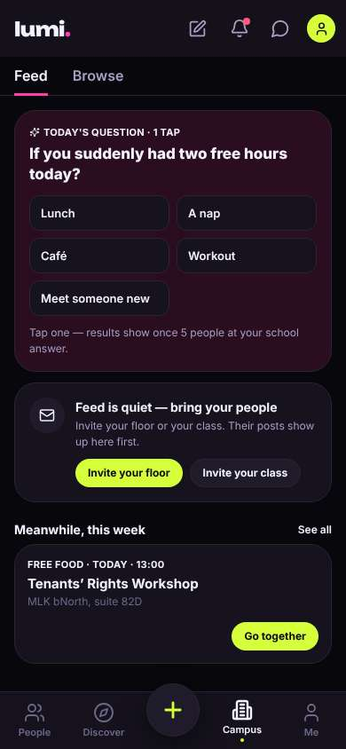

## Timeline

| step | what | screen | ms | signals / notes | shot |
|---|---|---|---|---|---|
| 0 | start | `/welcome` | 3163 | _confused_: “Who's free on campus right now? Find someone for lunch? Sounds kind of like a meetup or dating thing. I did catch '457 internships' scrolling past in that yellow strip, but it moves too fast to read. Is this legit, and where's the job stuff?” → f1 | <a href="shots/000-start-som.jpg">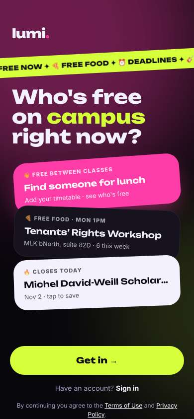</a> |
| 2 | click “Get in →” | `/start` | 1791 | expects: “It asks me to make an account or enter my email right away” (0.7) **mismatch**: No email yet, just asks which school. But '1/7' at top means seven screens of setup. ⚑ mismatch _neutral_: “OK, picking my school is harmless. Seven steps though, that's a lot before I even know what this is.” → f2 | <a href="shots/002-click-som.jpg">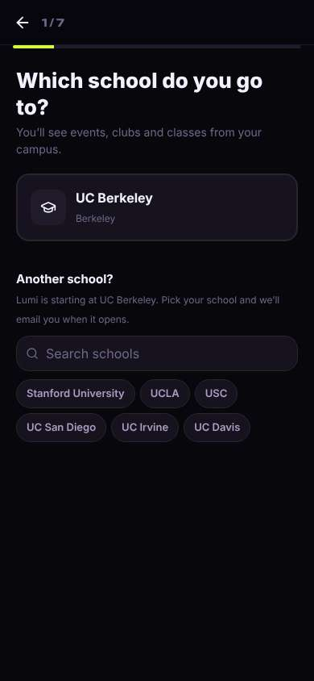</a> |
| 4 | click “UC Berkeley Berkeley” | `/start` | 891 | expects: “Goes to the next setup step” (0.8) as expected _curious_: “OK, 'Land an internship' with words next to it. That's what I came for. Good sign they take it seriously.” | <a href="shots/004-click-som.jpg">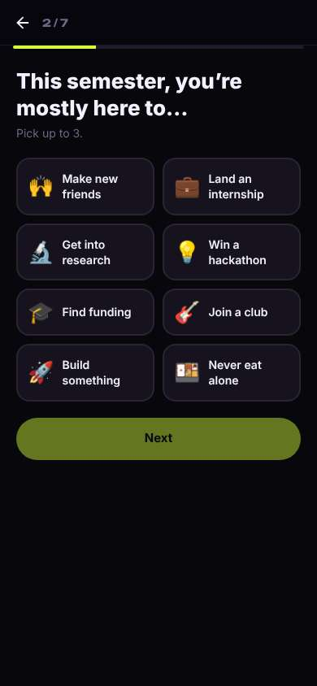</a> |
| 6 | click “💼 Land an internship” | `/start` | 846 | expects: “Internship gets highlighted, Next turns on” (0.8) as expected _neutral_: “Fine, that worked.” | <a href="shots/006-click-som.jpg">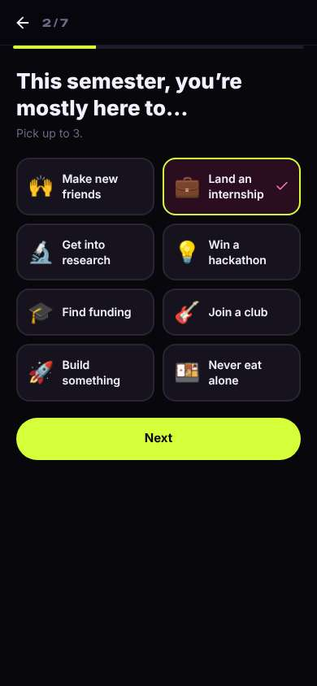</a> |
| 8 | click “Next” | `/start` | 881 | expects: “Next setup question” (0.7) as expected _neutral_: “Major and year isn't really private. At least it tells me why it wants it. Still haven't seen a single internship though.” | <a href="shots/008-click-som.jpg">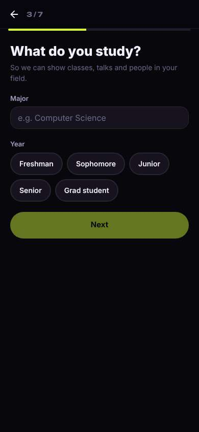</a> |
| 10 | type “e.g. Computer Science” ← “History” | `/start` | 875 |  | <a href="shots/010-type-som.jpg">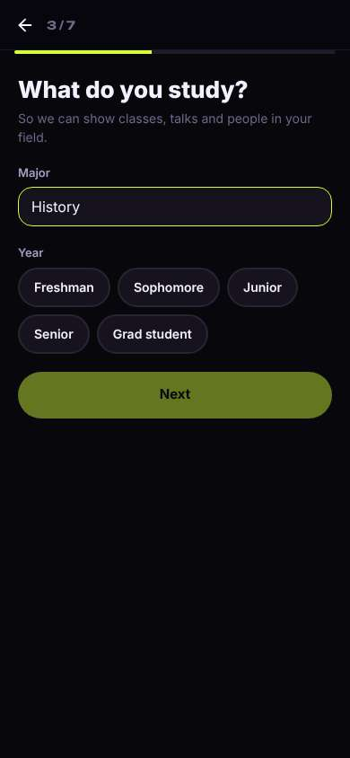</a> |
| 11 | click “Senior” | `/start` | 856 |  | <a href="shots/011-click-som.jpg">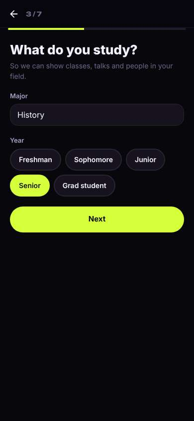</a> |
| 12 | click “Next” | `/start` | 840 | expects: “Another setup question” (0.7) as expected _bored_: “I'm a senior, I'm not looking to meet people, I want a job. Nothing here like 'recruiters' or 'alumni'. Glad there's a Skip.” → f3 | <a href="shots/012-click-som.jpg">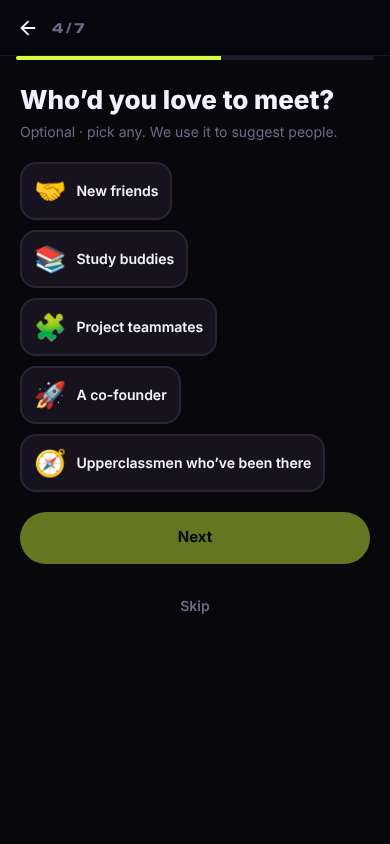</a> |
| 14 | click “Skip” | `/start` | 1126 | expects: “Next step, hopefully closer to seeing internships” (0.6) **mismatch**: Not internships yet: it built me a profile card that 'classmates see' ⚑ mismatch _neutral_: “Wait, it's already making a profile card that other people see? I haven't even seen what's in here. At least it's just an emoji and not my photo. 'Here to land an internship' — fine, that's true.” → f4 | <a href="shots/014-click-som.jpg">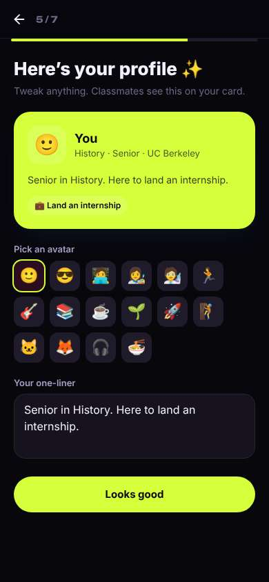</a> |
| 16 | click “Looks good” | `/start` | 863 | expects: “Next step, maybe the email/sign-up part” (0.6) **mismatch**: Not email yet; asks first name and birth year, explains birth year is private ⚑ mismatch _neutral_: “Now name and birth year, and I still haven't seen one internship. This is the kind of thing where I'd normally close it. They do say birth year is private, and it's just a first name. 'Rides'? Didn't know this did rides. OK, one more step, it says almost done.” → f5 | <a href="shots/016-click-som.jpg">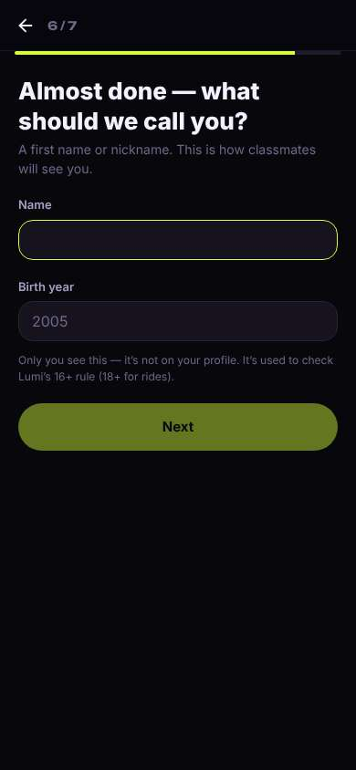</a> |
| 18 | type [53] ← “Marcus” | `/start` | 861 |  | <a href="shots/018-type-som.jpg">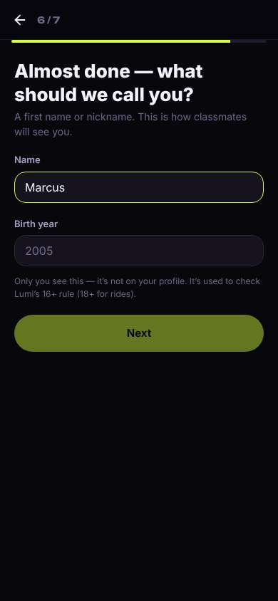</a> |
| 19 | type “2005” ← “2004” | `/start` | 861 |  | <a href="shots/019-type-som.jpg">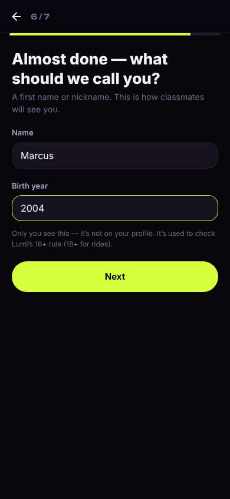</a> |
| 20 | click “Next” | `/start` | 845 | expects: “Last step: asks for my school email” (0.7) as expected _curious_: “Good, they let me skip. I'm not giving my email until I've actually seen these 457 internships. If they're real, I'll come back and save it.” | <a href="shots/020-click-som.jpg">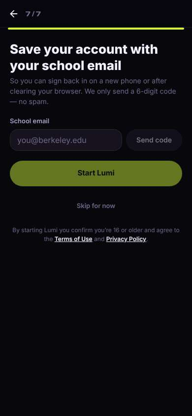</a> |
| 22 | click “Skip for now” | `/` | 961 | expects: “Finally get into the app and see what's in it” (0.7) **mismatch**: Got in, but the home screen is campus events and free food, no internships, even though I picked 'Land an internship' ⚑ mismatch _neutral_: “I told it I'm here for internships and the first thing I see is a pizza workshop and a quantum physics talk. Those four icons at the top, no idea what they do. The bottom ones have words at least. Where are the 457 internships?” → f6 | <a href="shots/022-click-som.jpg">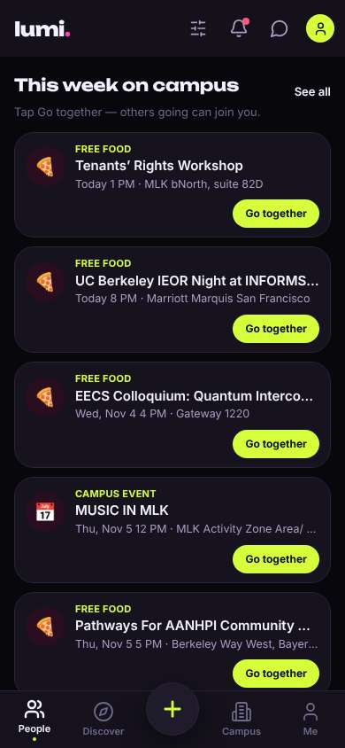</a> |
| 24 | click “Discover” | `/discover` | 864 | expects: “Some kind of browse page, maybe with internships and jobs” (0.5) **mismatch**: Discover is rides, hangouts, gym and dining — nothing about jobs ⚑ mismatch _frustrated_: “Rides to Costco, spontaneous hangouts... this is a social app. Still no internships. One more place to try, 'Campus', then I'm done.” → f7 | <a href="shots/024-click-som.jpg">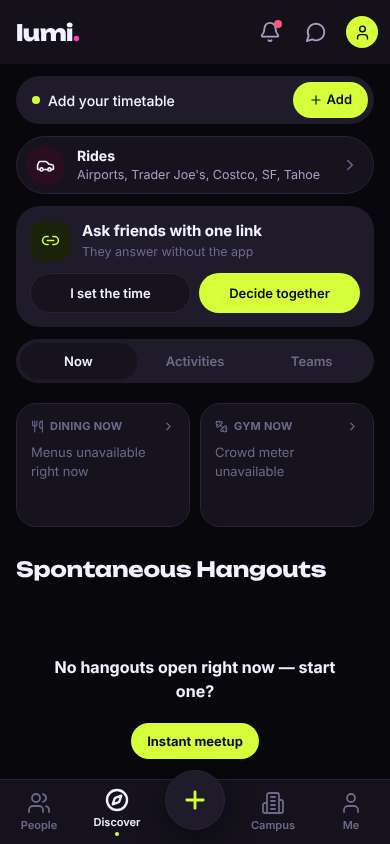</a> |
| 26 | click “Campus” | `/community` | 856 | expects: “Campus stuff, maybe deadlines and internships” (0.5) |  |
| 27 | finish | `/community` |  |  |  |

## Automatic checks (harness, not persona)

| screen | tap targets < 44px | sideways overflow | broken images |
|---|---|---|---|
| `/welcome` | 3 (Sign in 46×21, Terms of Use 76×15, Privacy Policy 180×33) | — | — |
| `/start` | 7 (Back 40×40, Stanford University 148×36, UCLA 62×36, USC 54×36, UC San Diego 112×36) | — | — |
| `/` | 10 (Filters 40×40, Notifications 40×40, Messages 40×40, Me 32×32, See all 41×20) | — | — |
| `/discover` | 10 (Notifications 40×40, Messages 40×40, Me 32×32, Add 75×36, I set the time 161×40) | — | — |
| `/community` | 13 (Notifications 40×40, Messages 40×40, Me 32×32, Feed 38×44, Lunch 158×40) | — | — |

## Timing (harness)

- Full page load (navigation timing): 1251 ms
- Step 0 `start` took 3163 ms until the network was quiet on `/welcome`
