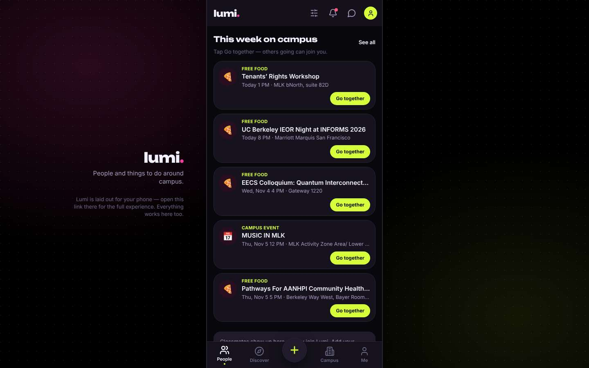
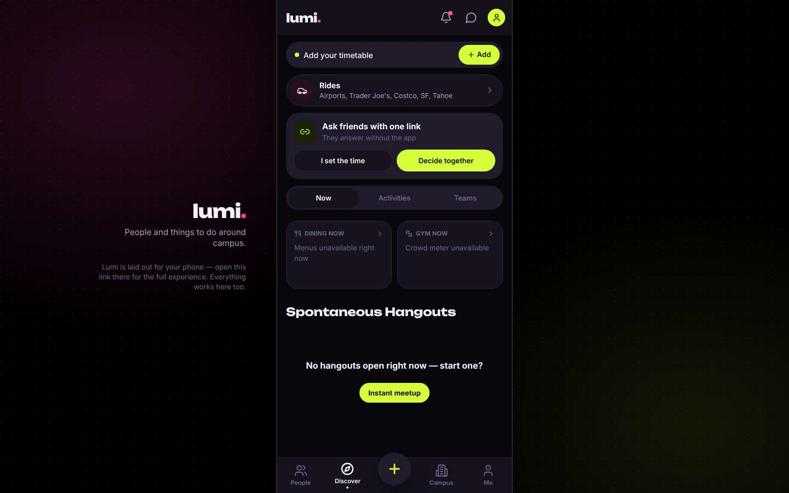
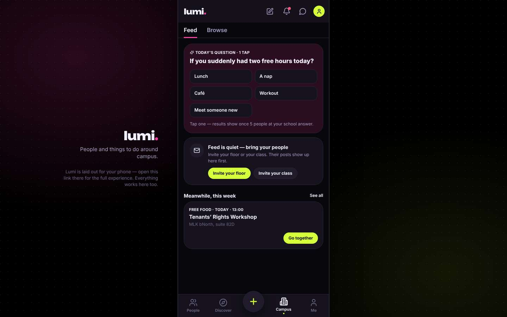
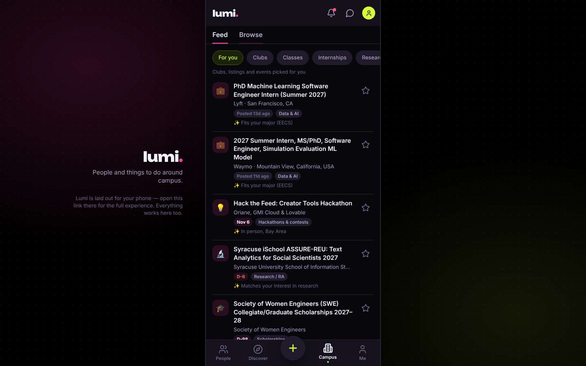
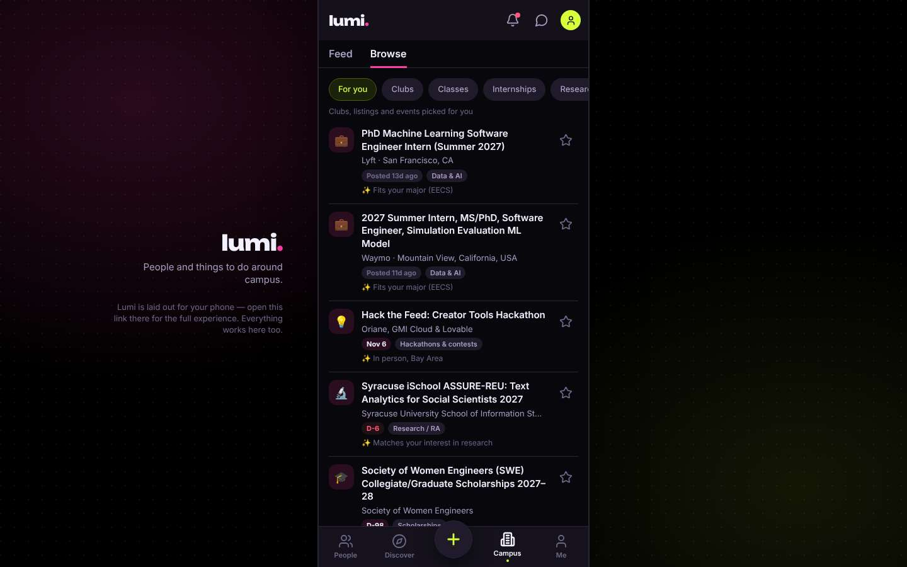
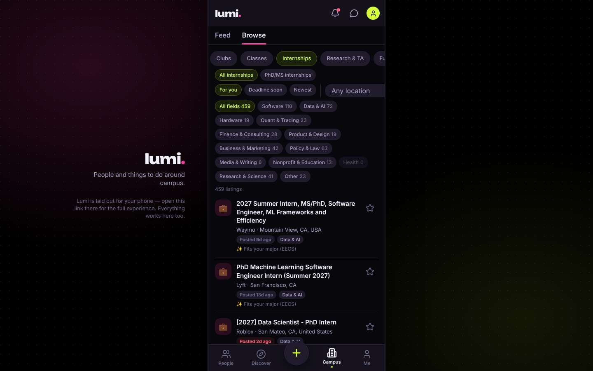
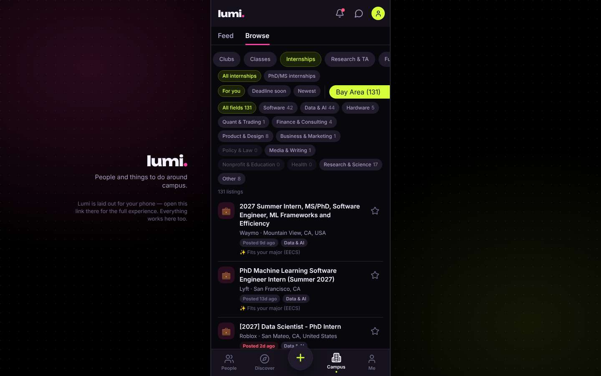
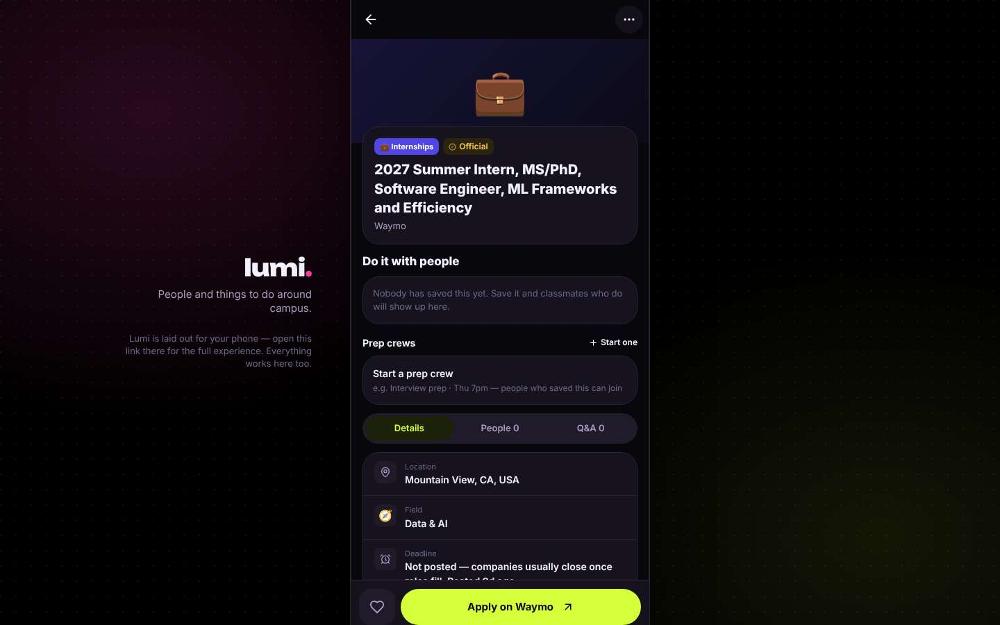
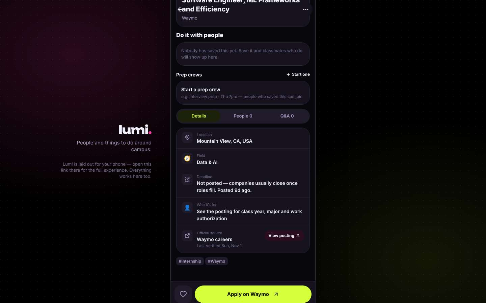

# ux-sim run `cmp1-fix-internship-near-berkeley-priya`

> **AI simulation — hypotheses, not measured user behaviour.** One simulated persona; nothing here is a rate or a measurement of real students.

| | |
|---|---|
| Persona | **Priya**, 26 — Second-year PhD student · desktop 1440×900 · prefers en · tech high (`priya-phd-desktop`) |
| Scenario | **Find an internship near Berkeley** — You need a paid internship (summer or part-time) somewhere near Berkeley / the Bay Area. Use the app to find one that looks real and open, and open its details so you know how to apply. (`internship-near-berkeley`) |
| Target | local · http://localhost:45765 · worktree commit `1a1a69501453` |
| Outcome | **success** · ended by persona |
| Account | fresh real account `priya.riyaldr6@berkeley.edu` (Priya, EECS, born 2000; sample: false) |
| Goal check (fixed, by harness) | met at step 13 after 7 action(s) — evidence: {"urlMatches":"^/opportunities/[^/?]+"}; {"textMatches":"\\bintern(ship)?s?\\b"} — _An internship listing's detail page is open (reached by the persona — the run starts on /)._ |
| Persona's reason | “Found a Waymo MS/PhD summer intern role in Mountain View, verified from the official source on Nov 1, with an Apply on Waymo link. Pay isn't stated, which is sloppy, but it's clearly a real, open posting.” |
| Effort | 8/40 actions · objective frustration 1.50/5 · 0 confused note(s) · ~128s simulated |
| Drop-off risk | **medium** _(AI hypothesis, persona agent)_ — The opportunities board is genuinely useful for a PhD (PhD-level roles, fellowships, Bay Area filter), but it's hidden behind Campus > Browse under a dorm-style social feed, and the detail page leads with prep crews instead of pay/details. I'd come back only if I bookmarked the board directly. · basis: steps 4, 6, 13 |

Known environment limits (not UX findings)

- Dining menus and RSF gym crowd levels need live campus sources (the local stack runs with CAMPUS_LIVE=0) — empty or missing data there is not a UX bug.
- AI features (Ask Lumi, AI profile draft on /start, conversation starters) need an OpenAI key; none is configured locally.
- Course catalog is the real Berkeley Class Schedule (6588 courses, Fall 2026 + Spring 2027), fetched 2026-11-02 with the worker's adapter. Seat counts and very recent changes may differ from live.
- Campus events, free food, internships, hackathons and scholarships are a read-only snapshot of live (1119 real items, 103 events this week, taken 2026-11-02 07:25 UTC) plus the CSV calendar. Nothing new appears during the run; Q&A and reviews are empty.
- No e-mail is sent: the sign-up / sign-in code is shown on screen in the hint (live sends a real e-mail).
- Real-time updates (SSE) work locally; other people never reply unless the stack was started with --autoreply.
- Signed in as a brand-new real (non-sample, e-mail-verified) account made for this run. Other students exist only if the scenario seeds peers (local fixtures); sample profiles are hidden from real accounts, as on live.

## Friction

| # | step | type | sev | persona says | screen | element | env-limited | evidence |
|---|---|---|---|---|---|---|---|---|
| f1 | 0 | No reason to stay | 1 | “A phone-sized column in the middle of my 1440px screen, with a note telling me to go use my phone. At least it's not stretched. Free food feed is very undergrad, but fine, I'm here for internships.” _wish: a real desktop layout, or at least don't tell me to switch devices_ | `/` |  | no | [shot](shots/000-start.jpg) [marked](shots/000-start-som.jpg) |
| f2 | 4 | Hard to find | 2 | “'Invite your floor' — I don't have a floor, I have a lab. This is a dorm app. Maybe 'Browse' hides something useful.” _wish: a visible Jobs/Internships or Opportunities entry point_ | `/community` | Campus | no | [shot](shots/004-click.jpg) [marked](shots/004-click-som.jpg) |
| f3 | 7 | Hard to find | 2 | “Okay, this is actually relevant — 'PhD' intern roles, a Jane Street grad fellowship. Should not be buried under a tab labelled 'Browse' inside 'Campus' though. And the old feed lingered for a moment after I clicked.” _wish: label it Opportunities, or surface it from the home screen_ | `/community?tab=opportunities` | Browse | no | [shot](shots/007-wait.jpg) [marked](shots/007-wait-som.jpg) |
| f4 | 9 | Bug | 1 | “Wall of chips — 'Health 0' is a chip for nothing. But there's a location filter, which is exactly what I need. The dropdown hanging off the edge of the column is sloppy.” _wish: keep the dropdown inside the layout; hide zero-count chips_ | `/community?tab=opportunities` | Location | no | [shot](shots/009-click.jpg) [marked](shots/009-click-som.jpg) |
| f5 | 13 | Missing / empty content | 2 | “Why is 'Prep crews' above the job details? I wanted location/pay/deadline first. No compensation listed at all — I'll assume Waymo pays its PhD interns, but the app should say so. The deadline note is at least honest.” _wish: show compensation (or 'paid') and put details above the social stuff_ | `/opportunities/:id` | Details | no | [shot](shots/013-click.jpg) [marked](shots/013-click-som.jpg) |

Severity: 1 = Minor — noticed it, cosmetic or a small annoyance; did not slow me down. · 2 = Moderate — slowed me down or made me hesitate; I recovered on my own. · 3 = Major — real confusion, a wrong path or many extra steps; I nearly gave up or only got through by guessing. · 4 = Blocker — I could not continue, gave up, or would stop using the app here.

## Timeline

| step | what | screen | ms | signals / notes | shot |
|---|---|---|---|---|---|
| 0 | start | `/` | 1765 | _neutral_: “A phone-sized column in the middle of my 1440px screen, with a note telling me to go use my phone. At least it's not stretched. Free food feed is very undergrad, but fine, I'm here for internships.” → f1 |  |
| 2 | click “Discover” | `/discover` | 928 | expects: “a discover page with categories like jobs/internships, events” (0.5) **mismatch**: Discover is rides, hangouts, dining and gym. Nothing about jobs or internships. ⚑ mismatch _neutral_: “Rides to Trader Joe's and 'Instant meetup'. Not what I came for. Campus tab is the next guess.” |  |
| 4 | click “Campus” | `/community` | 852 | expects: “campus resources: events, deadlines, maybe careers/internships” (0.6) **mismatch**: Campus is a social feed: 'two free hours? a nap', invite your floor. No careers or deadlines. ⚑ mismatch _bored_: “'Invite your floor' — I don't have a floor, I have a lab. This is a dorm app. Maybe 'Browse' hides something useful.” → f2 |  |
| 6 | click “Browse” | `/community?tab=opportunities` | 862 | expects: “a directory of campus things, possibly careers/opportunities” (0.45) as expected |  |
| 7 | wait | `/community?tab=opportunities` | 2304 | _curious_: “Okay, this is actually relevant — 'PhD' intern roles, a Jane Street grad fellowship. Should not be buried under a tab labelled 'Browse' inside 'Campus' though. And the old feed lingered for a moment after I clicked.” → f3 |  |
| 9 | click “Internships” | `/community?tab=opportunities` | 851 | expects: “list filtered to internships only, ideally with location info” (0.8) as expected _neutral_: “Wall of chips — 'Health 0' is a chip for nothing. But there's a location filter, which is exactly what I need. The dropdown hanging off the edge of the column is sloppy.” → f4 |  |
| 11 | select “Location” | `/community?tab=opportunities` | 3841 | expects: “list narrows to Bay Area internships” (0.6) as expected _curious_: “131 in the Bay Area, mostly PhD-level. Good. Waymo 'ML Frameworks and Efficiency' is close to systems — let's look at that one.” |  |
| 13 | click “💼 2027 Summer Intern, MS/PhD, Software ” | `/opportunities/:id` | 861 | expects: “listing details: pay, deadline, location, and an apply link” (0.65) **mismatch**: Details page has location (Mountain View), field, an honest 'deadline not posted' and a big 'Apply on Waymo' button — but no pay info, and the actual details sit below 'Do it with people' and 'Start a prep crew'. ⚑ mismatch _neutral_: “Why is 'Prep crews' above the job details? I wanted location/pay/deadline first. No compensation listed at all — I'll assume Waymo pays its PhD interns, but the app should say so. The deadline note is at least honest.” → f5 |  |
| 15 | scroll down | `/opportunities/:id` | 1325 | _curious_: “'Official source — Waymo careers, last verified Nov 1' with a View posting link. That's the kind of detail that makes me trust it's real and still open. I know how to apply: the Waymo button.” |  |
| 17 | finish | `/opportunities/:id` |  |  |  |

## Timing (harness)

- Full page load (navigation timing): 619 ms
- Step 11 `select` took 3841 ms until the network was quiet on `/community?tab=opportunities`
