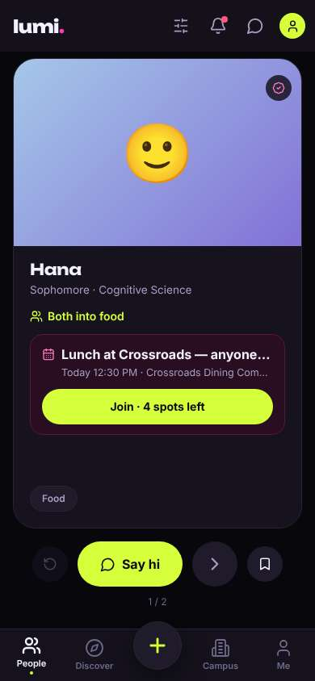
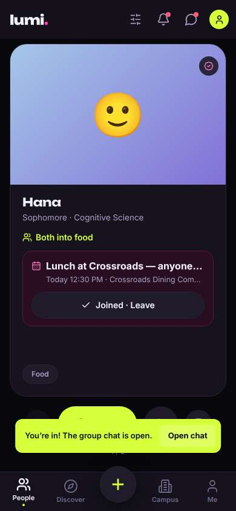
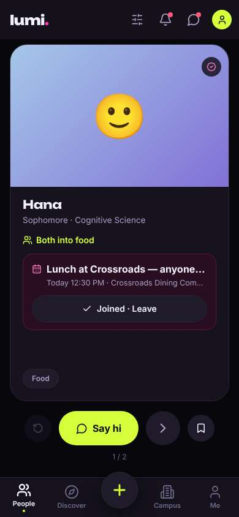
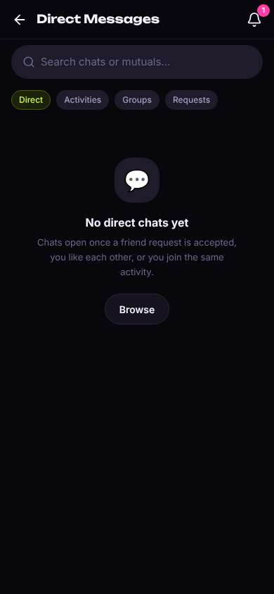
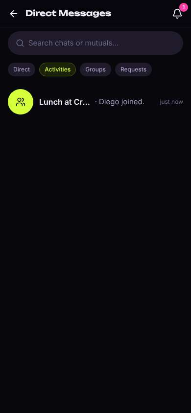
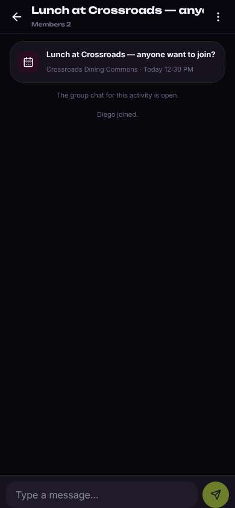
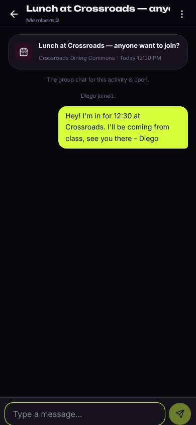

# ux-sim run `cmp1-fix-lunch-today-diego`

> **AI simulation — hypotheses, not measured user behaviour.** One simulated persona; nothing here is a rate or a measurement of real students.

| | |
|---|---|
| Persona | **Diego**, 21 — Junior (transfer from Laney College) · phone 390×844 · prefers en · tech medium (`diego-transfer-commuter`) |
| Scenario | **Find someone to get lunch with today** — It's a weekday and you'd rather not eat lunch alone again. Use the app to find someone (or a group) to get lunch with today, and let them know you're in. (`lunch-today`) |
| Target | local · http://localhost:40211 · worktree commit `1a1a69501453` |
| Outcome | **success** · ended by persona |
| Account | fresh real account `diego.iegokuvf@berkeley.edu` (Diego, Civil Engineering, born 2005; sample: false) · peers seeded: Hana, Leo |
| Goal check (fixed, by harness) | met at step 2 after 1 action(s) — evidence: joined or asked to join a peer's lunch plan; joined or asked to join a plan — _During the run the persona's own account joined/requested one of today's lunch plans, posted its own meal plan for today, or messaged in a lunch plan's chat._ |
| Persona's reason | “Joined Hana's 12:30 lunch at Crossroads and posted in the group chat that I'm coming. Took about a minute.” |
| Effort | 5/32 actions · objective frustration 0.50/4 · 0 confused note(s) · ~19s simulated |
| Drop-off risk | **medium** _(AI hypothesis, persona agent)_ — The lunch flow was fast, which is what I need, but I came for study partners and rides too and haven't seen that yet; if those aren't there I'd only open it for lunch now and then. · basis: steps 2, 6, 12 |

Known environment limits (not UX findings)

- Dining menus and RSF gym crowd levels need live campus sources (the local stack runs with CAMPUS_LIVE=0) — empty or missing data there is not a UX bug.
- AI features (Ask Lumi, AI profile draft on /start, conversation starters) need an OpenAI key; none is configured locally.
- Course catalog is the real Berkeley Class Schedule (6588 courses, Fall 2026 + Spring 2027), fetched 2026-11-02 with the worker's adapter. Seat counts and very recent changes may differ from live.
- Campus events, free food, internships, hackathons and scholarships are a read-only snapshot of live (1119 real items, 103 events this week, taken 2026-11-02 07:25 UTC) plus the CSV calendar. Nothing new appears during the run; Q&A and reviews are empty.
- No e-mail is sent: the sign-up / sign-in code is shown on screen in the hint (live sends a real e-mail).
- Real-time updates (SSE) work locally; other people never reply unless the stack was started with --autoreply.
- Signed in as a brand-new real (non-sample, e-mail-verified) account made for this run. Other students exist only if the scenario seeds peers (local fixtures); sample profiles are hidden from real accounts, as on live.

## Friction

| # | step | type | sev | persona says | screen | element | env-limited | evidence |
|---|---|---|---|---|---|---|---|---|
| f1 | 4 | Confusing UI | 1 | “The Open chat thing disappeared before I could tap it. Whatever, the messages icon had a dot.” _wish: keep the Open chat shortcut on the card after joining, not just in a toast_ | `/` |  | no | [shot](shots/004-observe.jpg) [marked](shots/004-observe-som.jpg) |
| f2 | 6 | Confusing UI | 2 | “Wait, I just joined an activity. It's probably under Activities, there's a tab right there.” _wish: open Messages on the tab with my newest chat, or show the lunch chat first_ | `/chats` | Direct | no | [shot](shots/006-click.jpg) [marked](shots/006-click-som.jpg) |

Severity: 1 = Minor — noticed it, cosmetic or a small annoyance; did not slow me down. · 2 = Moderate — slowed me down or made me hesitate; I recovered on my own. · 3 = Major — real confusion, a wrong path or many extra steps; I nearly gave up or only got through by guessing. · 4 = Blocker — I could not continue, gave up, or would stop using the app here.

## Timeline

| step | what | screen | ms | signals / notes | shot |
|---|---|---|---|---|---|
| 0 | start | `/` | 1275 | _curious_: “OK, first thing I see is a lunch at Crossroads today 12:30 with a Join button. That's literally what I came for.” |  |
| 2 | click “Join · 4 spots left” | `/` | 1178 | expects: “I join Hana's lunch at Crossroads and she/the group knows I'm coming” (0.75) as expected _delighted_: “One tap, done. Nice. I'll drop a quick message so they know I'm actually coming.” |  |
| 4 | observe | `/` |  | _neutral_: “The Open chat thing disappeared before I could tap it. Whatever, the messages icon had a dot.” → f1 |  |
| 6 | click “Messages” | `/chats` | 874 | expects: “messages list with the Crossroads lunch group chat” (0.7) **mismatch**: Opened on the Direct tab saying 'No direct chats yet... or you join the same activity' even though I just joined one; lunch chat isn't shown ⚑ mismatch _neutral_: “Wait, I just joined an activity. It's probably under Activities, there's a tab right there.” → f2 |  |
| 8 | click “Activities” | `/chats?tab=activity` | 933 | expects: “Lunch at Crossroads group chat listed” (0.8) as expected _neutral_: “There it is. It already says I joined, but I'll say something so it's not just a system line.” |  |
| 10 | click “Lunch at Crossroads — anyone want to joi” | `/chats/:id` | 1090 | expects: “group chat opens with a text box” (0.85) as expected _neutral_: “Good, chat with the time and place pinned at top. Just me and Hana so far.” |  |
| 12 | type “Type a message…” ← “Hey! I'm in for 12:30 at Crossroads. I'll be coming from class, see you there - Diego” | `/chats/:id` | 903 | expects: “my message posts in the group chat” (0.85) as expected _delighted_: “Done. Joined and told them I'm coming, under a minute. That's what I need between classes.” |  |
| 14 | finish | `/chats/:id` |  |  |  |

## Automatic checks (harness, not persona)

| screen | tap targets < 44px | sideways overflow | broken images |
|---|---|---|---|
| `/` | 5 (Filters 40×40, Notifications 40×40, Messages 40×40, Me 32×32) | — | — |
| `/chats` | 6 (Back 40×40, Notifications 40×40, Direct 56×28, Activities 75×28, Groups 64×28) | — | — |
| `/chats?tab=activity` | 6 (Back 40×40, Notifications 40×40, Direct 56×28, Activities 75×28, Groups 64×28) | — | — |
| `/chats/:id` | 2 (Back 40×40, Menu 40×40) | — | — |

## Timing (harness)

- Full page load (navigation timing): 360 ms
