# ux-sim run `cmp1-fix-ride-sfo-thanksgiving-seoyeon`

> **AI simulation — hypotheses, not measured user behaviour.** One simulated persona; nothing here is a rate or a measurement of real students.

| | |
|---|---|
| Persona | **Seoyeon**, 20 — Exchange student (one semester, from Yonsei) · phone 390×844 · prefers ko · tech medium (`seoyeon-exchange-korean`) |
| Scenario | **Share a ride to SFO for Thanksgiving** — You fly out of SFO the Wednesday before Thanksgiving (Nov 25) in the morning. Find other students to split a ride to the airport with — join one, or post yours so others can find you. (`ride-sfo-thanksgiving`) |
| Target | local · http://localhost:41949 · worktree commit `1a1a69501453` |
| Outcome | **success** · ended by persona |
| Account | fresh real account `seoyeon.yeonle73@berkeley.edu` (Seoyeon, Business Administration, born 2006; sample: false) · peers seeded: Jun |
| Goal check (fixed, by harness) | met at step 18 after 9 action(s) — evidence: joined someone's SFO ride — _During the run the persona posted an SFO ride on Nov 25, or joined/requested someone's SFO ride (server-side)._ |
| Persona's reason | “Jun이 수요일 오전 8:30에 SFO 가는 라이드에 같이 타기로 했고, 라이드 채팅에서 인사까지 했어요. 한국어로 바꿀 수 있어서 쉬웠어요.” |
| Effort | 11/45 actions · objective frustration 0.50/5 · 1 confused note(s) · ~96s simulated |
| Drop-off risk | **low** _(AI hypothesis, persona agent)_ — Korean language setting was easy to find and the ride flow was clear and safe-feeling; she'd come back to coordinate in the chat and for future SF/grocery rides. Leftover English strings (My rides, chat system messages) are minor. · basis: steps 6, 14, 16, 18 |

Known environment limits (not UX findings)

- Dining menus and RSF gym crowd levels need live campus sources (the local stack runs with CAMPUS_LIVE=0) — empty or missing data there is not a UX bug.
- AI features (Ask Lumi, AI profile draft on /start, conversation starters) need an OpenAI key; none is configured locally.
- Course catalog is the real Berkeley Class Schedule (6588 courses, Fall 2026 + Spring 2027), fetched 2026-11-02 with the worker's adapter. Seat counts and very recent changes may differ from live.
- Campus events, free food, internships, hackathons and scholarships are a read-only snapshot of live (1119 real items, 103 events this week, taken 2026-11-02 07:25 UTC) plus the CSV calendar. Nothing new appears during the run; Q&A and reviews are empty.
- No e-mail is sent: the sign-up / sign-in code is shown on screen in the hint (live sends a real e-mail).
- Real-time updates (SSE) work locally; other people never reply unless the stack was started with --autoreply.
- Signed in as a brand-new real (non-sample, e-mail-verified) account made for this run. Other students exist only if the scenario seeds peers (local fixtures); sample profiles are hidden from real accounts, as on live.

## Friction

| # | step | type | sev | persona says | screen | element | env-limited | evidence |
|---|---|---|---|---|---|---|---|---|
| f1 | 8 | Unclear wording | 1 | “대부분 한국어인데 Seat alerts는 영어 그대로네. 뭐 수업 얘기라 상관없어.” _wish: translate the whole page_ | `/profile` | Find a class to watch | no | [shot](shots/008-click.jpg) [marked](shots/008-click-som.jpg) |
| f2 | 10 | Unclear wording | 1 | “My rides... Airports! 공항 같이 가는 거 여기 있나봐. 근데 이것만 영어네.” _wish: 라이드 메뉴도 한국어로_ | `/profile` | My rides Airports, groceries, SF, Tahoe | no | [shot](shots/010-scroll.jpg) [marked](shots/010-scroll-som.jpg) |
| f3 | 20 | Unclear wording | 1 | “채팅방 맞아. 근데 여기 안내 문구는 다시 영어네... 짧아서 읽을 수는 있어.” _wish: 시스템 메시지도 한국어로_ | `/chats/:id` | 🚕 SFO · Wed Nov 25 8:30am 멤버 2명 | no | [shot](shots/020-click.jpg) [marked](shots/020-click-som.jpg) |

Severity: 1 = Minor — noticed it, cosmetic or a small annoyance; did not slow me down. · 2 = Moderate — slowed me down or made me hesitate; I recovered on my own. · 3 = Major — real confusion, a wrong path or many extra steps; I nearly gave up or only got through by guessing. · 4 = Blocker — I could not continue, gave up, or would stop using the app here.

## Timeline

| step | what | screen | ms | signals / notes | shot |
|---|---|---|---|---|---|
| 0 | start | `/` | 1293 | _confused_: “어... 사람 카드? 데이팅 앱인가? 라이드 같은 건 안 보여. 한국어 설정부터 찾아볼게.” | <a href="shots/000-start-som.jpg">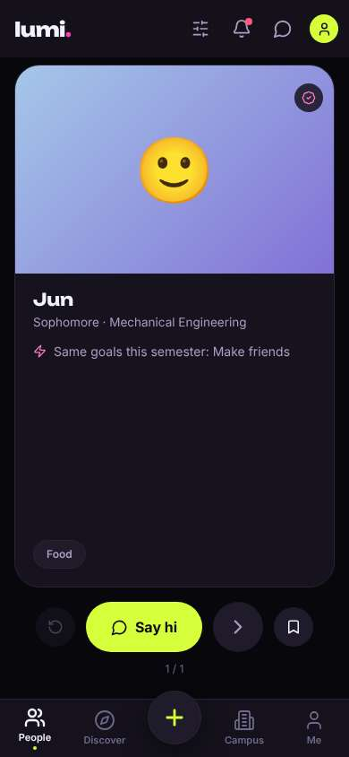</a> |
| 2 | click “Me” | `/profile` | 900 | expects: “settings page where I can change language to Korean” (0.5) **mismatch**: My profile page, but there is a gear icon at top ⚑ mismatch _neutral_: “프로필 페이지네. 톱니바퀴가 설정이겠지.” | <a href="shots/002-click-som.jpg">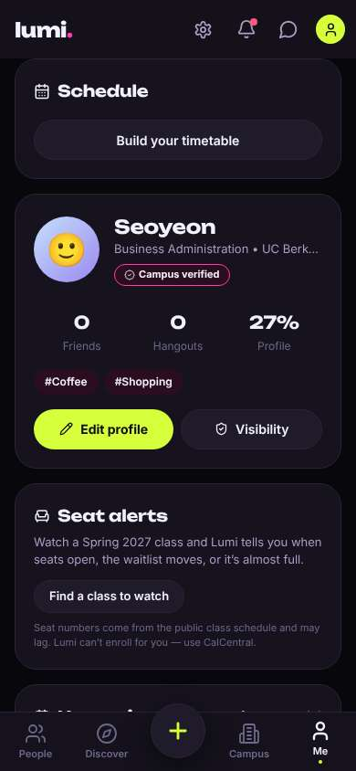</a> |
| 4 | click “Settings” | `/settings` | 853 | expects: “settings with a Language option” (0.7) as expected _delighted_: “와 한국어 있다! 다행이다.” | <a href="shots/004-click-som.jpg">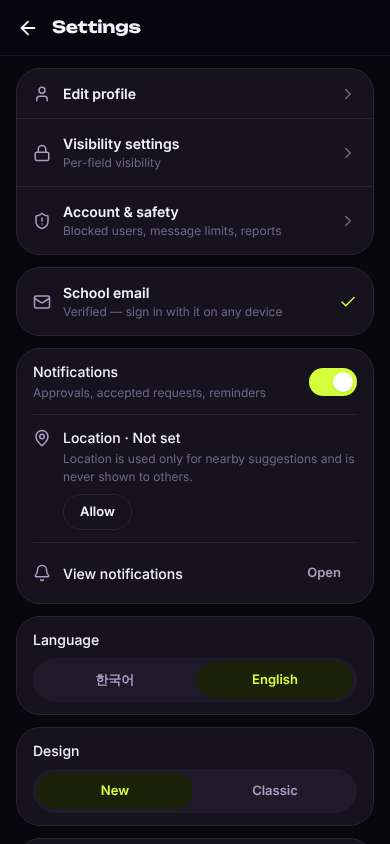</a> |
| 6 | click “한국어” | `/settings` | 1372 | expects: “app switches to Korean” (0.8) as expected _delighted_: “바로 한국어로 바뀌었어! 이제 좀 편하다.” | <a href="shots/006-click-som.jpg">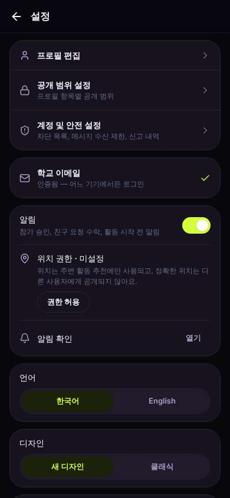</a> |
| 8 | click “뒤로” | `/profile` | 1139 | expects: “back to my profile, in Korean” (0.8) as expected _neutral_: “대부분 한국어인데 Seat alerts는 영어 그대로네. 뭐 수업 얘기라 상관없어.” → f1 | <a href="shots/008-click-som.jpg">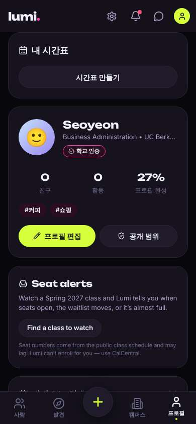</a> |
| 10 | scroll down | `/profile` | 1313 | _curious_: “My rides... Airports! 공항 같이 가는 거 여기 있나봐. 근데 이것만 영어네.” → f2 | <a href="shots/010-scroll-som.jpg">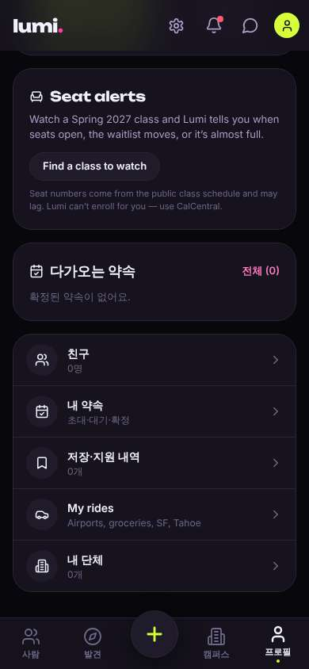</a> |
| 12 | click “My rides Airports, groceries, SF, Tahoe” | `/rides` | 864 | expects: “list of airport rides I can join or create” (0.6) as expected _curious_: “같이 타기! 이거다. 먼저 차 찾기로 SFO 가는 사람 있는지 볼게.” | <a href="shots/012-click-som.jpg">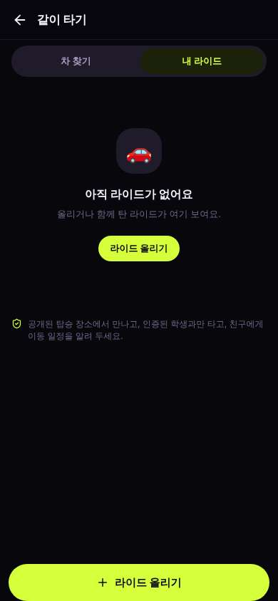</a> |
| 14 | click “차 찾기” | `/rides` | 854 | expects: “list of rides others posted, maybe one to SFO” (0.6) as expected _delighted_: “와, 추수감사절 배너까지! Jun이 수요일 오전 8:30에 SFO 간대. 딱 내 날짜야. 근데 자세히 보고 싶어.” | <a href="shots/014-click-som.jpg">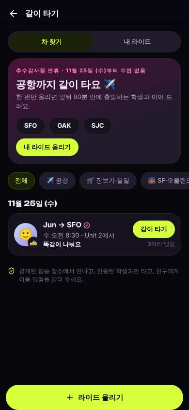</a> |
| 16 | click “🙂 🚕 Jun → SFO 수 오전 8:30 · Unit 2에서 똑같이” | `/rides/:id` | 862 | expects: “ride details (cost, pickup spot) before joining” (0.5) as expected _delighted_: “다 한국어로 정리돼 있어서 이해가 잘 돼. 비용은 똑같이 나누고, 공개 장소에서 만나고. 전화번호 안 물어보니까 안심이야. 내 비행기도 수요일 오전이라 괜찮을 것 같아.” | <a href="shots/016-click-som.jpg">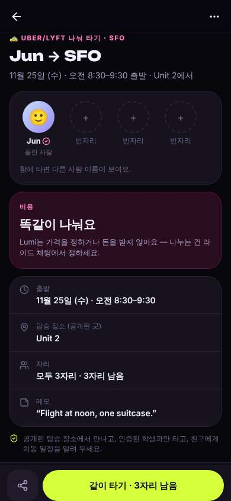</a> |
| 18 | click “같이 타기 · 3자리 남음” | `/rides/:id` | 867 | expects: “I join Jun's ride; a ride chat opens or a confirmation appears” (0.7) as expected _delighted_: “됐다! 나도 탑승으로 나와. 채팅에서 Jun한테 인사해야지.” | <a href="shots/018-click-som.jpg">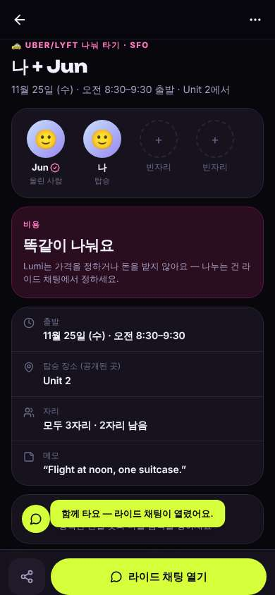</a> |
| 20 | click “라이드 채팅 열기” | `/chats/:id` | 957 | expects: “ride group chat with Jun” (0.8) as expected _neutral_: “채팅방 맞아. 근데 여기 안내 문구는 다시 영어네... 짧아서 읽을 수는 있어.” → f3 | <a href="shots/020-click-som.jpg">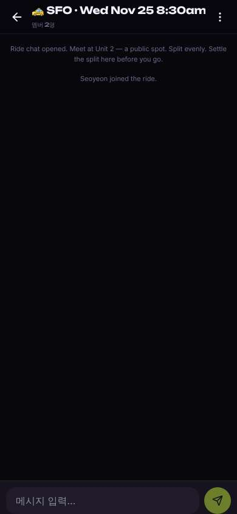</a> |
| 22 | type “메시지 입력…” ← “Hi Jun! I'm Seoyeon, I fly Wed morning too. See you at Unit 2 :)” | `/chats/:id` | 903 | expects: “message appears in chat” (0.8) as expected _delighted_: “메시지 보냈다. 이제 Jun이 답하면 돼. 생각보다 쉬웠어!” | <a href="shots/022-type-som.jpg">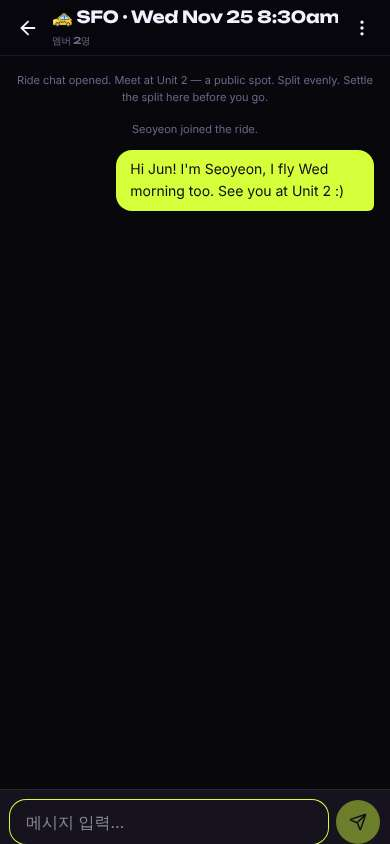</a> |
| 24 | finish | `/chats/:id` |  |  |  |

## Automatic checks (harness, not persona)

| screen | tap targets < 44px | sideways overflow | broken images |
|---|---|---|---|
| `/` | 4 (Filters 40×40, Notifications 40×40, Messages 40×40, Me 32×32) | — | — |
| `/profile` | 5 (Notifications 40×40, Messages 40×40, Me 32×32, Find a class to watch 165×36) | — | — |
| `/settings` | 7 (Back 40×40, Allow 69×36, Open 66×36, 한국어 156×36, English 156×36) | — | — |
| `/rides` | 11 (뒤로 40×40, 차 찾기 173×36, 내 라이드 173×36, 라이드 올리기 113×36) | — | — |
| `/rides/:id` | 2 (뒤로 40×40, 더 보기 40×40) | — | — |
| `/chats/:id` | 2 (뒤로 40×40, 메뉴 40×40) | — | — |

## Timing (harness)

- Full page load (navigation timing): 379 ms, 220 ms
