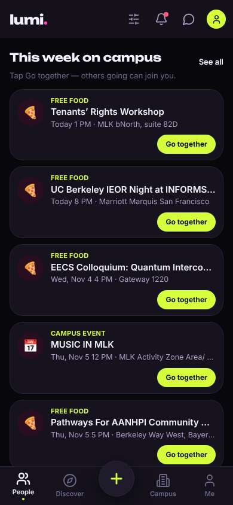
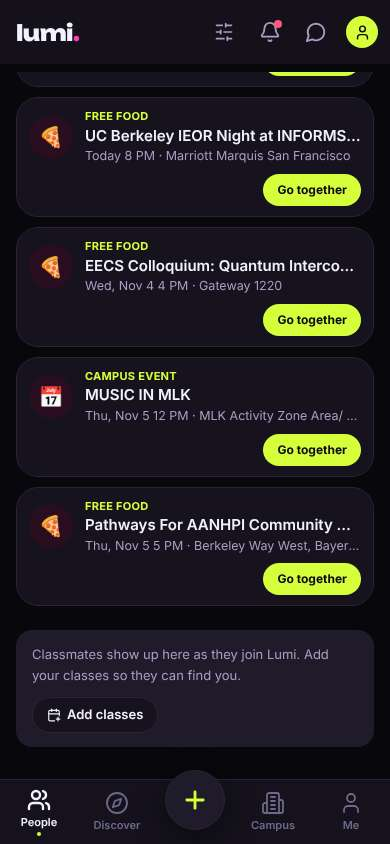
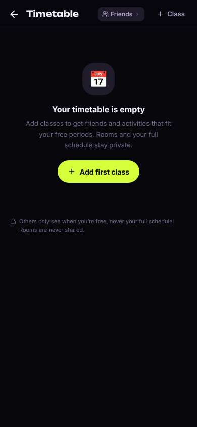
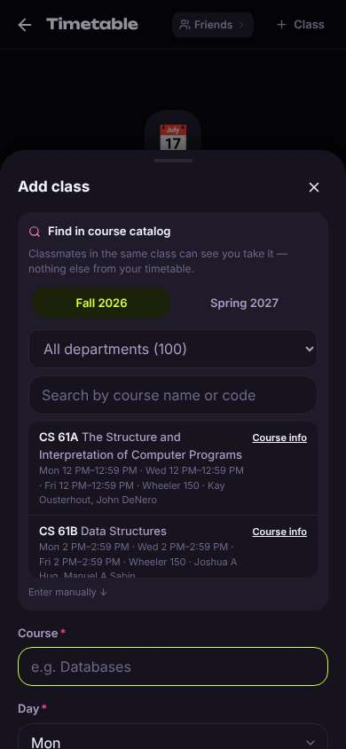
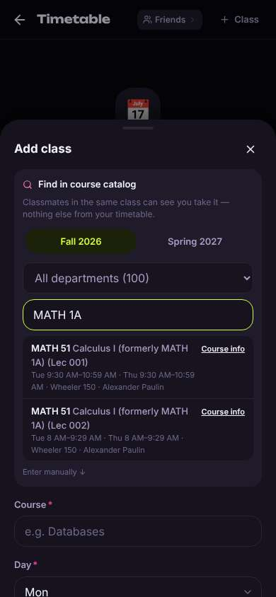
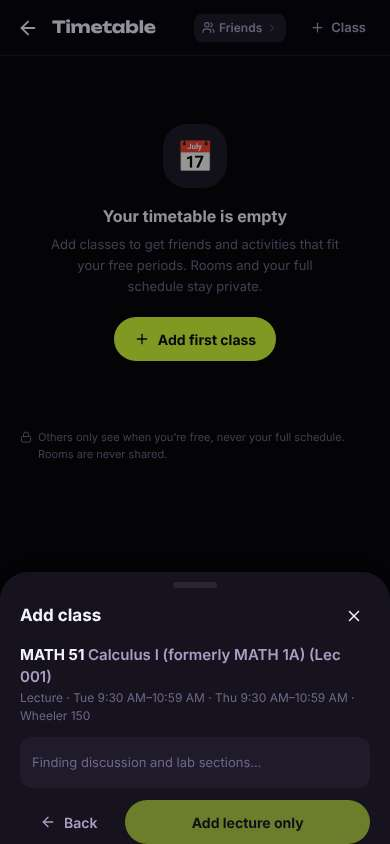
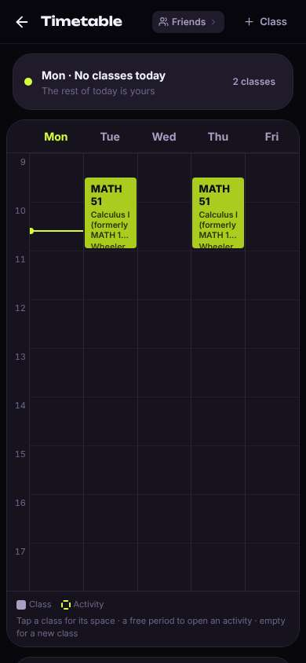

# ux-sim run `cmp1-fix-timetable-add-classes-minji`

> **AI simulation — hypotheses, not measured user behaviour.** One simulated persona; nothing here is a rate or a measurement of real students.

| | |
|---|---|
| Persona | **Minji**, 17 — First-year (started college a year early) · phone 390×844 · prefers ko · tech high (`minji-freshman-17`) |
| Scenario | **Put my classes into my timetable** — You want the app to know your schedule so it can show who's free when you are. Add your calculus class — Calculus I, which you know as MATH 1A — to your timetable in the app. (`timetable-add-classes`) |
| Target | local · http://localhost:45235 · worktree commit `1a1a69501453` |
| Outcome | **success** · ended by persona |
| Account | fresh real account `minji.injil9vs@berkeley.edu` (Minji, Undeclared, born 2009; sample: false) |
| Goal check (fixed, by harness) | met at step 12 after 7 action(s) — evidence: Calculus I is in my saved timetable — _The persona's own timetable (server-side) gained Calculus I (MATH 51 / MATH 1A) during the run._ |
| Persona's reason | “Calc I (MATH 51, formerly 1A) is on my timetable Tue/Thu 9:30. 검색은 쉬웠는데 로딩 기다리다가 갑자기 혼자 추가돼서 좀 어리둥절.” |
| Effort | 7/40 actions · objective frustration 1.00/4.5 · 0 confused note(s) · ~51s simulated |
| Drop-off risk | **medium** _(AI hypothesis, persona agent)_ — Adding the class was easy and the privacy line reassured me, but nothing showed me people my age or from my dorm yet — '0 free · 0 nearby' — so I'm not sure there's a reason to come back tomorrow. · basis: steps 9, 12 |

Known environment limits (not UX findings)

- Dining menus and RSF gym crowd levels need live campus sources (the local stack runs with CAMPUS_LIVE=0) — empty or missing data there is not a UX bug.
- AI features (Ask Lumi, AI profile draft on /start, conversation starters) need an OpenAI key; none is configured locally.
- Course catalog is the real Berkeley Class Schedule (6588 courses, Fall 2026 + Spring 2027), fetched 2026-11-02 with the worker's adapter. Seat counts and very recent changes may differ from live.
- Campus events, free food, internships, hackathons and scholarships are a read-only snapshot of live (1119 real items, 103 events this week, taken 2026-11-02 07:25 UTC) plus the CSV calendar. Nothing new appears during the run; Q&A and reviews are empty.
- No e-mail is sent: the sign-up / sign-in code is shown on screen in the hint (live sends a real e-mail).
- Real-time updates (SSE) work locally; other people never reply unless the stack was started with --autoreply.
- Signed in as a brand-new real (non-sample, e-mail-verified) account made for this run. Other students exist only if the scenario seeds peers (local fixtures); sample profiles are hidden from real accounts, as on live.

## Friction

| # | step | type | sev | persona says | screen | element | env-limited | evidence |
|---|---|---|---|---|---|---|---|---|
| f1 | 1 | Hard to find | 1 | “오 여기 있네. 'Add your classes so they can find you' — 좀 아래 숨어있긴 한데 ok” _wish: show Add classes near the top, not under all the free food cards_ | `/` | Add classes | no | [shot](shots/001-scroll.jpg) [marked](shots/001-scroll-som.jpg) |
| f2 | 7 | Confusing UI | 1 | “헐 MATH 51로 바뀌었구나, 'formerly MATH 1A'라고 써줘서 다행. 근데 Lec 001이랑 002 중에 뭐였지… 8시는 절대 아님, 9:30 거 같음” _wish: tell me which section is which / let me change it later easily_ | `/timetable` | MATH 51 Calculus I (formerly MATH 1A) (Lec 001) Tue 9:30 AM–10:59 AM · Thu 9:30 AM–10:59 A | no | [shot](shots/007-type.jpg) [marked](shots/007-type-som.jpg) |
| f3 | 9 | Slow | 1 | “아 discussion도 고르라는 거구나. 근데 로딩 좀 느림, 버튼도 회색이라 기다려야 함” | `/timetable` | Add lecture only | no | [shot](shots/009-click.jpg) [marked](shots/009-click-som.jpg) |
| f4 | 12 | Confusing UI | 2 | “어? 나 Add 안 눌렀는데 그냥 들어갔네. 화/목 9:30 MATH 51 보임, 좋아. 근데 '2 classes'라고 하네… 한 과목인데? 그리고 거의 20초 기다림” _wish: a clear 'Added Calculus I ✓' message, and count it as 1 class (2 meetings)_ | `/timetable` | MATH 51 Calculus I (formerly MATH 1A) (Lec 001) Wheeler 150 | no | [shot](shots/012-wait.jpg) [marked](shots/012-wait-som.jpg) |

Severity: 1 = Minor — noticed it, cosmetic or a small annoyance; did not slow me down. · 2 = Moderate — slowed me down or made me hesitate; I recovered on my own. · 3 = Major — real confusion, a wrong path or many extra steps; I nearly gave up or only got through by guessing. · 4 = Blocker — I could not continue, gave up, or would stop using the app here.

## Timeline

| step | what | screen | ms | signals / notes | shot |
|---|---|---|---|---|---|
| 0 | start | `/` | 2430 |  |  |
| 1 | scroll down | `/` | 1326 | expects: “maybe something about classes or my schedule below the events” (0.5) as expected _curious_: “오 여기 있네. 'Add your classes so they can find you' — 좀 아래 숨어있긴 한데 ok” → f1 |  |
| 3 | click “Add classes” | `/timetable` | 993 | expects: “a search box where I can look up MATH 1A” (0.7) **mismatch**: Went to an empty Timetable page with an 'Add first class' button, not a search box yet ⚑ mismatch _neutral_: “아 한 단계 더. 근데 'never your full schedule' 문구는 좋다, 안심됨” |  |
| 5 | click “Add first class” | `/timetable` | 871 | expects: “search for a class like MATH 1A” (0.7) as expected _curious_: “오 검색창 있다. 근데 아래 manual 입력폼이 리스트랑 겹쳐 보여서 좀 지저분함” |  |
| 7 | type “Search by course name or code” ← “MATH 1A” | `/timetable` | 877 | expects: “the list filters to MATH 1A Calculus” (0.7) as expected _delighted_: “헐 MATH 51로 바뀌었구나, 'formerly MATH 1A'라고 써줘서 다행. 근데 Lec 001이랑 002 중에 뭐였지… 8시는 절대 아님, 9:30 거 같음” → f2 |  |
| 9 | click “MATH 51 Calculus I (formerly MATH 1A) (L” | `/timetable` | 7372 | expects: “Calculus I Lec 001 gets added to my timetable (or fills the form below)” (0.6) **mismatch**: Not added yet — a confirm sheet appeared, 'Finding discussion and lab sections…' with a disabled 'Add lecture only' button; took ~7s ⚑ mismatch _neutral_: “아 discussion도 고르라는 거구나. 근데 로딩 좀 느림, 버튼도 회색이라 기다려야 함” → f3 |  |
| 11 | wait | `/timetable` | 10350 |  |  |
| 12 | wait | `/timetable` | 5805 | _curious_: “어? 나 Add 안 눌렀는데 그냥 들어갔네. 화/목 9:30 MATH 51 보임, 좋아. 근데 '2 classes'라고 하네… 한 과목인데? 그리고 거의 20초 기다림” → f4 |  |
| 14 | finish | `/timetable` |  |  |  |

## Automatic checks (harness, not persona)

| screen | tap targets < 44px | sideways overflow | broken images |
|---|---|---|---|
| `/` | 10 (Filters 40×40, Notifications 40×40, Messages 40×40, Me 32×32, See all 41×20) | — | — |
| `/timetable` | 7 (Back 40×40, Friends 92×28, Class 88×36) | — | — |

## Timing (harness)

- Full page load (navigation timing): 980 ms
- Step 9 `click` took 7372 ms until the network was quiet on `/timetable`
- Step 11 `wait` took 10350 ms until the network was quiet on `/timetable`
- Step 12 `wait` took 5805 ms until the network was quiet on `/timetable`
