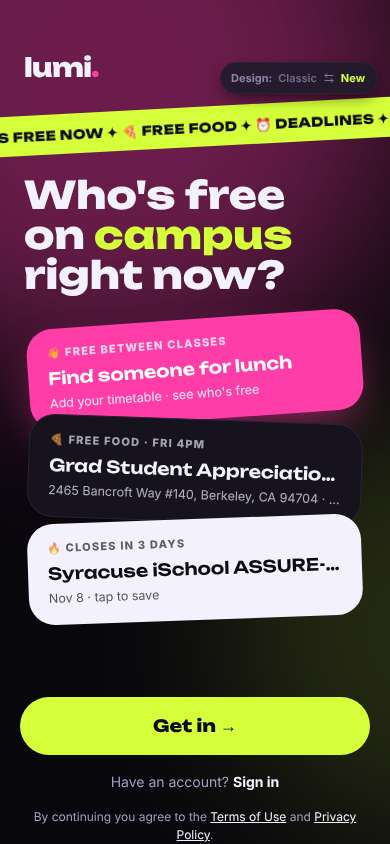
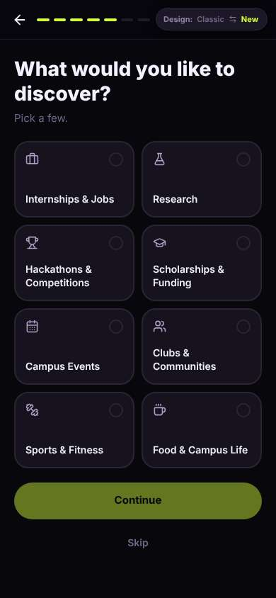
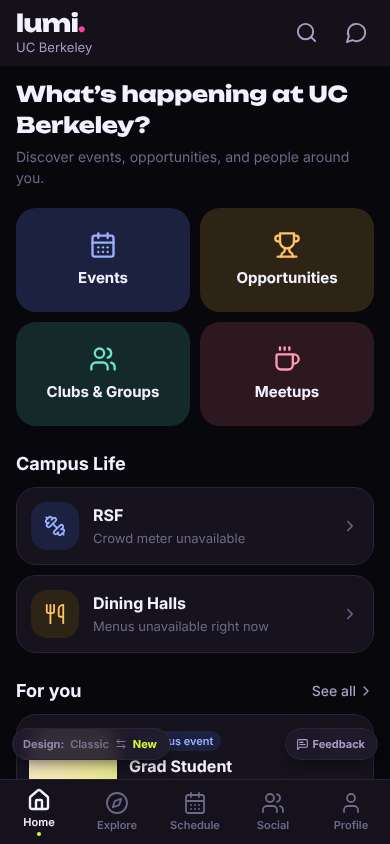
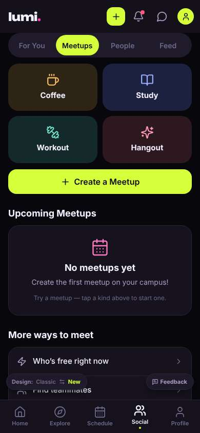
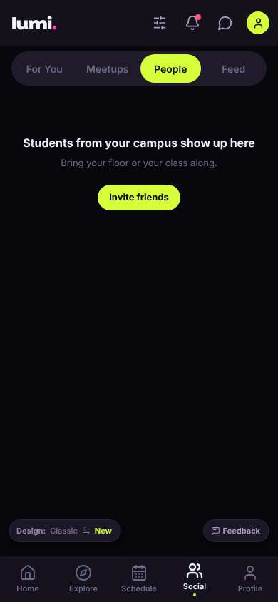

# ux-sim run `cmp2ha-base-cold-start-hangout-minji`

> **AI simulation — hypotheses, not measured user behaviour.** One simulated persona; nothing here is a rate or a measurement of real students.

| | |
|---|---|
| Persona | **Minji**, 17 — First-year (started college a year early) · phone 390×844 · prefers ko · tech high (`minji-freshman-17`) |
| Scenario | **Brand-new account: find someone on campus to hang out with this week** — You just heard about this app and want someone on campus to hang out with this week. Make an account with your school e-mail, then use the app to find a person or plan you could join this week and tell them you're in. (`cold-start-hangout`) |
| Target | local · http://localhost:43865 · worktree commit `2567ab7395d4` |
| Outcome | **abandoned** · ended by persona |
| Account | signed out at start |
| Goal check (fixed, by harness) | not met — _Signed up during the run AND, as that new account, joined/requested a plan, hosted one, sent a friend request or sent a chat message._ |
| Patience | exhausted at step 30; 0 action(s) after |
| Persona's reason | “가입은 했는데 Meetups도 People도 텅 비었고 친구 초대하래. 친구 없어서 깔았는데..” |
| Effort | 22/40 actions · objective frustration 1.50/4.5 · 3 confused note(s) · ~55s simulated |
| Drop-off risk | **high** _(AI hypothesis, persona agent)_ — Signed up through 7 screens and then found nobody — no meetups, no people, just 'invite friends' · basis: steps 26, 29 |

Known environment limits (not UX findings)

- Dining menus and RSF gym crowd levels need live campus sources (the local stack runs with CAMPUS_LIVE=0) — empty or missing data there is not a UX bug.
- AI features (Ask Lumi, AI profile draft on /start, conversation starters) need an OpenAI key; none is configured locally.
- Course catalog is the real Berkeley Class Schedule (6588 courses, Fall 2026 + Spring 2027), fetched 2026-11-02 with the worker's adapter. Seat counts and very recent changes may differ from live.
- Campus events, free food, internships, hackathons and scholarships are a read-only snapshot of live (1119 real items, 103 events this week, taken 2026-11-02 07:25 UTC) plus the CSV calendar. Nothing new appears during the run; Q&A and reviews are empty.
- No e-mail is sent: the sign-up / sign-in code is shown on screen in the hint (live sends a real e-mail).
- Real-time updates (SSE) work locally; other people never reply unless the stack was started with --autoreply.

## Friction

| # | step | type | sev | persona says | screen | element | env-limited | evidence |
|---|---|---|---|---|---|---|---|---|
| f1 | 14 | Onboarding friction | 2 | “아 귀찮아.. 또 고르래. 이메일은 언제 해? Skip” _wish: fewer steps, email sooner_ | `/start` | Skip | no | [shot](shots/014-click.jpg) [marked](shots/014-click-som.jpg) |
| f2 | 24 | No reason to stay | 2 | “Grad student party?? 나 17살인데.. 사람은 어디 있어? Meetups 눌러보자” | `/` | Campus event Grad Student Appreciation Party Sat, Nov 7 ASUC Student Union | no | [shot](shots/024-click.jpg) [marked](shots/024-click-som.jpg) |
| f3 | 26 | Missing / empty content | 2 | “아무것도 없네.. People 탭은?” | `/meet/meetups` |  | no | [shot](shots/026-click.jpg) [marked](shots/026-click-som.jpg) |
| f4 | 29 | Missing / empty content | 4 | “헐 아무도 없어?? 친구 초대하라고... 친구가 없어서 깐 건데 ㅠ” _wish: show me at least some people or plans this week_ | `/people/explore` | Invite friends | no | [shot](shots/029-click.jpg) [marked](shots/029-click-som.jpg) |

Severity: 1 = Minor — noticed it, cosmetic or a small annoyance; did not slow me down. · 2 = Moderate — slowed me down or made me hesitate; I recovered on my own. · 3 = Major — real confusion, a wrong path or many extra steps; I nearly gave up or only got through by guessing. · 4 = Blocker — I could not continue, gave up, or would stop using the app here.

## Where it ended

Step 29 on `/people/explore`.

## Timeline

| step | what | screen | ms | signals / notes | shot |
|---|---|---|---|---|---|
| 0 | start | `/welcome` | 1058 | _curious_: “'Find someone for lunch' 오 이거 나한테 딱인데. Get in 누르자” |  |
| 2 | click “Get in →” | `/start` | 880 | expects: “sign up with school email” (0.7) **mismatch**: name + birth year first, not email ⚑ mismatch _neutral_: “이름이랑 생년. 생년은 안 보인대, ok. 2009 넣자” |  |
| 4 | type “e.g. Alex” ← “Minji” | `/start` | 854 |  |  |
| 5 | type “2005” ← “2009” | `/start` | 843 |  |  |
| 6 | click “Continue” | `/start` | 837 | expects: “next step, maybe email” (0.6) |  |
| 7 | click “Meet new people Study, hang out, and mak” | `/start` | 840 |  |  |
| 8 | click “Continue” | `/start` | 835 | expects: “next step” (0.6) _bored_: “설명 화면.. 영어 많아 패스” |  |
| 10 | click “Continue” | `/start` | 833 | expects: “next step, maybe email” (0.6) |  |
| 11 | type “Search a university” ← “Berkeley” | `/start` | 842 |  |  |
| 12 | click “UC Berkeley University of California, Be” | `/start` | 829 |  |  |
| 13 | click “Undergraduate Bachelor’s student” | `/start` | 833 |  |  |
| 14 | click “Continue” | `/start` | 820 | expects: “email step” (0.6) _frustrated_: “아 귀찮아.. 또 고르래. 이메일은 언제 해? Skip” → f1 |  |
| 16 | click “Skip” | `/start` | 829 | expects: “email step” (0.5) |  |
| 17 | click “Residence Hall / Dorm” | `/start` | 823 |  |  |
| 18 | click “Continue” | `/start` | 831 | expects: “email step finally” (0.5) _neutral_: “이메일 optional? 그래도 학교 이메일로 하라고 했으니까 넣자” |  |
| 20 | type “you@berkeley.edu” ← “minji.park@berkeley.edu” | `/start` | 839 |  |  |
| 21 | click “Send code” | `/start` | 828 | expects: “a code is sent” (0.7) |  |
| 22 | type “123456” ← “200100” | `/start` | 844 |  |  |
| 23 | click “Verify” | `/start` | 831 | expects: “verified” (0.8) |  |
| 24 | click “Get Started” | `/` | 934 | expects: “into the app, people to hang out with” (0.6) **mismatch**: home with grad party and RSF/dining, no people ⚑ mismatch _confused_: “Grad student party?? 나 17살인데.. 사람은 어디 있어? Meetups 눌러보자” → f2 |  |
| 26 | click “Meetups” | `/meet/meetups` | 824 | expects: “plans people made that I can join” (0.6) **mismatch**: No meetups yet — create the first one ⚑ mismatch _neutral_: “아무것도 없네.. People 탭은?” → f3 |  |
| 28 | click “People” | `/people` | 832 | expects: “students I could say hi to” (0.5) |  |
| 29 | click “Explore People” | `/people/explore` | 829 | expects: “list of students” (0.5) _frustrated_: “헐 아무도 없어?? 친구 초대하라고... 친구가 없어서 깐 건데 ㅠ” → f4 |  |
| 31 | finish | `/people/explore` |  |  |  |

## Automatic checks (harness, not persona)

| screen | tap targets < 44px | sideways overflow | broken images |
|---|---|---|---|
| `/welcome` | 4 (Sign in 46×21, Terms of Use 76×15, Privacy Policy 180×33, Switch to the classic design 158×32) | — | — |
| `/start` | 4 (Back 40×40, Switch to the classic design 158×32) | — | — |
| `/` | 3 (See all 62×21, Feedback 93×32, Switch to the classic design 158×32) | — | — |
| `/meet/meetups` | 10 (Create 36×36, Notifications 40×40, Messages 40×40, Me 32×32, For You 85×40) | — | — |
| `/people` | 10 (Create 36×36, Notifications 40×40, Messages 40×40, Me 32×32, For You 85×40) | — | — |
| `/people/explore` | 11 (Filters 40×40, Notifications 40×40, Messages 40×40, Me 32×32, For You 85×40) | — | — |

## Timing (harness)

- Full page load (navigation timing): 148 ms
