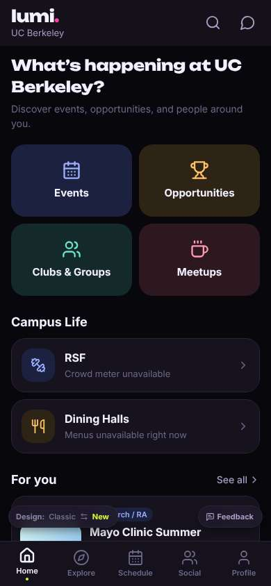
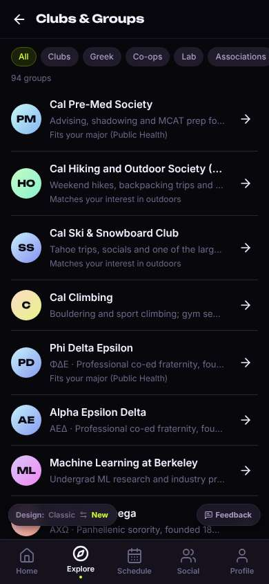
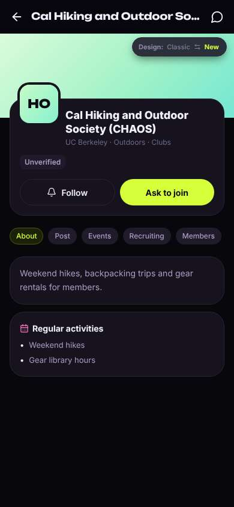
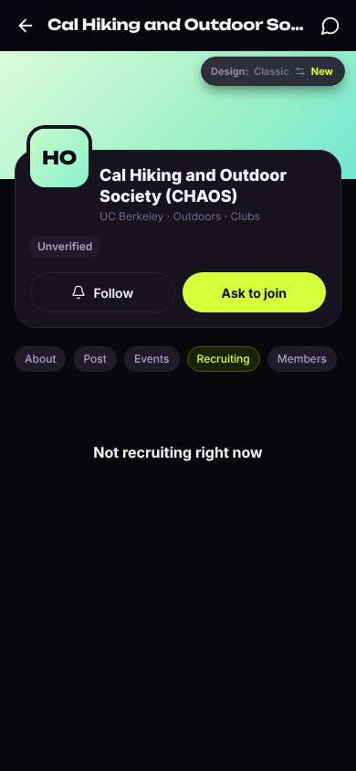

# ux-sim run `cmp2ha-base-find-a-club-aisha`

> **AI simulation — hypotheses, not measured user behaviour.** One simulated persona; nothing here is a rate or a measurement of real students.

| | |
|---|---|
| Persona | **Aisha**, 18 — First-year (first in her family to go to college) · phone 390×844 · prefers en · tech medium (`aisha-firstgen-anxious`) |
| Scenario | **Find a club I'd actually like** — You want to find one student club or group you'd actually enjoy and feel welcome in. Use the app to find one that fits you and open its page to see how to join. (`find-a-club`) |
| Target | local · http://localhost:43729 · worktree commit `2567ab7395d4` |
| Outcome | **success** · ended by persona |
| Account | fresh real account `aisha.isha2954@berkeley.edu` (Aisha, Public Health, born 2008; sample: false) |
| Goal check (fixed, by harness) | met at step 4 after 2 action(s) — evidence: {"urlMatches":"^/orgs/[^/?]+"} — _A club / organization page is open (reached by the persona — the run starts on /)._ |
| Persona's reason | “I found a hiking club that feels friendly and opened its page, but I still don't know if I can join — it says not recruiting next to Ask to join.” |
| Effort | 3/50 actions · objective frustration 1.00/6 · 2 confused note(s) · ~63s simulated |
| Drop-off risk | **medium** _(AI hypothesis, persona agent)_ — Found a club fast, but Unverified + Not recruiting + Ask to join leaves me scared to tap anything · basis: steps 4, 6 |

Known environment limits (not UX findings)

- Dining menus and RSF gym crowd levels need live campus sources (the local stack runs with CAMPUS_LIVE=0) — empty or missing data there is not a UX bug.
- AI features (Ask Lumi, AI profile draft on /start, conversation starters) need an OpenAI key; none is configured locally.
- Course catalog is the real Berkeley Class Schedule (6588 courses, Fall 2026 + Spring 2027), fetched 2026-11-02 with the worker's adapter. Seat counts and very recent changes may differ from live.
- Campus events, free food, internships, hackathons and scholarships are a read-only snapshot of live (1119 real items, 103 events this week, taken 2026-11-02 07:25 UTC) plus the CSV calendar. Nothing new appears during the run; Q&A and reviews are empty.
- No e-mail is sent: the sign-up / sign-in code is shown on screen in the hint (live sends a real e-mail).
- Real-time updates (SSE) work locally; other people never reply unless the stack was started with --autoreply.
- Signed in as a brand-new real (non-sample, e-mail-verified) account made for this run. Other students exist only if the scenario seeds peers (local fixtures); sample profiles are hidden from real accounts, as on live.

## Friction

| # | step | type | sev | persona says | screen | element | env-limited | evidence |
|---|---|---|---|---|---|---|---|---|
| f1 | 2 | Hard to find | 1 | “Pre-Med Society feels like a résumé club. Hiking club sounds friendly and low-pressure. There are a lot of sororities further down... no search box though.” _wish: search clubs by interest_ | `/explore/clubs` |  | no | [shot](shots/002-click.jpg) [marked](shots/002-click-som.jpg) |
| f2 | 4 | Trust / privacy worry | 3 | “Wait, 'Unverified' — is this even the real club? And 'Ask to join'... who am I asking, does it send my profile? Maybe 'Recruiting' tells me if they're taking people.” _wish: say plainly what Ask to join does and whether I can just show up to a hike_ | `/orgs/:id` | Ask to join | no | [shot](shots/004-click.jpg) [marked](shots/004-click-som.jpg) |
| f3 | 6 | Confusing UI | 3 | “So they're not recruiting... but I can still ask to join? Did I miss a window? I don't want to send a request that's wrong. I'll follow them for now so I don't lose it, that seems safe.” _wish: tell me whether I can just show up to hikes and when they take new people_ | `/orgs/:id?tab=recruit` | Recruiting | no | [shot](shots/006-click.jpg) [marked](shots/006-click-som.jpg) |

Severity: 1 = Minor — noticed it, cosmetic or a small annoyance; did not slow me down. · 2 = Moderate — slowed me down or made me hesitate; I recovered on my own. · 3 = Major — real confusion, a wrong path or many extra steps; I nearly gave up or only got through by guessing. · 4 = Blocker — I could not continue, gave up, or would stop using the app here.

## Timeline

| step | what | screen | ms | signals / notes | shot |
|---|---|---|---|---|---|
| 0 | start | `/` | 935 | _curious_: “Oh, 'Clubs & Groups' is right there. That's what I'm looking for.” |  |
| 2 | click “Clubs & Groups” | `/explore/clubs` | 860 | expects: “a list of clubs I can browse” (0.8) as expected _neutral_: “Pre-Med Society feels like a résumé club. Hiking club sounds friendly and low-pressure. There are a lot of sororities further down... no search box though.” → f1 |  |
| 4 | click “HO Cal Hiking and Outdoor Society (CHAOS” | `/orgs/:id` | 844 | expects: “the hiking club's page with how to join” (0.7) **mismatch**: club page with Unverified badge, big 'Ask to join', short About; nothing says how joining works ⚑ mismatch _confused_: “Wait, 'Unverified' — is this even the real club? And 'Ask to join'... who am I asking, does it send my profile? Maybe 'Recruiting' tells me if they're taking people.” → f2 |  |
| 6 | click “Recruiting” | `/orgs/:id?tab=recruit` | 830 | expects: “whether they are recruiting and how to join” (0.6) **mismatch**: 'Not recruiting right now' under a big 'Ask to join' ⚑ mismatch _confused_: “So they're not recruiting... but I can still ask to join? Did I miss a window? I don't want to send a request that's wrong. I'll follow them for now so I don't lose it, that seems safe.” → f3 |  |
| 8 | finish | `/orgs/:id?tab=recruit` |  |  |  |

## Automatic checks (harness, not persona)

| screen | tap targets < 44px | sideways overflow | broken images |
|---|---|---|---|
| `/` | 3 (See all 62×21, Feedback 93×32, Switch to the classic design 158×32) | — | — |
| `/explore/clubs` | 9 (Back 40×40, All 37×28, Clubs 55×28, Greek 56×28, Co-ops 65×28) | — | — |
| `/orgs/:id` | 8 (Back 40×40, Messages 40×40, About 56×28, Post 47×28, Events 61×28) | — | — |
| `/orgs/:id?tab=recruit` | 8 (Back 40×40, Messages 40×40, About 56×28, Post 47×28, Events 61×28) | — | — |

## Timing (harness)

- Full page load (navigation timing): 129 ms
