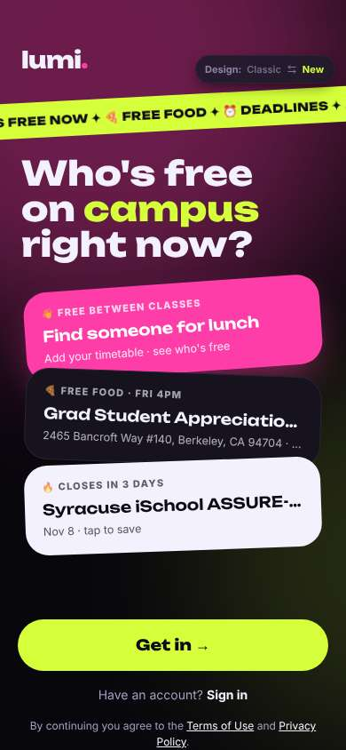
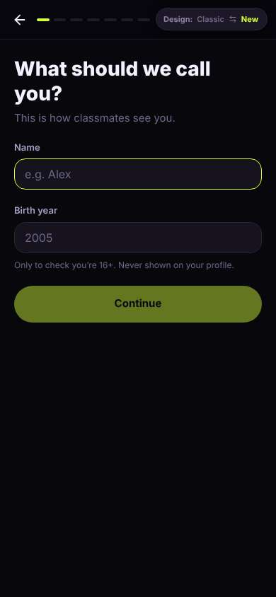
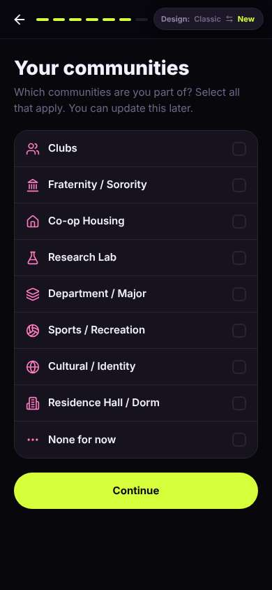
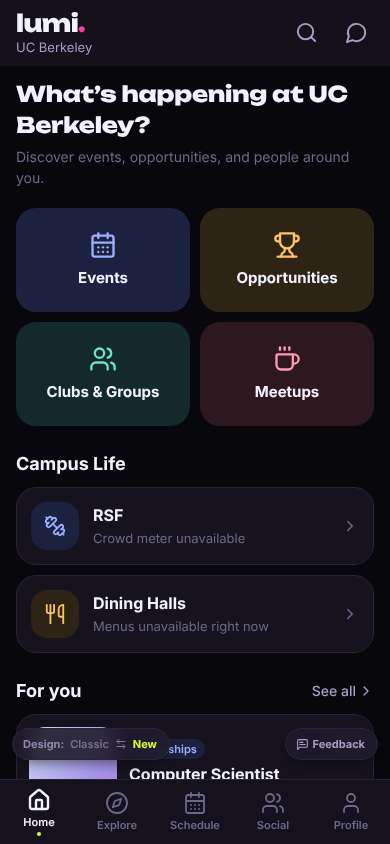

# ux-sim run `cmp2ha-base-first-open-decide-marcus`

> **AI simulation — hypotheses, not measured user behaviour.** One simulated persona; nothing here is a rate or a measurement of real students.

| | |
|---|---|
| Persona | **Marcus**, 22 — Senior · phone 390×844 · prefers en · tech low (`marcus-senior-lowtech`) |
| Scenario | **First open: what is this app, and is it worth signing up?** — A friend sent you a link to this app. You have never seen it before. Figure out what it is for, and decide whether you want to make an account. If it seems worth it, sign up with your school e-mail. (`first-open-decide`) |
| Target | local · http://localhost:43307 · worktree commit `2567ab7395d4` |
| Outcome | **success** · ended by persona |
| Account | signed out at start |
| Goal check (fixed, by harness) | met at step 27 after 20 action(s) — evidence: the account the browser is signed in to was created during this run; {"urlMatches":"^/(discover\|community\|profile)?(\\?.*)?$"} — _Signed up during the run (a new account exists and the browser is signed in to it) and landed inside the app (signed-in home or a main tab)._ |
| Persona's reason | “Signed up with my Berkeley email after seven screens; the front page has an Opportunities button, so I'll check it for internships.” |
| Effort | 20/36 actions · objective frustration 0.50/4 · 0 confused note(s) · ~129s simulated |
| Drop-off risk | **medium** _(AI hypothesis, persona agent)_ — Sign-up asked my name and birth year before showing anything and ran 7 screens; the first job card was CS, not History · basis: steps 2, 18, 27 |

Known environment limits (not UX findings)

- Dining menus and RSF gym crowd levels need live campus sources (the local stack runs with CAMPUS_LIVE=0) — empty or missing data there is not a UX bug.
- AI features (Ask Lumi, AI profile draft on /start, conversation starters) need an OpenAI key; none is configured locally.
- Course catalog is the real Berkeley Class Schedule (6588 courses, Fall 2026 + Spring 2027), fetched 2026-11-02 with the worker's adapter. Seat counts and very recent changes may differ from live.
- Campus events, free food, internships, hackathons and scholarships are a read-only snapshot of live (1119 real items, 103 events this week, taken 2026-11-02 07:25 UTC) plus the CSV calendar. Nothing new appears during the run; Q&A and reviews are empty.
- No e-mail is sent: the sign-up / sign-in code is shown on screen in the hint (live sends a real e-mail).
- Real-time updates (SSE) work locally; other people never reply unless the stack was started with --autoreply.

## Friction

| # | step | type | sev | persona says | screen | element | env-limited | evidence |
|---|---|---|---|---|---|---|---|---|
| f1 | 2 | Trust / privacy worry | 2 | “Name and birth year right away. I haven't even seen an internship. At least it says why it wants the year. First name only, fine.” _wish: let me look around before asking who I am_ | `/start` | 2005 | no | [shot](shots/002-click.jpg) [marked](shots/002-click-som.jpg) |
| f2 | 18 | Onboarding friction | 2 | “Another list. 'None for now.' This is the sixth screen, getting long.” | `/start` | None for now | no | [shot](shots/018-click.jpg) [marked](shots/018-click-som.jpg) |

Severity: 1 = Minor — noticed it, cosmetic or a small annoyance; did not slow me down. · 2 = Moderate — slowed me down or made me hesitate; I recovered on my own. · 3 = Major — real confusion, a wrong path or many extra steps; I nearly gave up or only got through by guessing. · 4 = Blocker — I could not continue, gave up, or would stop using the app here.

## Timeline

| step | what | screen | ms | signals / notes | shot |
|---|---|---|---|---|---|
| 0 | start | `/welcome` | 989 | _neutral_: “'Who's free on campus right now?' and a lunch card — sounds like a social thing. But the moving banner says 457 internships. That's what my sister meant. I'll see what 'Get in' asks for.” |  |
| 2 | click “Get in →” | `/start` | 876 | expects: “see what's inside or sign up” (0.5) **mismatch**: straight to name and birth year, haven't seen anything inside ⚑ mismatch _neutral_: “Name and birth year right away. I haven't even seen an internship. At least it says why it wants the year. First name only, fine.” → f1 |  |
| 4 | type “e.g. Alex” ← “Marcus” | `/start` | 840 |  |  |
| 5 | type “2005” ← “2004” | `/start` | 840 |  |  |
| 6 | click “Continue” | `/start` | 826 | expects: “next question” (0.6) _neutral_: “'Internships' is listed right in the first option. Good, that's me.” |  |
| 8 | click “Discover opportunities & events Internsh” | `/start` | 828 |  |  |
| 9 | click “Continue” | `/start` | 837 | expects: “next” (0.6) _neutral_: “OK, so it's internships plus classes plus clubs. That explains it.” |  |
| 11 | click “Continue” | `/start` | 830 | expects: “next” (0.6) |  |
| 12 | type “Search a university” ← “Berkeley” | `/start` | 828 |  |  |
| 13 | click “UC Berkeley University of California, Be” | `/start` | 823 |  |  |
| 14 | click “Undergraduate Bachelor’s student” | `/start` | 821 |  |  |
| 15 | click “Continue” | `/start` | 819 | expects: “next” (0.6) |  |
| 16 | observe | `/start` |  |  |  |
| 17 | click “Internships & Jobs” | `/start` | 822 |  |  |
| 18 | click “Continue” | `/start` | 838 | expects: “next” (0.6) _neutral_: “Another list. 'None for now.' This is the sixth screen, getting long.” → f2 |  |
| 20 | click “None for now” | `/start` | 842 |  |  |
| 21 | click “Continue” | `/start` | 835 | expects: “email or into the app” (0.5) _neutral_: “School email, optional. It's berkeley.edu so it's tied to campus — that makes it feel more legit. I'll add it.” |  |
| 23 | type “you@berkeley.edu” ← “marcus.reed@berkeley.edu” | `/start` | 838 |  |  |
| 24 | click “Send code” | `/start` | 837 |  |  |
| 25 | type “123456” ← “283687” | `/start` | 841 |  |  |
| 26 | click “Verify” | `/start` | 831 |  |  |
| 27 | click “Get Started” | `/` | 1232 | expects: “into the app, hopefully internships” (0.6) as expected _neutral_: “OK, I'm in, and there's an 'Opportunities' button right on the front. First card is 'Computer Scientist', not exactly History, but it's jobs. Worth keeping.” |  |
| 29 | finish | `/` |  |  |  |

## Automatic checks (harness, not persona)

| screen | tap targets < 44px | sideways overflow | broken images |
|---|---|---|---|
| `/welcome` | 4 (Sign in 46×21, Terms of Use 76×15, Privacy Policy 180×33, Switch to the classic design 158×32) | — | — |
| `/start` | 4 (Back 40×40, Switch to the classic design 158×32) | — | — |
| `/` | 3 (See all 62×21, Feedback 93×32, Switch to the classic design 158×32) | — | — |

## Timing (harness)

- Full page load (navigation timing): 182 ms
