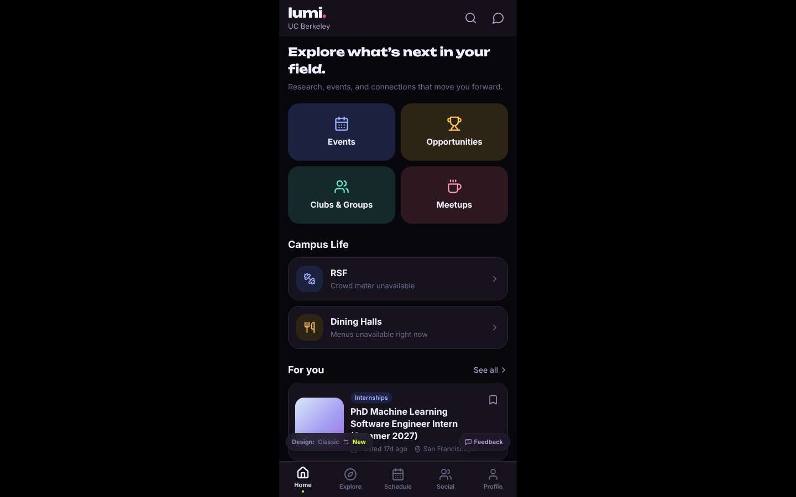
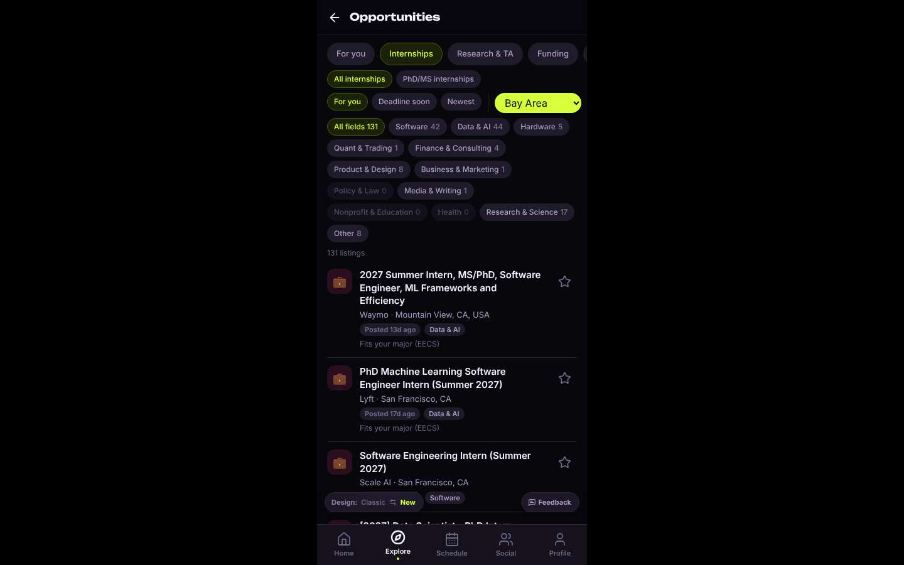
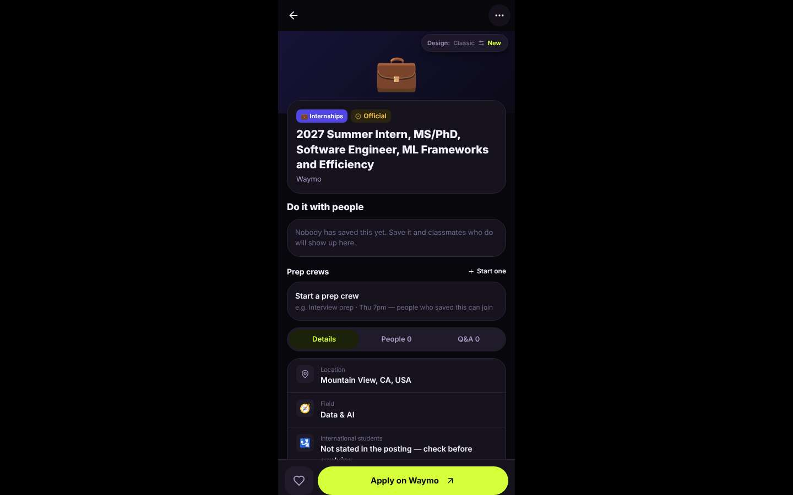

# ux-sim run `cmp2ha-base-internship-near-berkeley-priya`

> **AI simulation — hypotheses, not measured user behaviour.** One simulated persona; nothing here is a rate or a measurement of real students.

| | |
|---|---|
| Persona | **Priya**, 26 — Second-year PhD student · desktop 1440×900 · prefers en · tech high (`priya-phd-desktop`) |
| Scenario | **Find an internship near Berkeley** — You need a paid internship (summer or part-time) somewhere near Berkeley / the Bay Area. Use the app to find one that looks real and open, and open its details so you know how to apply. (`internship-near-berkeley`) |
| Target | local · http://localhost:34627 · worktree commit `2567ab7395d4` |
| Outcome | **success** · ended by persona |
| Account | fresh real account `priya.riya0t2x@berkeley.edu` (Priya, EECS, born 2000; sample: false) |
| Goal check (fixed, by harness) | met at step 9 after 4 action(s) — evidence: {"urlMatches":"^/opportunities/[^/?]+"}; {"textMatches":"\\bintern(ship)?s?\\b"} — _An internship listing's detail page is open (reached by the persona — the run starts on /)._ |
| Persona's reason | “Found a Waymo MS/PhD ML intern role in Mountain View via Opportunities > Internships > Bay Area; Apply link is clear.” |
| Effort | 4/40 actions · objective frustration 0.50/5 · 0 confused note(s) · ~77s simulated |
| Drop-off risk | **medium** _(AI hypothesis, persona agent)_ — The board is useful, but the layout is a phone column on my laptop and it pushes social features over job facts · basis: steps 0, 9 |

Known environment limits (not UX findings)

- Dining menus and RSF gym crowd levels need live campus sources (the local stack runs with CAMPUS_LIVE=0) — empty or missing data there is not a UX bug.
- AI features (Ask Lumi, AI profile draft on /start, conversation starters) need an OpenAI key; none is configured locally.
- Course catalog is the real Berkeley Class Schedule (6588 courses, Fall 2026 + Spring 2027), fetched 2026-11-02 with the worker's adapter. Seat counts and very recent changes may differ from live.
- Campus events, free food, internships, hackathons and scholarships are a read-only snapshot of live (1119 real items, 103 events this week, taken 2026-11-02 07:25 UTC) plus the CSV calendar. Nothing new appears during the run; Q&A and reviews are empty.
- No e-mail is sent: the sign-up / sign-in code is shown on screen in the hint (live sends a real e-mail).
- Real-time updates (SSE) work locally; other people never reply unless the stack was started with --autoreply.
- Signed in as a brand-new real (non-sample, e-mail-verified) account made for this run. Other students exist only if the scenario seeds peers (local fixtures); sample profiles are hidden from real accounts, as on live.

## Friction

| # | step | type | sev | persona says | screen | element | env-limited | evidence |
|---|---|---|---|---|---|---|---|---|
| f1 | 0 | No reason to stay | 1 | “Phone-width column in the middle of a 1440 screen again. At least 'Opportunities' is on the first screen now. I want a list I can filter, not one card.” | `/` |  | no | [shot](shots/000-start.jpg) [marked](shots/000-start-som.jpg) |
| f2 | 9 | Missing / empty content | 2 | “Good enough — Mountain View, MS/PhD, Apply on Waymo. Why is 'Start a prep crew' above the actual details? And nothing about pay.” _wish: pay, dates and eligibility first; social extras below_ | `/opportunities/:id` | Start a prep crew e.g. Interview prep · Thu 7pm — people who saved this can join | no | [shot](shots/009-click.jpg) [marked](shots/009-click-som.jpg) |

Severity: 1 = Minor — noticed it, cosmetic or a small annoyance; did not slow me down. · 2 = Moderate — slowed me down or made me hesitate; I recovered on my own. · 3 = Major — real confusion, a wrong path or many extra steps; I nearly gave up or only got through by guessing. · 4 = Blocker — I could not continue, gave up, or would stop using the app here.

## Timeline

| step | what | screen | ms | signals / notes | shot |
|---|---|---|---|---|---|
| 0 | start | `/` | 931 | _neutral_: “Phone-width column in the middle of a 1440 screen again. At least 'Opportunities' is on the first screen now. I want a list I can filter, not one card.” → f1 |  |
| 2 | click “Opportunities” | `/explore/opportunities` | 1165 | expects: “a list of opportunities with filters for internships and location” (0.7) as expected _curious_: “Good: an actual list, PhD roles, Waymo MS/PhD intern. Filter to Internships.” |  |
| 4 | click “Internships” | `/explore/opportunities` | 832 | expects: “only internships, maybe with a location filter” (0.75) as expected _curious_: “PhD/MS chip and a Location filter. Good. Set location to the Bay Area.” |  |
| 6 | observe | `/explore/opportunities` |  |  |  |
| 7 | select “Location” | `/explore/opportunities` | 815 | expects: “Bay Area internships only” (0.6) as expected _curious_: “131 in the Bay Area. Waymo ML Frameworks MS/PhD intern on top — open it.” |  |
| 9 | click “💼 2027 Summer Intern, MS/PhD, Software ” | `/opportunities/:id` | 937 | expects: “listing details with pay, deadline and how to apply” (0.7) **mismatch**: details open with Apply on Waymo, but social 'prep crew' block sits above the job details; no pay info ⚑ mismatch _neutral_: “Good enough — Mountain View, MS/PhD, Apply on Waymo. Why is 'Start a prep crew' above the actual details? And nothing about pay.” → f2 |  |
| 11 | finish | `/opportunities/:id` |  |  |  |

## Timing (harness)

- Full page load (navigation timing): 127 ms
