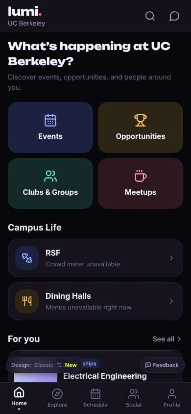
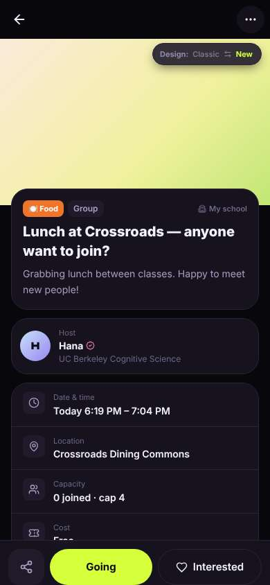
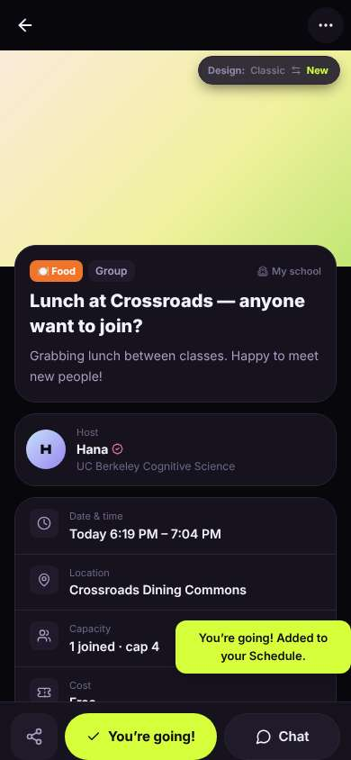
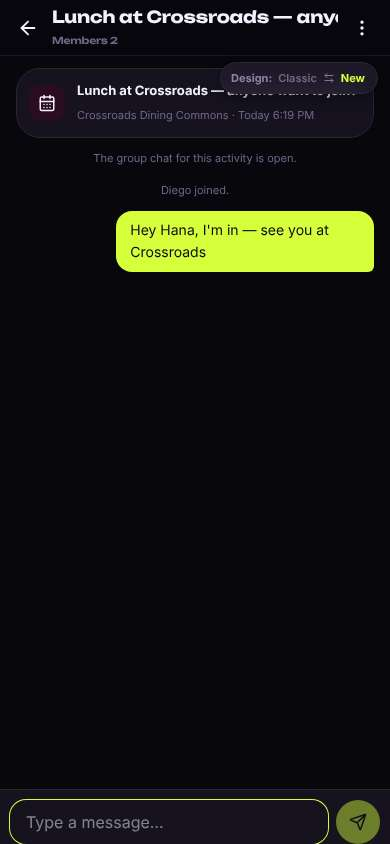

# ux-sim run `cmp2ha-base-lunch-today-diego`

> **AI simulation — hypotheses, not measured user behaviour.** One simulated persona; nothing here is a rate or a measurement of real students.

| | |
|---|---|
| Persona | **Diego**, 21 — Junior (transfer from Laney College) · phone 390×844 · prefers en · tech medium (`diego-transfer-commuter`) |
| Scenario | **Find someone to get lunch with today** — It's a weekday and you'd rather not eat lunch alone again. Use the app to find someone (or a group) to get lunch with today, and let them know you're in. (`lunch-today`) |
| Target | local · http://localhost:46067 · worktree commit `2567ab7395d4` |
| Outcome | **success** · ended by persona |
| Account | fresh real account `diego.iegoxk31@berkeley.edu` (Diego, Civil Engineering, born 2005; sample: false) · peers seeded: Hana, Leo |
| Goal check (fixed, by harness) | met at step 5 after 3 action(s) — evidence: joined or asked to join a peer's lunch plan; joined or asked to join a plan — _During the run the persona's own account joined/requested one of today's lunch plans, posted its own meal plan for today, or messaged in a lunch plan's chat._ |
| Persona's reason | “Joined Hana's Crossroads meal from Social > Meetups and told her in the chat. Under a minute.” |
| Effort | 5/32 actions · objective frustration 0.00/4 · 0 confused note(s) · ~26s simulated |
| Drop-off risk | **medium** _(AI hypothesis, persona agent)_ — Fast for lunch, but I still haven't seen anything about study partners or rides for my commute · basis: steps 1, 5 |

Known environment limits (not UX findings)

- Dining menus and RSF gym crowd levels need live campus sources (the local stack runs with CAMPUS_LIVE=0) — empty or missing data there is not a UX bug.
- AI features (Ask Lumi, AI profile draft on /start, conversation starters) need an OpenAI key; none is configured locally.
- Course catalog is the real Berkeley Class Schedule (6588 courses, Fall 2026 + Spring 2027), fetched 2026-11-02 with the worker's adapter. Seat counts and very recent changes may differ from live.
- Campus events, free food, internships, hackathons and scholarships are a read-only snapshot of live (1119 real items, 103 events this week, taken 2026-11-02 07:25 UTC) plus the CSV calendar. Nothing new appears during the run; Q&A and reviews are empty.
- No e-mail is sent: the sign-up / sign-in code is shown on screen in the hint (live sends a real e-mail).
- Real-time updates (SSE) work locally; other people never reply unless the stack was started with --autoreply.
- Signed in as a brand-new real (non-sample, e-mail-verified) account made for this run. Other students exist only if the scenario seeds peers (local fixtures); sample profiles are hidden from real accounts, as on live.

## Friction

| # | step | type | sev | persona says | screen | element | env-limited | evidence |
|---|---|---|---|---|---|---|---|---|
| f1 | 9 | Unclear wording | 1 | “Sent. Took a minute. Only thing: it's called lunch but it's 6pm, and the list said 1 going while the page said 0 joined.” | `/chats/:id` |  | no | [shot](shots/009-type.jpg) [marked](shots/009-type-som.jpg) |

Severity: 1 = Minor — noticed it, cosmetic or a small annoyance; did not slow me down. · 2 = Moderate — slowed me down or made me hesitate; I recovered on my own. · 3 = Major — real confusion, a wrong path or many extra steps; I nearly gave up or only got through by guessing. · 4 = Blocker — I could not continue, gave up, or would stop using the app here.

## Timeline

| step | what | screen | ms | signals / notes | shot |
|---|---|---|---|---|---|
| 0 | start | `/` | 1021 |  |  |
| 1 | click “Meetups” | `/meet/meetups` | 887 | expects: “people doing meetups, maybe a lunch” (0.6) as expected _curious_: “OK, two food things today. 'Lunch' at 6:19 PM is weird but whatever, Crossroads is close.” |  |
| 3 | click “Lunch at Crossroads — anyone want to joi” | `/activities/:id` | 1042 | expects: “details of the Crossroads lunch and a join button” (0.7) as expected _neutral_: “Hana, CogSci, Crossroads. 'Going' — I guess that's join. '0 joined' but the list said 1 going, eh.” |  |
| 5 | click “Going” | `/activities/:id` | 842 | expects: “I'm added to her lunch and can message her” (0.6) as expected _delighted_: “Done, that was quick. There's a Chat button right there, nice.” |  |
| 7 | click “Chat” | `/chats/:id` | 941 | expects: “the group chat for this lunch” (0.8) as expected _neutral_: “Good, chat is here. I'll just say I'm coming.” |  |
| 9 | type “Type a message…” ← “Hey Hana, I'm in — see you at Crossroads” | `/chats/:id` | 854 | expects: “message sent in the chat” (0.8) as expected _neutral_: “Sent. Took a minute. Only thing: it's called lunch but it's 6pm, and the list said 1 going while the page said 0 joined.” → f1 |  |
| 11 | finish | `/chats/:id` |  |  |  |

## Automatic checks (harness, not persona)

| screen | tap targets < 44px | sideways overflow | broken images |
|---|---|---|---|
| `/` | 3 (See all 62×21, Feedback 93×32, Switch to the classic design 158×32) | — | — |
| `/meet/meetups` | 10 (Create 36×36, Notifications 40×40, Messages 40×40, Me 32×32, For You 85×40) | — | — |
| `/activities/:id` | 3 (Back 40×40, More 40×40, Switch to the classic design 158×32) | — | — |
| `/chats/:id` | 3 (Back 40×40, Menu 40×40, Switch to the classic design 158×32) | — | — |

## Timing (harness)

- Full page load (navigation timing): 116 ms
