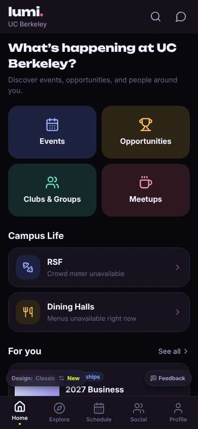
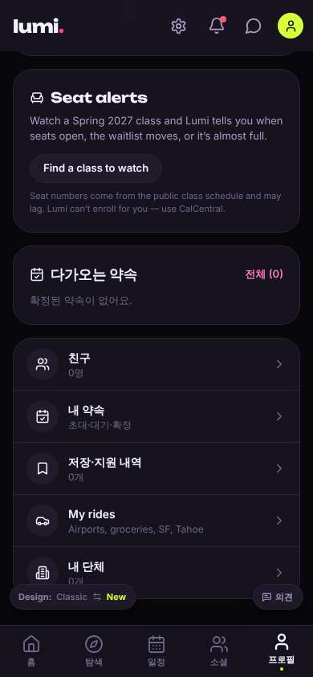
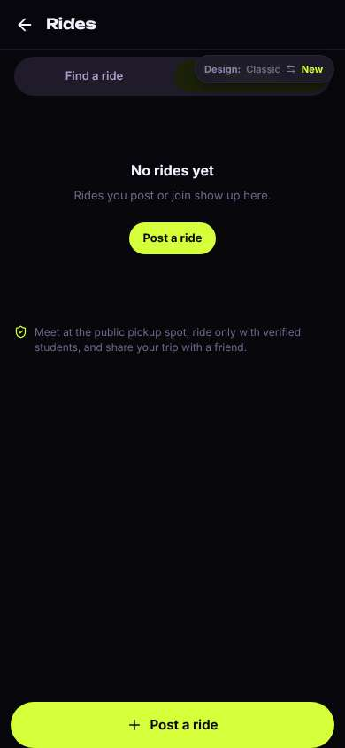
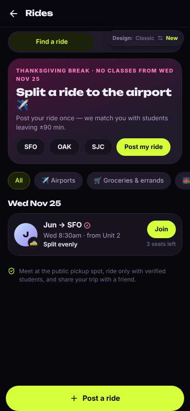
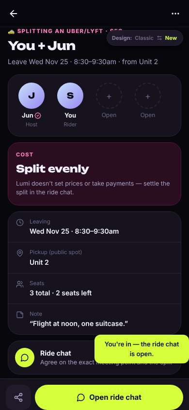

# ux-sim run `cmp2ha-base-ride-sfo-thanksgiving-seoyeon`

> **AI simulation — hypotheses, not measured user behaviour.** One simulated persona; nothing here is a rate or a measurement of real students.

| | |
|---|---|
| Persona | **Seoyeon**, 20 — Exchange student (one semester, from Yonsei) · phone 390×844 · prefers ko · tech medium (`seoyeon-exchange-korean`) |
| Scenario | **Share a ride to SFO for Thanksgiving** — You fly out of SFO the Wednesday before Thanksgiving (Nov 25) in the morning. Find other students to split a ride to the airport with — join one, or post yours so others can find you. (`ride-sfo-thanksgiving`) |
| Target | local · http://localhost:34819 · worktree commit `2567ab7395d4` |
| Outcome | **success** · ended by persona |
| Account | fresh real account `seoyeon.yeon3jcs@berkeley.edu` (Seoyeon, Business Administration, born 2006; sample: false) · peers seeded: Jun |
| Goal check (fixed, by harness) | met at step 17 after 9 action(s) — evidence: joined someone's SFO ride — _During the run the persona posted an SFO ride on Nov 25, or joined/requested someone's SFO ride (server-side)._ |
| Persona's reason | “Jun의 25일 SFO 라이드에 참여했어요. 한국어 설정은 쉬웠는데 라이드 화면은 영어였어요.” |
| Effort | 9/45 actions · objective frustration 1.00/5 · 2 confused note(s) · ~102s simulated |
| Drop-off risk | **low** _(AI hypothesis, persona agent)_ — Found and joined a matching SFO ride, no phone number asked; Rides screens stay English · basis: steps 13, 17 |

Known environment limits (not UX findings)

- Dining menus and RSF gym crowd levels need live campus sources (the local stack runs with CAMPUS_LIVE=0) — empty or missing data there is not a UX bug.
- AI features (Ask Lumi, AI profile draft on /start, conversation starters) need an OpenAI key; none is configured locally.
- Course catalog is the real Berkeley Class Schedule (6588 courses, Fall 2026 + Spring 2027), fetched 2026-11-02 with the worker's adapter. Seat counts and very recent changes may differ from live.
- Campus events, free food, internships, hackathons and scholarships are a read-only snapshot of live (1119 real items, 103 events this week, taken 2026-11-02 07:25 UTC) plus the CSV calendar. Nothing new appears during the run; Q&A and reviews are empty.
- No e-mail is sent: the sign-up / sign-in code is shown on screen in the hint (live sends a real e-mail).
- Real-time updates (SSE) work locally; other people never reply unless the stack was started with --autoreply.
- Signed in as a brand-new real (non-sample, e-mail-verified) account made for this run. Other students exist only if the scenario seeds peers (local fixtures); sample profiles are hidden from real accounts, as on live.

## Friction

| # | step | type | sev | persona says | screen | element | env-limited | evidence |
|---|---|---|---|---|---|---|---|---|
| f1 | 9 | Unclear wording | 1 | “'My rides — Airports' 이거 영어로 남아있네. 그래도 공항이라 써있어서 이거다” | `/profile` | My rides Airports, groceries, SF, Tahoe | no | [shot](shots/009-scroll.jpg) [marked](shots/009-scroll-som.jpg) |
| f2 | 11 | Unclear wording | 2 | “어... 다 영어네. 내 라이드는 없고. 'Find a ride' 누르면 다른 사람 것 보이겠지” | `/rides` | Find a ride | no | [shot](shots/011-click.jpg) [marked](shots/011-click-som.jpg) |

Severity: 1 = Minor — noticed it, cosmetic or a small annoyance; did not slow me down. · 2 = Moderate — slowed me down or made me hesitate; I recovered on my own. · 3 = Major — real confusion, a wrong path or many extra steps; I nearly gave up or only got through by guessing. · 4 = Blocker — I could not continue, gave up, or would stop using the app here.

## Timeline

| step | what | screen | ms | signals / notes | shot |
|---|---|---|---|---|---|
| 0 | start | `/` | 933 | _confused_: “어... 영어가 너무 많아. 공항 가는 거 어디 있지? 한국어 설정 먼저 찾아보자. Profile에 있을까?” |  |
| 2 | click “Profile” | `/profile` | 967 | expects: “profile with settings, maybe language” (0.5) as expected _neutral_: “Settings 있다. 언어 바꾸자” |  |
| 4 | click “Settings” | `/settings` | 840 | expects: “settings with language” (0.7) as expected _delighted_: “한국어 있다!” |  |
| 6 | click “한국어” | `/settings` | 933 | expects: “app switches to Korean” (0.85) as expected _delighted_: “좋아 이제 읽기 쉬워. 이제 공항 가는 거 찾자” |  |
| 8 | back | `/profile` | 902 | ⚑ backtrack |  |
| 9 | scroll down | `/profile` | 1321 | _neutral_: “'My rides — Airports' 이거 영어로 남아있네. 그래도 공항이라 써있어서 이거다” → f1 |  |
| 11 | click “My rides Airports, groceries, SF, Tahoe” | `/rides` | 855 | expects: “rides to the airport, maybe SFO” (0.7) **mismatch**: My rides is empty, English screen; there's a 'Find a ride' tab ⚑ mismatch _confused_: “어... 다 영어네. 내 라이드는 없고. 'Find a ride' 누르면 다른 사람 것 보이겠지” → f2 |  |
| 13 | click “Find a ride” | `/rides` | 839 | expects: “list of rides others posted, maybe SFO” (0.7) as expected _delighted_: “와! Jun이 25일 수요일 8:30 SFO 간대. 내 비행기 아침이니까 딱이다. 영어지만 SFO, Wed는 알겠어” |  |
| 15 | click “J 🚕 Jun → SFO Wed 8:30am · from Unit 2 ” | `/rides/:id` | 838 | expects: “ride details and a join button” (0.75) as expected _neutral_: “Public pickup, 전화번호 안 물어봄. 안심. Join 누르자” |  |
| 17 | click “Join · 3 seats left” | `/rides/:id` | 823 | expects: “I join Jun's ride” (0.8) as expected _delighted_: “됐다! Jun이랑 같이 가. 채팅에서 얘기하면 되겠다” |  |
| 19 | finish | `/rides/:id` |  |  |  |

## Automatic checks (harness, not persona)

| screen | tap targets < 44px | sideways overflow | broken images |
|---|---|---|---|
| `/` | 3 (See all 62×21, Feedback 93×32, Switch to the classic design 158×32) | — | — |
| `/profile` | 7 (Notifications 40×40, Messages 40×40, Me 32×32, Find a class to watch 165×36, Feedback 93×32) | — | — |
| `/settings` | 6 (Back 40×40, Allow 69×36, Open 66×36, 한국어 156×36, English 156×36) | — | — |
| `/rides` | 12 (뒤로 40×40, Find a ride 173×36, My rides 173×36, Post a ride 99×36, Switch to the classic design 158×32) | — | — |
| `/rides/:id` | 3 (뒤로 40×40, More 40×40, Switch to the classic design 158×32) | — | — |

## Timing (harness)

- Full page load (navigation timing): 128 ms, 69 ms
