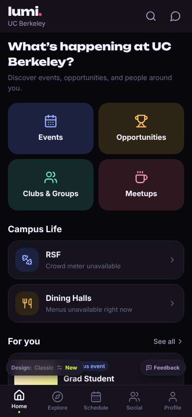
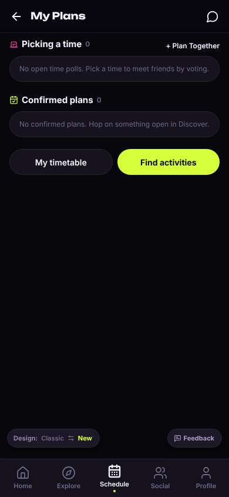
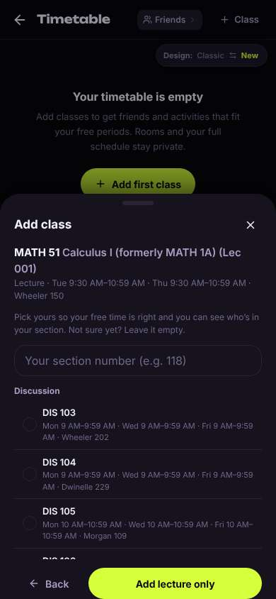
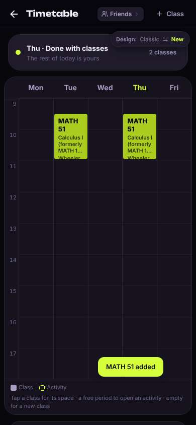

# ux-sim run `cmp2ha-base-timetable-add-classes-minji`

> **AI simulation — hypotheses, not measured user behaviour.** One simulated persona; nothing here is a rate or a measurement of real students.

| | |
|---|---|
| Persona | **Minji**, 17 — First-year (started college a year early) · phone 390×844 · prefers ko · tech high (`minji-freshman-17`) |
| Scenario | **Put my classes into my timetable** — You want the app to know your schedule so it can show who's free when you are. Add your calculus class — Calculus I, which you know as MATH 1A — to your timetable in the app. (`timetable-add-classes`) |
| Target | local · http://localhost:45875 · worktree commit `2567ab7395d4` |
| Outcome | **success** · ended by persona |
| Account | fresh real account `minji.injiz63m@berkeley.edu` (Minji, Undeclared, born 2009; sample: false) |
| Goal check (fixed, by harness) | met at step 12 after 6 action(s) — evidence: Calculus I is in my saved timetable — _The persona's own timetable (server-side) gained Calculus I (MATH 51 / MATH 1A) during the run._ |
| Persona's reason | “MATH 51 (전 1A) 시간표에 넣었어. 쉬웠음.” |
| Effort | 6/40 actions · objective frustration 1.00/4.5 · 0 confused note(s) · ~33s simulated |
| Drop-off risk | **medium** _(AI hypothesis, persona agent)_ — Adding was easy but nothing shows people my age or my dorm yet · basis: steps 12 |

Known environment limits (not UX findings)

- Dining menus and RSF gym crowd levels need live campus sources (the local stack runs with CAMPUS_LIVE=0) — empty or missing data there is not a UX bug.
- AI features (Ask Lumi, AI profile draft on /start, conversation starters) need an OpenAI key; none is configured locally.
- Course catalog is the real Berkeley Class Schedule (6588 courses, Fall 2026 + Spring 2027), fetched 2026-11-02 with the worker's adapter. Seat counts and very recent changes may differ from live.
- Campus events, free food, internships, hackathons and scholarships are a read-only snapshot of live (1119 real items, 103 events this week, taken 2026-11-02 07:25 UTC) plus the CSV calendar. Nothing new appears during the run; Q&A and reviews are empty.
- No e-mail is sent: the sign-up / sign-in code is shown on screen in the hint (live sends a real e-mail).
- Real-time updates (SSE) work locally; other people never reply unless the stack was started with --autoreply.
- Signed in as a brand-new real (non-sample, e-mail-verified) account made for this run. Other students exist only if the scenario seeds peers (local fixtures); sample profiles are hidden from real accounts, as on live.

## Friction

| # | step | type | sev | persona says | screen | element | env-limited | evidence |
|---|---|---|---|---|---|---|---|---|
| f1 | 2 | Hard to find | 1 | “My Plans? 시간표 아니네. 아 밑에 My timetable 있다” | `/schedule` | My timetable | no | [shot](shots/002-click.jpg) [marked](shots/002-click-som.jpg) |
| f2 | 10 | Confusing UI | 1 | “디스커션 섹션?? 몰라.. 'Add lecture only' 누르면 되겠지” | `/timetable` | Add lecture only | no | [shot](shots/010-click.jpg) [marked](shots/010-click-som.jpg) |
| f3 | 12 | Unclear wording | 1 | “들어갔다! 근데 '2 classes'? 하나인데..” | `/timetable` |  | no | [shot](shots/012-click.jpg) [marked](shots/012-click-som.jpg) |

Severity: 1 = Minor — noticed it, cosmetic or a small annoyance; did not slow me down. · 2 = Moderate — slowed me down or made me hesitate; I recovered on my own. · 3 = Major — real confusion, a wrong path or many extra steps; I nearly gave up or only got through by guessing. · 4 = Blocker — I could not continue, gave up, or would stop using the app here.

## Timeline

| step | what | screen | ms | signals / notes | shot |
|---|---|---|---|---|---|
| 0 | start | `/` | 973 | _neutral_: “영어 많네.. 시간표는 Schedule 이겠지” |  |
| 2 | click “Schedule” | `/schedule` | 881 | expects: “my timetable where I can add classes” (0.7) **mismatch**: My Plans with polls, timetable is a button at the bottom ⚑ mismatch _neutral_: “My Plans? 시간표 아니네. 아 밑에 My timetable 있다” → f1 |  |
| 4 | click “My timetable” | `/timetable` | 834 | expects: “timetable grid with an add class button” (0.8) as expected _curious_: “오 다른 사람은 free 시간만 본대. 좋아” |  |
| 6 | click “Add first class” | `/timetable` | 839 | expects: “search for a class” (0.8) as expected _neutral_: “검색창 있다. MATH 1A 쳐보자” |  |
| 8 | type “Search by course name or code” ← “MATH 1A” | `/timetable` | 849 | expects: “Calculus shows up” (0.7) as expected _curious_: “MATH 51로 바뀌었네, formerly 1A 써있어서 다행. 9:30 거 같아” |  |
| 10 | click “MATH 51 Calculus I (formerly MATH 1A) (L” | `/timetable` | 3841 | expects: “it gets added or asks for section” (0.6) **mismatch**: asks for a discussion section from a long list ⚑ mismatch _neutral_: “디스커션 섹션?? 몰라.. 'Add lecture only' 누르면 되겠지” → f2 |  |
| 12 | click “Add lecture only” | `/timetable` | 829 | expects: “math class added to my timetable” (0.75) as expected _neutral_: “들어갔다! 근데 '2 classes'? 하나인데..” → f3 |  |
| 14 | finish | `/timetable` |  |  |  |

## Automatic checks (harness, not persona)

| screen | tap targets < 44px | sideways overflow | broken images |
|---|---|---|---|
| `/` | 3 (See all 62×21, Feedback 93×32, Switch to the classic design 158×32) | — | — |
| `/schedule` | 5 (Back 40×40, Messages 40×40, + Plan Together 92×18, Feedback 93×32, Switch to the classic design 158×32) | — | — |
| `/timetable` | 7 (Back 40×40, Friends 92×28, Class 88×36, Switch to the classic design 158×32) | — | — |

## Timing (harness)

- Full page load (navigation timing): 170 ms
- Step 10 `click` took 3841 ms until the network was quiet on `/timetable`
