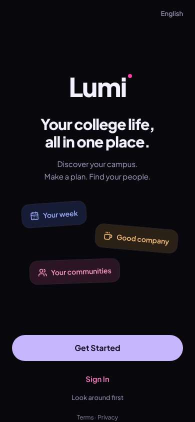
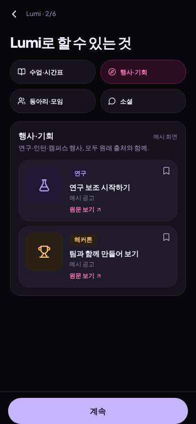
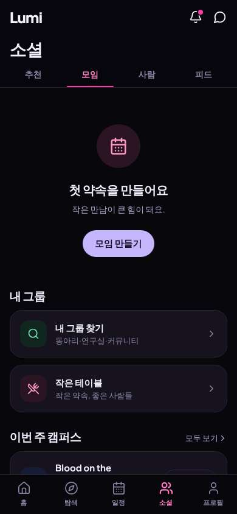
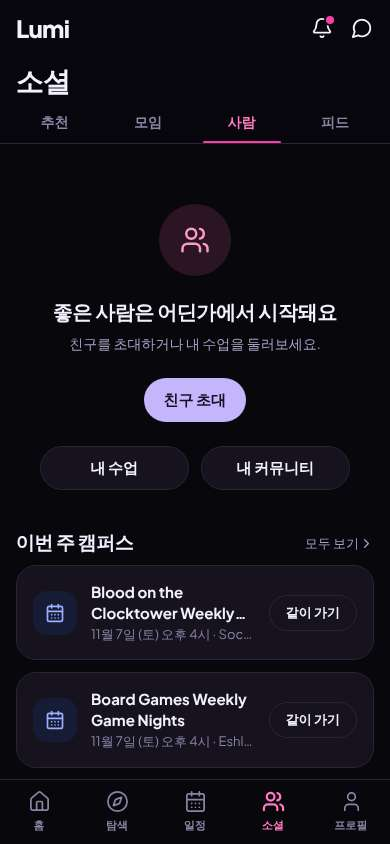
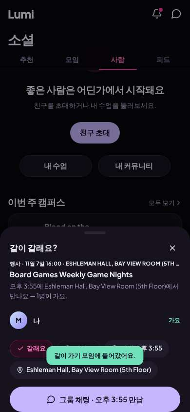

# ux-sim run `cmp2ha-new-cold-start-hangout-minji`

> **AI simulation — hypotheses, not measured user behaviour.** One simulated persona; nothing here is a rate or a measurement of real students.

| | |
|---|---|
| Persona | **Minji**, 17 — First-year (started college a year early) · phone 390×844 · prefers ko · tech high (`minji-freshman-17`) |
| Scenario | **Brand-new account: find someone on campus to hang out with this week** — You just heard about this app and want someone on campus to hang out with this week. Make an account with your school e-mail, then use the app to find a person or plan you could join this week and tell them you're in. (`cold-start-hangout`) |
| Target | local · http://localhost:38913 · worktree commit `a3f2ebed58f4` |
| Outcome | **success** · ended by persona |
| Account | signed out at start |
| Goal check (fixed, by harness) | met at step 37 after 25 action(s) — evidence: the account the browser is signed in to was created during this run; posted a plan — _Signed up during the run AND, as that new account, joined/requested a plan, hosted one, sent a friend request or sent a chat message._ |
| Persona's reason | “토요일 보드게임 나이트 '같이 가기'에 들어갔어. 근데 아직 나 혼자라 누가 올지 모르겠어.” |
| Effort | 25/40 actions · objective frustration 2.00/4.5 · 2 confused note(s) · ~47s simulated |
| Drop-off risk | **medium** _(AI hypothesis, persona agent)_ — Korean switch and a way to go to something this week were easy, but I'm still the only one — no people anywhere · basis: steps 2, 35, 37 |

Known environment limits (not UX findings)

- Dining menus and RSF gym crowd levels need live campus sources (the local stack runs with CAMPUS_LIVE=0) — empty or missing data there is not a UX bug.
- AI features (Ask Lumi, AI profile draft on /start, conversation starters) need an OpenAI key; none is configured locally.
- Course catalog is the real Berkeley Class Schedule (6588 courses, Fall 2026 + Spring 2027), fetched 2026-11-02 with the worker's adapter. Seat counts and very recent changes may differ from live.
- Campus events, free food, internships, hackathons and scholarships are a read-only snapshot of live (1119 real items, 103 events this week, taken 2026-11-02 07:25 UTC) plus the CSV calendar. Nothing new appears during the run; Q&A and reviews are empty.
- No e-mail is sent: the sign-up / sign-in code is shown on screen in the hint (live sends a real e-mail).
- Real-time updates (SSE) work locally; other people never reply unless the stack was started with --autoreply.

## Friction

| # | step | type | sev | persona says | screen | element | env-limited | evidence |
|---|---|---|---|---|---|---|---|---|
| f1 | 9 | Onboarding friction | 2 | “뭐지, 계속 눌렀는데 아직 2/6? 탭 4개 다 봐야 돼? 아 귀찮아” _wish: let me skip the tour_ | `/start/what` | 계속 | no | [shot](shots/009-click.jpg) [marked](shots/009-click-som.jpg) |
| f2 | 33 | Missing / empty content | 2 | “모임은 없고 첫 약속 만들래. 밑에 게임나이트 있네. 사람 탭은?” | `/social/meetups` |  | no | [shot](shots/033-click.jpg) [marked](shots/033-click-som.jpg) |
| f3 | 35 | Missing / empty content | 3 | “사람도 없네.. 친구 초대하래. 근데 밑에 보드게임 나이트 토요일 — '같이 가기' 누르면 같이 갈 사람 찾아주나?” _wish: show me some people or plans this week, not invite friends_ | `/social/people` | 친구 초대 | no | [shot](shots/035-click.jpg) [marked](shots/035-click-som.jpg) |
| f4 | 37 | Confusing UI | 2 | “어? 바로 들어가졌네. '1명이 가요' — 나 혼자잖아 ㅋㅋ. 그래도 토요일 보드게임, 그룹 채팅 있으니까 누가 오면 얘기하면 되겠다” _wish: ask before joining, and say nobody else is in yet_ | `/social/people` | 갈래요 | no | [shot](shots/037-click.jpg) [marked](shots/037-click-som.jpg) |

Severity: 1 = Minor — noticed it, cosmetic or a small annoyance; did not slow me down. · 2 = Moderate — slowed me down or made me hesitate; I recovered on my own. · 3 = Major — real confusion, a wrong path or many extra steps; I nearly gave up or only got through by guessing. · 4 = Blocker — I could not continue, gave up, or would stop using the app here.

## Timeline

| step | what | screen | ms | signals / notes | shot |
|---|---|---|---|---|---|
| 0 | start | `/welcome` | 995 | _curious_: “깔끔하네. 오른쪽 위에 'English' — 한국어 있나?” |  |
| 2 | click “English” | `/welcome` | 863 | expects: “language choices incl. Korean” (0.6) **mismatch**: toggled straight to Korean ⚑ mismatch _delighted_: “헐 바로 한국어 됐다! 좋아. 시작하기” |  |
| 4 | click “시작하기” | `/start/goals` | 859 | expects: “sign up with school email” (0.7) _neutral_: “1/6.. 6단계. 새 사람 만나기” |  |
| 6 | click “새 사람 만나기” | `/start/goals` | 829 |  |  |
| 7 | click “계속” | `/start/what` | 845 | expects: “next step” (0.6) _bored_: “예시 화면.. 패스” |  |
| 9 | click “계속” | `/start/what` | 839 | expects: “next step” (0.6) **mismatch**: Continue only moved to the next tab of the same 2/6 tour ⚑ mismatch _frustrated_: “뭐지, 계속 눌렀는데 아직 2/6? 탭 4개 다 봐야 돼? 아 귀찮아” → f1 |  |
| 11 | click “계속” | `/start/what` | 840 |  |  |
| 12 | click “계속” | `/start/what` | 838 |  |  |
| 13 | click “계속” | `/start/university` | 834 | expects: “next step finally” (0.5) |  |
| 14 | type “학교 검색” ← “Berkeley” | `/start/university` | 855 |  |  |
| 15 | click “UC Berkeley University of California, Be” | `/start/university` | 839 |  |  |
| 16 | observe | `/start/university` |  |  |  |
| 17 | click “학부생” | `/start/university` | 827 |  |  |
| 18 | click “1학년” | `/start/university` | 828 |  |  |
| 19 | click “계속” | `/start/discover` | 831 | expects: “email step” (0.6) |  |
| 20 | click “건너뛰기” | `/start/communities` | 830 | expects: “next step, maybe email” (0.6) |  |
| 21 | click “기숙사” | `/start/communities` | 835 |  |  |
| 22 | observe | `/start/communities` |  |  |  |
| 23 | click “다음” | `/start/about` | 834 | expects: “email step” (0.6) _neutral_: “마지막 6/6. 이름, 생년 (나만 보임), 이메일. ok” |  |
| 25 | type “이름 또는 닉네임” ← “Minji” | `/start/about` | 837 |  |  |
| 26 | type “나만 보여요” ← “2009” | `/start/about` | 840 |  |  |
| 27 | type “you@berkeley.edu” ← “minji.park@berkeley.edu” | `/start/about` | 841 |  |  |
| 28 | click “코드 받기” | `/start/about` | 834 | expects: “code sent” (0.7) |  |
| 29 | type “코드 입력” ← “685133” | `/start/about` | 840 |  |  |
| 30 | observe | `/start/about` |  |  |  |
| 31 | click “시작하기” | `/` | 1233 | expects: “into the app, people to hang out with” (0.6) _neutral_: “들어왔다. 근데 홈엔 행사만.. 사람은? 모임 눌러보자” |  |
| 33 | click “모임” | `/social/meetups` | 825 | expects: “plans people made that I can join” (0.6) **mismatch**: no meetups, 'make your first plan'; campus events below with '같이 가기' ⚑ mismatch _neutral_: “모임은 없고 첫 약속 만들래. 밑에 게임나이트 있네. 사람 탭은?” → f2 |  |
| 35 | click “사람” | `/social/people` | 832 | expects: “students I could say hi to” (0.5) _confused_: “사람도 없네.. 친구 초대하래. 근데 밑에 보드게임 나이트 토요일 — '같이 가기' 누르면 같이 갈 사람 찾아주나?” → f3 |  |
| 37 | click “같이 가기” | `/social/people` | 831 | expects: “find others going to board games night with me” (0.4) **mismatch**: one tap put me in a 'go together' group as the only person (1명이 가요), with a group chat ⚑ mismatch _neutral_: “어? 바로 들어가졌네. '1명이 가요' — 나 혼자잖아 ㅋㅋ. 그래도 토요일 보드게임, 그룹 채팅 있으니까 누가 오면 얘기하면 되겠다” → f4 |  |
| 39 | finish | `/social/people` |  |  |  |

## Automatic checks (harness, not persona)

| screen | tap targets < 44px | sideways overflow | broken images |
|---|---|---|---|
| `/welcome` | 5 (English 44×20, Sign In 80×40, Look around first 136×36, Terms 34×15, Privacy 41×15) | — | — |
| `/start/goals` | 1 (뒤로 40×40) | — | — |
| `/start/what` | 5 (뒤로 40×40) | — | — |
| `/start/university` | 9 (뒤로 40×40, 학교 검색 287×23, 학부생 73×36, 대학원생 86×36, 졸업생 73×36) | — | — |
| `/start/discover` | 2 (뒤로 40×40, 건너뛰기 80×40) | — | — |
| `/start/communities` | 12 (뒤로 40×40, 건너뛰기 80×40, 동아리 73×36, 그릭 라이프 101×36, 연구실 73×36) | — | — |
| `/start/about` | 4 (뒤로 40×40, 학생증으로 인증 93×18, 이용약관 234×31, 개인정보처리방침 92×15) | — | — |
| `/` | 6 (검색 40×40, 알림 40×40, 메시지 40×40, 모두 보기 69×20, 원문 보기 68×19) | — | — |
| `/social/meetups` | 4 (알림 40×40, 메시지 40×40, 모두 보기 69×20, Blood on the Clocktower Weekly Game Night 164×41) | — | — |
| `/social/people` | 10 (알림 40×40, 메시지 40×40, 모두 보기 69×20, Blood on the Clocktower Weekly Game Night 164×41, 11월 7일 (토) 오후 4시 · Social Sciences Building Room 140 164×18) | — | — |

## Timing (harness)

- Full page load (navigation timing): 186 ms, 82 ms
