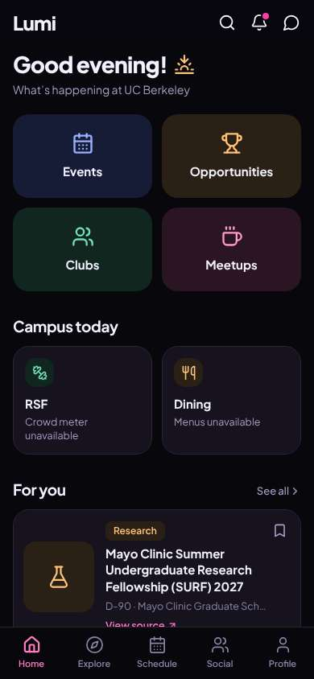
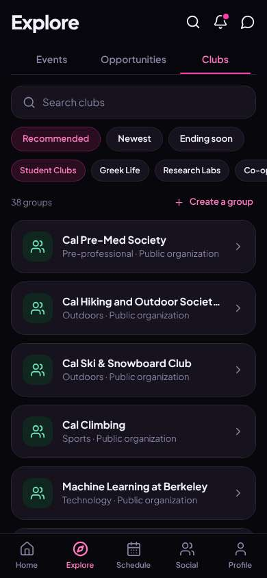
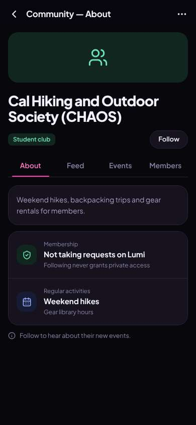
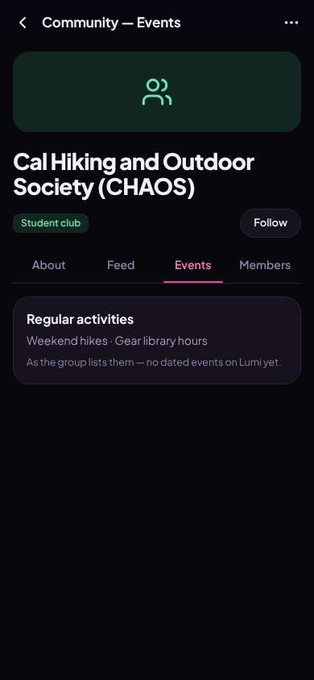

# ux-sim run `cmp2ha-new-find-a-club-aisha`

> **AI simulation — hypotheses, not measured user behaviour.** One simulated persona; nothing here is a rate or a measurement of real students.

| | |
|---|---|
| Persona | **Aisha**, 18 — First-year (first in her family to go to college) · phone 390×844 · prefers en · tech medium (`aisha-firstgen-anxious`) |
| Scenario | **Find a club I'd actually like** — You want to find one student club or group you'd actually enjoy and feel welcome in. Use the app to find one that fits you and open its page to see how to join. (`find-a-club`) |
| Target | local · http://localhost:41457 · worktree commit `a3f2ebed58f4` |
| Outcome | **success** · ended by persona |
| Account | fresh real account `aisha.isha2vjr@berkeley.edu` (Aisha, Public Health, born 2008; sample: false) |
| Goal check (fixed, by harness) | met at step 4 after 2 action(s) — evidence: {"urlMatches":"^/orgs/[^/?]+"} — _A club / organization page is open (reached by the persona — the run starts on /)._ |
| Persona's reason | “Found the hiking club quickly with the search/Student Clubs split and opened its page. Joining still isn't explained, but nothing felt risky to tap.” |
| Effort | 3/50 actions · objective frustration 1.00/6 · 1 confused note(s) · ~53s simulated |
| Drop-off risk | **medium** _(AI hypothesis, persona agent)_ — Calmer than before, but I still don't know how to actually join or when the next hike is · basis: steps 4, 6 |

Known environment limits (not UX findings)

- Dining menus and RSF gym crowd levels need live campus sources (the local stack runs with CAMPUS_LIVE=0) — empty or missing data there is not a UX bug.
- AI features (Ask Lumi, AI profile draft on /start, conversation starters) need an OpenAI key; none is configured locally.
- Course catalog is the real Berkeley Class Schedule (6588 courses, Fall 2026 + Spring 2027), fetched 2026-11-02 with the worker's adapter. Seat counts and very recent changes may differ from live.
- Campus events, free food, internships, hackathons and scholarships are a read-only snapshot of live (1119 real items, 103 events this week, taken 2026-11-02 07:25 UTC) plus the CSV calendar. Nothing new appears during the run; Q&A and reviews are empty.
- No e-mail is sent: the sign-up / sign-in code is shown on screen in the hint (live sends a real e-mail).
- Real-time updates (SSE) work locally; other people never reply unless the stack was started with --autoreply.
- Signed in as a brand-new real (non-sample, e-mail-verified) account made for this run. Other students exist only if the scenario seeds peers (local fixtures); sample profiles are hidden from real accounts, as on live.

## Friction

| # | step | type | sev | persona says | screen | element | env-limited | evidence |
|---|---|---|---|---|---|---|---|---|
| f1 | 2 | Unclear wording | 1 | “Nice, there's a search and Greek life is separate. But the cards only say 'Outdoors · Public organization' — I can't tell what they do. 'Ending soon' for clubs? Hiking sounds friendly though.” _wish: one line about what the club does on each card_ | `/explore/clubs` | Ending soon | no | [shot](shots/002-click.jpg) [marked](shots/002-click-som.jpg) |
| f2 | 4 | Unclear wording | 2 | “OK, at least nothing scary to tap — Follow just gets updates. But 'Not taking requests on Lumi'... so how DO I join? And 'never grants private access' — private access to what? Maybe Events shows a hike I can go to.” _wish: say plainly how to join (show up / their own sign-up) instead of what Lumi doesn't do_ | `/orgs/:id` |  | no | [shot](shots/004-click.jpg) [marked](shots/004-click-som.jpg) |
| f3 | 6 | Missing / empty content | 2 | “No actual hike dates. I'll follow them so I hear about the next one — it says that's all following does, which feels safe.” | `/orgs/:id?tab=events` | Events | no | [shot](shots/006-click.jpg) [marked](shots/006-click-som.jpg) |

Severity: 1 = Minor — noticed it, cosmetic or a small annoyance; did not slow me down. · 2 = Moderate — slowed me down or made me hesitate; I recovered on my own. · 3 = Major — real confusion, a wrong path or many extra steps; I nearly gave up or only got through by guessing. · 4 = Blocker — I could not continue, gave up, or would stop using the app here.

## Timeline

| step | what | screen | ms | signals / notes | shot |
|---|---|---|---|---|---|
| 0 | start | `/` | 933 | _curious_: “'Clubs' is right there on the first screen. That's what I want.” |  |
| 2 | click “Clubs” | `/explore/clubs` | 866 | expects: “a list of clubs I can browse” (0.8) as expected _neutral_: “Nice, there's a search and Greek life is separate. But the cards only say 'Outdoors · Public organization' — I can't tell what they do. 'Ending soon' for clubs? Hiking sounds friendly though.” → f1 |  |
| 4 | click “Cal Hiking and Outdoor Society (CHAOS) O” | `/orgs/:id` | 836 | expects: “the hiking club's page with how to join” (0.7) **mismatch**: calm club page, just Follow; Membership says 'Not taking requests on Lumi · Following never grants private access' ⚑ mismatch _confused_: “OK, at least nothing scary to tap — Follow just gets updates. But 'Not taking requests on Lumi'... so how DO I join? And 'never grants private access' — private access to what? Maybe Events shows a hike I can go to.” → f2 |  |
| 6 | click “Events” | `/orgs/:id?tab=events` | 840 | expects: “upcoming hikes I could go to” (0.5) **mismatch**: no dated events, just 'Weekend hikes' ⚑ mismatch _neutral_: “No actual hike dates. I'll follow them so I hear about the next one — it says that's all following does, which feels safe.” → f3 |  |
| 8 | finish | `/orgs/:id?tab=events` |  |  |  |

## Automatic checks (harness, not persona)

| screen | tap targets < 44px | sideways overflow | broken images |
|---|---|---|---|
| `/` | 6 (Search 40×40, Notifications 40×40, Messages 40×40, See all 55×20, View source 90×19) | — | — |
| `/explore/clubs` | 12 (Search 40×40, Notifications 40×40, Messages 40×40, Search clubs 295×23, Recommended 131×36) | — | — |
| `/orgs/:id` | 3 (Back 40×40, More 40×40, Follow 76×36) | — | — |
| `/orgs/:id?tab=events` | 3 (Back 40×40, More 40×40, Follow 76×36) | — | — |

## Timing (harness)

- Full page load (navigation timing): 124 ms
