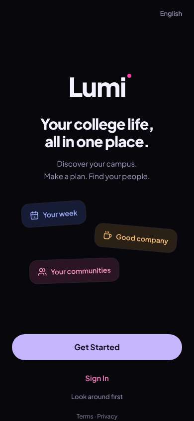
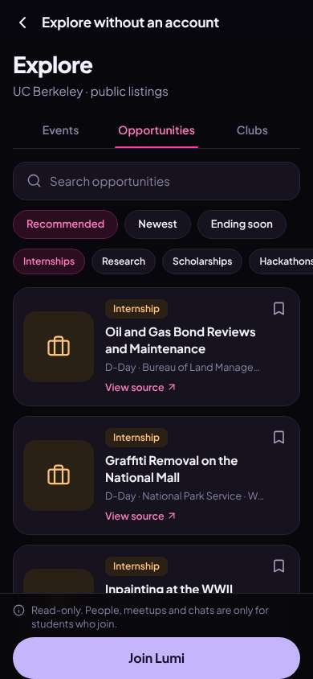
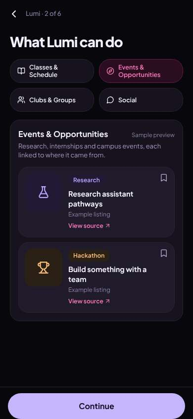
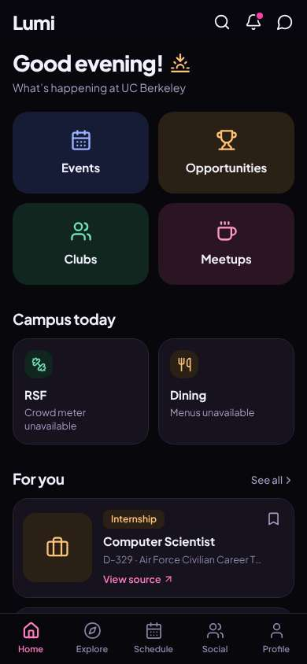

# ux-sim run `cmp2ha-new-first-open-decide-marcus`

> **AI simulation — hypotheses, not measured user behaviour.** One simulated persona; nothing here is a rate or a measurement of real students.

| | |
|---|---|
| Persona | **Marcus**, 22 — Senior · phone 390×844 · prefers en · tech low (`marcus-senior-lowtech`) |
| Scenario | **First open: what is this app, and is it worth signing up?** — A friend sent you a link to this app. You have never seen it before. Figure out what it is for, and decide whether you want to make an account. If it seems worth it, sign up with your school e-mail. (`first-open-decide`) |
| Target | local · http://localhost:41403 · worktree commit `a3f2ebed58f4` |
| Outcome | **success** · ended by persona |
| Account | signed out at start |
| Goal check (fixed, by harness) | met at step 30 after 24 action(s) — evidence: the account the browser is signed in to was created during this run; {"urlMatches":"^/(discover\|community\|profile)?(\\?.*)?$"} — _Signed up during the run (a new account exists and the browser is signed in to it) and landed inside the app (signed-in home or a main tab)._ |
| Persona's reason | “I looked around first, saw real internship listings, then signed up with my Berkeley email. Worth keeping for the Opportunities tab.” |
| Effort | 24/36 actions · objective frustration 1.00/4 · 1 confused note(s) · ~166s simulated |
| Drop-off risk | **medium** _(AI hypothesis, persona agent)_ — Look-around-first earned trust, but the welcome never mentions internships, the preview step looped, and the first internships were in DC/Bakersfield · basis: steps 2, 5, 10, 30 |

Known environment limits (not UX findings)

- Dining menus and RSF gym crowd levels need live campus sources (the local stack runs with CAMPUS_LIVE=0) — empty or missing data there is not a UX bug.
- AI features (Ask Lumi, AI profile draft on /start, conversation starters) need an OpenAI key; none is configured locally.
- Course catalog is the real Berkeley Class Schedule (6588 courses, Fall 2026 + Spring 2027), fetched 2026-11-02 with the worker's adapter. Seat counts and very recent changes may differ from live.
- Campus events, free food, internships, hackathons and scholarships are a read-only snapshot of live (1119 real items, 103 events this week, taken 2026-11-02 07:25 UTC) plus the CSV calendar. Nothing new appears during the run; Q&A and reviews are empty.
- No e-mail is sent: the sign-up / sign-in code is shown on screen in the hint (live sends a real e-mail).
- Real-time updates (SSE) work locally; other people never reply unless the stack was started with --autoreply.

## Friction

| # | step | type | sev | persona says | screen | element | env-limited | evidence |
|---|---|---|---|---|---|---|---|---|
| f1 | 0 | Unclear wording | 1 | “'Your college life, all in one place.' Pretty vague — nothing about internships. But 'Look around first' — good, I want to see it before giving my info.” | `/welcome` |  | no | [shot](shots/000-start.jpg) [marked](shots/000-start-som.jpg) |
| f2 | 5 | Missing / empty content | 2 | “So it does have real internships — Bureau of Land Management, Park Service. But Bakersfield and DC, not near Berkeley, and what's 'D-Day'? Still, it's real stuff, not a party app. I'll join.” _wish: show Bay Area ones first and say 'closes today' in words_ | `/guest/explore/opportunities` | Internship Oil and Gas Bond Reviews and Maintenance D-Day · Bureau of Land Management · Ba | no | [shot](shots/005-click.jpg) [marked](shots/005-click-som.jpg) |
| f3 | 10 | Onboarding friction | 2 | “I pressed Continue and it's still '2 of 6'? It just flipped to another sample. How many of these are there?” _wish: Continue should go to the next step, or let me skip the preview_ | `/start/what` | Continue | no | [shot](shots/010-click.jpg) [marked](shots/010-click-som.jpg) |

Severity: 1 = Minor — noticed it, cosmetic or a small annoyance; did not slow me down. · 2 = Moderate — slowed me down or made me hesitate; I recovered on my own. · 3 = Major — real confusion, a wrong path or many extra steps; I nearly gave up or only got through by guessing. · 4 = Blocker — I could not continue, gave up, or would stop using the app here.

## Timeline

| step | what | screen | ms | signals / notes | shot |
|---|---|---|---|---|---|
| 0 | start | `/welcome` | 971 | _neutral_: “'Your college life, all in one place.' Pretty vague — nothing about internships. But 'Look around first' — good, I want to see it before giving my info.” → f1 |  |
| 2 | click “Look around first” | `/guest/explore/events` | 886 | expects: “see the app without signing up” (0.7) as expected _curious_: “Events list, and an 'Opportunities' tab with words on it. Let me check that — that's where internships would be.” |  |
| 4 | click “Opportunities” | `/guest/explore/opportunities` | 830 | expects: “internships and jobs list” (0.7) |  |
| 5 | click “Internships” | `/guest/explore/opportunities` | 837 | expects: “only internships” (0.8) **mismatch**: real internship listings, but the first ones are in Bakersfield and Washington DC, all 'D-Day' ⚑ mismatch _neutral_: “So it does have real internships — Bureau of Land Management, Park Service. But Bakersfield and DC, not near Berkeley, and what's 'D-Day'? Still, it's real stuff, not a party app. I'll join.” → f2 |  |
| 7 | click “Join Lumi” | `/start/goals` | 835 | expects: “sign up” (0.8) |  |
| 8 | click “Find events & opportunities” | `/start/goals` | 840 |  |  |
| 9 | click “Continue” | `/start/what` | 831 | expects: “next” (0.6) **mismatch**: Continue moved to the next tab of the same 2 of 6 preview ⚑ mismatch |  |
| 10 | click “Continue” | `/start/what` | 837 | _confused_: “I pressed Continue and it's still '2 of 6'? It just flipped to another sample. How many of these are there?” → f3 |  |
| 12 | click “Continue” | `/start/what` | 834 |  |  |
| 13 | click “Continue” | `/start/what` | 832 |  |  |
| 14 | click “Continue” | `/start/university` | 831 |  |  |
| 15 | observe | `/start/university` |  |  |  |
| 16 | type “Search universities” ← “Berkeley” | `/start/university` | 848 |  |  |
| 17 | click “UC Berkeley University of California, Be” | `/start/university` | 837 |  |  |
| 18 | click “Undergraduate” | `/start/university` | 830 |  |  |
| 19 | click “4th+” | `/start/university` | 825 |  |  |
| 20 | click “Continue” | `/start/discover` | 832 | expects: “next” (0.6) |  |
| 21 | click “Internships” | `/start/discover` | 829 |  |  |
| 22 | click “Continue” | `/start/communities` | 840 | expects: “next” (0.6) |  |
| 23 | click “Skip” | `/start/about` | 837 | expects: “email step” (0.6) _neutral_: “Last step, 6 of 6. Name, birth year 'private to you', school email. Asked after I saw the listings — that's fair.” |  |
| 25 | type “First name or nickname” ← “Marcus” | `/start/about` | 833 |  |  |
| 26 | type “Private to you” ← “2004” | `/start/about` | 830 |  |  |
| 27 | type “you@berkeley.edu” ← “marcus.reed@berkeley.edu” | `/start/about` | 841 |  |  |
| 28 | click “Send code” | `/start/about` | 831 |  |  |
| 29 | type “Enter your code” ← “675477” | `/start/about` | 849 |  |  |
| 30 | click “Get Started” | `/` | 928 | expects: “into the app” (0.7) as expected _neutral_: “I'm in. Opportunities is on the front, first card is an internship. I already saw real listings before signing up, so I trust it more.” |  |
| 32 | finish | `/` |  |  |  |

## Automatic checks (harness, not persona)

| screen | tap targets < 44px | sideways overflow | broken images |
|---|---|---|---|
| `/welcome` | 5 (English 44×20, Sign In 80×40, Look around first 136×36, Terms 34×15, Privacy 41×15) | — | — |
| `/guest/explore/events` | 13 (Back 40×40, Search events 295×23, Recommended 131×36, Newest 82×36, Ending soon 111×36) | — | — |
| `/guest/explore/opportunities` | 14 (Back 40×40, Search opportunities 295×23, Recommended 131×36, Newest 82×36, Ending soon 111×36) | — | — |
| `/start/goals` | 1 (Back 40×40) | — | — |
| `/start/what` | 5 (Back 40×40) | — | — |
| `/start/university` | 9 (Back 40×40, Search universities 287×23, Undergraduate 130×36, Graduate 94×36, Alumni 77×36) | — | — |
| `/start/discover` | 2 (Back 40×40, Skip 54×40) | — | — |
| `/start/communities` | 12 (Back 40×40, Skip 54×40, Student Clubs 123×36, Greek Life 98×36, Research Labs 125×36) | — | — |
| `/start/about` | 4 (Back 40×40, Use your student ID 121×18, Terms 33×15, Privacy Policy 77×15) | — | — |
| `/` | 6 (Search 40×40, Notifications 40×40, Messages 40×40, See all 55×20, View source 90×19) | — | — |

## Timing (harness)

- Full page load (navigation timing): 165 ms
