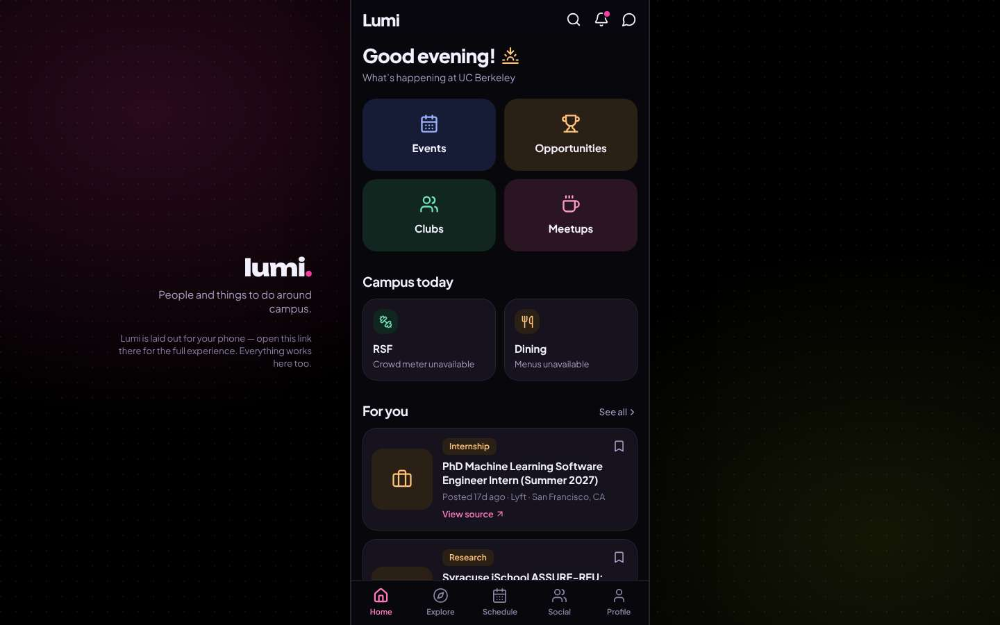
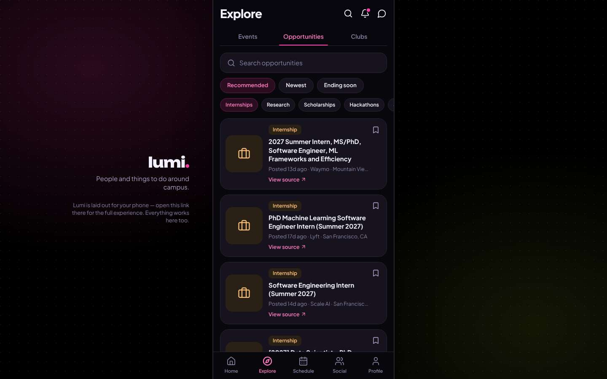
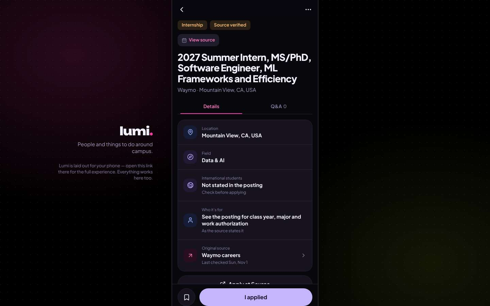

# ux-sim run `cmp2ha-new-internship-near-berkeley-priya`

> **AI simulation — hypotheses, not measured user behaviour.** One simulated persona; nothing here is a rate or a measurement of real students.

| | |
|---|---|
| Persona | **Priya**, 26 — Second-year PhD student · desktop 1440×900 · prefers en · tech high (`priya-phd-desktop`) |
| Scenario | **Find an internship near Berkeley** — You need a paid internship (summer or part-time) somewhere near Berkeley / the Bay Area. Use the app to find one that looks real and open, and open its details so you know how to apply. (`internship-near-berkeley`) |
| Target | local · http://localhost:43265 · worktree commit `a3f2ebed58f4` |
| Outcome | **success** · ended by persona |
| Account | fresh real account `priya.riya1j47@berkeley.edu` (Priya, EECS, born 2000; sample: false) |
| Goal check (fixed, by harness) | met at step 6 after 3 action(s) — evidence: {"urlMatches":"^/opportunities/[^/?]+"}; {"textMatches":"\\bintern(ship)?s?\\b"} — _An internship listing's detail page is open (reached by the persona — the run starts on /)._ |
| Persona's reason | “Found a Waymo MS/PhD ML intern role in Mountain View; details page shows the source and the eligibility caveats.” |
| Effort | 3/40 actions · objective frustration 0.50/5 · 0 confused note(s) · ~50s simulated |
| Drop-off risk | **medium** _(AI hypothesis, persona agent)_ — Details page is cleaner, but no location/PhD filter and the main button is 'I applied' instead of Apply · basis: steps 4, 6 |

Known environment limits (not UX findings)

- Dining menus and RSF gym crowd levels need live campus sources (the local stack runs with CAMPUS_LIVE=0) — empty or missing data there is not a UX bug.
- AI features (Ask Lumi, AI profile draft on /start, conversation starters) need an OpenAI key; none is configured locally.
- Course catalog is the real Berkeley Class Schedule (6588 courses, Fall 2026 + Spring 2027), fetched 2026-11-02 with the worker's adapter. Seat counts and very recent changes may differ from live.
- Campus events, free food, internships, hackathons and scholarships are a read-only snapshot of live (1119 real items, 103 events this week, taken 2026-11-02 07:25 UTC) plus the CSV calendar. Nothing new appears during the run; Q&A and reviews are empty.
- No e-mail is sent: the sign-up / sign-in code is shown on screen in the hint (live sends a real e-mail).
- Real-time updates (SSE) work locally; other people never reply unless the stack was started with --autoreply.
- Signed in as a brand-new real (non-sample, e-mail-verified) account made for this run. Other students exist only if the scenario seeds peers (local fixtures); sample profiles are hidden from real accounts, as on live.

## Friction

| # | step | type | sev | persona says | screen | element | env-limited | evidence |
|---|---|---|---|---|---|---|---|---|
| f1 | 0 | No reason to stay | 1 | “Still a phone column, but at least it says so and the side isn't just black. 'Opportunities' up top. I want a list I can filter.” | `/` |  | no | [shot](shots/000-start.jpg) [marked](shots/000-start-som.jpg) |
| f2 | 4 | Hard to find | 2 | “No location filter, no PhD/MS filter. I have to read each truncated 'Mountain Vie…' line. The top ones happen to be Bay Area, so fine.” _wish: a Bay Area / near Berkeley location filter and a PhD/MS filter_ | `/explore/opportunities` | Internships | no | [shot](shots/004-click.jpg) [marked](shots/004-click-som.jpg) |
| f3 | 6 | Confusing UI | 2 | “Better: facts first, source verified, last checked Nov 1. But the big lavender button says 'I applied' — I haven't. The real 'Apply at Source' is half under it. Still no pay.” _wish: make 'Apply at source' the main button; 'I applied' secondary_ | `/opportunities/:id` | I applied | no | [shot](shots/006-click.jpg) [marked](shots/006-click-som.jpg) |

Severity: 1 = Minor — noticed it, cosmetic or a small annoyance; did not slow me down. · 2 = Moderate — slowed me down or made me hesitate; I recovered on my own. · 3 = Major — real confusion, a wrong path or many extra steps; I nearly gave up or only got through by guessing. · 4 = Blocker — I could not continue, gave up, or would stop using the app here.

## Timeline

| step | what | screen | ms | signals / notes | shot |
|---|---|---|---|---|---|
| 0 | start | `/` | 937 | _neutral_: “Still a phone column, but at least it says so and the side isn't just black. 'Opportunities' up top. I want a list I can filter.” → f1 |  |
| 2 | click “Opportunities” | `/explore/opportunities` | 857 | expects: “a list of opportunities with filters for internships and location” (0.7) as expected _curious_: “List with search and an Internships chip. Filter.” |  |
| 4 | click “Internships” | `/explore/opportunities` | 828 | expects: “only internships, maybe with a location filter” (0.75) **mismatch**: internships only, but no location or PhD/MS filter anywhere; locations only in the truncated card line ⚑ mismatch _neutral_: “No location filter, no PhD/MS filter. I have to read each truncated 'Mountain Vie…' line. The top ones happen to be Bay Area, so fine.” → f2 |  |
| 6 | click “Internship 2027 Summer Intern, MS/PhD, S” | `/opportunities/:id` | 838 | expects: “listing details with pay, deadline and how to apply” (0.7) as expected _neutral_: “Better: facts first, source verified, last checked Nov 1. But the big lavender button says 'I applied' — I haven't. The real 'Apply at Source' is half under it. Still no pay.” → f3 |  |
| 8 | finish | `/opportunities/:id` |  |  |  |

## Timing (harness)

- Full page load (navigation timing): 130 ms
