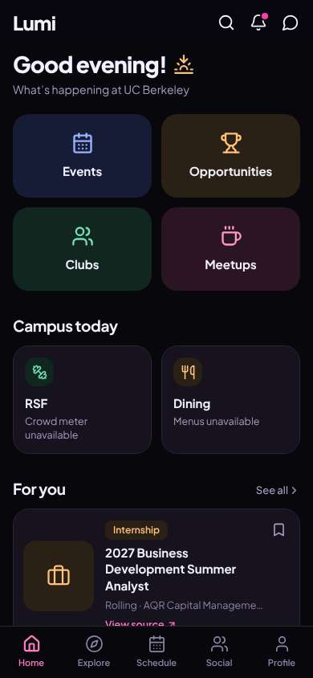
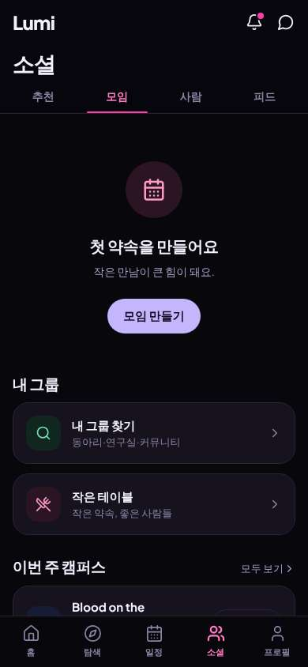
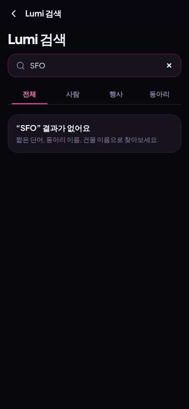
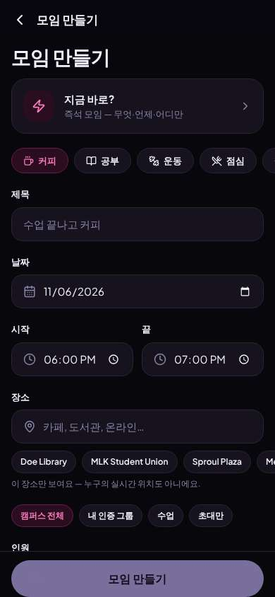

# ux-sim run `cmp2ha-new-ride-sfo-thanksgiving-seoyeon`

> **AI simulation — hypotheses, not measured user behaviour.** One simulated persona; nothing here is a rate or a measurement of real students.

| | |
|---|---|
| Persona | **Seoyeon**, 20 — Exchange student (one semester, from Yonsei) · phone 390×844 · prefers ko · tech medium (`seoyeon-exchange-korean`) |
| Scenario | **Share a ride to SFO for Thanksgiving** — You fly out of SFO the Wednesday before Thanksgiving (Nov 25) in the morning. Find other students to split a ride to the airport with — join one, or post yours so others can find you. (`ride-sfo-thanksgiving`) |
| Target | local · http://localhost:35331 · worktree commit `a3f2ebed58f4` |
| Outcome | **abandoned** · ended by persona |
| Account | fresh real account `seoyeon.yeon4mvd@berkeley.edu` (Seoyeon, Business Administration, born 2006; sample: false) · peers seeded: Jun |
| Goal check (fixed, by harness) | not met — _During the run the persona posted an SFO ride on Nov 25, or joined/requested someone's SFO ride (server-side)._ |
| Patience | exhausted at step 24; 0 action(s) after |
| Persona's reason | “한국어는 쉽게 바꿨는데, 공항 같이 갈 사람 찾는 기능이 없어요. 검색해도 SFO 결과 없고 모임은 커피/공부뿐이라 포기.” |
| Effort | 14/45 actions · objective frustration 2.00/5 · 4 confused note(s) · ~113s simulated |
| Drop-off risk | **high** _(AI hypothesis, persona agent)_ — The one thing I came for (sharing a ride to SFO) does not exist anywhere I looked · basis: steps 11, 19, 23 |

Known environment limits (not UX findings)

- Dining menus and RSF gym crowd levels need live campus sources (the local stack runs with CAMPUS_LIVE=0) — empty or missing data there is not a UX bug.
- AI features (Ask Lumi, AI profile draft on /start, conversation starters) need an OpenAI key; none is configured locally.
- Course catalog is the real Berkeley Class Schedule (6588 courses, Fall 2026 + Spring 2027), fetched 2026-11-02 with the worker's adapter. Seat counts and very recent changes may differ from live.
- Campus events, free food, internships, hackathons and scholarships are a read-only snapshot of live (1119 real items, 103 events this week, taken 2026-11-02 07:25 UTC) plus the CSV calendar. Nothing new appears during the run; Q&A and reviews are empty.
- No e-mail is sent: the sign-up / sign-in code is shown on screen in the hint (live sends a real e-mail).
- Real-time updates (SSE) work locally; other people never reply unless the stack was started with --autoreply.
- Signed in as a brand-new real (non-sample, e-mail-verified) account made for this run. Other students exist only if the scenario seeds peers (local fixtures); sample profiles are hidden from real accounts, as on live.

## Friction

| # | step | type | sev | persona says | screen | element | env-limited | evidence |
|---|---|---|---|---|---|---|---|---|
| f1 | 11 | Hard to find | 3 | “라이드나 공항 같은 게 없어... 검색해볼까? SFO” _wish: a place to find/share rides to the airport_ | `/social/meetups` |  | no | [shot](shots/011-click.jpg) [marked](shots/011-click-som.jpg) |
| f2 | 19 | Missing / empty content | 3 | “결과 없음... 라이드 기능이 없나? 그럼 내가 '모임 만들기'로 공항 같이 갈 사람 구해볼까” | `/search` | 행사, 사람, 동아리 검색… | no | [shot](shots/019-type.jpg) [marked](shots/019-type-som.jpg) |
| f3 | 23 | Missing / empty content | 4 | “커피, 공부, 운동, 점심... 공항 가는 건 없네. 이걸로 올리면 이상하게 보일 것 같아. 이 앱엔 라이드가 없나 봐. 그냥 우버 탈래” _wish: a way to find or post a shared ride to SFO_ | `/meetups/new` | 모임 만들기 | no | [shot](shots/023-click.jpg) [marked](shots/023-click-som.jpg) |

Severity: 1 = Minor — noticed it, cosmetic or a small annoyance; did not slow me down. · 2 = Moderate — slowed me down or made me hesitate; I recovered on my own. · 3 = Major — real confusion, a wrong path or many extra steps; I nearly gave up or only got through by guessing. · 4 = Blocker — I could not continue, gave up, or would stop using the app here.

## Where it ended

Step 23 on `/meetups/new`.

## Timeline

| step | what | screen | ms | signals / notes | shot |
|---|---|---|---|---|---|
| 0 | start | `/` | 982 | _confused_: “어... 영어가 너무 많아. 공항 가는 거 어디 있지? 한국어 설정 먼저 찾아보자. Profile에 있을까?” |  |
| 2 | click “Profile” | `/profile` | 865 | expects: “profile with settings, maybe language” (0.5) as expected _neutral_: “Settings 있다. 언어 바꾸자” |  |
| 4 | click “Settings” | `/settings` | 833 | expects: “settings with language” (0.7) as expected _neutral_: “Language — English. 눌러서 한국어로” |  |
| 6 | click “Language English” | `/settings` | 842 | expects: “choose Korean” (0.7) |  |
| 7 | click “한국어” | `/settings` | 830 | expects: “app switches to Korean” (0.85) as expected _delighted_: “한국어 됐다. 이제 공항 가는 사람 찾자” |  |
| 9 | goto / | `/` | 874 | _neutral_: “홈에 공항/라이드 같은 건 안 보이네. '모임'에 같이 가는 거 있을까?” |  |
| 11 | click “모임” | `/social/meetups` | 855 | expects: “meetups, maybe rides to the airport” (0.4) **mismatch**: meetups page, no rides, empty 'make your first plan' ⚑ mismatch _confused_: “라이드나 공항 같은 게 없어... 검색해볼까? SFO” → f1 |  |
| 13 | click “알림” | `/notifications` | 829 |  |  |
| 14 | observe | `/notifications` |  | _neutral_: “앗 알림이네, 잘못 눌렀다. 검색은 홈에 있었지” |  |
| 16 | click “뒤로” | `/social/meetups` | 831 | ⚑ backtrack |  |
| 17 | click “홈” | `/` | 831 |  |  |
| 18 | click “검색” | `/search` | 819 | expects: “search box” (0.8) |  |
| 19 | type “행사, 사람, 동아리 검색…” ← “SFO” | `/search` | 853 | expects: “rides or people going to SFO” (0.4) **mismatch**: 'SFO' no results ⚑ mismatch _frustrated_: “결과 없음... 라이드 기능이 없나? 그럼 내가 '모임 만들기'로 공항 같이 갈 사람 구해볼까” → f2 |  |
| 21 | click “뒤로” | `/` | 824 |  |  |
| 22 | click “소셜” | `/social` | 820 |  |  |
| 23 | click “모임 만들기” | `/meetups/new` | 822 | expects: “a form to make a plan, maybe I can write SFO Nov 25” (0.4) **mismatch**: meetup form only for coffee/study/workout/lunch/hangout on campus, no airport/ride option ⚑ mismatch _frustrated_: “커피, 공부, 운동, 점심... 공항 가는 건 없네. 이걸로 올리면 이상하게 보일 것 같아. 이 앱엔 라이드가 없나 봐. 그냥 우버 탈래” → f3 |  |
| 25 | finish | `/meetups/new` |  |  |  |

## Automatic checks (harness, not persona)

| screen | tap targets < 44px | sideways overflow | broken images |
|---|---|---|---|
| `/` | 6 (Search 40×40, Notifications 40×40, Messages 40×40, See all 55×20, View source 90×19) | — | — |
| `/profile` | 12 (Settings 40×40, Messages 40×40, Set what you’re open to 176×20, 0 Groups 62×21, 0 Friends 61×21) | — | — |
| `/settings` | 1 (Back 40×40) | — | — |
| `/social/meetups` | 4 (알림 40×40, 메시지 40×40, 모두 보기 69×20, Blood on the Clocktower Weekly Game Night 164×41) | — | — |
| `/notifications` | 2 (뒤로 40×40, 더 보기 40×40) | — | — |
| `/search` | 2 (뒤로 40×40, 행사, 사람, 동아리 검색… 295×23) | — | — |
| `/social` | 13 (알림 40×40, 메시지 40×40, 커피 60×36, 공부 60×36, 운동 60×36) | — | — |
| `/meetups/new` | 14 (뒤로 40×40, 커피 81×36, 공부 81×36, 운동 81×36, 점심 81×36) | — | — |

## Timing (harness)

- Full page load (navigation timing): 180 ms, 117 ms, 69 ms
