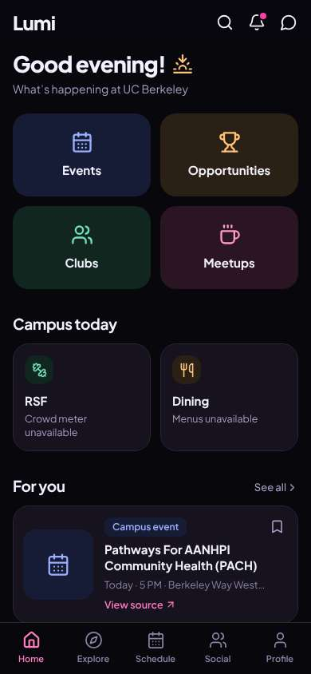
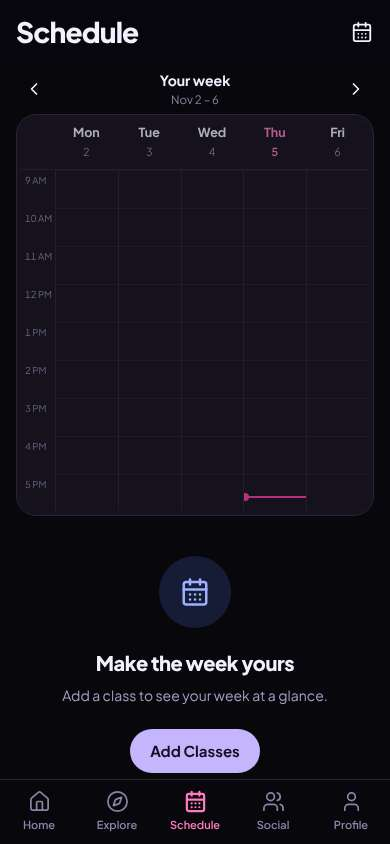
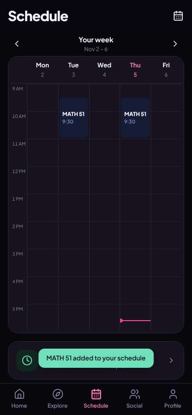

# ux-sim run `cmp2ha-new-timetable-add-classes-minji`

> **AI simulation — hypotheses, not measured user behaviour.** One simulated persona; nothing here is a rate or a measurement of real students.

| | |
|---|---|
| Persona | **Minji**, 17 — First-year (started college a year early) · phone 390×844 · prefers ko · tech high (`minji-freshman-17`) |
| Scenario | **Put my classes into my timetable** — You want the app to know your schedule so it can show who's free when you are. Add your calculus class — Calculus I, which you know as MATH 1A — to your timetable in the app. (`timetable-add-classes`) |
| Target | local · http://localhost:40383 · worktree commit `a3f2ebed58f4` |
| Outcome | **success** · ended by persona |
| Account | fresh real account `minji.injizzcp@berkeley.edu` (Minji, Undeclared, born 2009; sample: false) |
| Goal check (fixed, by harness) | met at step 11 after 5 action(s) — evidence: Calculus I is in my saved timetable — _The persona's own timetable (server-side) gained Calculus I (MATH 51 / MATH 1A) during the run._ |
| Persona's reason | “MATH 51 (전 1A) 시간표에 넣었어. 바로 시간표 화면이라 쉬웠음.” |
| Effort | 5/40 actions · objective frustration 0.50/4.5 · 0 confused note(s) · ~22s simulated |
| Drop-off risk | **medium** _(AI hypothesis, persona agent)_ — Adding was easy, but nothing shows people my age or my dorm yet · basis: steps 11 |

Known environment limits (not UX findings)

- Dining menus and RSF gym crowd levels need live campus sources (the local stack runs with CAMPUS_LIVE=0) — empty or missing data there is not a UX bug.
- AI features (Ask Lumi, AI profile draft on /start, conversation starters) need an OpenAI key; none is configured locally.
- Course catalog is the real Berkeley Class Schedule (6588 courses, Fall 2026 + Spring 2027), fetched 2026-11-02 with the worker's adapter. Seat counts and very recent changes may differ from live.
- Campus events, free food, internships, hackathons and scholarships are a read-only snapshot of live (1119 real items, 103 events this week, taken 2026-11-02 07:25 UTC) plus the CSV calendar. Nothing new appears during the run; Q&A and reviews are empty.
- No e-mail is sent: the sign-up / sign-in code is shown on screen in the hint (live sends a real e-mail).
- Real-time updates (SSE) work locally; other people never reply unless the stack was started with --autoreply.
- Signed in as a brand-new real (non-sample, e-mail-verified) account made for this run. Other students exist only if the scenario seeds peers (local fixtures); sample profiles are hidden from real accounts, as on live.

## Friction

_No friction events were logged._

## Timeline

| step | what | screen | ms | signals / notes | shot |
|---|---|---|---|---|---|
| 0 | start | `/` | 932 | _neutral_: “영어 많네.. 시간표는 Schedule 이겠지” |  |
| 2 | click “Schedule” | `/schedule` | 859 | expects: “my timetable where I can add classes” (0.7) as expected _delighted_: “오 바로 시간표다. Add Classes 누르면 되겠다” |  |
| 4 | click “Add Classes” | `/schedule/classes` | 840 | expects: “search for a class” (0.85) as expected _neutral_: “검색창. 'like MATH 51'? 내꺼 1A인데.. 일단 1A 쳐보자” |  |
| 6 | type “Course code or name, like MATH 51” ← “MATH 1A” | `/schedule/classes` | 845 | expects: “Calculus shows up” (0.7) as expected _curious_: “formerly 1A 써있다 ㅇㅋ. 9:30 거” |  |
| 8 | click “MATH 51 Calculus I (formerly MATH 1A) (L” | `/schedule/classes` | 2844 | expects: “it gets added or asks for section” (0.6) **mismatch**: asks for discussion section, says optional, Add Class button ⚑ mismatch |  |
| 9 | observe | `/schedule/classes` |  | _neutral_: “섹션 optional 이라네. 그냥 Add Class” |  |
| 11 | click “Add Class” | `/schedule` | 825 | expects: “math class added to my timetable” (0.8) as expected _delighted_: “들어갔다! 깔끔하네” |  |
| 13 | finish | `/schedule` |  |  |  |

## Automatic checks (harness, not persona)

| screen | tap targets < 44px | sideways overflow | broken images |
|---|---|---|---|
| `/` | 6 (Search 40×40, Notifications 40×40, Messages 40×40, See all 55×20, View source 90×19) | — | — |
| `/schedule` | 3 (Add or edit classes 40×40, Previous week 36×36, Next week 36×36) | — | — |
| `/schedule/classes` | 9 (Back 40×40, Fall 2026 90×36, Spring 2027 109×36, Course code or name, like MATH 51 295×23, Mon 51×32) | — | — |

## Timing (harness)

- Full page load (navigation timing): 131 ms
