# ux-sim run `sched-20261102-1925-diego-cold-start-hangout`

> **AI simulation — hypotheses, not measured user behaviour.** One simulated persona; nothing here is a rate or a measurement of real students.

| | |
|---|---|
| Persona | **Diego**, 21 — Junior (transfer from Laney College) · phone 390×844 · prefers en · tech medium (`diego-transfer-commuter`) |
| Scenario | **Brand-new account: find someone on campus to hang out with this week** — You just heard about this app and want someone on campus to hang out with this week. Make an account with your school e-mail, then use the app to find a person or plan you could join this week and tell them you're in. (`cold-start-hangout`) |
| Target | local · http://localhost:44355 · worktree commit `6d64c5686fb8` |
| Outcome | **abandoned** · ended by persona |
| Account | signed out at start |
| Goal check (fixed, by harness) | met at step 29 after 21 action(s) — evidence: the account the browser is signed in to was created during this run; posted a plan — _Signed up during the run AND, as that new account, joined/requested a plan, hosted one, sent a friend request or sent a chat message._ |
| Patience | exhausted at step 30; 0 action(s) after |
| ⚠ unnoticed success | The check passed but the persona did not realise it had succeeded. |
| Persona's reason | “Took 17 taps of questionnaires before I even saw the app, then every place to meet people was empty, and 'Go together' just signed me up for a seminar with myself. Wasted my break.” |
| Effort | 21/32 actions · objective frustration 2.50/4 · 2 confused note(s) · ~88s simulated |
| Drop-off risk | **high** _(AI hypothesis, persona agent)_ — Promised 'who's free now' but showed no people; meetups and hangouts were empty and the only joinable things were faculty seminars with nobody going — no reason to reopen between classes. · basis: steps 16, 22, 24, 26, 29 |

Known environment limits (not UX findings)

- Dining menus and RSF gym crowd levels need live campus sources (the local stack runs with CAMPUS_LIVE=0) — empty or missing data there is not a UX bug.
- AI features (Ask Lumi, AI profile draft on /start, conversation starters) need an OpenAI key; none is configured locally.
- Course catalog is the built-in sample list (~210 courses, e.g. MATH 1A; no cached catalog — run `local-stack catalog fetch` once (about 5 minutes) to test with the real Berkeley schedule). Live has the imported current-term Berkeley schedule (e.g. MATH 51) — course-name findings on timetable/class screens are marked environment-limited.
- Campus events, free food, internships, hackathons and scholarships are a read-only snapshot of live (1302 real items, 133 events this week, taken 2026-11-02 19:15 UTC) plus the CSV calendar. Nothing new appears during the run; Q&A and reviews are empty.
- No e-mail is sent: the sign-up / sign-in code is shown on screen in the hint (live sends a real e-mail).
- Real-time updates (SSE) work locally; other people never reply unless the stack was started with --autoreply.

## Friction

| # | step | type | sev | persona says | screen | element | env-limited | evidence |
|---|---|---|---|---|---|---|---|---|
| f1 | 8 | Onboarding friction | 2 | “A feature tour screen, and that progress bar says I'm only like 3 of 8 steps in. I haven't even given my email yet. Hurry up.” _wish: let me sign up first, skip the tour_ | `/start` | Continue | no | [shot](shots/008-click.jpg) [marked](shots/008-click-som.jpg) |
| f2 | 15 | Onboarding friction | 3 | “Seriously, another one? I'm 11 taps in and still no email, no people. I'm a transfer, I'm not part of any of these yet. This is eating my break.” _wish: ask the school email up front, and let me see who's free before all these questionnaires_ | `/start` | Continue | no | [shot](shots/015-click.jpg) [marked](shots/015-click-som.jpg) |
| f3 | 22 | Confusing UI | 2 | “The welcome page promised who's free right now, this is an events directory. Meetups sounds closest to hanging out, I'll try that.” _wish: show the 'who's free now' thing the welcome screen sold me_ | `/` | Meetups | no | [shot](shots/022-click.jpg) [marked](shots/022-click-som.jpg) |
| f4 | 24 | Missing / empty content | 3 | “No meetups yet. Great, nobody's here. I don't want to host, I want to join something. 'Who's free right now' is down there, last shot.” _wish: at least one plan this week I could just join_ | `/meet/meetups` |  | no | [shot](shots/024-click.jpg) [marked](shots/024-click-som.jpg) |
| f5 | 27 | No reason to stay | 2 | “These are faculty seminars, not hangouts. 'Go together' with who? Nobody's attached to them. I'd be starting a plan alone again.” _wish: show me which students are going, so I can say I'm in_ | `/meet/more?tab=activities` | Go together | no | [shot](shots/027-click.jpg) [marked](shots/027-click-som.jpg) |
| f6 | 29 | Confusing UI | 3 | “Together with who? It's just me. And it already put me as going without asking — I only wanted to look. A study abroad week isn't hanging out, and nobody else is here. I'm out.” _wish: show who else is going before signing me up; don't say 'together' when it's only me_ | `/meet/more?tab=activities` | 🙂 You going | no | [shot](shots/029-click.jpg) [marked](shots/029-click-som.jpg) |

Severity: 1 = Minor — noticed it, cosmetic or a small annoyance; did not slow me down. · 2 = Moderate — slowed me down or made me hesitate; I recovered on my own. · 3 = Major — real confusion, a wrong path or many extra steps; I nearly gave up or only got through by guessing. · 4 = Blocker — I could not continue, gave up, or would stop using the app here.

## Where it ended

Step 29 on `/meet/more?tab=activities`.

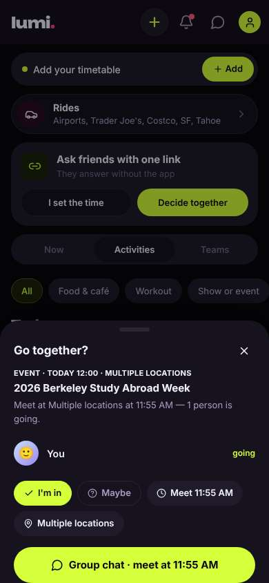

## Timeline

| step | what | screen | ms | signals / notes | shot |
|---|---|---|---|---|---|
| 0 | start | `/welcome` | 2620 |  | <a href="shots/000-start-som.jpg">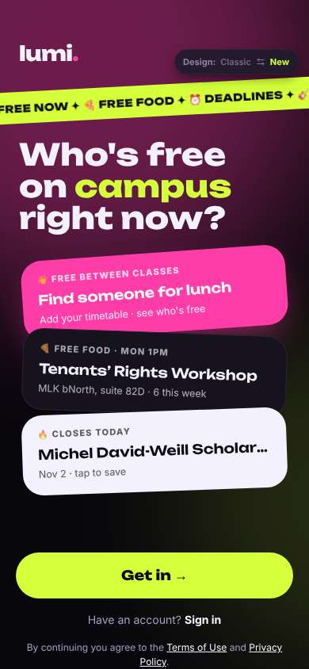</a> |
| 1 | click “Get in →” | `/start` | 962 | expects: “sign-up form asking for school email” (0.8) **mismatch**: asks name and birth year first, no email yet ⚑ mismatch _neutral_: “OK, name and birth year. Birth year's a bit random but fine, quick.” | <a href="shots/001-click-som.jpg">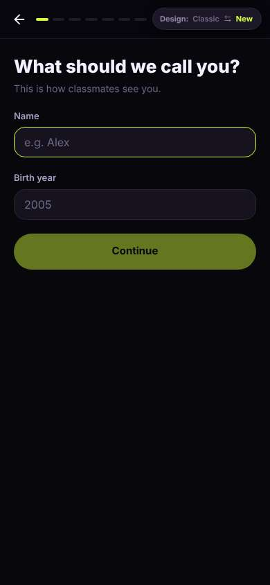</a> |
| 3 | type “e.g. Alex” ← “Diego” | `/start` | 890 |  | <a href="shots/003-type-som.jpg">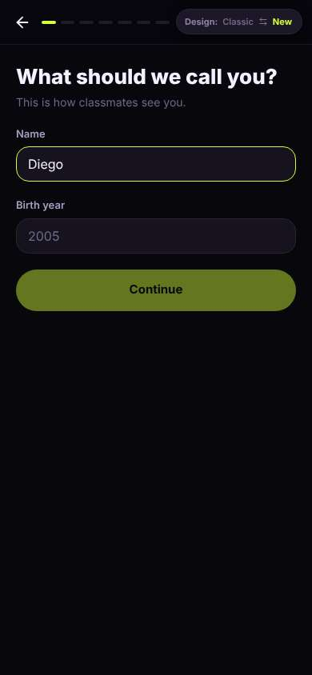</a> |
| 4 | type “2005” ← “2005” | `/start` | 894 |  | <a href="shots/004-type-som.jpg">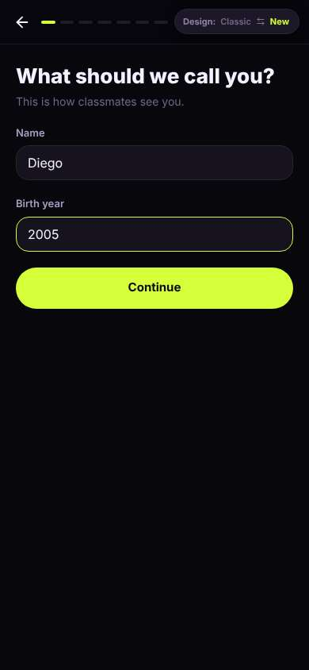</a> |
| 5 | click “Continue” | `/start` | 841 | expects: “email step” (0.7) **mismatch**: interests picker instead of email ⚑ mismatch _neutral_: “Another question. Meet new people, that's me. Pick and move on.” | <a href="shots/005-click-som.jpg">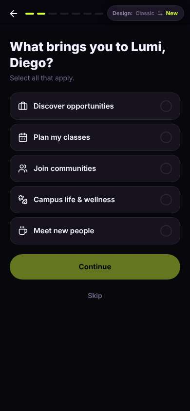</a> |
| 7 | click “Meet new people” | `/start` | 850 |  | <a href="shots/007-click-som.jpg">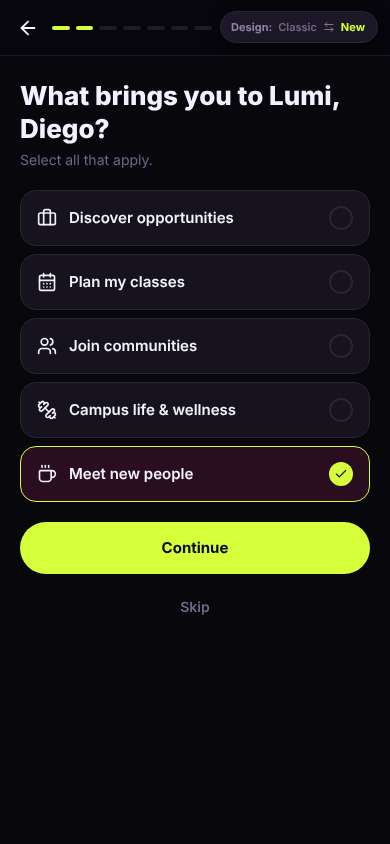</a> |
| 8 | click “Continue” | `/start` | 848 | _bored_: “A feature tour screen, and that progress bar says I'm only like 3 of 8 steps in. I haven't even given my email yet. Hurry up.” → f1 | <a href="shots/008-click-som.jpg">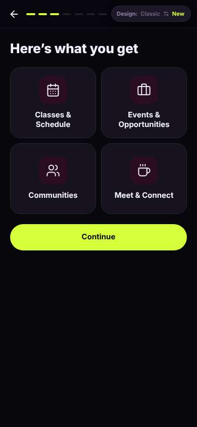</a> |
| 10 | click “Continue” | `/start` | 846 |  | <a href="shots/010-click-som.jpg">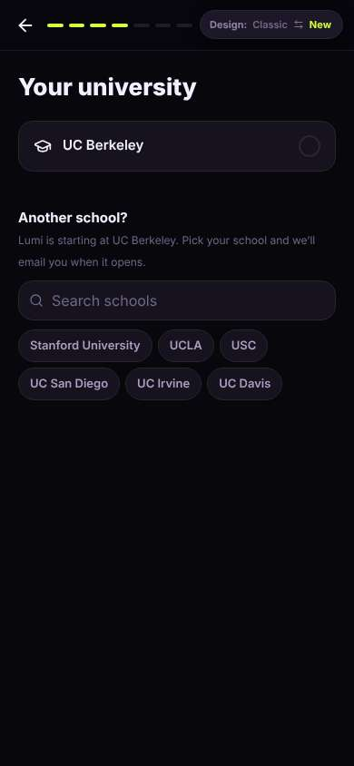</a> |
| 11 | click “UC Berkeley” | `/start` | 847 | expects: “next step, probably email” (0.6) **mismatch**: status picker appeared on same screen ⚑ mismatch _neutral_: “Status. Undergrad. Fine, at least it's one tap.” | <a href="shots/011-click-som.jpg">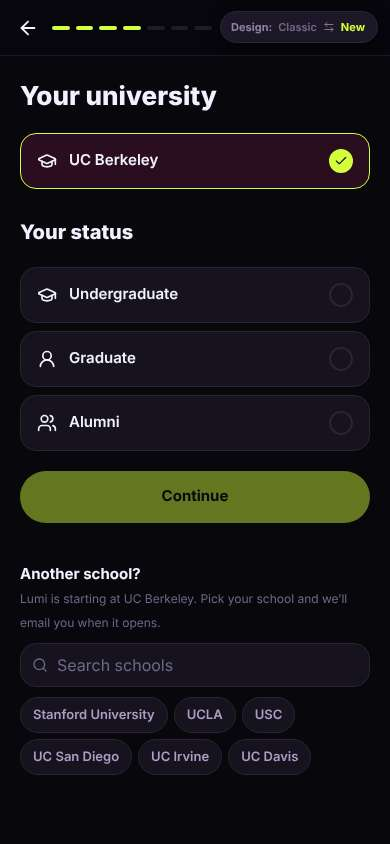</a> |
| 13 | click “Undergraduate” | `/start` | 839 |  | <a href="shots/013-click-som.jpg">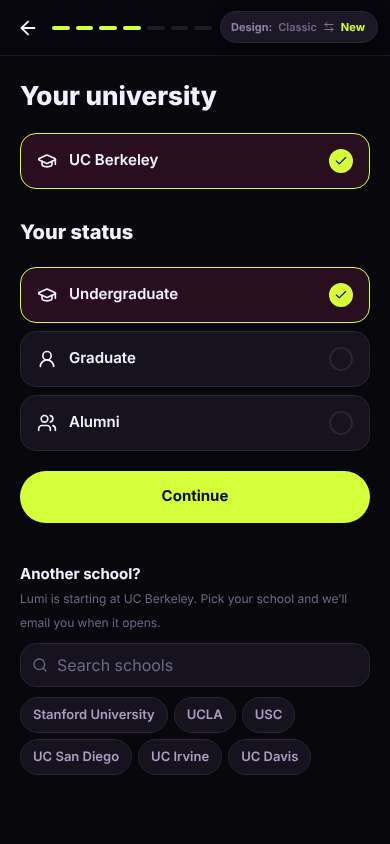</a> |
| 14 | click “Continue” | `/start` | 845 |  | <a href="shots/014-click-som.jpg">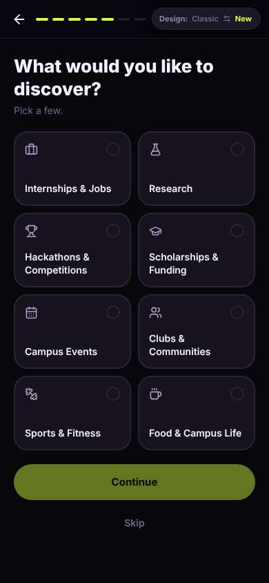</a> |
| 15 | click “Skip” | `/start` | 841 | _frustrated_: “Seriously, another one? I'm 11 taps in and still no email, no people. I'm a transfer, I'm not part of any of these yet. This is eating my break.” → f2 | <a href="shots/015-click-som.jpg">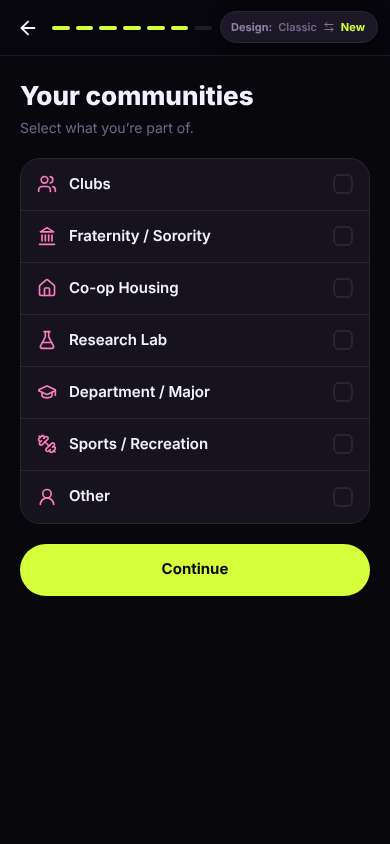</a> |
| 17 | click “Continue” | `/start` | 861 |  | <a href="shots/017-click-som.jpg">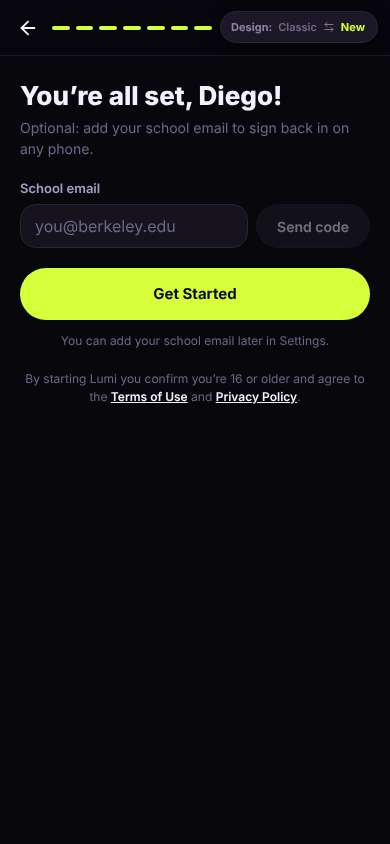</a> |
| 18 | type “you@berkeley.edu” ← “diego.r@berkeley.edu” | `/start` | 874 |  | <a href="shots/018-type-som.jpg">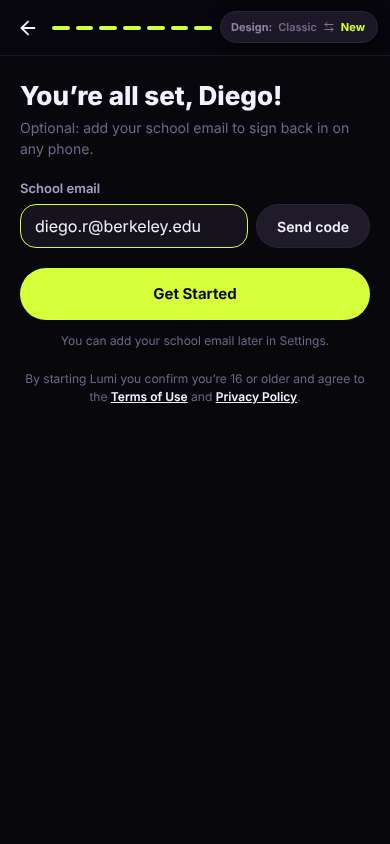</a> |
| 19 | click “Send code” | `/start` | 836 |  | <a href="shots/019-click-som.jpg">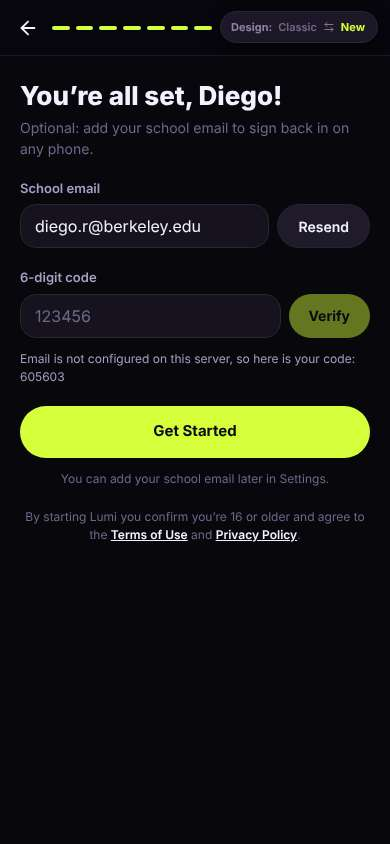</a> |
| 20 | type “123456” ← “605603” | `/start` | 880 |  | <a href="shots/020-type-som.jpg">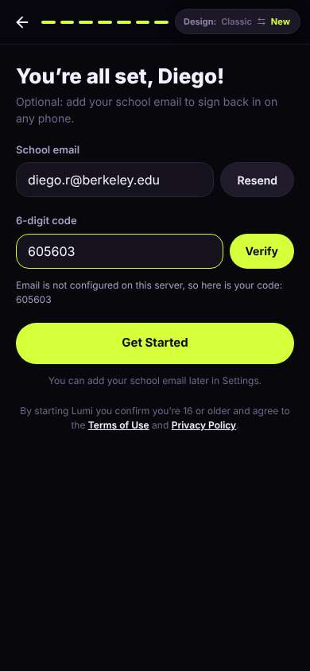</a> |
| 21 | click “Verify” | `/start` | 835 |  | <a href="shots/021-click-som.jpg">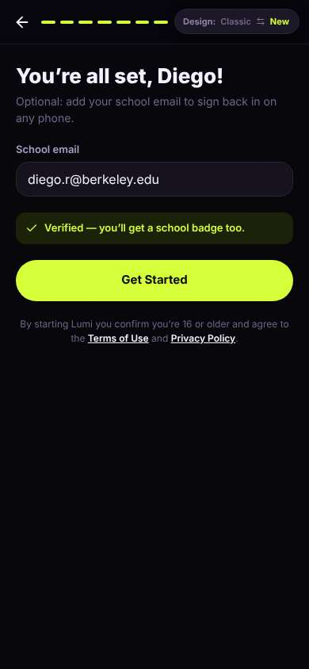</a> |
| 22 | click “Get Started” | `/` | 962 | expects: “home screen showing who's free on campus now” (0.6) **mismatch**: generic events/opportunities home, no 'who's free' anywhere ⚑ mismatch _neutral_: “The welcome page promised who's free right now, this is an events directory. Meetups sounds closest to hanging out, I'll try that.” → f3 | <a href="shots/022-click-som.jpg">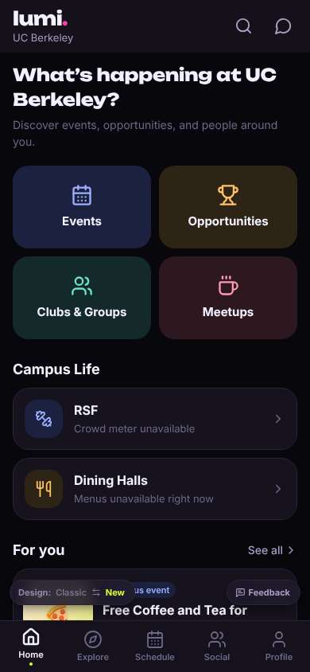</a> |
| 24 | click “Meetups” | `/meet/meetups` | 857 | _neutral_: “No meetups yet. Great, nobody's here. I don't want to host, I want to join something. 'Who's free right now' is down there, last shot.” → f4 | <a href="shots/024-click-som.jpg">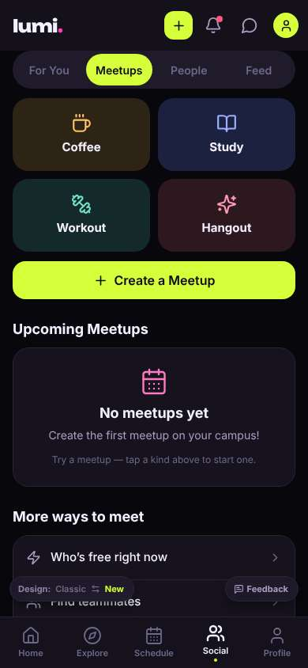</a> |
| 26 | click “Who’s free right now” | `/meet/more` | 837 |  | <a href="shots/026-click-som.jpg">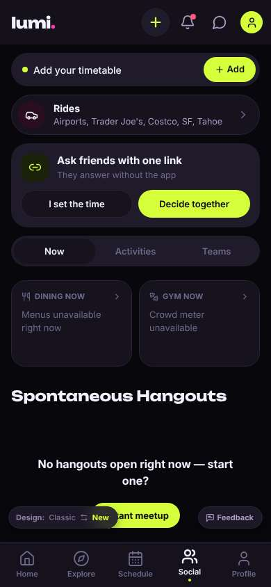</a> |
| 27 | click “Activities” | `/meet/more?tab=activities` | 848 | expects: “list of activities/plans this week I could join” (0.4) **mismatch**: a long list of campus seminars with 'Go together' buttons, but no people or student plans ⚑ mismatch _neutral_: “These are faculty seminars, not hangouts. 'Go together' with who? Nobody's attached to them. I'd be starting a plan alone again.” → f5 | <a href="shots/027-click-som.jpg">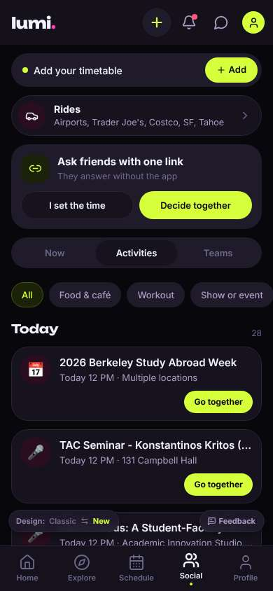</a> |
| 29 | click “Go together” | `/meet/more?tab=activities` | 942 | expects: “see other students going, or it makes a plan with me as the only one” (0.5) as expected _frustrated_: “Together with who? It's just me. And it already put me as going without asking — I only wanted to look. A study abroad week isn't hanging out, and nobody else is here. I'm out.” → f6 | <a href="shots/029-click-som.jpg">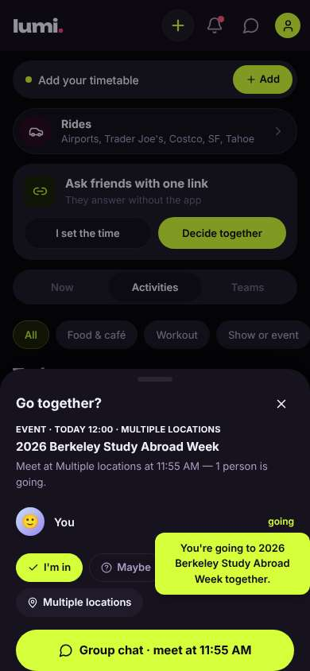</a> |
| 31 | finish | `/meet/more?tab=activities` |  |  |  |

## Automatic checks (harness, not persona)

| screen | tap targets < 44px | sideways overflow | broken images |
|---|---|---|---|
| `/welcome` | 4 (Sign in 46×21, Terms of Use 76×15, Privacy Policy 180×33, Switch to the classic design 158×32) | — | — |
| `/start` | 8 (Back 40×40, Switch to the classic design 158×32) | — | — |
| `/` | 3 (See all 62×21, Feedback 93×32, Switch to the classic design 158×32) | — | — |
| `/meet/meetups` | 10 (Create 36×36, Notifications 40×40, Messages 40×40, Me 32×32, For You 85×40) | — | — |
| `/meet/more` | 13 (Create 40×40, Notifications 40×40, Messages 40×40, Me 32×32, Add 75×36) | — | — |
| `/meet/more?tab=activities` | 18 (Create 40×40, Notifications 40×40, Messages 40×40, Me 32×32, Add 75×36) | — | — |

## Timing (harness)

- Full page load (navigation timing): 1232 ms
