# ux-sim run `sched-20261102-1925-jordan-cold-start-hangout`

> **AI simulation — hypotheses, not measured user behaviour.** One simulated persona; nothing here is a rate or a measurement of real students.

| | |
|---|---|
| Persona | **Jordan**, 19 — Sophomore · phone 390×844 · prefers en · tech high (`jordan-sophomore-impatient`) |
| Scenario | **Brand-new account: find someone on campus to hang out with this week** — You just heard about this app and want someone on campus to hang out with this week. Make an account with your school e-mail, then use the app to find a person or plan you could join this week and tell them you're in. (`cold-start-hangout`) |
| Target | local · http://localhost:41563 · worktree commit `6d64c5686fb8` |
| Outcome | **abandoned** · ended by persona |
| Account | signed out at start |
| Goal check (fixed, by harness) | not met — _Signed up during the run AND, as that new account, joined/requested a plan, hosted one, sent a friend request or sent a chat message._ |
| Patience | exhausted at step 16; 0 action(s) after |
| Persona's reason | “Five setup screens, two interest pickers, a feature tour, and I still haven't entered my email or seen one person. Deleted.” |
| Effort | 10/28 actions · objective frustration 3.00/3 · 2 confused note(s) · ~16s simulated |
| Drop-off risk | **high** _(AI hypothesis, persona agent)_ — Promised 'who's free right now' on the welcome screen but buried it behind a long onboarding; Jordan quits on >2 setup screens · basis: steps 5, 8, 15 |

Known environment limits (not UX findings)

- Dining menus and RSF gym crowd levels need live campus sources (the local stack runs with CAMPUS_LIVE=0) — empty or missing data there is not a UX bug.
- AI features (Ask Lumi, AI profile draft on /start, conversation starters) need an OpenAI key; none is configured locally.
- Course catalog is the built-in sample list (~210 courses, e.g. MATH 1A; no cached catalog — run `local-stack catalog fetch` once (about 5 minutes) to test with the real Berkeley schedule). Live has the imported current-term Berkeley schedule (e.g. MATH 51) — course-name findings on timetable/class screens are marked environment-limited.
- Campus events, free food, internships, hackathons and scholarships are a read-only snapshot of live (1302 real items, 133 events this week, taken 2026-11-02 19:15 UTC) plus the CSV calendar. Nothing new appears during the run; Q&A and reviews are empty.
- No e-mail is sent: the sign-up / sign-in code is shown on screen in the hint (live sends a real e-mail).
- Real-time updates (SSE) work locally; other people never reply unless the stack was started with --autoreply.

## Friction

| # | step | type | sev | persona says | screen | element | env-limited | evidence |
|---|---|---|---|---|---|---|---|---|
| f1 | 1 | Trust / privacy worry | 1 | “birth year? why. whatever, fast enough.” _wish: say why you need my birth year_ | `/start` | 2005 | no | [shot](shots/001-click.jpg) [marked](shots/001-click-som.jpg) |
| f2 | 5 | Onboarding friction | 2 | “second setup screen. clock's ticking.” _wish: let me in first, ask later_ | `/start` | Continue | no | [shot](shots/005-click.jpg) [marked](shots/005-click-som.jpg) |
| f3 | 8 | Onboarding friction | 3 | “a feature list? I don't care. third screen and I still don't have an account.” _wish: skip the tour_ | `/start` | Continue | no | [shot](shots/008-click.jpg) [marked](shots/008-click-som.jpg) |
| f4 | 15 | Onboarding friction | 4 | “I already told you what I want two screens ago. another picker? nope.” _wish: one interests screen max, then show me who's free_ | `/start` | Continue | no | [shot](shots/015-click.jpg) [marked](shots/015-click-som.jpg) |

Severity: 1 = Minor — noticed it, cosmetic or a small annoyance; did not slow me down. · 2 = Moderate — slowed me down or made me hesitate; I recovered on my own. · 3 = Major — real confusion, a wrong path or many extra steps; I nearly gave up or only got through by guessing. · 4 = Blocker — I could not continue, gave up, or would stop using the app here.

## Where it ended

Step 15 on `/start`.

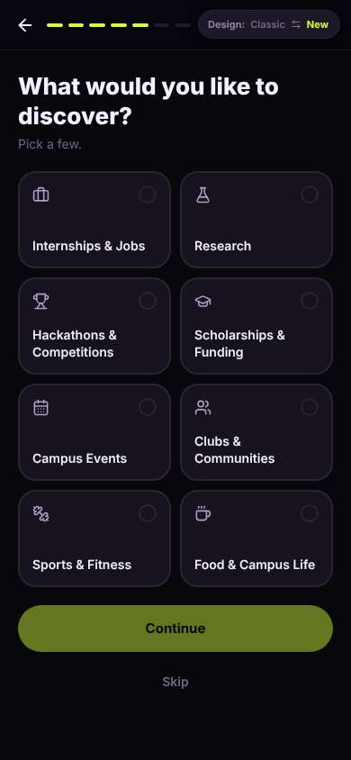

## Timeline

| step | what | screen | ms | signals / notes | shot |
|---|---|---|---|---|---|
| 0 | start | `/welcome` | 2459 |  | <a href="shots/000-start-som.jpg">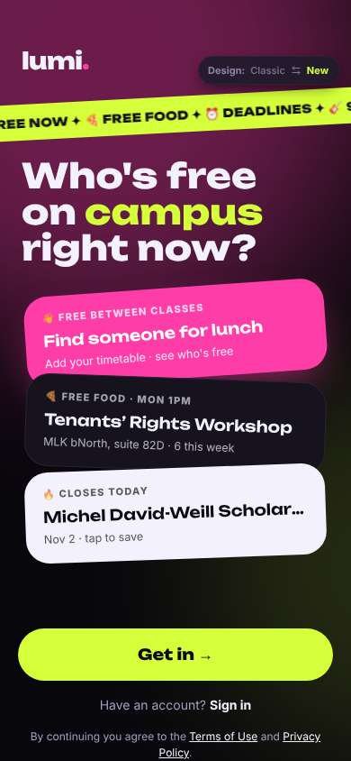</a> |
| 1 | click “Get in →” | `/start` | 944 | expects: “sign up with school email” (0.8) **mismatch**: asks name and birth year first, no email yet ⚑ mismatch _neutral_: “birth year? why. whatever, fast enough.” → f1 | <a href="shots/001-click-som.jpg">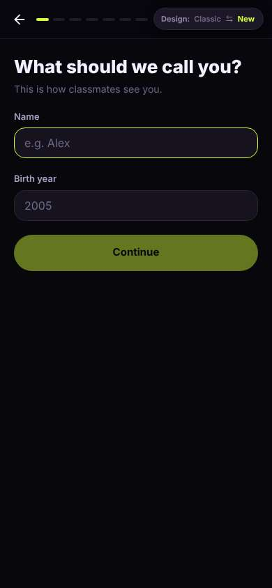</a> |
| 3 | type “e.g. Alex” ← “Jordan” | `/start` | 878 |  | <a href="shots/003-type-som.jpg">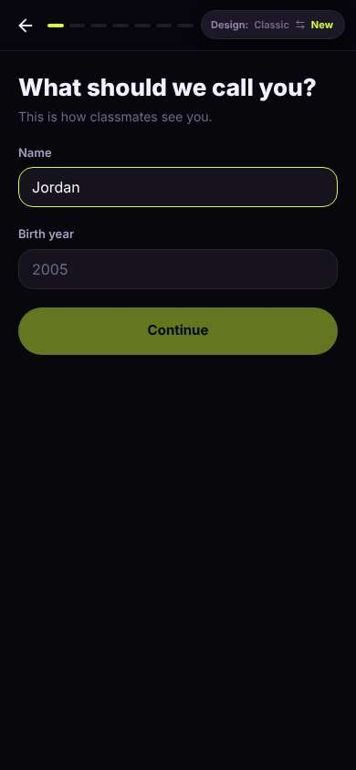</a> |
| 4 | type “2005” ← “2007” | `/start` | 882 |  | <a href="shots/004-type-som.jpg">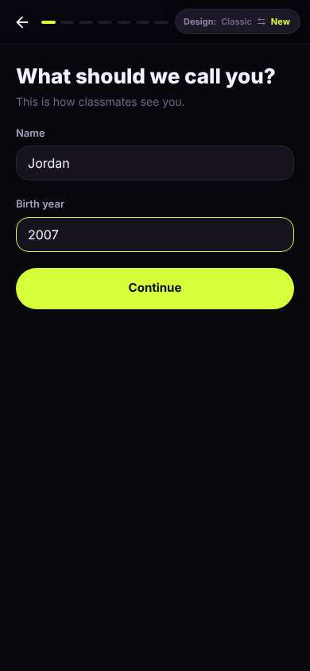</a> |
| 5 | click “Continue” | `/start` | 864 | expects: “email step” (0.6) **mismatch**: interest picker, still no email ⚑ mismatch _bored_: “second setup screen. clock's ticking.” → f2 | <a href="shots/005-click-som.jpg">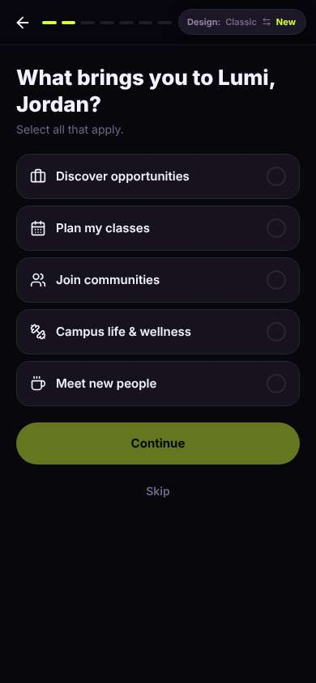</a> |
| 7 | click “Meet new people” | `/start` | 856 |  | <a href="shots/007-click-som.jpg">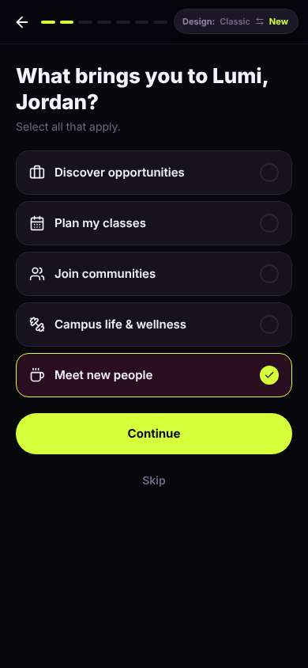</a> |
| 8 | click “Continue” | `/start` | 854 | expects: “email or straight into app” (0.5) **mismatch**: feature tour slide, a third setup screen ⚑ mismatch _frustrated_: “a feature list? I don't care. third screen and I still don't have an account.” → f3 | <a href="shots/008-click-som.jpg">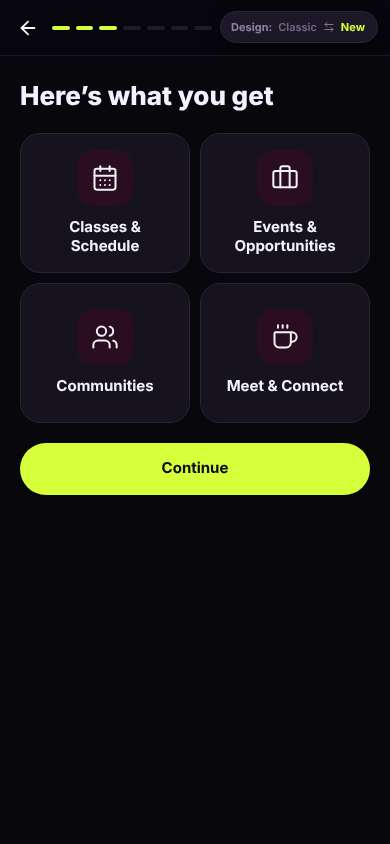</a> |
| 10 | click “Continue” | `/start` | 855 | expects: “email signup finally” (0.5) **mismatch**: school picker, 4th setup screen ⚑ mismatch _bored_: “ok at least this is one tap. but come on.” | <a href="shots/010-click-som.jpg">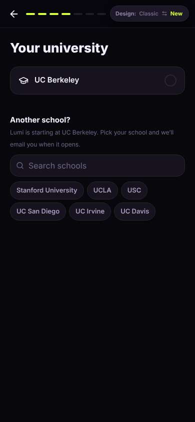</a> |
| 12 | click “UC Berkeley” | `/start` | 856 | expects: “email entry” (0.6) **mismatch**: status buttons appeared on same screen ⚑ mismatch _neutral_: “fine, undergrad.” | <a href="shots/012-click-som.jpg">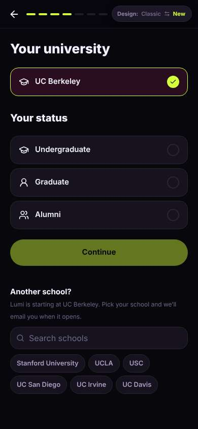</a> |
| 14 | click “Undergraduate” | `/start` | 860 |  | <a href="shots/014-click-som.jpg">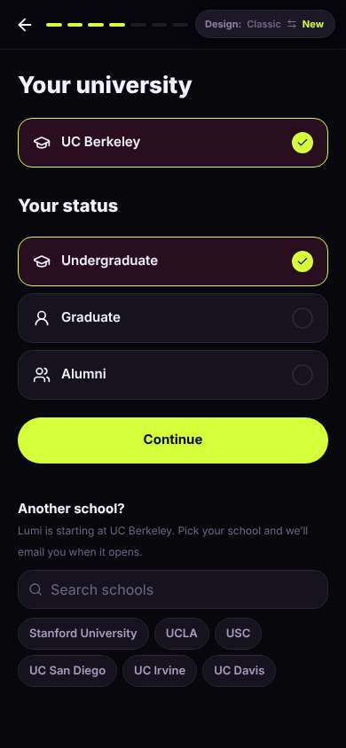</a> |
| 15 | click “Continue” | `/start` | 860 | expects: “email entry” (0.6) **mismatch**: another interest picker (5th setup screen), still no email, haven't seen a single person ⚑ mismatch _frustrated_: “I already told you what I want two screens ago. another picker? nope.” → f4 |  |
| 17 | finish | `/start` |  |  |  |

## Automatic checks (harness, not persona)

| screen | tap targets < 44px | sideways overflow | broken images |
|---|---|---|---|
| `/welcome` | 4 (Sign in 46×21, Terms of Use 76×15, Privacy Policy 180×33, Switch to the classic design 158×32) | — | — |
| `/start` | 8 (Back 40×40, Switch to the classic design 158×32) | — | — |

## Timing (harness)

- Full page load (navigation timing): 1021 ms
