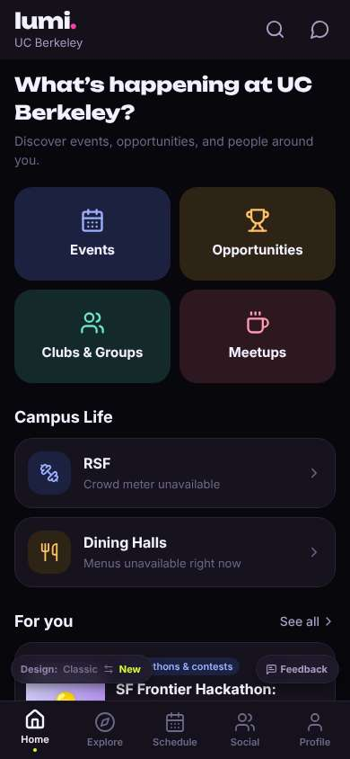
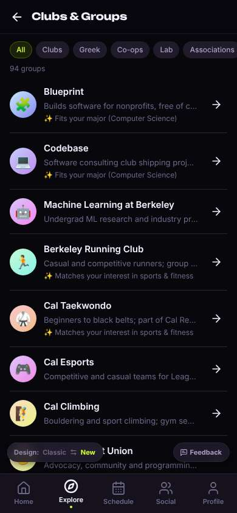
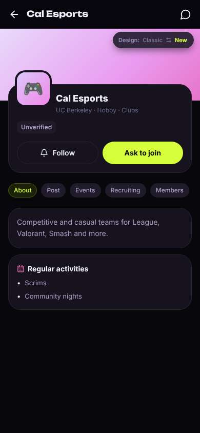
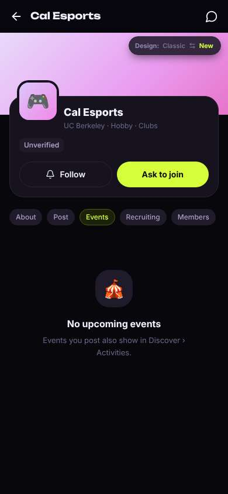
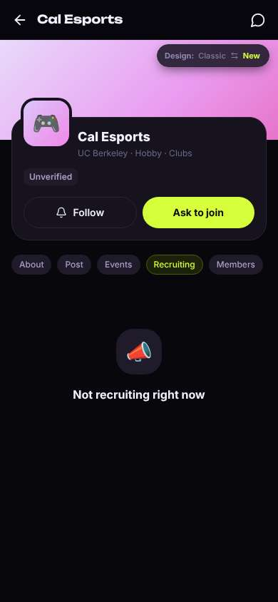
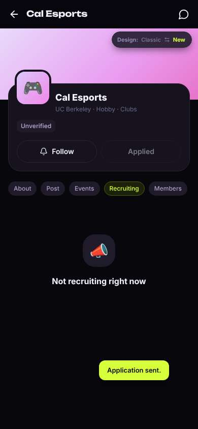
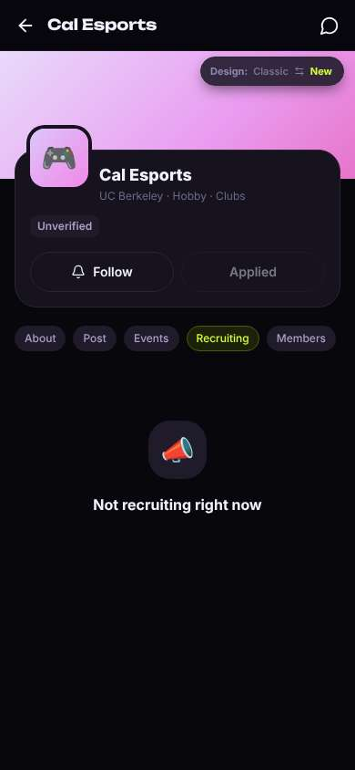

# ux-sim run `sched-20261102-1925-jordan-find-a-club`

> **AI simulation — hypotheses, not measured user behaviour.** One simulated persona; nothing here is a rate or a measurement of real students.

| | |
|---|---|
| Persona | **Jordan**, 19 — Sophomore · phone 390×844 · prefers en · tech high (`jordan-sophomore-impatient`) |
| Scenario | **Find a club I'd actually like** — You want to find one student club or group you'd actually enjoy and feel welcome in. Use the app to find one that fits you and open its page to see how to join. (`find-a-club`) |
| Target | local · http://localhost:35449 · worktree commit `6d64c5686fb8` |
| Outcome | **success** · ended by persona |
| Account | fresh real account `jordan.clubifyn@berkeley.edu` (Jordan, Computer Science, born 2007; sample: false) |
| Goal check (fixed, by harness) | met at step 4 after 2 action(s) — evidence: {"urlMatches":"^/orgs/[^/?]+"} — _A club / organization page is open (reached by the persona — the run starts on /)._ |
| Persona's reason | “Found Cal Esports in like two taps and hit Ask to join. Page is kinda dead though - no events, not recruiting.” |
| Effort | 5/28 actions · objective frustration 1.50/3 · 1 confused note(s) · ~12s simulated |
| Drop-off risk | **medium** _(AI hypothesis, persona agent)_ — Getting to a club was fast and the 'fits your major' tags were nice, but the club page was empty (no events, not recruiting, unverified) so there's nothing pulling me back unless they actually reply. · basis: steps 4, 6, 8, 10 |

Known environment limits (not UX findings)

- Dining menus and RSF gym crowd levels need live campus sources (the local stack runs with CAMPUS_LIVE=0) — empty or missing data there is not a UX bug.
- AI features (Ask Lumi, AI profile draft on /start, conversation starters) need an OpenAI key; none is configured locally.
- Course catalog is the built-in sample list (~210 courses, e.g. MATH 1A; no cached catalog — run `local-stack catalog fetch` once (about 5 minutes) to test with the real Berkeley schedule). Live has the imported current-term Berkeley schedule (e.g. MATH 51) — course-name findings on timetable/class screens are marked environment-limited.
- Campus events, free food, internships, hackathons and scholarships are a read-only snapshot of live (1302 real items, 133 events this week, taken 2026-11-02 19:15 UTC) plus the CSV calendar. Nothing new appears during the run; Q&A and reviews are empty.
- No e-mail is sent: the sign-up / sign-in code is shown on screen in the hint (live sends a real e-mail).
- Real-time updates (SSE) work locally; other people never reply unless the stack was started with --autoreply.
- Signed in as a brand-new real (non-sample, e-mail-verified) account made for this run. Other students exist only if the scenario seeds peers (local fixtures); sample profiles are hidden from real accounts, as on live.

## Friction

| # | step | type | sev | persona says | screen | element | env-limited | evidence |
|---|---|---|---|---|---|---|---|---|
| f1 | 4 | Missing / empty content | 2 | “ok and? when are community nights? 'unverified' — is this even real?” _wish: show when they meet next and how many people are in it_ | `/orgs/:id` | About | no | [shot](shots/004-click.jpg) [marked](shots/004-click-som.jpg) |
| f2 | 6 | Missing / empty content | 2 | “nothing. and why is it telling me about events I post? I'm not running this club.” _wish: show past/recurring meetups so it doesn't look dead_ | `/orgs/:id?tab=events` | Events | no | [shot](shots/006-click.jpg) [marked](shots/006-click-som.jpg) |
| f3 | 8 | Confusing UI | 2 | “wait. not recruiting but ask to join? which is it.” _wish: tell me if Ask to join still works when they're not recruiting_ | `/orgs/:id?tab=recruit` | Recruiting | no | [shot](shots/008-click.jpg) [marked](shots/008-click-som.jpg) |
| f4 | 10 | Confusing UI | 1 | “ok, fast, I like that. but applied to who? will anyone answer? they're 'not recruiting'.” _wish: say who gets it and when I'd hear back_ | `/orgs/:id?tab=recruit` | Applied | no | [shot](shots/010-click.jpg) [marked](shots/010-click-som.jpg) |

Severity: 1 = Minor — noticed it, cosmetic or a small annoyance; did not slow me down. · 2 = Moderate — slowed me down or made me hesitate; I recovered on my own. · 3 = Major — real confusion, a wrong path or many extra steps; I nearly gave up or only got through by guessing. · 4 = Blocker — I could not continue, gave up, or would stop using the app here.

## Timeline

| step | what | screen | ms | signals / notes | shot |
|---|---|---|---|---|---|
| 0 | start | `/` | 1700 |  |  |
| 1 | click “Clubs & Groups” | `/explore/clubs` | 931 | expects: “list of clubs” (0.85) as expected _curious_: “ok, 94 clubs and it knows I'm CS. not bad.” |  |
| 3 | observe | `/explore/clubs` |  |  |  |
| 4 | click “🎮 Cal Esports Competitive and casual te” | `/orgs/:id` | 855 | expects: “Cal Esports page with how to join and when they meet” (0.7) **mismatch**: Page has a big 'Ask to join' but no meeting times, just 'Scrims, Community nights', plus an 'Unverified' badge ⚑ mismatch _neutral_: “ok and? when are community nights? 'unverified' — is this even real?” → f1 |  |
| 6 | click “Events” | `/orgs/:id?tab=events` | 846 | expects: “upcoming esports events, like a community night” (0.4) **mismatch**: 'No upcoming events' plus a line about events I post showing in Discover > Activities ⚑ mismatch _bored_: “nothing. and why is it telling me about events I post? I'm not running this club.” → f2 |  |
| 8 | click “Recruiting” | `/orgs/:id?tab=recruit` | 857 | expects: “how to join / tryouts info” (0.5) **mismatch**: 'Not recruiting right now' while a big lime 'Ask to join' button sits above it ⚑ mismatch _confused_: “wait. not recruiting but ask to join? which is it.” → f3 |  |
| 10 | click “Ask to join” | `/orgs/:id?tab=recruit` | 856 | expects: “sends a join request or tells me how joining works” (0.5) as expected _neutral_: “ok, fast, I like that. but applied to who? will anyone answer? they're 'not recruiting'.” → f4 |  |
| 12 | finish | `/orgs/:id?tab=recruit` |  |  |  |

## Automatic checks (harness, not persona)

| screen | tap targets < 44px | sideways overflow | broken images |
|---|---|---|---|
| `/` | 3 (See all 62×21, Feedback 93×32, Switch to the classic design 158×32) | — | — |
| `/explore/clubs` | 9 (See all 62×21, Feedback 93×32, Switch to the classic design 158×32) | — | — |
| `/orgs/:id` | 8 (Back 40×40, Messages 40×40, About 56×28, Post 47×28, Events 61×28) | — | — |
| `/orgs/:id?tab=events` | 8 (Back 40×40, Messages 40×40, About 56×28, Post 47×28, Events 61×28) | — | — |
| `/orgs/:id?tab=recruit` | 8 (Back 40×40, Messages 40×40, About 56×28, Post 47×28, Events 61×28) | — | — |

## Timing (harness)

- Full page load (navigation timing): 668 ms
