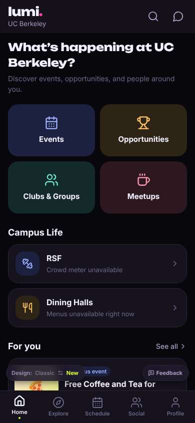
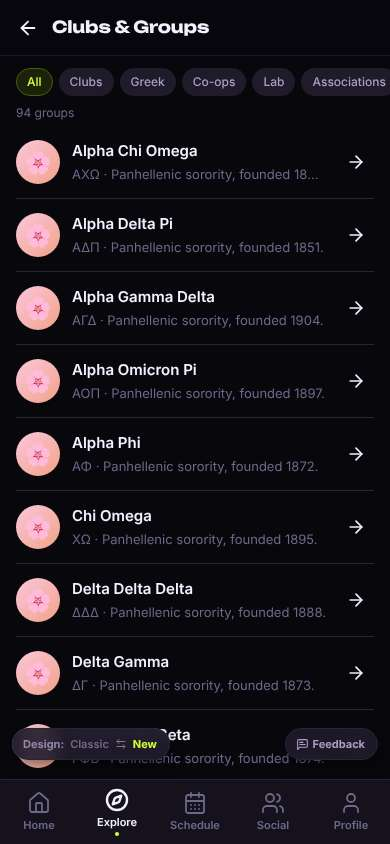
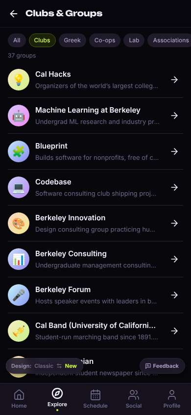
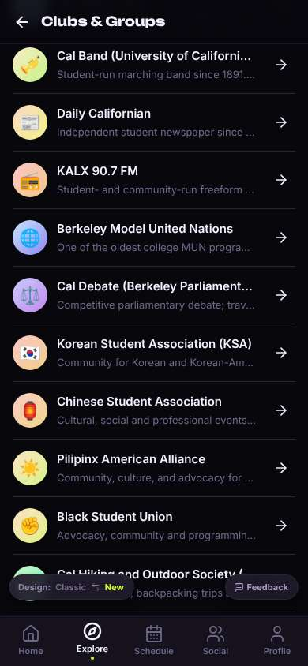
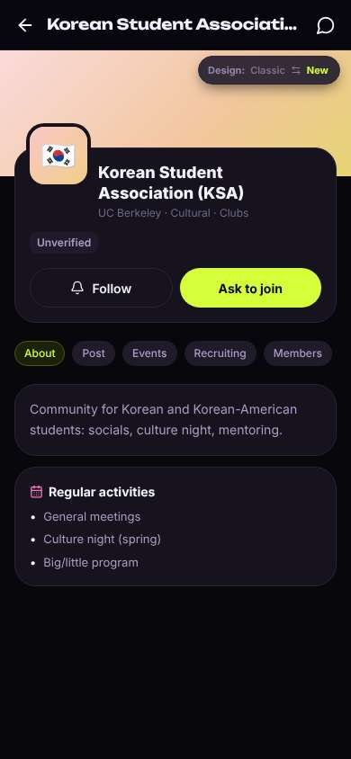
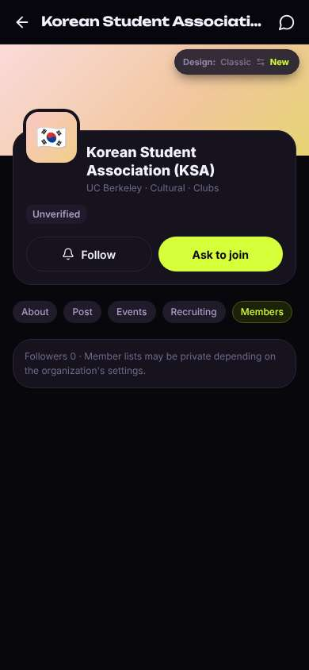
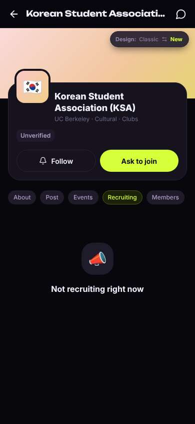
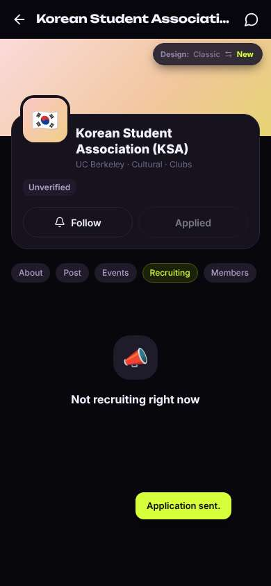
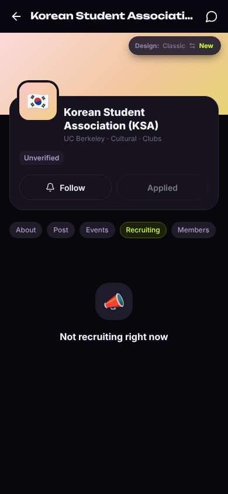

# ux-sim run `sched-20261102-1925-minji-find-a-club`

> **AI simulation — hypotheses, not measured user behaviour.** One simulated persona; nothing here is a rate or a measurement of real students.

| | |
|---|---|
| Persona | **Minji**, 17 — First-year (started college a year early) · phone 390×844 · prefers ko · tech high (`minji-freshman-17`) |
| Scenario | **Find a club I'd actually like** — You want to find one student club or group you'd actually enjoy and feel welcome in. Use the app to find one that fits you and open its page to see how to join. (`find-a-club`) |
| Target | local · http://localhost:37125 · worktree commit `6d64c5686fb8` |
| Outcome | **success** · ended by persona |
| Account | fresh real account `minji.clubifyl@berkeley.edu` (Minji, Undeclared, born 2009; sample: false) |
| Goal check (fixed, by harness) | met at step 10 after 4 action(s) — evidence: {"urlMatches":"^/orgs/[^/?]+"} — _A club / organization page is open (reached by the persona — the run starts on /)._ |
| Persona's reason | “KSA 찾았고 page에서 Ask to join 눌렀어. Easy, but 0 followers and 'not recruiting' makes me unsure anyone will answer.” |
| Effort | 7/40 actions · objective frustration 1.00/4.5 · 2 confused note(s) · ~35s simulated |
| Drop-off risk | **medium** _(AI hypothesis, persona agent)_ — Finding a club was fast and didn't ask for personal info, but the club looks empty (0 followers) and there's no sign of people my age or what happens next · basis: steps 12, 14, 16 |

Known environment limits (not UX findings)

- Dining menus and RSF gym crowd levels need live campus sources (the local stack runs with CAMPUS_LIVE=0) — empty or missing data there is not a UX bug.
- AI features (Ask Lumi, AI profile draft on /start, conversation starters) need an OpenAI key; none is configured locally.
- Course catalog is the built-in sample list (~210 courses, e.g. MATH 1A; no cached catalog — run `local-stack catalog fetch` once (about 5 minutes) to test with the real Berkeley schedule). Live has the imported current-term Berkeley schedule (e.g. MATH 51) — course-name findings on timetable/class screens are marked environment-limited.
- Campus events, free food, internships, hackathons and scholarships are a read-only snapshot of live (1302 real items, 133 events this week, taken 2026-11-02 19:15 UTC) plus the CSV calendar. Nothing new appears during the run; Q&A and reviews are empty.
- No e-mail is sent: the sign-up / sign-in code is shown on screen in the hint (live sends a real e-mail).
- Real-time updates (SSE) work locally; other people never reply unless the stack was started with --autoreply.
- Signed in as a brand-new real (non-sample, e-mail-verified) account made for this run. Other students exist only if the scenario seeds peers (local fixtures); sample profiles are hidden from real accounts, as on live.

## Friction

| # | step | type | sev | persona says | screen | element | env-limited | evidence |
|---|---|---|---|---|---|---|---|---|
| f1 | 4 | No reason to stay | 2 | “All 눌렀는데 sorority만 계속 나와. 그리스 문자 너무 많아... I'm 17, I don't want rush stuff” _wish: show regular clubs / interests first, not a wall of Greek life_ | `/explore/clubs` | All | no | [shot](shots/004-observe.jpg) [marked](shots/004-observe-som.jpg) |
| f2 | 10 | Trust / privacy worry | 1 | “깔끔하다, 글 짧아서 좋아. 근데 'Unverified'... 뭐지? 진짜 KSA 맞아?” _wish: explain what Unverified means or show it's the real club_ | `/orgs/:id` |  | no | [shot](shots/010-click.jpg) [marked](shots/010-click-som.jpg) |
| f3 | 12 | Missing / empty content | 2 | “헐 0명... 아무도 없어? 이거 진짜 활동하는 거 맞나” _wish: see roughly how many people / some freshmen are in it_ | `/orgs/:id?tab=members` | Members | no | [shot](shots/012-click.jpg) [marked](shots/012-click-som.jpg) |
| f4 | 14 | Confusing UI | 2 | “뭐지? recruiting 안 한다면서 Ask to join은 왜 있어? 눌러도 되는 거야?” _wish: tell me if I can still join now, or when the next intake is_ | `/orgs/:id?tab=recruit` | Ask to join | no | [shot](shots/014-click.jpg) [marked](shots/014-click-som.jpg) |
| f5 | 16 | Confusing UI | 1 | “오 바로 됐네, 개인정보 안 물어봐서 좋아. 근데 언제 연락 와? 누가 봐?” _wish: say what happens next, e.g. 'KSA officers will message you'_ | `/orgs/:id?tab=recruit` | Applied | no | [shot](shots/016-click.jpg) [marked](shots/016-click-som.jpg) |

Severity: 1 = Minor — noticed it, cosmetic or a small annoyance; did not slow me down. · 2 = Moderate — slowed me down or made me hesitate; I recovered on my own. · 3 = Major — real confusion, a wrong path or many extra steps; I nearly gave up or only got through by guessing. · 4 = Blocker — I could not continue, gave up, or would stop using the app here.

## Timeline

| step | what | screen | ms | signals / notes | shot |
|---|---|---|---|---|---|
| 0 | start | `/` | 1525 | _curious_: “오 Clubs & Groups 바로 있네. easy. no big face photos, good” |  |
| 2 | click “Clubs & Groups” | `/explore/clubs` | 914 | expects: “list of clubs I can browse” (0.8) as expected _neutral_: “94개... 근데 왜 다 sorority야? Alpha Chi Omega, Alpha Delta Pi... not my vibe” |  |
| 4 | observe | `/explore/clubs` |  | _bored_: “All 눌렀는데 sorority만 계속 나와. 그리스 문자 너무 많아... I'm 17, I don't want rush stuff” → f1 |  |
| 6 | click “Clubs” | `/explore/clubs` | 878 | expects: “only normal student clubs like hobbies, data science, food” (0.7) as expected _neutral_: “아 다 consulting이랑 hackathon... 너무 빡세 보여. scroll 해볼게” |  |
| 8 | scroll down | `/explore/clubs` | 1313 | _curious_: “오 🇰🇷 KSA! 한국 사람들 있으면 덜 어색할 듯. 근데 다 18-19살이겠지...” |  |
| 10 | click “🇰🇷 Korean Student Association (KSA) Co” | `/orgs/:id` | 840 | expects: “KSA page with what they do and how to join (maybe insta link)” (0.7) as expected _neutral_: “깔끔하다, 글 짧아서 좋아. 근데 'Unverified'... 뭐지? 진짜 KSA 맞아?” → f2 |  |
| 12 | click “Members” | `/orgs/:id?tab=members` | 845 | expects: “list of members, hopefully some freshmen like me” (0.5) **mismatch**: Followers 0 and 'member lists may be private'. Nobody visible. ⚑ mismatch _frustrated_: “헐 0명... 아무도 없어? 이거 진짜 활동하는 거 맞나” → f3 |  |
| 14 | click “Recruiting” | `/orgs/:id?tab=recruit` | 847 | expects: “when they recruit and how to join” (0.6) **mismatch**: Says 'Not recruiting right now' but the big lime 'Ask to join' button is still there ⚑ mismatch _confused_: “뭐지? recruiting 안 한다면서 Ask to join은 왜 있어? 눌러도 되는 거야?” → f4 |  |
| 16 | click “Ask to join” | `/orgs/:id?tab=recruit` | 843 | expects: “sends a request to KSA, or asks me a few questions first” (0.5) as expected _neutral_: “오 바로 됐네, 개인정보 안 물어봐서 좋아. 근데 언제 연락 와? 누가 봐?” → f5 |  |
| 18 | finish | `/orgs/:id?tab=recruit` |  |  |  |

## Automatic checks (harness, not persona)

| screen | tap targets < 44px | sideways overflow | broken images |
|---|---|---|---|
| `/` | 3 (See all 62×21, Feedback 93×32, Switch to the classic design 158×32) | — | — |
| `/explore/clubs` | 9 (See all 62×21, Feedback 93×32, Switch to the classic design 158×32) | — | — |
| `/orgs/:id` | 8 (Back 40×40, Messages 40×40, About 56×28, Post 47×28, Events 61×28) | — | — |
| `/orgs/:id?tab=members` | 8 (Back 40×40, Messages 40×40, About 56×28, Post 47×28, Events 61×28) | — | — |
| `/orgs/:id?tab=recruit` | 8 (Back 40×40, Messages 40×40, About 56×28, Post 47×28, Events 61×28) | — | — |

## Timing (harness)

- Full page load (navigation timing): 611 ms
