# ux-sim run `sched-20261103-1915-aisha-first-open-decide`

> **AI simulation — hypotheses, not measured user behaviour.** One simulated persona; nothing here is a rate or a measurement of real students.

| | |
|---|---|
| Persona | **Aisha**, 18 — First-year (first in her family to go to college) · phone 390×844 · prefers en · tech medium (`aisha-firstgen-anxious`) |
| Scenario | **First open: what is this app, and is it worth signing up?** — A friend sent you a link to this app. You have never seen it before. Figure out what it is for, and decide whether you want to make an account. If it seems worth it, sign up with your school e-mail. (`first-open-decide`) |
| Target | local · http://localhost:45293 · worktree commit `3f891a8142aa` |
| Outcome | **abandoned** · ended by persona |
| Account | signed out at start |
| Goal check (fixed, by harness) | met at step 40 after 25 action(s) — evidence: the account the browser is signed in to was created during this run; {"urlMatches":"^/(discover\|community\|profile)?(\\?.*)?$"} — _Signed up during the run (a new account exists and the browser is signed in to it) and landed inside the app (signed-in home or a main tab)._ |
| Patience | exhausted at step 52; 0 action(s) after |
| ⚠ unnoticed success | The check passed but the persona did not realise it had succeeded. |
| Persona's reason | “I did make an account with my school email, but when I went looking for a club it pushed career fraternities at me and then the hiking club said 'not recruiting' next to 'Ask to join'. I don't know what I'm allowed to do, so I'm closing it for now.” |
| Effort | 31/50 actions · objective frustration 4.00/6 · 4 confused note(s) · ~411s simulated |
| Drop-off risk | **medium** _(AI hypothesis, persona agent)_ — Sign-up was gentle and the school badge and privacy short version reassured her, but the first club experience felt résumé-first and the join rules were unclear, which is exactly her fear; she may come back only if a friend pulls her into an event. · basis: steps 42, 43, 51, 52 |

Known environment limits (not UX findings)

- Dining menus and RSF gym crowd levels need live campus sources (the local stack runs with CAMPUS_LIVE=0) — empty or missing data there is not a UX bug.
- AI features (Ask Lumi, AI profile draft on /start, conversation starters) need an OpenAI key; none is configured locally.
- Course catalog is the built-in sample list (~210 courses, e.g. MATH 1A; no cached catalog — run `local-stack catalog fetch` once (about 5 minutes) to test with the real Berkeley schedule). Live has the imported current-term Berkeley schedule (e.g. MATH 51) — course-name findings on timetable/class screens are marked environment-limited.
- Campus events, free food, internships, hackathons and scholarships are a read-only snapshot of live (1279 real items, 134 events this week, taken 2026-11-03 19:15 UTC) plus the CSV calendar. Nothing new appears during the run; Q&A and reviews are empty.
- No e-mail is sent: the sign-up / sign-in code is shown on screen in the hint (live sends a real e-mail).
- Real-time updates (SSE) work locally; other people never reply unless the stack was started with --autoreply.

## Friction

| # | step | type | sev | persona says | screen | element | env-limited | evidence |
|---|---|---|---|---|---|---|---|---|
| f1 | 0 | No reason to stay | 1 | “OK, '94 clubs' in the scrolling banner catches my eye, that's what I want. But the big headline is 'Who's free on campus right now?' and 'Find someone for lunch'... wait, is this a meetup app where strangers see when I'm free? The quantum colloquium and DOE grad research cards are not for a first-year like me.” _wish: show something for first-years looking for a club, not grad research deadlines_ | `/welcome` |  | no | [shot](shots/000-start.jpg) [marked](shots/000-start-som.jpg) |
| f2 | 2 | Trust / privacy worry | 2 | “The short version is actually reassuring, other users never see my email. But wait... who runs this? It literally says 'operator name — to be set'. Is this a real thing or someone's class project? That makes me nervous about giving my school email.” _wish: say who actually runs Lumi and a real contact email_ | `/privacy` |  | no | [shot](shots/002-click.jpg) [marked](shots/002-click-som.jpg) |
| f3 | 7 | Onboarding friction | 2 | “Wait, I haven't even seen any clubs yet and I'm already making a profile? I still don't really know what this app does. Also the privacy page I just read said my age shows on my profile, and this says it's never shown. Which one is true?” _wish: let me peek at the clubs before signing up, and make the privacy page match what the form says about age_ | `/start` | 2005 | no | [shot](shots/007-click.jpg) [marked](shots/007-click-som.jpg) |
| f4 | 25 | Onboarding friction | 2 | “Didn't I just answer this? I already said clubs and meeting people. This is the fifth screen and I still haven't seen a single club.” _wish: don't ask what I'm interested in twice; show me some clubs sooner_ | `/start` |  | no | [shot](shots/025-click.jpg) [marked](shots/025-click-som.jpg) |
| f5 | 29 | Trust / privacy worry | 1 | “Hmm, I'm not part of any club yet, that's the whole reason I'm here. I do live in a dorm though. I won't tick 'Cultural / Identity' because I don't know who would see that on my profile.” _wish: say whether these show on my profile_ | `/start` | Cultural / Identity | no | [shot](shots/029-click.jpg) [marked](shots/029-click-som.jpg) |
| f6 | 40 | No reason to stay | 1 | “Clubs & Groups is right there, good. But 'For you' is a law job panel? I said clubs and campus events, not careers. And the Design/Feedback buttons are sitting on top of the card.” _wish: 'For you' should reflect what I picked: clubs and welcoming events_ | `/` | Campus event Careers in Consumer Protection – Job Panel Wed, Nov 4 Law | no | [shot](shots/040-click.jpg) [marked](shots/040-click-som.jpg) |
| f7 | 42 | No reason to stay | 3 | “Wait, 'matches your interest in careers'? I never said careers, I said clubs and meeting people. The first thing I see is professional fraternities and pre-law — that's exactly the résumé-club stuff I was scared of. Do you have to rush or apply for all of these?” _wish: recommend based on what I actually picked, and show low-pressure, open-to-everyone clubs first; say if a club needs an application_ | `/explore/clubs` | KT Kappa Theta Pi ΚΘΠ · Professional co-ed fraternity, founded 2012. Technology. Matches y | no | [shot](shots/042-click.jpg) [marked](shots/042-click-som.jpg) |
| f8 | 51 | Confusing UI | 3 | “Wait, does 'not recruiting' mean I can't join a hiking club right now? Then what does 'Ask to join' do — send them a message with my profile? I don't want to accidentally ask for something I'm not allowed to. This is exactly the unwritten-rules thing I don't know.” _wish: tell me plainly: open to anyone / just show up / needs an application, and what 'Ask to join' sends and who sees it_ | `/orgs/:id?tab=recruit` | Ask to join | no | [shot](shots/051-click.jpg) [marked](shots/051-click-som.jpg) |

Severity: 1 = Minor — noticed it, cosmetic or a small annoyance; did not slow me down. · 2 = Moderate — slowed me down or made me hesitate; I recovered on my own. · 3 = Major — real confusion, a wrong path or many extra steps; I nearly gave up or only got through by guessing. · 4 = Blocker — I could not continue, gave up, or would stop using the app here.

## Where it ended

Step 51 on `/orgs/:id?tab=recruit`.

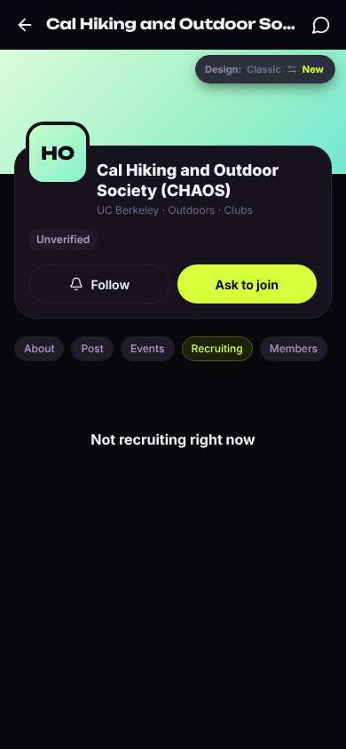

## Timeline

| step | what | screen | ms | signals / notes | shot |
|---|---|---|---|---|---|
| 0 | start | `/welcome` | 1531 | _curious_: “OK, '94 clubs' in the scrolling banner catches my eye, that's what I want. But the big headline is 'Who's free on campus right now?' and 'Find someone for lunch'... wait, is this a meetup app where strangers see when I'm free? The quantum colloquium and DOE grad research cards are not for a first-year like me.” → f1 | <a href="shots/000-start-som.jpg">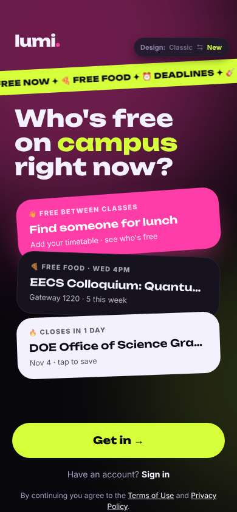</a> |
| 2 | click “Privacy Policy” | `/privacy` | 930 | expects: “privacy policy page explaining who sees my info and schedule” (0.7) as expected _confused_: “The short version is actually reassuring, other users never see my email. But wait... who runs this? It literally says 'operator name — to be set'. Is this a real thing or someone's class project? That makes me nervous about giving my school email.” → f2 | <a href="shots/002-click-som.jpg">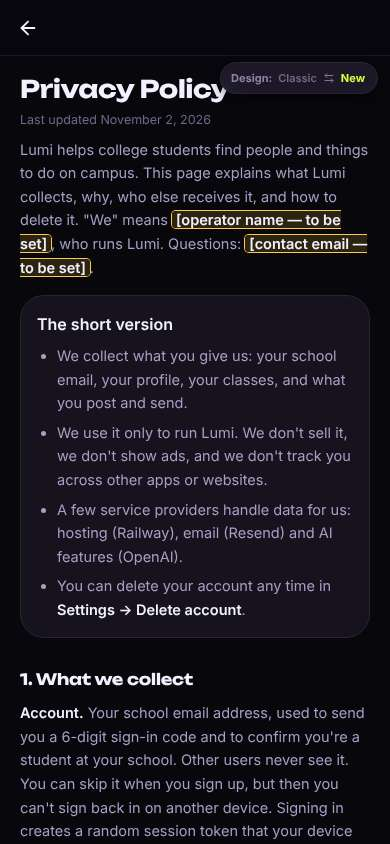</a> |
| 4 | scroll down | `/privacy` | 1319 | _curious_: “Okay, this is good: avatar is just an emoji, no photos, never my address, and I can choose whether classmates see my classes. That makes me feel a lot less like it's a dating app. But 'age shows on your profile' — I'd rather it didn't. Enough reading, let me go back and see what it actually does.” | <a href="shots/004-scroll-som.jpg">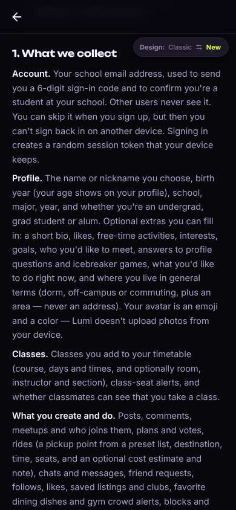</a> |
| 6 | click “Back” | `/welcome` | 844 | expects: “back to the welcome screen” (0.9) | <a href="shots/006-click-som.jpg">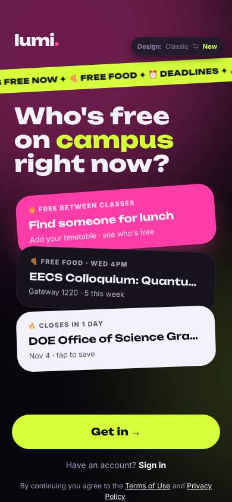</a> |
| 7 | click “Get in →” | `/start` | 874 | expects: “either it lets me look around first, or it asks for my school email to sign up” (0.5) **mismatch**: No way to look around first; it went straight into a multi-step sign-up asking name and birth year. Says birth year is never shown on profile. ⚑ mismatch _confused_: “Wait, I haven't even seen any clubs yet and I'm already making a profile? I still don't really know what this app does. Also the privacy page I just read said my age shows on my profile, and this says it's never shown. Which one is true?” → f3 | <a href="shots/007-click-som.jpg">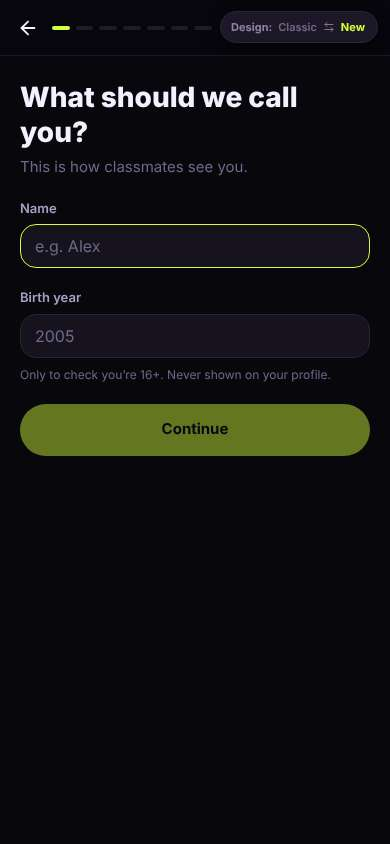</a> |
| 9 | type “e.g. Alex” ← “Aisha” | `/start` | 871 |  |  |
| 10 | type “2005” ← “2008” | `/start` | 859 |  | <a href="shots/010-type-som.jpg">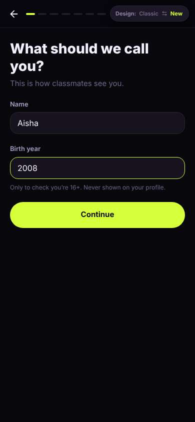</a> |
| 11 | click “Continue” | `/start` | 854 | expects: “next step, probably school or major” (0.6) **mismatch**: Asked 'What brings you to Lumi?' with five choices incl. 'Get involved in communities — Clubs, Greek life, co-ops'. ⚑ mismatch _curious_: “Oh, this actually helps — now I get what the app is: clubs, classes, events, meeting people. 'Get involved in communities' is exactly me. 'Meet new people' too, I think.” | <a href="shots/011-click-som.jpg">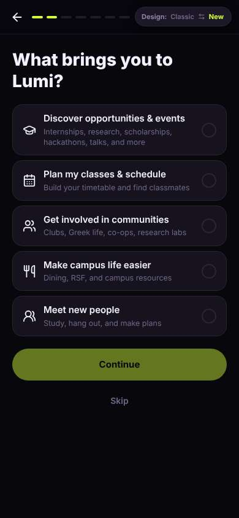</a> |
| 13 | click “Get involved in communities Clubs, Greek” | `/start` | 847 | expects: “it gets selected/highlighted” (0.8) as expected _neutral_: “Good, I can pick more than one, I hope.” | <a href="shots/013-click-som.jpg">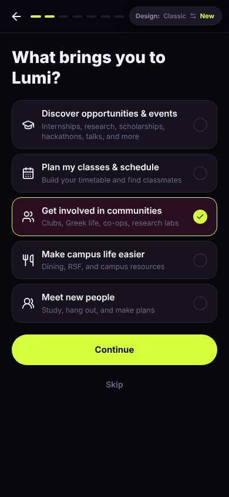</a> |
| 15 | click “Meet new people Study, hang out, and mak” | `/start` | 831 | expects: “Meet new people also selected, both stay selected” (0.7) as expected _neutral_: “Okay, both.” | <a href="shots/015-click-som.jpg">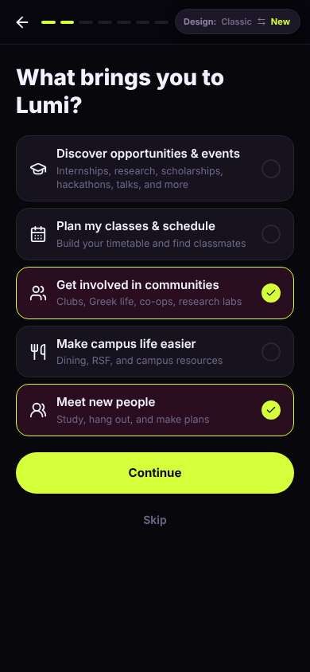</a> |
| 17 | click “Continue” | `/start` | 855 | expects: “asks for school / year / major” (0.6) **mismatch**: An explainer screen: 'Here's how Lumi helps you' with three sections ⚑ mismatch _neutral_: “Fine, this is clear. 'Join clubs' — but does it tell me which ones you have to apply to? That's the thing I actually don't know how to figure out. Also it showed all three things even though I picked two.” | <a href="shots/017-click-som.jpg">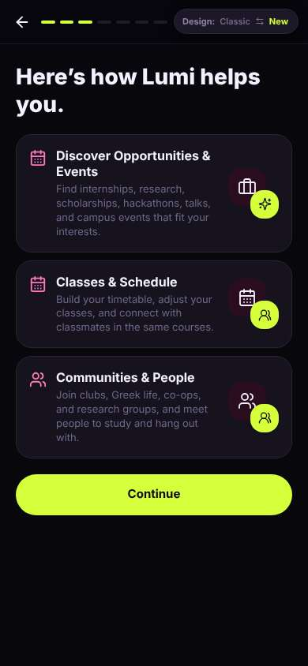</a> |
| 19 | click “Continue” | `/start` | 846 | expects: “school or email step” (0.5) as expected _neutral_: “Okay, school. That's what I expected.” | <a href="shots/019-click-som.jpg">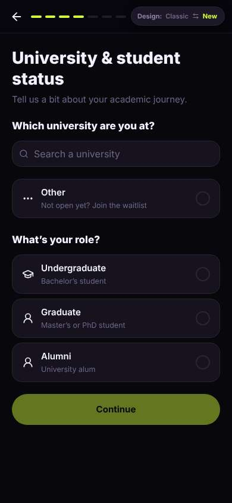</a> |
| 21 | type “Search a university” ← “Berkeley” | `/start` | 853 | expects: “UC Berkeley shows up in a list” (0.8) as expected _neutral_: “There it is.” | <a href="shots/021-type-som.jpg">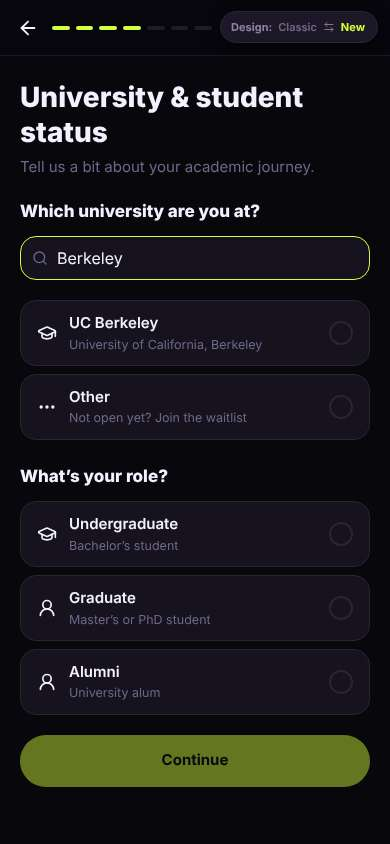</a> |
| 23 | click “UC Berkeley University of California, Be” | `/start` | 840 |  | <a href="shots/023-click-som.jpg">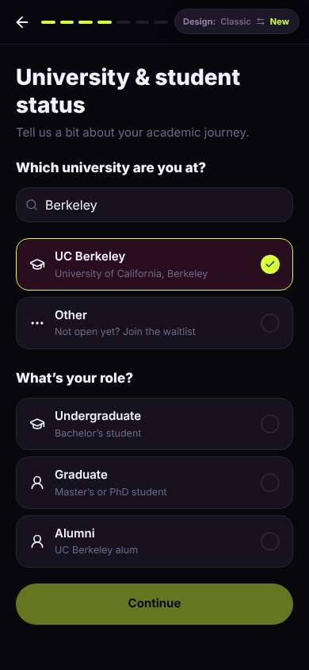</a> |
| 24 | click “Undergraduate Bachelor’s student” | `/start` | 851 |  | <a href="shots/024-click-som.jpg">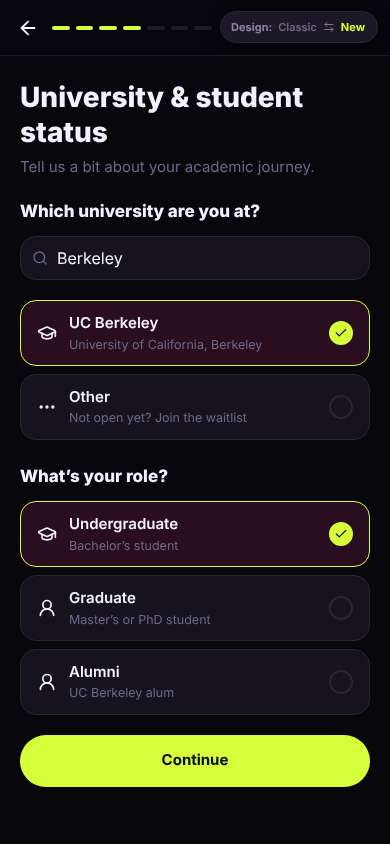</a> |
| 25 | click “Continue” | `/start` | 837 | expects: “year and major step” (0.6) **mismatch**: Another interests picker: 'What would you like to discover?' ⚑ mismatch _bored_: “Didn't I just answer this? I already said clubs and meeting people. This is the fifth screen and I still haven't seen a single club.” → f4 | <a href="shots/025-click-som.jpg">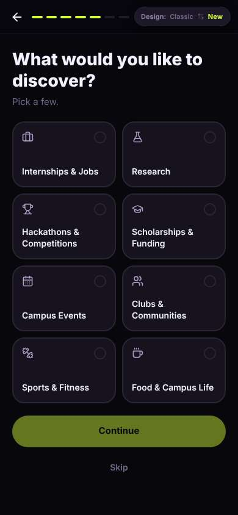</a> |
| 27 | click “Clubs & Communities” | `/start` | 851 |  | <a href="shots/027-click-som.jpg">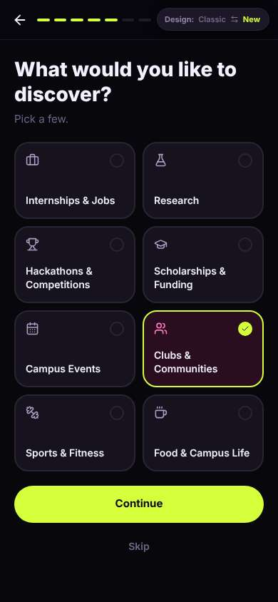</a> |
| 28 | click “Campus Events” | `/start` | 852 |  | <a href="shots/028-click-som.jpg">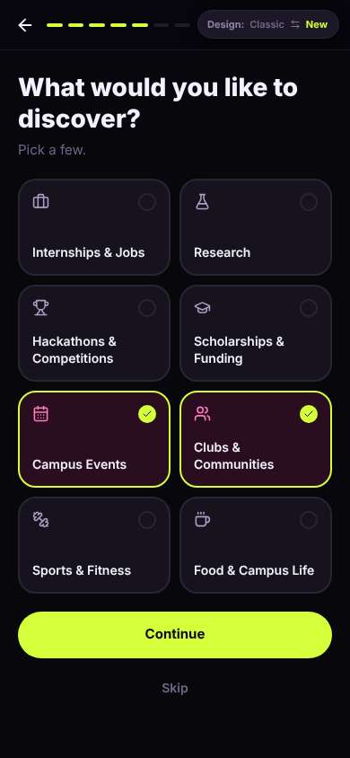</a> |
| 29 | click “Continue” | `/start` | 853 | expects: “year/major or email step” (0.5) **mismatch**: 'Your communities — which are you part of?' list ⚑ mismatch _neutral_: “Hmm, I'm not part of any club yet, that's the whole reason I'm here. I do live in a dorm though. I won't tick 'Cultural / Identity' because I don't know who would see that on my profile.” → f5 | <a href="shots/029-click-som.jpg">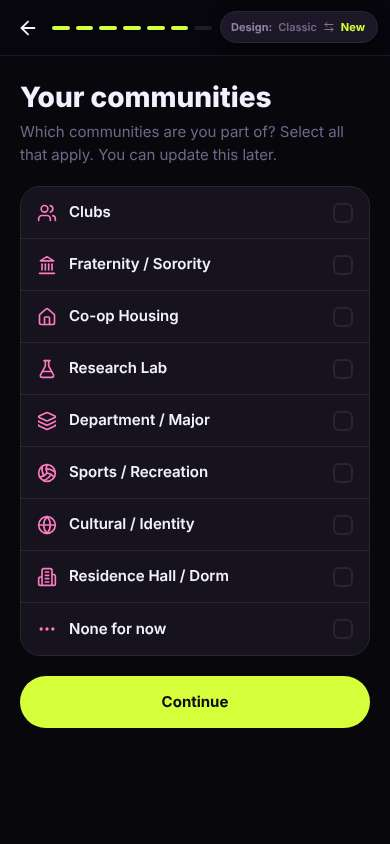</a> |
| 31 | click “Residence Hall / Dorm” | `/start` | 835 |  | <a href="shots/031-click-som.jpg">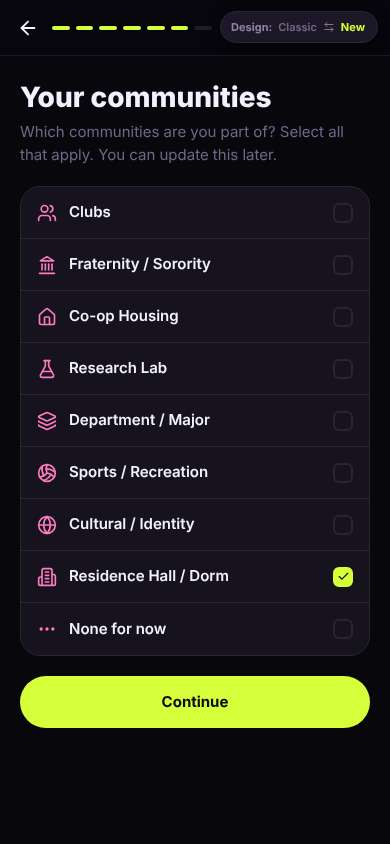</a> |
| 32 | click “Continue” | `/start` | 845 | expects: “school email step, finally” (0.4) **mismatch**: 'You're all set' — school email is optional; big Get Started button is already active. ⚑ mismatch _neutral_: “Wait, so I already have an account without an email? That's kind of nice, low pressure. But I'd rather not lose my stuff if I switch phones, and my friend said to use my school email, so I'll add it.” | <a href="shots/032-click-som.jpg">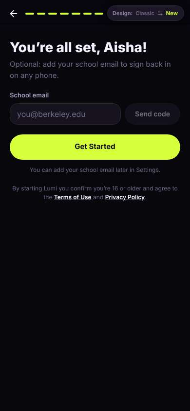</a> |
| 34 | type “you@berkeley.edu” ← “aisha.r@berkeley.edu” | `/start` | 876 |  | <a href="shots/034-type-som.jpg">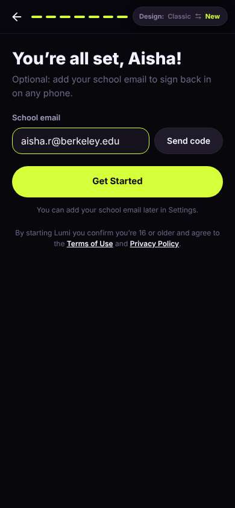</a> |
| 35 | click “Send code” | `/start` | 832 | expects: “a box to enter a 6-digit code appears” (0.8) as expected _neutral_: “Okay, code box.” | <a href="shots/035-click-som.jpg">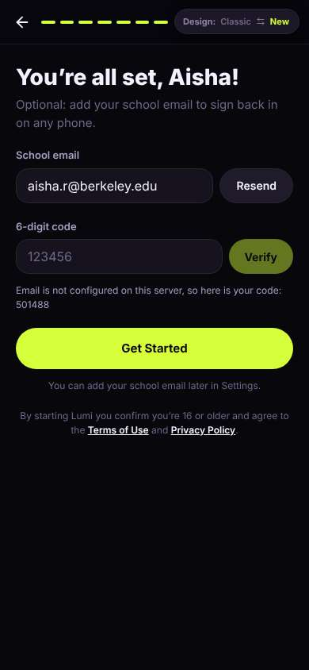</a> |
| 37 | type “123456” ← “501488” | `/start` | 856 |  | <a href="shots/037-type-som.jpg">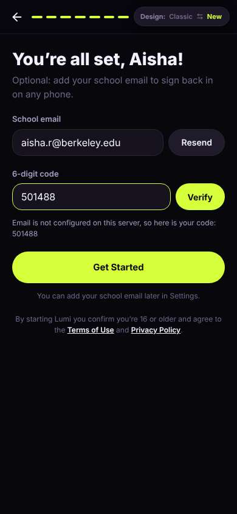</a> |
| 38 | click “Verify” | `/start` | 850 | expects: “email shows as verified, then I tap Get Started” (0.7) as expected _delighted_: “Oh nice, a school badge. That makes me feel like everyone here is actually a Berkeley student, which makes me feel safer.” | <a href="shots/038-click-som.jpg">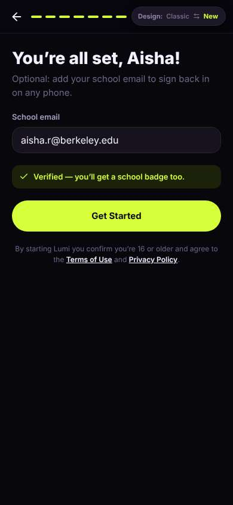</a> |
| 40 | click “Get Started” | `/` | 1449 | expects: “home screen, hopefully with clubs” (0.6) as expected _neutral_: “Clubs & Groups is right there, good. But 'For you' is a law job panel? I said clubs and campus events, not careers. And the Design/Feedback buttons are sitting on top of the card.” → f6 | <a href="shots/040-click-som.jpg">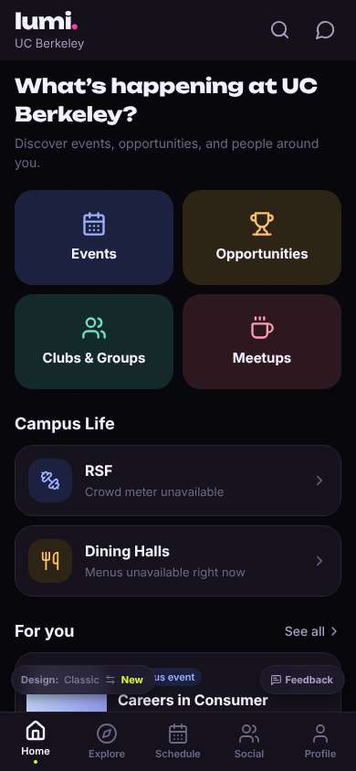</a> |
| 42 | click “Clubs & Groups” | `/explore/clubs` | 853 | expects: “a list of clubs I can browse” (0.8) **mismatch**: Club list opens on professional business/tech fraternities labelled 'Matches your interest in careers', then sororities. ⚑ mismatch _frustrated_: “Wait, 'matches your interest in careers'? I never said careers, I said clubs and meeting people. The first thing I see is professional fraternities and pre-law — that's exactly the résumé-club stuff I was scared of. Do you have to rush or apply for all of these?” → f7 | <a href="shots/042-click-som.jpg">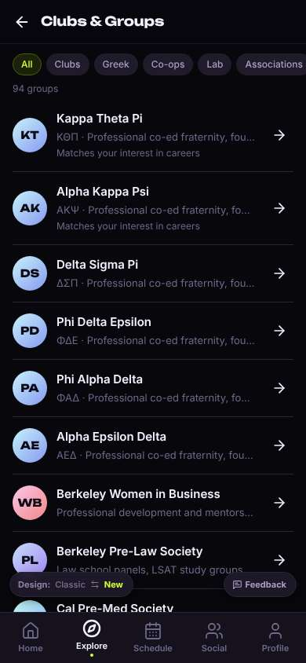</a> |
| 44 | click “Clubs” | `/explore/clubs` | 844 | expects: “just regular clubs, not fraternities” (0.7) as expected _neutral_: “Still business and pre-law at the top, but at least they're real clubs now. Let me scroll — there has to be something chill.” | <a href="shots/044-click-som.jpg">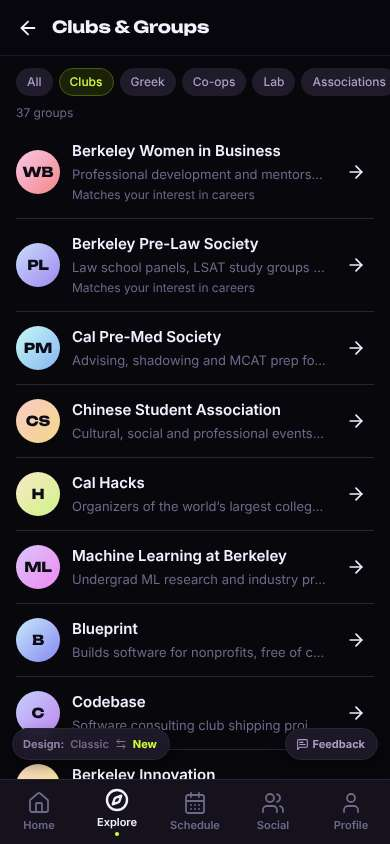</a> |
| 46 | scroll down | `/explore/clubs` | 1314 |  | <a href="shots/046-scroll-som.jpg">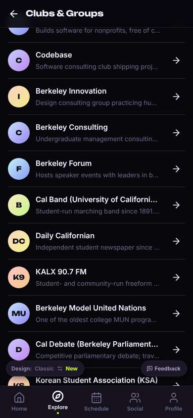</a> |
| 47 | scroll down | `/explore/clubs` | 1310 | _curious_: “Okay, now we're talking — hiking, running club 'casual', board games. These sound like places I could just show up. I had to scroll past a lot of consulting and VC though.” | <a href="shots/047-scroll-som.jpg">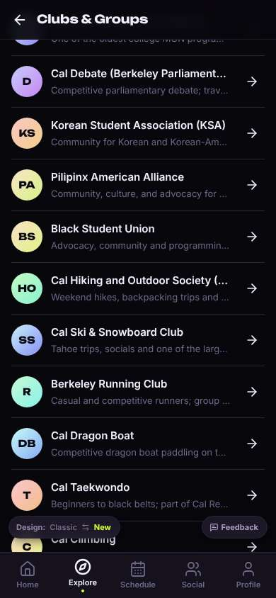</a> |
| 49 | click “HO Cal Hiking and Outdoor Society (CHAOS” | `/orgs/:id` | 852 | expects: “club page with how to join, whether you need to apply, upcoming hikes” (0.6) as expected _neutral_: “This is a real-looking club page. I'm not tapping 'Ask to join' yet — I don't know if that messages someone. 'Recruiting' might tell me if I have to apply.” | <a href="shots/049-click-som.jpg">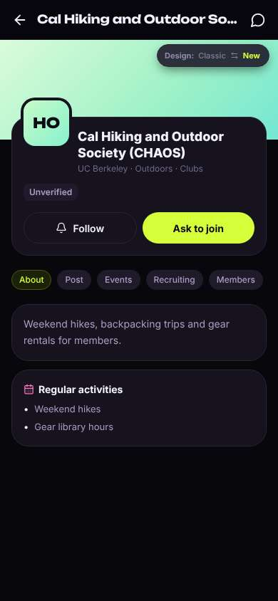</a> |
| 51 | click “Recruiting” | `/orgs/:id?tab=recruit` | 852 | expects: “says whether it's open to everyone or you need to apply, and when” (0.5) **mismatch**: Recruiting tab just says 'Not recruiting right now', while the big 'Ask to join' button is still there. ⚑ mismatch _confused_: “Wait, does 'not recruiting' mean I can't join a hiking club right now? Then what does 'Ask to join' do — send them a message with my profile? I don't want to accidentally ask for something I'm not allowed to. This is exactly the unwritten-rules thing I don't know.” → f8 |  |
| 53 | finish | `/orgs/:id?tab=recruit` |  |  |  |

## Automatic checks (harness, not persona)

| screen | tap targets < 44px | sideways overflow | broken images |
|---|---|---|---|
| `/welcome` | 4 (Sign in 46×21, Terms of Use 76×15, Privacy Policy 180×33, Switch to the classic design 158×32) | — | — |
| `/privacy` | 2 (Back 40×40, Switch to the classic design 158×32) | — | — |
| `/start` | 4 (Back 40×40, Switch to the classic design 158×32) | — | — |
| `/` | 3 (See all 62×21, Feedback 93×32, Switch to the classic design 158×32) | — | — |
| `/explore/clubs` | 9 (Back 40×40, All 37×28, Clubs 55×28, Greek 56×28, Co-ops 65×28) | — | — |
| `/orgs/:id` | 8 (Back 40×40, Messages 40×40, About 56×28, Post 47×28, Events 61×28) | — | — |
| `/orgs/:id?tab=recruit` | 8 (Back 40×40, Messages 40×40, About 56×28, Post 47×28, Events 61×28) | — | — |

## Timing (harness)

- Full page load (navigation timing): 372 ms
