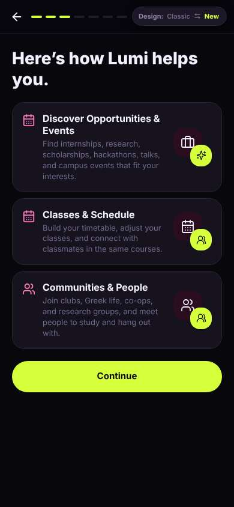
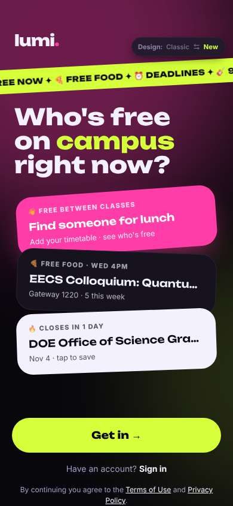
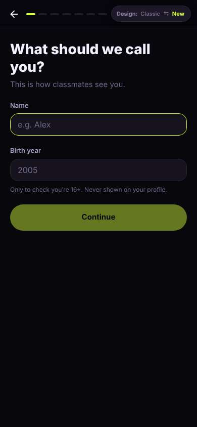
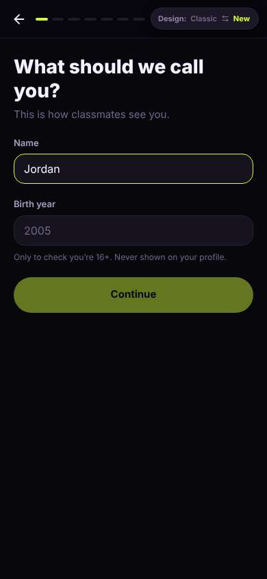
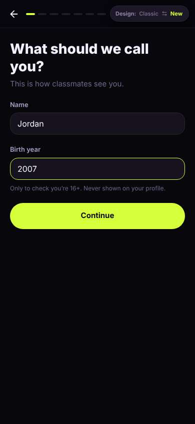
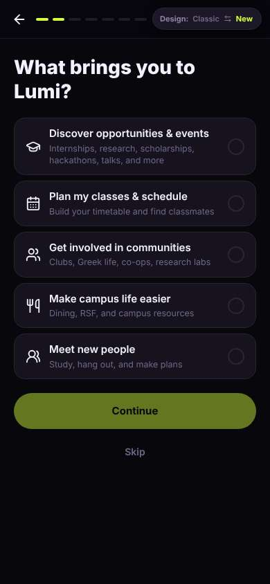
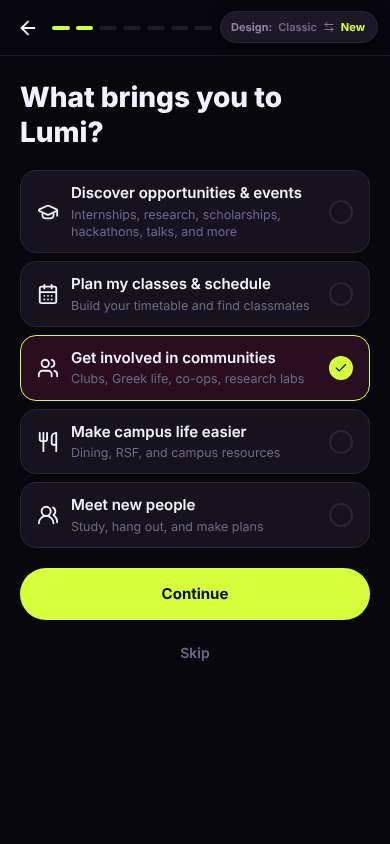

# ux-sim run `sched-20261103-1915-jordan-first-open-decide`

> **AI simulation — hypotheses, not measured user behaviour.** One simulated persona; nothing here is a rate or a measurement of real students.

| | |
|---|---|
| Persona | **Jordan**, 19 — Sophomore · phone 390×844 · prefers en · tech high (`jordan-sophomore-impatient`) |
| Scenario | **First open: what is this app, and is it worth signing up?** — A friend sent you a link to this app. You have never seen it before. Figure out what it is for, and decide whether you want to make an account. If it seems worth it, sign up with your school e-mail. (`first-open-decide`) |
| Target | local · http://localhost:36791 · worktree commit `3f891a8142aa` |
| Outcome | **abandoned** · ended by persona |
| Account | signed out at start |
| Goal check (fixed, by harness) | not met — _Signed up during the run (a new account exists and the browser is signed in to it) and landed inside the app (signed-in home or a main tab)._ |
| Patience | exhausted at step 10; 0 action(s) after |
| Persona's reason | “Tapped Get in to look around and got a sign-up quiz instead. Three screens in, still haven't seen one club, and the bar says there's more. Nah.” |
| Effort | 6/28 actions · objective frustration 1.50/3 · 2 confused note(s) · ~14s simulated |
| Drop-off risk | **high** _(AI hypothesis, persona agent)_ — Never saw real content; the welcome teasers were grad-school research and a quantum talk, then a multi-step setup with a brochure screen. Matches exactly how I deleted the last five apps. · basis: steps 2, 9 |

Known environment limits (not UX findings)

- Dining menus and RSF gym crowd levels need live campus sources (the local stack runs with CAMPUS_LIVE=0) — empty or missing data there is not a UX bug.
- AI features (Ask Lumi, AI profile draft on /start, conversation starters) need an OpenAI key; none is configured locally.
- Course catalog is the built-in sample list (~210 courses, e.g. MATH 1A; no cached catalog — run `local-stack catalog fetch` once (about 5 minutes) to test with the real Berkeley schedule). Live has the imported current-term Berkeley schedule (e.g. MATH 51) — course-name findings on timetable/class screens are marked environment-limited.
- Campus events, free food, internships, hackathons and scholarships are a read-only snapshot of live (1279 real items, 134 events this week, taken 2026-11-03 19:15 UTC) plus the CSV calendar. Nothing new appears during the run; Q&A and reviews are empty.
- No e-mail is sent: the sign-up / sign-in code is shown on screen in the hint (live sends a real e-mail).
- Real-time updates (SSE) work locally; other people never reply unless the stack was started with --autoreply.

## Friction

| # | step | type | sev | persona says | screen | element | env-limited | evidence |
|---|---|---|---|---|---|---|---|---|
| f1 | 0 | No reason to stay | 1 | “ok looks less dead than the other campus apps. 94 clubs, free food. but a DOE grad research thing as a teaser card? not me.” _wish: teaser cards that fit an undergrad, like a club or hackathon_ | `/welcome` |  | no | [shot](shots/000-start.jpg) [marked](shots/000-start-som.jpg) |
| f2 | 2 | Onboarding friction | 2 | “wait I didn't even get to look around. 7 steps?? ugh.” _wish: let me peek at clubs before making me sign up, or say how long setup is_ | `/start` |  | no | [shot](shots/002-click.jpg) [marked](shots/002-click-som.jpg) |
| f3 | 9 | Onboarding friction | 3 | “ok and? I picked clubs and you show me a wall of text about clubs. 4 more dashes to go. boring.” _wish: after I pick clubs, show me actual clubs. skip the brochure_ | `/start` | Continue | no | [shot](shots/009-click.jpg) [marked](shots/009-click-som.jpg) |

Severity: 1 = Minor — noticed it, cosmetic or a small annoyance; did not slow me down. · 2 = Moderate — slowed me down or made me hesitate; I recovered on my own. · 3 = Major — real confusion, a wrong path or many extra steps; I nearly gave up or only got through by guessing. · 4 = Blocker — I could not continue, gave up, or would stop using the app here.

## Where it ended

Step 9 on `/start`.

## Timeline

| step | what | screen | ms | signals / notes | shot |
|---|---|---|---|---|---|
| 0 | start | `/welcome` | 2429 | _curious_: “ok looks less dead than the other campus apps. 94 clubs, free food. but a DOE grad research thing as a teaser card? not me.” → f1 |  |
| 2 | click “Get in →” | `/start` | 934 | expects: “I get to browse stuff, maybe clubs, before signing up” (0.5) **mismatch**: straight into sign-up: name + birth year, and the progress bar has like 7 dashes ⚑ mismatch _frustrated_: “wait I didn't even get to look around. 7 steps?? ugh.” → f2 |  |
| 4 | type “e.g. Alex” ← “Jordan” | `/start` | 882 |  |  |
| 5 | type “2005” ← “2007” | `/start` | 865 |  |  |
| 6 | click “Continue” | `/start` | 854 | expects: “school email step” (0.5) **mismatch**: interests picker, not email. at least there's a Skip ⚑ mismatch _neutral_: “fine, quiz screen. clubs and hackathons, tap tap.” |  |
| 8 | click “Get involved in communities Clubs, Greek” | `/start` | 849 |  |  |
| 9 | click “Continue” | `/start` | 849 | expects: “email finally, or another quiz” (0.4) **mismatch**: third setup screen is just a brochure of features, 3 of ~7 dashes done, still no email and still no actual clubs ⚑ mismatch _frustrated_: “ok and? I picked clubs and you show me a wall of text about clubs. 4 more dashes to go. boring.” → f3 |  |
| 11 | finish | `/start` |  |  |  |

## Automatic checks (harness, not persona)

| screen | tap targets < 44px | sideways overflow | broken images |
|---|---|---|---|
| `/welcome` | 4 (Sign in 46×21, Terms of Use 76×15, Privacy Policy 180×33, Switch to the classic design 158×32) | — | — |
| `/start` | 3 (Back 40×40, Switch to the classic design 158×32) | — | — |

## Timing (harness)

- Full page load (navigation timing): 1018 ms
