# ux-sim run `sched-20261103-1915-minji-first-open-decide`

> **AI simulation — hypotheses, not measured user behaviour.** One simulated persona; nothing here is a rate or a measurement of real students.

| | |
|---|---|
| Persona | **Minji**, 17 — First-year (started college a year early) · phone 390×844 · prefers ko · tech high (`minji-freshman-17`) |
| Scenario | **First open: what is this app, and is it worth signing up?** — A friend sent you a link to this app. You have never seen it before. Figure out what it is for, and decide whether you want to make an account. If it seems worth it, sign up with your school e-mail. (`first-open-decide`) |
| Target | local · http://localhost:45239 · worktree commit `3f891a8142aa` |
| Outcome | **abandoned** · ended by persona |
| Account | signed out at start |
| Goal check (fixed, by harness) | met at step 30 after 20 action(s) — evidence: the account the browser is signed in to was created during this run; {"urlMatches":"^/(discover\|community\|profile)?(\\?.*)?$"} — _Signed up during the run (a new account exists and the browser is signed in to it) and landed inside the app (signed-in home or a main tab)._ |
| Patience | exhausted at step 35; 0 action(s) after |
| ⚠ unnoticed success | The check passed but the persona did not realise it had succeeded. |
| Persona's reason | “I did make the account with my berkeley email because the 'find someone for lunch' thing sounded nice, but then home was grad parties and every people screen was empty. 솔직히 I'm closing it.” |
| Effort | 22/40 actions · objective frustration 4.50/4.5 · 3 confused note(s) · ~57s simulated |
| Drop-off risk | **high** _(AI hypothesis, persona agent)_ — Signed up for 'find someone for lunch', but after ~8 setup screens Home showed a grad party, Meetups said 'No meetups yet', and Who's free showed no people — nothing for a 17-year-old freshman, and she won't be the one to create the first meetup · basis: steps 30, 32, 34 |

Known environment limits (not UX findings)

- Dining menus and RSF gym crowd levels need live campus sources (the local stack runs with CAMPUS_LIVE=0) — empty or missing data there is not a UX bug.
- AI features (Ask Lumi, AI profile draft on /start, conversation starters) need an OpenAI key; none is configured locally.
- Course catalog is the built-in sample list (~210 courses, e.g. MATH 1A; no cached catalog — run `local-stack catalog fetch` once (about 5 minutes) to test with the real Berkeley schedule). Live has the imported current-term Berkeley schedule (e.g. MATH 51) — course-name findings on timetable/class screens are marked environment-limited.
- Campus events, free food, internships, hackathons and scholarships are a read-only snapshot of live (1279 real items, 134 events this week, taken 2026-11-03 19:15 UTC) plus the CSV calendar. Nothing new appears during the run; Q&A and reviews are empty.
- No e-mail is sent: the sign-up / sign-in code is shown on screen in the hint (live sends a real e-mail).
- Real-time updates (SSE) work locally; other people never reply unless the stack was started with --autoreply.

## Friction

| # | step | type | sev | persona says | screen | element | env-limited | evidence |
|---|---|---|---|---|---|---|---|---|
| f1 | 0 | No reason to stay | 1 | “오 'Find someone for lunch' — that's literally what I want. but the other cards are grad research + quantum colloquium... 뭐지, is this for grad students?” _wish: show freshman-ish stuff on the welcome cards, not grad fellowships_ | `/welcome` |  | no | [shot](shots/000-start.jpg) [marked](shots/000-start-som.jpg) |
| f2 | 2 | Onboarding friction | 2 | “아 바로 가입이네... I wanted to peek first. 7 steps?? birth year ok, says never shown, I'm 17 so fine” _wish: let me look around before signing up_ | `/start` |  | no | [shot](shots/002-click.jpg) [marked](shots/002-click-som.jpg) |
| f3 | 9 | Unclear wording | 2 | “I picked 'Meet new people' and it shows internships first?? too much English text, 안 읽을래. skimming. also no 한국어 option anywhere” _wish: show what I picked (meeting people / eating together) in 1 line, and a language switch_ | `/start` |  | no | [shot](shots/009-click.jpg) [marked](shots/009-click-som.jpg) |
| f4 | 16 | Onboarding friction | 2 | “아 귀찮아... another picker. still haven't seen a single person or the app itself” _wish: fewer setup screens before I see anything real_ | `/start` |  | no | [shot](shots/016-click.jpg) [marked](shots/016-click-som.jpg) |
| f5 | 30 | No reason to stay | 3 | “뭐지... where's the lunch thing I saw at the start? 'For you' = grad student party?? I'm 17 lol. not for me” _wish: show the 'find someone for lunch' / who's free thing from the welcome page right on home, and things for freshmen_ | `/` | Campus event Grad Student Appreciation Party Sat, Nov 7 ASUC Student Union | no | [shot](shots/030-click.jpg) [marked](shots/030-click-som.jpg) |
| f6 | 32 | Missing / empty content | 3 | “헐 nobody's here. I'm not gonna be the first one to make a meetup, I'm 17 and new, that's so awkward” _wish: show some people / meetups from my dorm or year, even small ones_ | `/meet/meetups` | Create a Meetup | no | [shot](shots/032-click.jpg) [marked](shots/032-click-som.jpg) |
| f7 | 34 | Missing / empty content | 3 | “아 again empty. 'Who's free' but no one is shown, it just wants me to add my timetable or start something myself. rides to Tahoe?? 뭐야” _wish: when I tap 'who's free', show actual students free now (ideally my dorm/year), not another menu_ | `/meet/more` |  | no | [shot](shots/034-click.jpg) [marked](shots/034-click-som.jpg) |

Severity: 1 = Minor — noticed it, cosmetic or a small annoyance; did not slow me down. · 2 = Moderate — slowed me down or made me hesitate; I recovered on my own. · 3 = Major — real confusion, a wrong path or many extra steps; I nearly gave up or only got through by guessing. · 4 = Blocker — I could not continue, gave up, or would stop using the app here.

## Where it ended

Step 34 on `/meet/more`.

## Timeline

| step | what | screen | ms | signals / notes | shot |
|---|---|---|---|---|---|
| 0 | start | `/welcome` | 2505 | _curious_: “오 'Find someone for lunch' — that's literally what I want. but the other cards are grad research + quantum colloquium... 뭐지, is this for grad students?” → f1 | <a href="shots/000-start-som.jpg">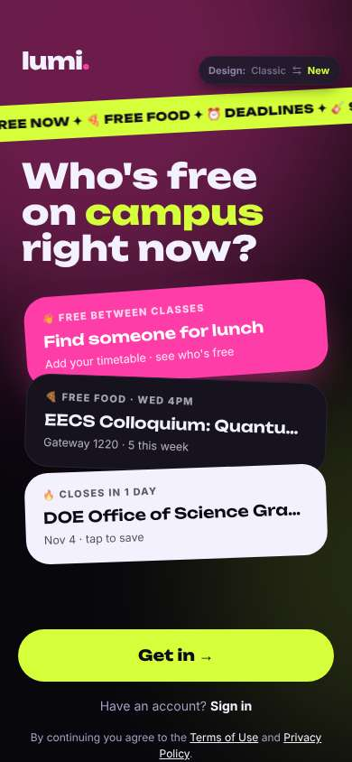</a> |
| 2 | click “Get in →” | `/start` | 913 | expects: “it shows me what the app is or asks to make an account” (0.6) as expected _neutral_: “아 바로 가입이네... I wanted to peek first. 7 steps?? birth year ok, says never shown, I'm 17 so fine” → f2 |  |
| 4 | type “e.g. Alex” ← “Minji” | `/start` | 863 |  | <a href="shots/004-type-som.jpg">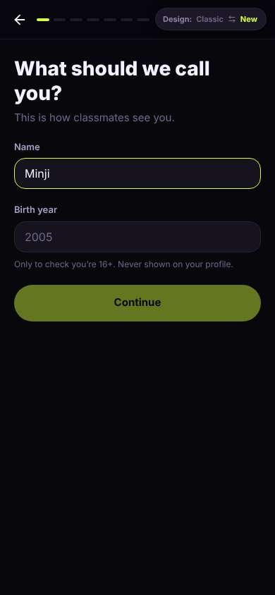</a> |
| 5 | type “2005” ← “2009” | `/start` | 872 |  | <a href="shots/005-type-som.jpg">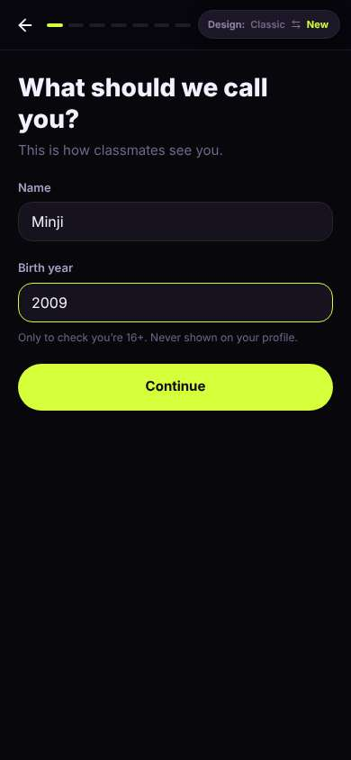</a> |
| 6 | click “Continue” | `/start` | 845 | expects: “next step, probably school email” (0.5) **mismatch**: not email, a 'what brings you' picker ⚑ mismatch _neutral_: “ok quick taps, fine. 'Meet new people' 이거지” | <a href="shots/006-click-som.jpg">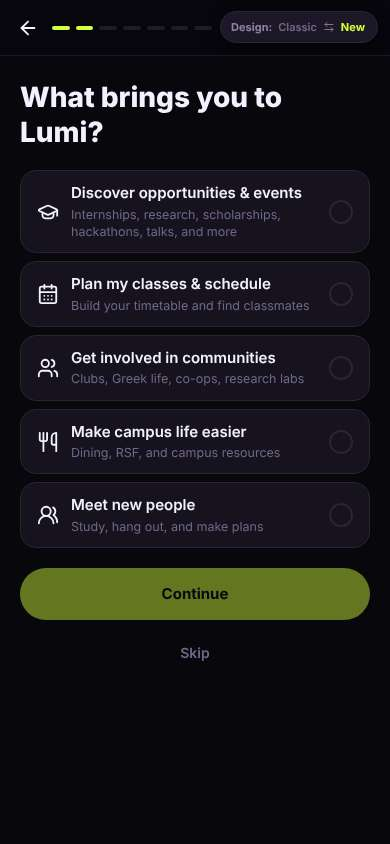</a> |
| 8 | click “Meet new people Study, hang out, and mak” | `/start` | 847 |  | <a href="shots/008-click-som.jpg">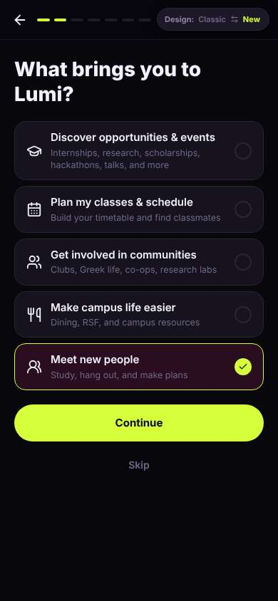</a> |
| 9 | click “Continue” | `/start` | 852 | expects: “next sign-up step, maybe email” (0.5) **mismatch**: an explainer screen with 3 paragraph cards, internships first — not about meeting people even though I picked that ⚑ mismatch _bored_: “I picked 'Meet new people' and it shows internships first?? too much English text, 안 읽을래. skimming. also no 한국어 option anywhere” → f3 | <a href="shots/009-click-som.jpg">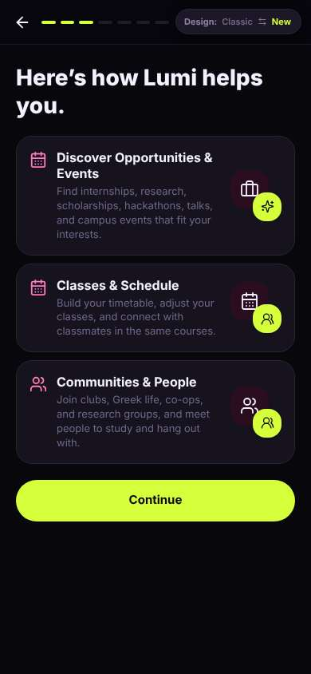</a> |
| 11 | click “Continue” | `/start` | 843 | expects: “email step” (0.5) **mismatch**: university + role picker, still no email ⚑ mismatch _neutral_: “ok Berkeley, undergrad. easy” | <a href="shots/011-click-som.jpg">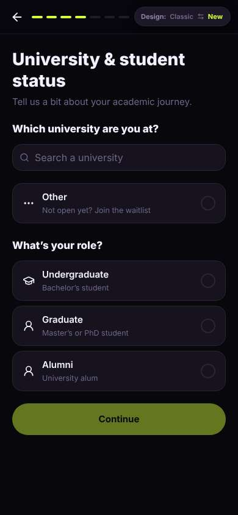</a> |
| 13 | type “Search a university” ← “Berkeley” | `/start` | 877 |  | <a href="shots/013-type-som.jpg">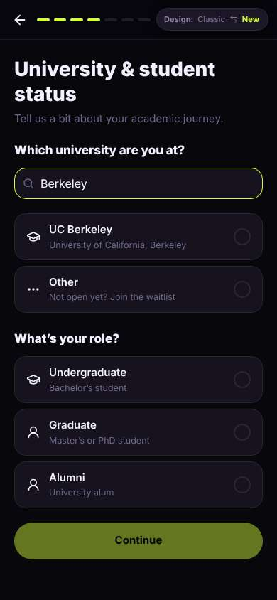</a> |
| 14 | click “UC Berkeley University of California, Be” | `/start` | 855 |  | <a href="shots/014-click-som.jpg">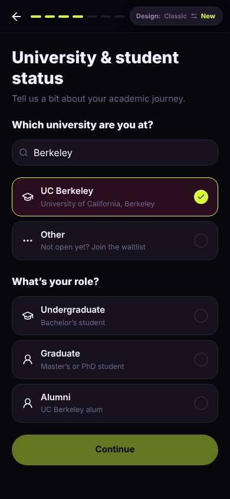</a> |
| 15 | click “Undergraduate Bachelor’s student” | `/start` | 842 |  | <a href="shots/015-click-som.jpg">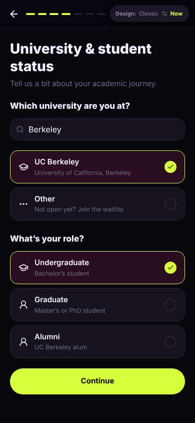</a> |
| 16 | click “Continue” | `/start` | 858 | expects: “year / major or email” (0.5) **mismatch**: another interest picker, mostly career stuff ⚑ mismatch _bored_: “아 귀찮아... another picker. still haven't seen a single person or the app itself” → f4 | <a href="shots/016-click-som.jpg">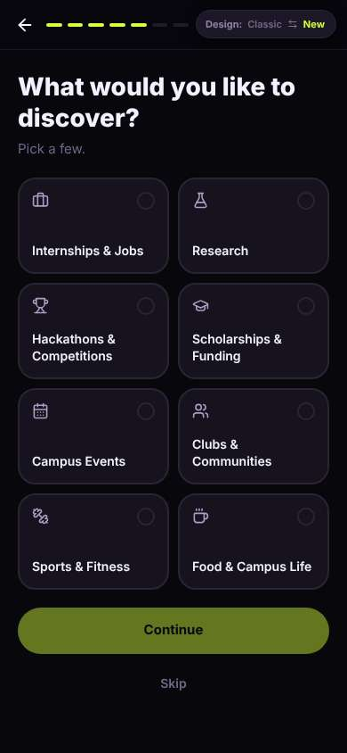</a> |
| 18 | click “Food & Campus Life” | `/start` | 834 |  | <a href="shots/018-click-som.jpg">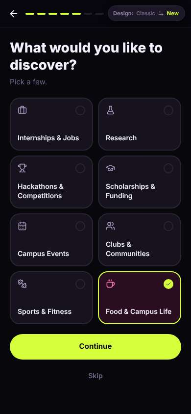</a> |
| 19 | click “Continue” | `/start` | 853 | expects: “email finally” (0.4) **mismatch**: communities picker, still no email ⚑ mismatch _neutral_: “Residence Hall / Dorm — ok that one I actually care about. maybe it shows dorm people” | <a href="shots/019-click-som.jpg">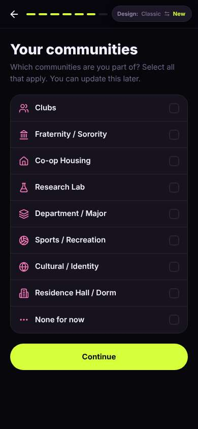</a> |
| 21 | click “Residence Hall / Dorm” | `/start` | 847 | expects: “pick a specific dorm” (0.4) **mismatch**: just highlighted, didn't ask which dorm ⚑ mismatch _neutral_: “huh, which dorm though? maybe later” | <a href="shots/021-click-som.jpg">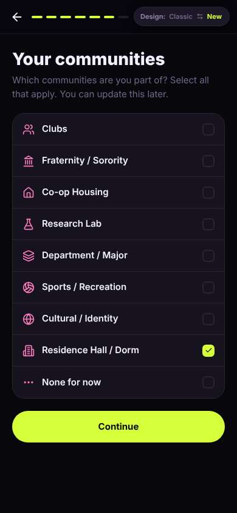</a> |
| 23 | click “Continue” | `/start` | 846 | _curious_: “오 email is optional? nice, didn't have to give it to start. but my friend said sign up with school email so I'll do it — berkeley.edu means real students only, that's kinda reassuring” | <a href="shots/023-click-som.jpg">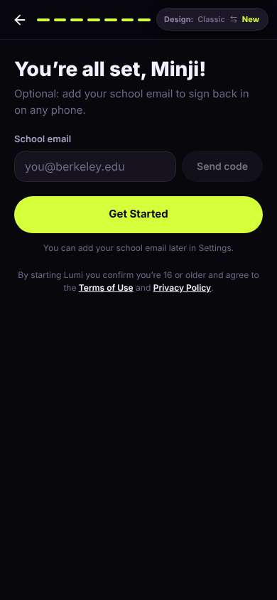</a> |
| 25 | type “you@berkeley.edu” ← “minji.kim@berkeley.edu” | `/start` | 848 |  | <a href="shots/025-type-som.jpg">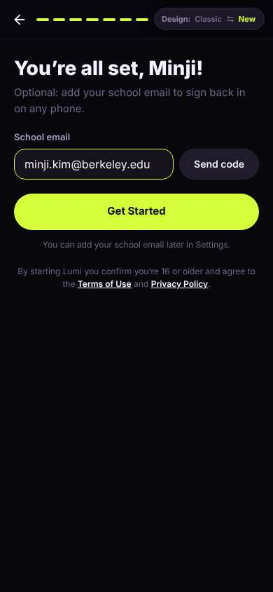</a> |
| 26 | click “Send code” | `/start` | 839 |  | <a href="shots/026-click-som.jpg">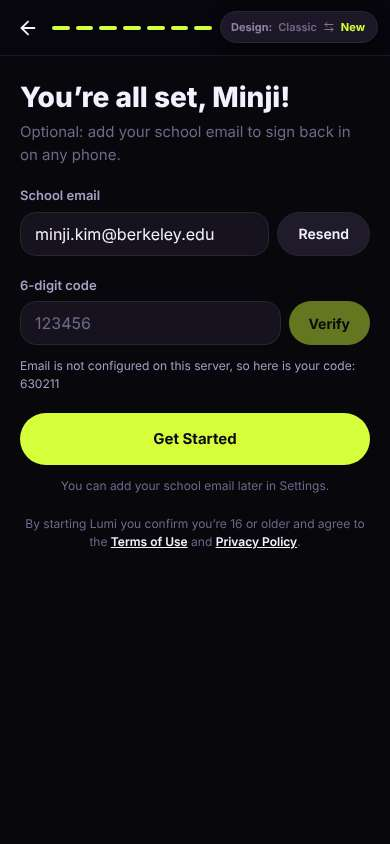</a> |
| 27 | type “123456” ← “630211” | `/start` | 901 |  | <a href="shots/027-type-som.jpg">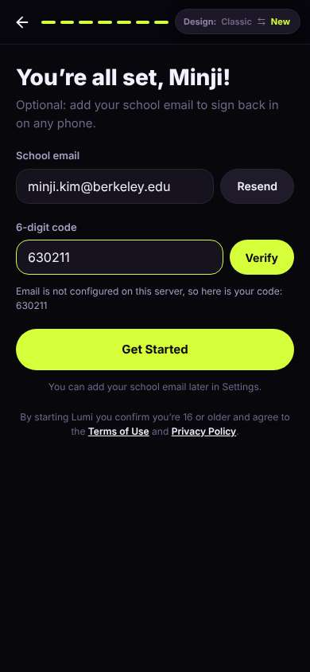</a> |
| 28 | click “Verify” | `/start` | 862 | expects: “email verified” (0.8) as expected _delighted_: “school badge 좋다 — feels less sketchy, real Berkeley people” | <a href="shots/028-click-som.jpg">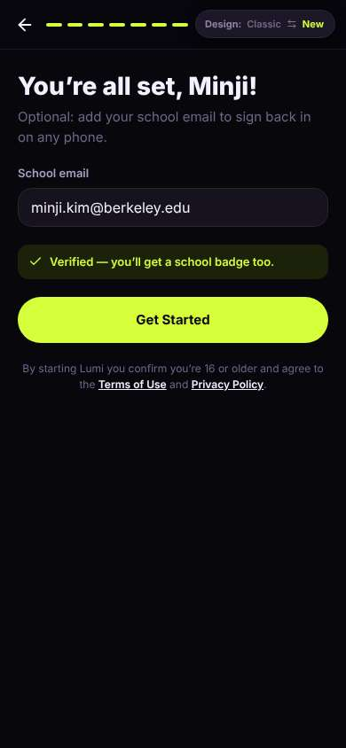</a> |
| 30 | click “Get Started” | `/` | 1492 | expects: “home with people to eat with” (0.5) **mismatch**: generic home with category tiles; 'For you' starts with a Grad Student party. the 'Find someone for lunch' thing from the welcome screen isn't here ⚑ mismatch _confused_: “뭐지... where's the lunch thing I saw at the start? 'For you' = grad student party?? I'm 17 lol. not for me” → f5 | <a href="shots/030-click-som.jpg">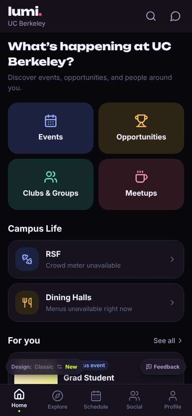</a> |
| 32 | click “Meetups” | `/meet/meetups` | 838 | expects: “people meeting up for food, maybe a lunch I can join” (0.5) **mismatch**: Meetups is empty: 'No meetups yet — create the first meetup on your campus' ⚑ mismatch _frustrated_: “헐 nobody's here. I'm not gonna be the first one to make a meetup, I'm 17 and new, that's so awkward” → f6 | <a href="shots/032-click-som.jpg">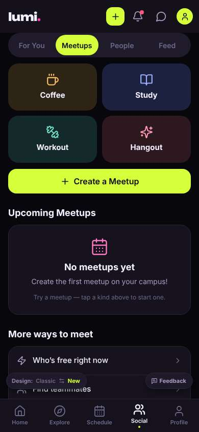</a> |
| 34 | click “Who’s free right now” | `/meet/more` | 859 | expects: “list of people free now to grab food with” (0.4) **mismatch**: not a list of people — a mix of rides, 'ask friends with one link', dining, and 'No hangouts open right now — start one?' ⚑ mismatch _frustrated_: “아 again empty. 'Who's free' but no one is shown, it just wants me to add my timetable or start something myself. rides to Tahoe?? 뭐야” → f7 | <a href="shots/034-click-som.jpg">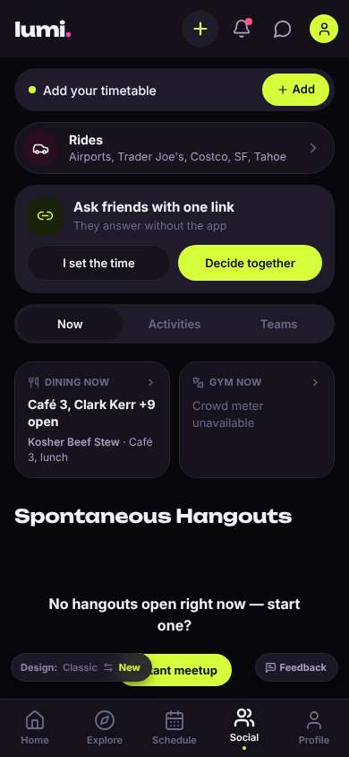</a> |
| 36 | finish | `/meet/more` |  |  |  |

## Automatic checks (harness, not persona)

| screen | tap targets < 44px | sideways overflow | broken images |
|---|---|---|---|
| `/welcome` | 4 (Sign in 46×21, Terms of Use 76×15, Privacy Policy 180×33, Switch to the classic design 158×32) | — | — |
| `/start` | 4 (Back 40×40, Switch to the classic design 158×32) | — | — |
| `/` | 3 (See all 62×21, Feedback 93×32, Switch to the classic design 158×32) | — | — |
| `/meet/meetups` | 10 (Create 36×36, Notifications 40×40, Messages 40×40, Me 32×32, For You 85×40) | — | — |
| `/meet/more` | 13 (Create 40×40, Notifications 40×40, Messages 40×40, Me 32×32, Add 75×36) | — | — |

## Timing (harness)

- Full page load (navigation timing): 844 ms
