# ux-sim run `sched-20261103-1915-seoyeon-first-open-decide`

> **AI simulation — hypotheses, not measured user behaviour.** One simulated persona; nothing here is a rate or a measurement of real students.

| | |
|---|---|
| Persona | **Seoyeon**, 20 — Exchange student (one semester, from Yonsei) · phone 390×844 · prefers ko · tech medium (`seoyeon-exchange-korean`) |
| Scenario | **First open: what is this app, and is it worth signing up?** — A friend sent you a link to this app. You have never seen it before. Figure out what it is for, and decide whether you want to make an account. If it seems worth it, sign up with your school e-mail. (`first-open-decide`) |
| Target | local · http://localhost:42693 · worktree commit `3f891a8142aa` |
| Outcome | **success** · ended by persona |
| Account | signed out at start |
| Goal check (fixed, by harness) | met at step 30 after 19 action(s) — evidence: the account the browser is signed in to was created during this run; {"urlMatches":"^/(discover\|community\|profile)?(\\?.*)?$"} — _Signed up during the run (a new account exists and the browser is signed in to it) and landed inside the app (signed-in home or a main tab)._ |
| Persona's reason | “I understood it is a Berkeley campus app, made an account with my school e-mail, and found Rides with SFO for Thanksgiving — worth it for me, even though it's all English.” |
| Effort | 22/45 actions · objective frustration 2.00/5 · 3 confused note(s) · ~151s simulated |
| Drop-off risk | **medium** _(AI hypothesis, persona agent)_ — Rides to SFO is exactly what I need so I'd come back near Thanksgiving, but no Korean, long onboarding and empty meetups/rides lists could make me drift away · basis: steps 6, 11, 19, 32, 35 |

Known environment limits (not UX findings)

- Dining menus and RSF gym crowd levels need live campus sources (the local stack runs with CAMPUS_LIVE=0) — empty or missing data there is not a UX bug.
- AI features (Ask Lumi, AI profile draft on /start, conversation starters) need an OpenAI key; none is configured locally.
- Course catalog is the built-in sample list (~210 courses, e.g. MATH 1A; no cached catalog — run `local-stack catalog fetch` once (about 5 minutes) to test with the real Berkeley schedule). Live has the imported current-term Berkeley schedule (e.g. MATH 51) — course-name findings on timetable/class screens are marked environment-limited.
- Campus events, free food, internships, hackathons and scholarships are a read-only snapshot of live (1279 real items, 134 events this week, taken 2026-11-03 19:15 UTC) plus the CSV calendar. Nothing new appears during the run; Q&A and reviews are empty.
- No e-mail is sent: the sign-up / sign-in code is shown on screen in the hint (live sends a real e-mail).
- Real-time updates (SSE) work locally; other people never reply unless the stack was started with --autoreply.

## Friction

| # | step | type | sev | persona says | screen | element | env-limited | evidence |
|---|---|---|---|---|---|---|---|---|
| f1 | 0 | Unclear wording | 2 | “어... 'Who's free on campus right now?' 친구 찾는 앱인가? 한국어 설정은 안 보이네. 'Get in'... 가입하는 건가?” _wish: Korean language option on the first screen, and a clearer button like 'Sign up'_ | `/welcome` | Get in → | no | [shot](shots/000-start.jpg) [marked](shots/000-start-som.jpg) |
| f2 | 2 | Onboarding friction | 1 | “아 바로 가입이네. 이름이랑 생년만이면 괜찮아. 근데 아직 SFO 같이 가는 사람 찾을 수 있는지 모르겠어.” _wish: see what the app does (rides?) before signing up_ | `/start` |  | no | [shot](shots/002-click.jpg) [marked](shots/002-click-som.jpg) |
| f3 | 6 | Missing / empty content | 2 | “음... 공항 가는 거, 같이 우버 타는 건 없네. 'Meet new people... make plans'가 제일 가까운 것 같아. RSF는 뭐지?” _wish: an option like 'Rides / travel together' for students going home or to the airport_ | `/start` | Meet new people Study, hang out, and make plans | no | [shot](shots/006-click.jpg) [marked](shots/006-click-som.jpg) |
| f4 | 9 | Unclear wording | 2 | “영어가 너무 많아... 대충 읽으면 학교 이벤트, 수업, 동아리 앱이네. 공항 얘기는 여전히 없어.” _wish: shorter text or Korean; mention rides/travel if it exists_ | `/start` |  | no | [shot](shots/009-click.jpg) [marked](shots/009-click-som.jpg) |
| f5 | 14 | Confusing UI | 1 | “교환학생은 어디 골라야 하지? Undergraduate 맞겠지... 'Exchange student' 같은 건 없네.” _wish: an 'Exchange / visiting student' role_ | `/start` | Undergraduate Bachelor’s student | no | [shot](shots/014-click.jpg) [marked](shots/014-click-som.jpg) |
| f6 | 17 | Onboarding friction | 2 | “또 질문... 이메일은 언제 해? 그냥 Skip 할래.” _wish: fewer questions before I can see the app_ | `/start` | Skip | no | [shot](shots/017-click.jpg) [marked](shots/017-click-som.jpg) |
| f7 | 32 | Missing / empty content | 2 | “아무도 없네... 근데 'Rides' 보인다! 이거다.” _wish: see some existing meetups so it feels alive_ | `/meet/meetups` |  | no | [shot](shots/032-click.jpg) [marked](shots/032-click-som.jpg) |
| f8 | 35 | Bug | 1 | “위에 'Design' 버튼이 'My rides'를 가려서 잘 안 보여.” _wish: the Design pill should not cover the My rides tab_ | `/rides` | My rides | no | [shot](shots/035-click.jpg) [marked](shots/035-click-som.jpg) |

Severity: 1 = Minor — noticed it, cosmetic or a small annoyance; did not slow me down. · 2 = Moderate — slowed me down or made me hesitate; I recovered on my own. · 3 = Major — real confusion, a wrong path or many extra steps; I nearly gave up or only got through by guessing. · 4 = Blocker — I could not continue, gave up, or would stop using the app here.

## Timeline

| step | what | screen | ms | signals / notes | shot |
|---|---|---|---|---|---|
| 0 | start | `/welcome` | 2392 | _confused_: “어... 'Who's free on campus right now?' 친구 찾는 앱인가? 한국어 설정은 안 보이네. 'Get in'... 가입하는 건가?” → f1 | <a href="shots/000-start-som.jpg">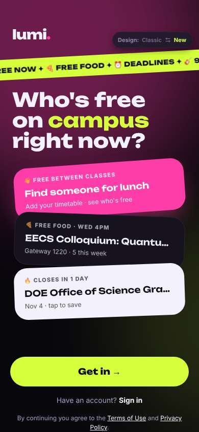</a> |
| 2 | click “Get in →” | `/start` | 914 | expects: “sign up form or see more of the app” (0.5) as expected _neutral_: “아 바로 가입이네. 이름이랑 생년만이면 괜찮아. 근데 아직 SFO 같이 가는 사람 찾을 수 있는지 모르겠어.” → f2 | <a href="shots/002-click-som.jpg">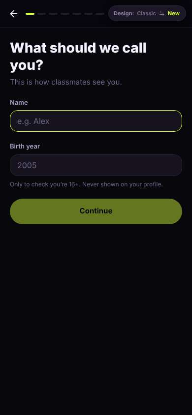</a> |
| 4 | type “e.g. Alex” ← “Seoyeon” | `/start` | 876 |  | <a href="shots/004-type-som.jpg">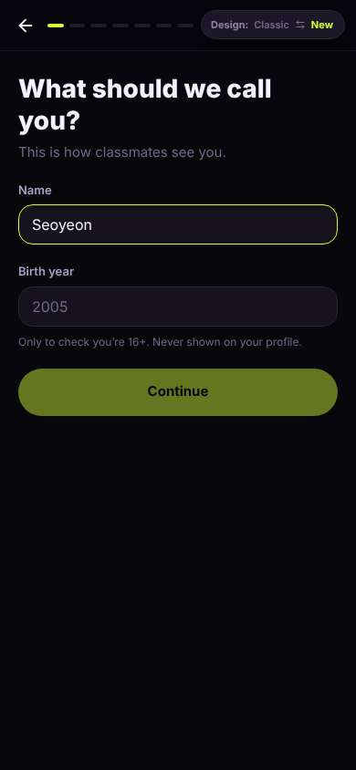</a> |
| 5 | type “2005” ← “2006” | `/start` | 855 |  | <a href="shots/005-type-som.jpg">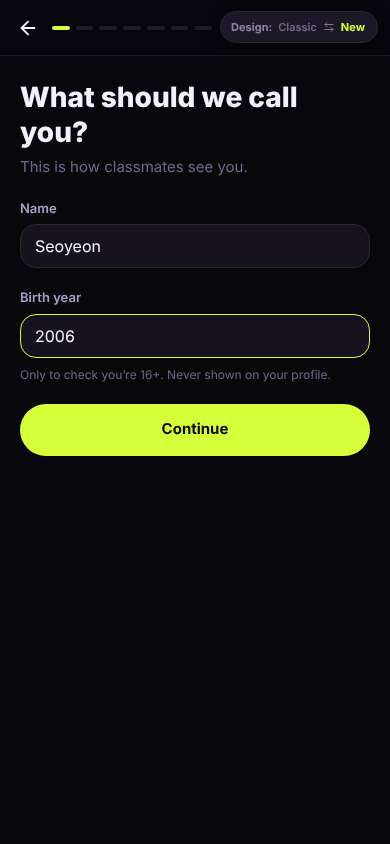</a> |
| 6 | click “Continue” | `/start` | 845 | expects: “next sign-up step” (0.8) as expected _confused_: “음... 공항 가는 거, 같이 우버 타는 건 없네. 'Meet new people... make plans'가 제일 가까운 것 같아. RSF는 뭐지?” → f3 | <a href="shots/006-click-som.jpg">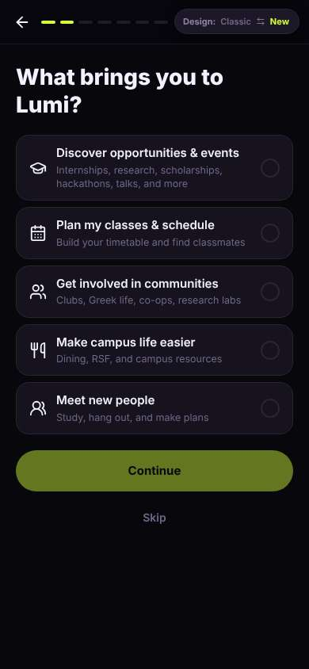</a> |
| 8 | click “Meet new people Study, hang out, and mak” | `/start` | 859 |  | <a href="shots/008-click-som.jpg">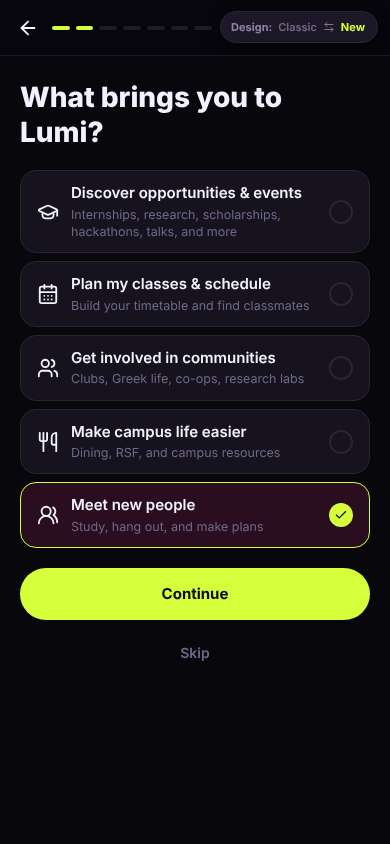</a> |
| 9 | click “Continue” | `/start` | 861 | expects: “next step, maybe school email” (0.6) **mismatch**: An explanation screen with three dense English paragraphs, not the email step ⚑ mismatch _bored_: “영어가 너무 많아... 대충 읽으면 학교 이벤트, 수업, 동아리 앱이네. 공항 얘기는 여전히 없어.” → f4 | <a href="shots/009-click-som.jpg">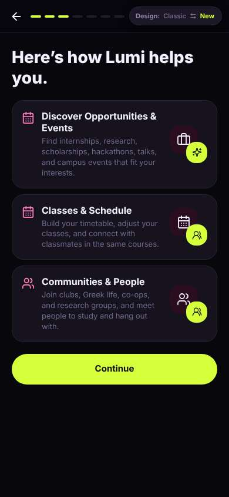</a> |
| 11 | click “Continue” | `/start` | 851 | expects: “school email step” (0.6) **mismatch**: University and role screen, not email yet ⚑ mismatch _neutral_: “아직 이메일 아니네. 단계가 많다. 학교 검색해볼게.” | <a href="shots/011-click-som.jpg">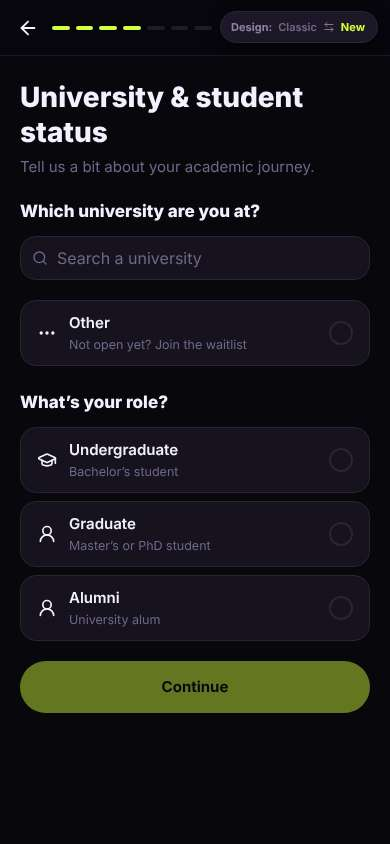</a> |
| 13 | type “Search a university” ← “Berkeley” | `/start` | 870 |  | <a href="shots/013-type-som.jpg">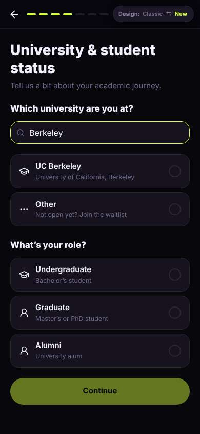</a> |
| 14 | click “UC Berkeley University of California, Be” | `/start` | 852 | _confused_: “교환학생은 어디 골라야 하지? Undergraduate 맞겠지... 'Exchange student' 같은 건 없네.” → f5 | <a href="shots/014-click-som.jpg">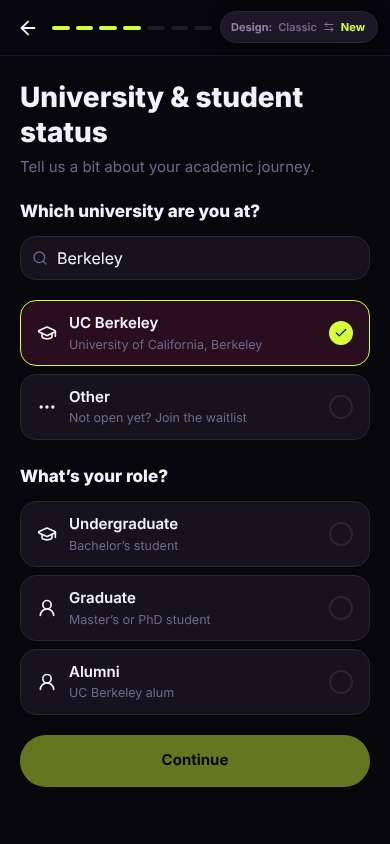</a> |
| 16 | click “Undergraduate Bachelor’s student” | `/start` | 833 |  | <a href="shots/016-click-som.jpg">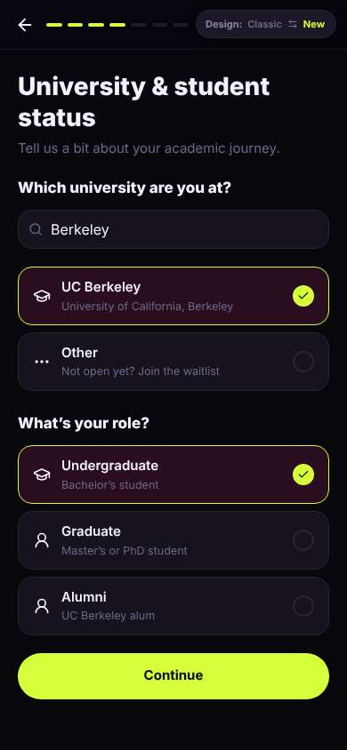</a> |
| 17 | click “Continue” | `/start` | 852 | expects: “school email step” (0.6) **mismatch**: Another interests screen; still no email step ⚑ mismatch _bored_: “또 질문... 이메일은 언제 해? 그냥 Skip 할래.” → f6 | <a href="shots/017-click-som.jpg">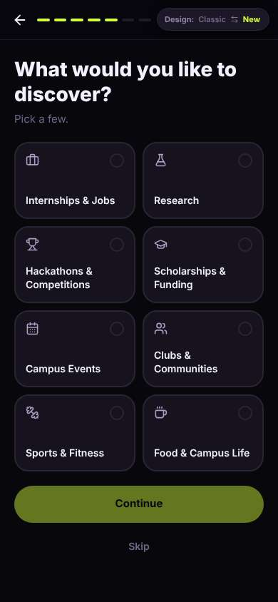</a> |
| 19 | click “Skip” | `/start` | 858 | expects: “school email step finally” (0.5) **mismatch**: Yet another question: communities. No email. ⚑ mismatch _bored_: “한 학기만 있는데 커뮤니티 없어요. 'None for now'.” | <a href="shots/019-click-som.jpg">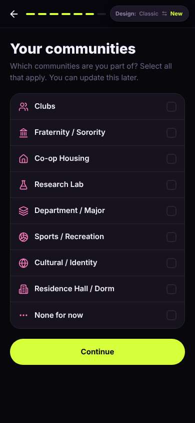</a> |
| 21 | click “None for now” | `/start` | 843 |  | <a href="shots/021-click-som.jpg">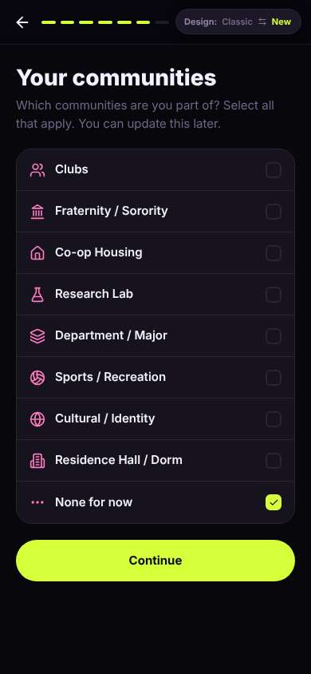</a> |
| 22 | click “Continue” | `/start` | 842 | expects: “email or finish” (0.5) as expected _neutral_: “아 이메일은 선택이구나. 그래도 친구가 학교 이메일로 하라고 했으니까 넣을게.” | <a href="shots/022-click-som.jpg">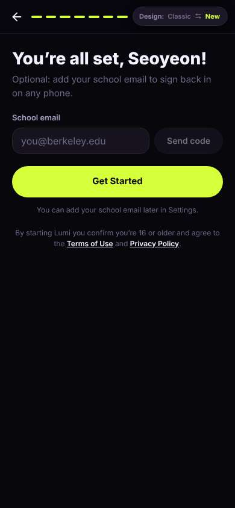</a> |
| 24 | type “you@berkeley.edu” ← “seoyeon.kim@berkeley.edu” | `/start` | 864 |  | <a href="shots/024-type-som.jpg">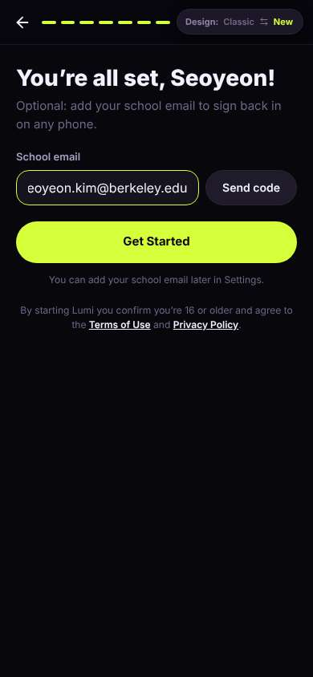</a> |
| 25 | click “Send code” | `/start` | 840 | expects: “a code input appears” (0.7) as expected _neutral_: “코드 넣으면 되겠다.” | <a href="shots/025-click-som.jpg">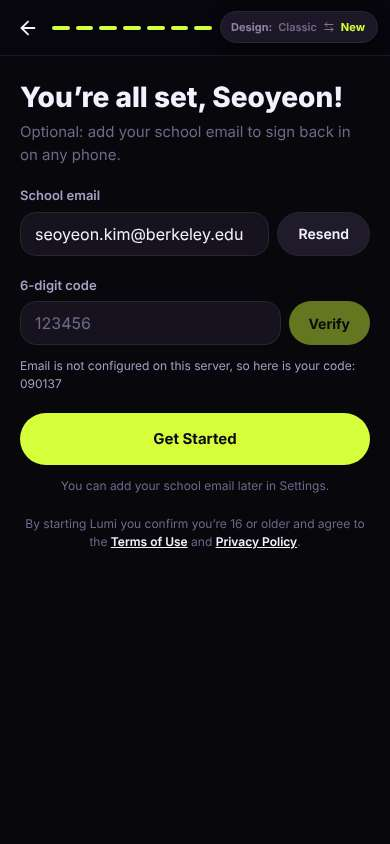</a> |
| 27 | type “123456” ← “090137” | `/start` | 867 |  | <a href="shots/027-type-som.jpg">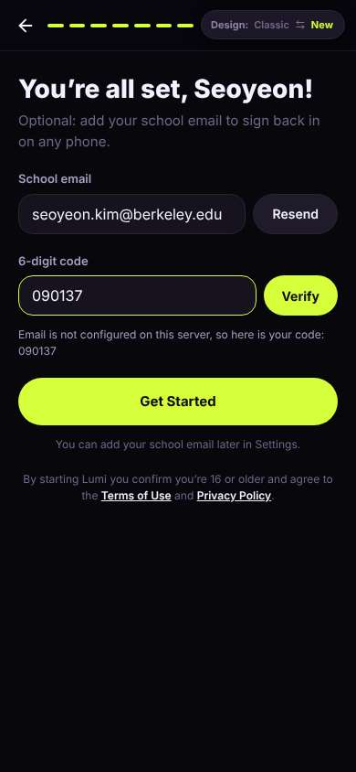</a> |
| 28 | click “Verify” | `/start` | 832 | expects: “email verified” (0.8) as expected _delighted_: “오 빠르다! 'Verified' 학교 배지도 준대. 진짜 버클리 학생만 있는 거면 좀 안심돼.” | <a href="shots/028-click-som.jpg">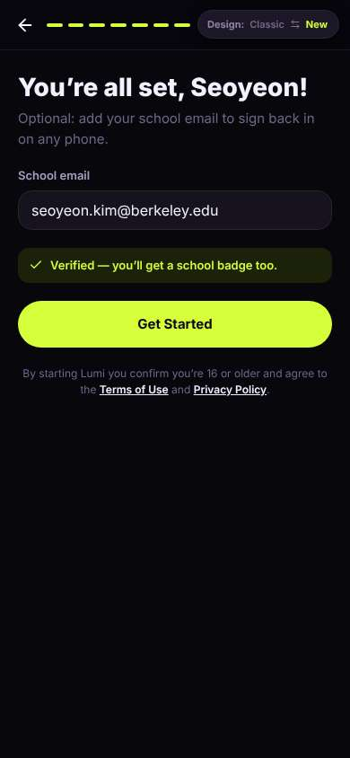</a> |
| 30 | click “Get Started” | `/` | 969 | expects: “main app home” (0.8) as expected _curious_: “들어왔다. 'Meetups'... 여기서 공항 같이 갈 사람 찾을 수 있을까?” | <a href="shots/030-click-som.jpg">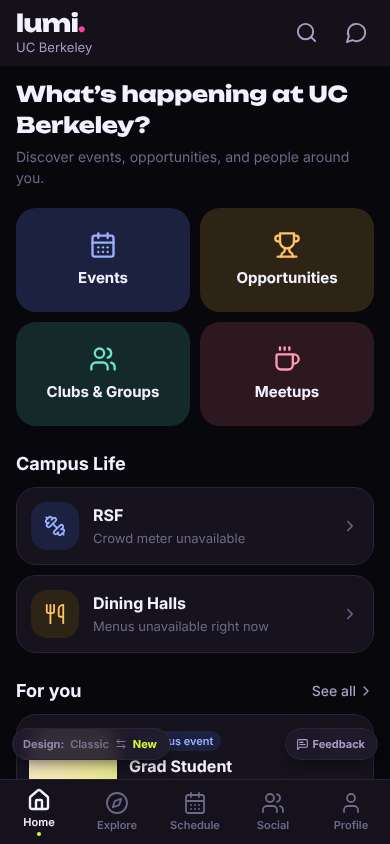</a> |
| 32 | click “Meetups” | `/meet/meetups` | 843 | expects: “list of student meetups, maybe rides” (0.4) as expected _curious_: “아무도 없네... 근데 'Rides' 보인다! 이거다.” → f7 | <a href="shots/032-click-som.jpg">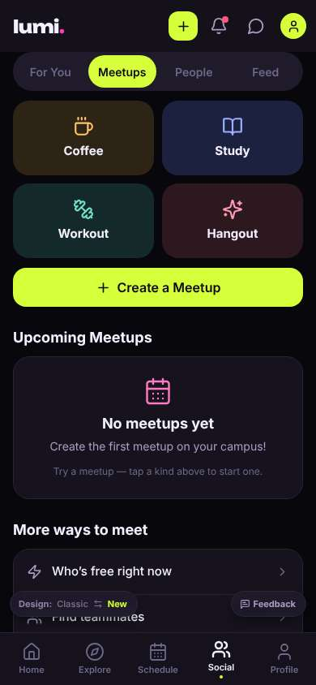</a> |
| 34 | scroll down | `/meet/meetups` | 1323 |  | <a href="shots/034-scroll-som.jpg">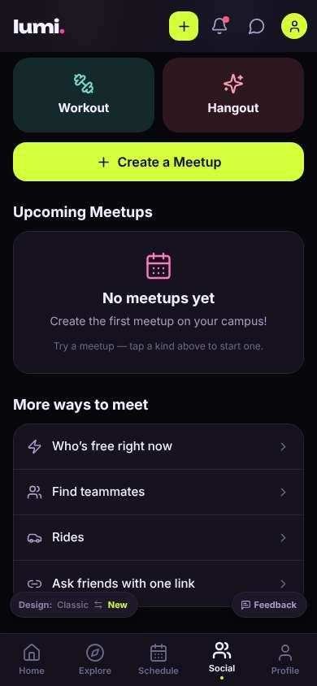</a> |
| 35 | click “Rides” | `/rides` | 855 | expects: “ride sharing list, maybe SFO rides” (0.6) as expected _delighted_: “와 이거다! 추수감사절 SFO 같이 타기. 인증된 학생만이라 안심돼. 아직 아무도 없지만 가입한 거 잘했다.” _neutral_: “위에 'Design' 버튼이 'My rides'를 가려서 잘 안 보여.” → f8 |  |
| 38 | finish | `/rides` |  |  | <a href="shots/038-finish-som.jpg">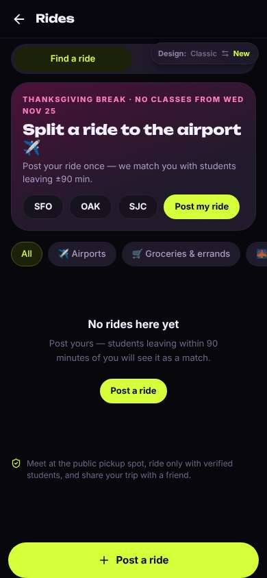</a> |

## Automatic checks (harness, not persona)

| screen | tap targets < 44px | sideways overflow | broken images |
|---|---|---|---|
| `/welcome` | 4 (Sign in 46×21, Terms of Use 76×15, Privacy Policy 180×33, Switch to the classic design 158×32) | — | — |
| `/start` | 4 (Back 40×40, Switch to the classic design 158×32) | — | — |
| `/` | 3 (See all 62×21, Feedback 93×32, Switch to the classic design 158×32) | — | — |
| `/meet/meetups` | 10 (Create 36×36, Notifications 40×40, Messages 40×40, Me 32×32, For You 85×40) | — | — |
| `/rides` | 13 (Back 40×40, Find a ride 173×36, My rides 173×36, SFO 60×36, OAK 63×36) | — | — |

## Timing (harness)

- Full page load (navigation timing): 1090 ms
