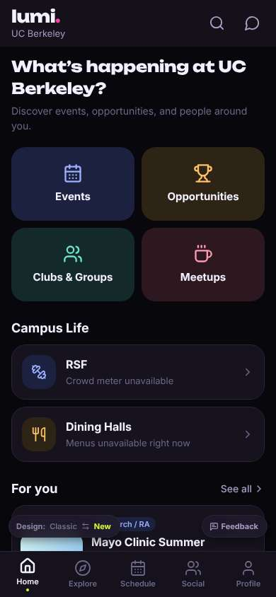
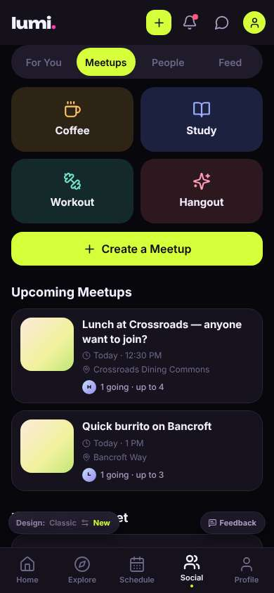
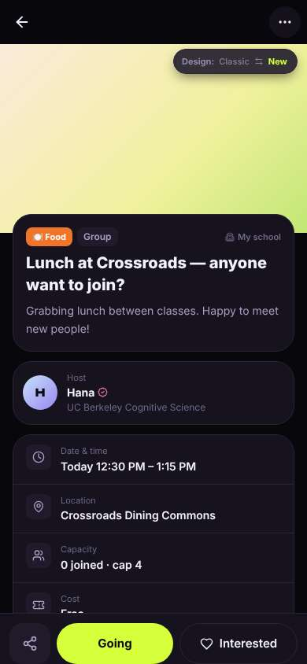
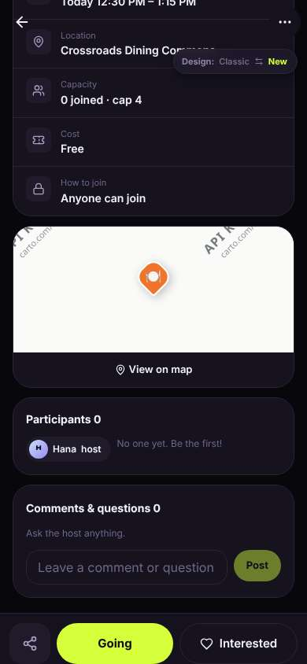
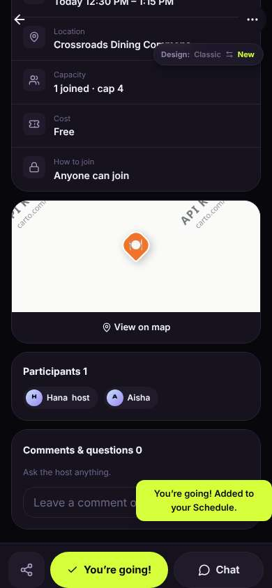
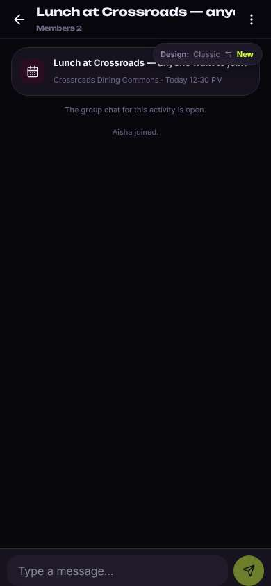
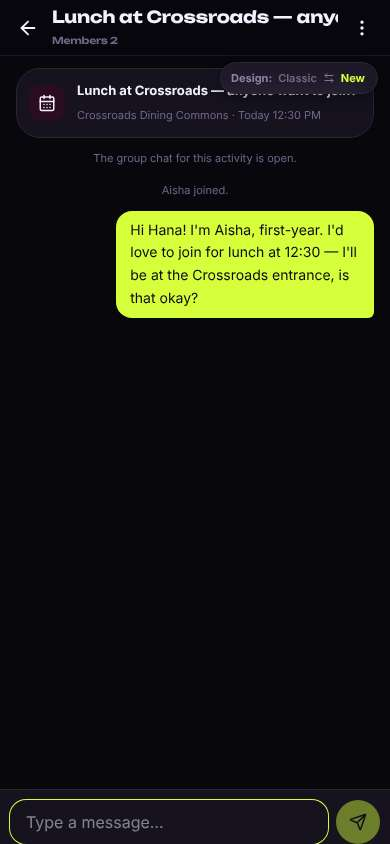

# ux-sim run `sched-20261104-1915-aisha-lunch-today`

> **AI simulation — hypotheses, not measured user behaviour.** One simulated persona; nothing here is a rate or a measurement of real students.

| | |
|---|---|
| Persona | **Aisha**, 18 — First-year (first in her family to go to college) · phone 390×844 · prefers en · tech medium (`aisha-firstgen-anxious`) |
| Scenario | **Find someone to get lunch with today** — It's a weekday and you'd rather not eat lunch alone again. Use the app to find someone (or a group) to get lunch with today, and let them know you're in. (`lunch-today`) |
| Target | local · http://localhost:37465 · worktree commit `b1c9c98b2b5a` |
| Outcome | **success** · ended by persona |
| Account | fresh real account `aisha.odayzy4g@berkeley.edu` (Aisha, Public Health, born 2008; sample: false) · peers seeded: Hana, Leo |
| Goal check (fixed, by harness) | met at step 8 after 4 action(s) — evidence: joined or asked to join a peer's lunch plan; joined or asked to join a plan — _During the run the persona's own account joined/requested one of today's lunch plans, posted its own meal plan for today, or messaged in a lunch plan's chat._ |
| Persona's reason | “I found Hana's 'Lunch at Crossroads' for today, said I'm going, and said hi in the lunch chat so she knows I'm coming. I wasn't totally sure what 'Going' would do before I tapped it, but it worked out.” |
| Effort | 6/50 actions · objective frustration 0.50/6 · 1 confused note(s) · ~67s simulated |
| Drop-off risk | **low** _(AI hypothesis, persona agent)_ — It took me straight to a real lunch today with no application, and the chat made it feel safe; I'd come back if Hana actually shows up and replies · basis: steps 1, 3, 8, 10 |

Known environment limits (not UX findings)

- Dining menus and RSF gym crowd levels need live campus sources (the local stack runs with CAMPUS_LIVE=0) — empty or missing data there is not a UX bug.
- AI features (Ask Lumi, AI profile draft on /start, conversation starters) need an OpenAI key; none is configured locally.
- Course catalog is the built-in sample list (~210 courses, e.g. MATH 1A; no cached catalog — run `local-stack catalog fetch` once (about 5 minutes) to test with the real Berkeley schedule). Live has the imported current-term Berkeley schedule (e.g. MATH 51) — course-name findings on timetable/class screens are marked environment-limited.
- Campus events, free food, internships, hackathons and scholarships are a read-only snapshot of live (1281 real items, 120 events this week, taken 2026-11-04 19:15 UTC) plus the CSV calendar. Nothing new appears during the run; Q&A and reviews are empty.
- No e-mail is sent: the sign-up / sign-in code is shown on screen in the hint (live sends a real e-mail).
- Real-time updates (SSE) work locally; other people never reply unless the stack was started with --autoreply.
- Signed in as a brand-new real (non-sample, e-mail-verified) account made for this run. Other students exist only if the scenario seeds peers (local fixtures); sample profiles are hidden from real accounts, as on live.

## Friction

| # | step | type | sev | persona says | screen | element | env-limited | evidence |
|---|---|---|---|---|---|---|---|---|
| f1 | 3 | Confusing UI | 1 | “Okay, this is reassuring — Hana seems real, it's free, 'happy to meet new people'. But wait, the list said '1 going' and here it says '0 joined'... which is it? Am I going to be alone with a stranger?” _wish: the going count matches between list and detail, and say whether the host counts_ | `/activities/:id` |  | no | [shot](shots/003-click.jpg) [marked](shots/003-click-som.jpg) |
| f2 | 3 | Confusing UI | 2 | “Wait, does 'Going' mean I'm already marked as going, or is it the button to say I'm going? And what's the difference with 'Interested'? I don't want to accidentally tell Hana I'm coming and then flake... but that IS what I want, I think. Does it message her?” _wish: a button that says 'Join lunch' and a line telling me what happens (Hana is notified / group chat opens)_ | `/activities/:id` | Going | no | [shot](shots/003-click.jpg) [marked](shots/003-click-som.jpg) |
| f3 | 8 | Confusing UI | 1 | “Oh — it just did it, no 'are you sure?'. That's kind of okay since it's what I wanted, and seeing my name next to Hana's is reassuring. But I didn't know tapping 'Going' would publicly list me. Does Hana get told? I'm guessing the Chat is how I say hi.” _wish: one line before or after joining saying who can see I joined and whether Hana is notified_ | `/activities/:id` | You’re going! | no | [shot](shots/008-click.jpg) [marked](shots/008-click-som.jpg) |
| f4 | 12 | Bug | 1 | “Sent. No 'delivered' or 'seen' marker, so I'll probably keep checking until Hana answers... but at least she knows I'm coming. Also that little Design pill is sitting on top of the lunch title in the chat, kind of covering it.” _wish: the floating Design pill doesn't cover the header/event card_ | `/chats/:id` | Switch to the classic design | no | [shot](shots/012-type.jpg) [marked](shots/012-type-som.jpg) |

Severity: 1 = Minor — noticed it, cosmetic or a small annoyance; did not slow me down. · 2 = Moderate — slowed me down or made me hesitate; I recovered on my own. · 3 = Major — real confusion, a wrong path or many extra steps; I nearly gave up or only got through by guessing. · 4 = Blocker — I could not continue, gave up, or would stop using the app here.

## Timeline

| step | what | screen | ms | signals / notes | shot |
|---|---|---|---|---|---|
| 0 | start | `/` | 1509 |  |  |
| 1 | click “Meetups” | `/meet/meetups` | 1118 | expects: “a list of casual meetups like lunch or coffee with other students” (0.6) as expected _curious_: “Oh, this is exactly it — someone is literally asking if anyone wants lunch today. Only one person going though... I want to see who it is before I do anything.” |  |
| 3 | click “Lunch at Crossroads — anyone want to joi” | `/activities/:id` | 1265 | expects: “details of the lunch: who's hosting, where exactly, and what joining means — without joining yet” (0.7) as expected _neutral_: “Okay, this is reassuring — Hana seems real, it's free, 'happy to meet new people'. But wait, the list said '1 going' and here it says '0 joined'... which is it? Am I going to be alone with a stranger?” → f1 _confused_: “Wait, does 'Going' mean I'm already marked as going, or is it the button to say I'm going? And what's the difference with 'Interested'? I don't want to accidentally tell Hana I'm coming and then flake... but that IS what I want, I think. Does it message her?” → f2 |  |
| 6 | scroll down | `/activities/:id` | 1317 | _curious_: “'How to join: Anyone can join' — okay good, no application, no interview. That's a relief. 'Be the first!' is a little scary but Hana did say she's happy to meet new people. And the comments are public, so I won't post there.” |  |
| 8 | click “Going” | `/activities/:id` | 846 | expects: “I'm added as a participant of Hana's lunch, and maybe asked to confirm first” (0.6) **mismatch**: Joined instantly with no confirmation; I'm listed under Participants next to Hana, button now 'You're going!', toast 'Added to your Schedule', and a Chat button appeared ⚑ mismatch _neutral_: “Oh — it just did it, no 'are you sure?'. That's kind of okay since it's what I wanted, and seeing my name next to Hana's is reassuring. But I didn't know tapping 'Going' would publicly list me. Does Hana get told? I'm guessing the Chat is how I say hi.” → f3 |  |
| 10 | click “Chat” | `/chats/:id` | 855 | expects: “a group chat with Hana for this lunch, where I can say hi” (0.7) as expected _delighted_: “Oh good, 'Aisha joined.' — so Hana can see it, I don't have to wonder. It's just the two of us in here so it doesn't feel scary. I'll say a quick hi so she knows I'm real and how to find me.” |  |
| 12 | type “Type a message…” ← “Hi Hana! I'm Aisha, first-year. I'd love to join for lunch at 12:30 — I'll be at the Crossroads entrance, is that okay?” | `/chats/:id` | 896 | expects: “my message shows up in the chat” (0.8) as expected _neutral_: “Sent. No 'delivered' or 'seen' marker, so I'll probably keep checking until Hana answers... but at least she knows I'm coming. Also that little Design pill is sitting on top of the lunch title in the chat, kind of covering it.” → f4 |  |
| 14 | finish | `/chats/:id` |  |  |  |

## Automatic checks (harness, not persona)

| screen | tap targets < 44px | sideways overflow | broken images |
|---|---|---|---|
| `/` | 5 (See all 62×21, Save 36×36, Save 36×36, Feedback 93×32, Switch to the classic design 158×32) | — | — |
| `/meet/meetups` | 10 (Create 36×36, Notifications 40×40, Messages 40×40, Me 32×32, For You 85×40) | — | — |
| `/activities/:id` | 6 (Back 40×40, More 40×40, Switch to the classic design 158×32) | — | — |
| `/chats/:id` | 3 (Back 40×40, Menu 40×40, Switch to the classic design 158×32) | — | — |

## Timing (harness)

- Full page load (navigation timing): 481 ms
