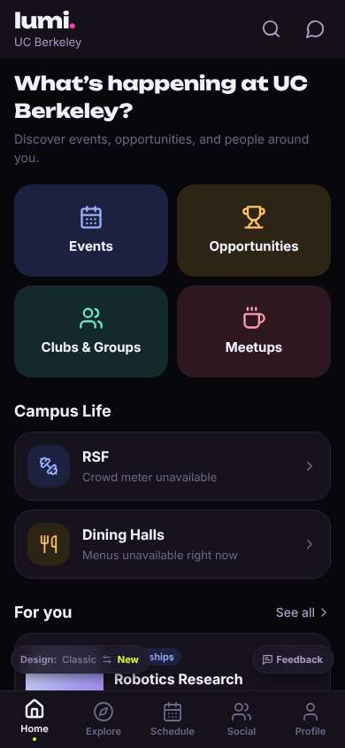
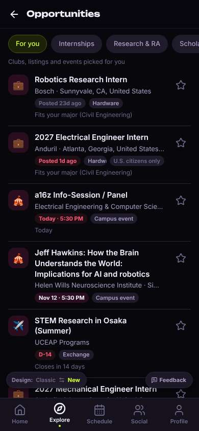
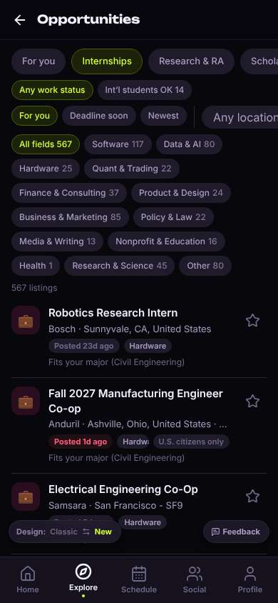
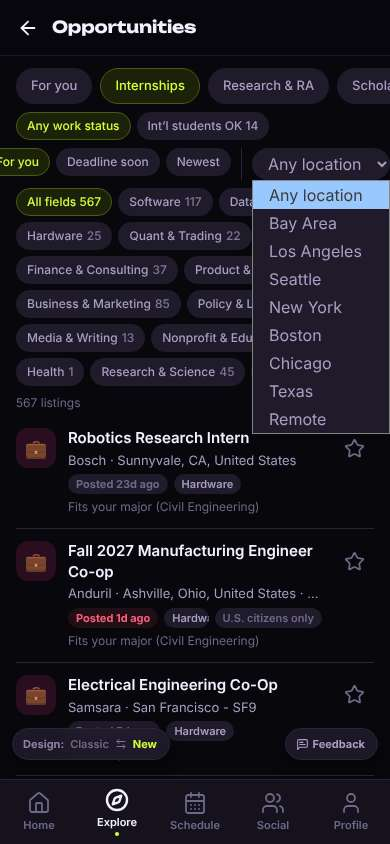
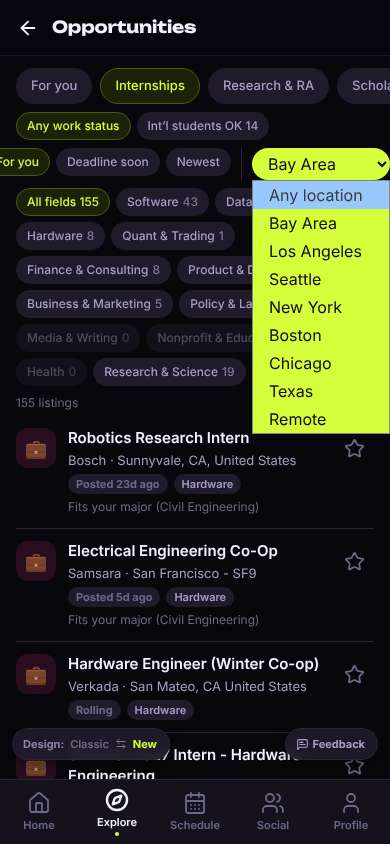
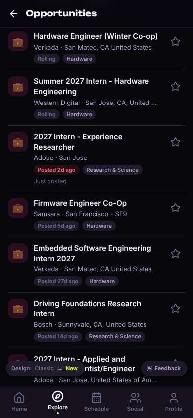
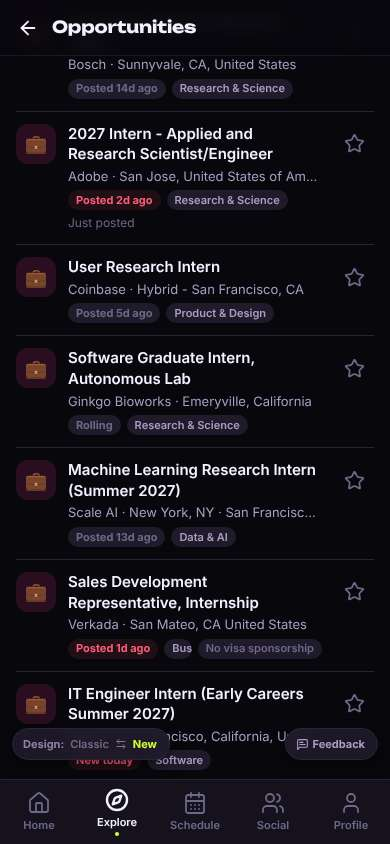
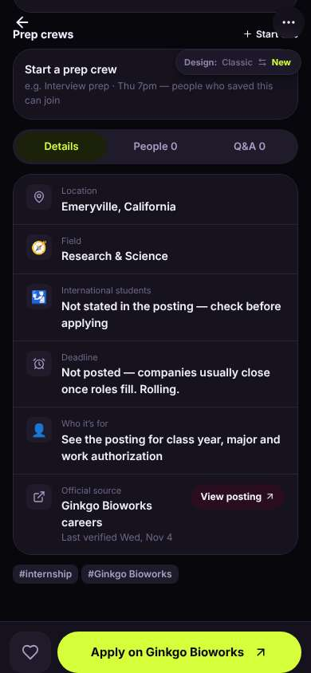
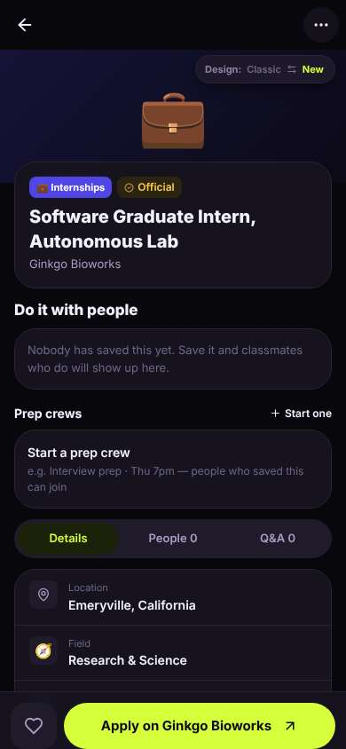
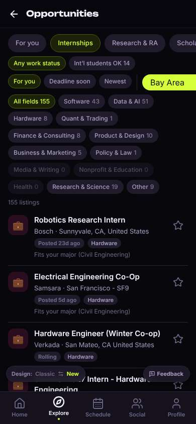

# ux-sim run `sched-20261104-1915-diego-internship-near-berkeley`

> **AI simulation — hypotheses, not measured user behaviour.** One simulated persona; nothing here is a rate or a measurement of real students.

| | |
|---|---|
| Persona | **Diego**, 21 — Junior (transfer from Laney College) · phone 390×844 · prefers en · tech medium (`diego-transfer-commuter`) |
| Scenario | **Find an internship near Berkeley** — You need a paid internship (summer or part-time) somewhere near Berkeley / the Bay Area. Use the app to find one that looks real and open, and open its details so you know how to apply. (`internship-near-berkeley`) |
| Target | local · http://localhost:34709 · worktree commit `b1c9c98b2b5a` |
| Outcome | **success** · ended by persona |
| Account | fresh real account `diego.eleyzy56@berkeley.edu` (Diego, Civil Engineering, born 2005; sample: false) |
| Goal check (fixed, by harness) | met at step 15 after 8 action(s) — evidence: {"urlMatches":"^/opportunities/[^/?]+"}; {"textMatches":"\\bintern(ship)?s?\\b"} — _An internship listing's detail page is open (reached by the persona — the run starts on /)._ |
| Persona's reason | “Filtered internships to the Bay Area and opened a Ginkgo Bioworks internship in Emeryville, verified today, with a clear Apply button. I couldn't tell if it's paid or if undergrads qualify, so I'll check on their site.” |
| Effort | 10/32 actions · objective frustration 2.75/4 · 1 confused note(s) · ~122s simulated |
| Drop-off risk | **medium** _(AI hypothesis, persona agent)_ — The Bay Area filter and the Apply button saved me time, but nothing was civil engineering, pay was never shown and 'fits your major' was wrong, so I'm not sure it's for someone like me. · basis: steps 4, 10, 14, 18 |

Known environment limits (not UX findings)

- Dining menus and RSF gym crowd levels need live campus sources (the local stack runs with CAMPUS_LIVE=0) — empty or missing data there is not a UX bug.
- AI features (Ask Lumi, AI profile draft on /start, conversation starters) need an OpenAI key; none is configured locally.
- Course catalog is the built-in sample list (~210 courses, e.g. MATH 1A; no cached catalog — run `local-stack catalog fetch` once (about 5 minutes) to test with the real Berkeley schedule). Live has the imported current-term Berkeley schedule (e.g. MATH 51) — course-name findings on timetable/class screens are marked environment-limited.
- Campus events, free food, internships, hackathons and scholarships are a read-only snapshot of live (1281 real items, 120 events this week, taken 2026-11-04 19:15 UTC) plus the CSV calendar. Nothing new appears during the run; Q&A and reviews are empty.
- No e-mail is sent: the sign-up / sign-in code is shown on screen in the hint (live sends a real e-mail).
- Real-time updates (SSE) work locally; other people never reply unless the stack was started with --autoreply.
- Signed in as a brand-new real (non-sample, e-mail-verified) account made for this run. Other students exist only if the scenario seeds peers (local fixtures); sample profiles are hidden from real accounts, as on live.

## Friction

| # | step | type | sev | persona says | screen | element | env-limited | evidence |
|---|---|---|---|---|---|---|---|---|
| f1 | 2 | Confusing UI | 2 | “Says 'Fits your major (Civil Engineering)' on Electrical Engineer and Robotics interns. That's not civil. Makes me trust the 'For you' less.” _wish: Only say it fits my major when it actually matches civil engineering_ | `/explore/opportunities` | 💼 2027 Electrical Engineer Intern Anduril · Atlanta, Georgia, United States · Boston, Mas | no | [shot](shots/002-observe.jpg) [marked](shots/002-observe-som.jpg) |
| f2 | 13 | Missing / empty content | 2 | “It's all software, hardware, research. Nothing civil — no construction, no transportation, no city/public works. There isn't even a civil or engineering field chip. Emeryville is right by me though.” _wish: A civil/structural/transportation category, or local firms and public agencies_ | `/explore/opportunities` |  | no | [shot](shots/013-scroll.jpg) [marked](shots/013-scroll-som.jpg) |
| f3 | 17 | Missing / empty content | 2 | “Wait, 'Software Graduate Intern' — that's probably for grad students, I'm an undergrad. And still no pay anywhere. There was a plain 'Software Intern' from the same lab right below it, I'll check that one.” _wish: Show pay/paid vs unpaid and who's eligible (undergrad/grad) on the card_ | `/opportunities/:id` | Details | no | [shot](shots/017-scroll.jpg) [marked](shots/017-scroll-som.jpg) |

Severity: 1 = Minor — noticed it, cosmetic or a small annoyance; did not slow me down. · 2 = Moderate — slowed me down or made me hesitate; I recovered on my own. · 3 = Major — real confusion, a wrong path or many extra steps; I nearly gave up or only got through by guessing. · 4 = Blocker — I could not continue, gave up, or would stop using the app here.

## Timeline

| step | what | screen | ms | signals / notes | shot |
|---|---|---|---|---|---|
| 0 | start | `/` | 1864 |  |  |
| 1 | click “Opportunities” | `/explore/opportunities` | 942 | expects: “list of internships and jobs, hopefully filterable by location” (0.8) as expected |  |
| 2 | observe | `/explore/opportunities` |  | _neutral_: “OK, this is the right place. But 'Fits your major (Civil Engineering)' on an Electrical Engineer intern? That's not my major. And it's Atlanta. Let me hit Internships.” _frustrated_: “Says 'Fits your major (Civil Engineering)' on Electrical Engineer and Robotics interns. That's not civil. Makes me trust the 'For you' less.” → f1 |  |
| 5 | click “Internships” | `/explore/opportunities` | 850 | expects: “only internships, maybe a location filter” (0.7) as expected _curious_: “There's a location dropdown. That's what I need. Ignoring the wall of chips.” |  |
| 7 | select “Location” ❌ locator.selectOption: Timeout 3000ms exceeded. | `/explore/opportunities` | 6810 | ⚑ failed |  |
| 8 | click “Location” | `/explore/opportunities` | 848 | expects: “a list of locations like Bay Area / Berkeley” (0.7) as expected _delighted_: “Bay Area. Perfect, that's exactly the filter I want.” |  |
| 10 | select “Location” | `/explore/opportunities` | 822 | expects: “only Bay Area internships listed” (0.85) as expected ⚑ repeated _curious_: “OK, 155 in the Bay. Sunnyvale's a long haul without a car though. Let me scroll for something closer to Oakland.” |  |
| 12 | scroll down | `/explore/opportunities` | 1318 |  |  |
| 13 | scroll down | `/explore/opportunities` | 1315 | _neutral_: “It's all software, hardware, research. Nothing civil — no construction, no transportation, no city/public works. There isn't even a civil or engineering field chip. Emeryville is right by me though.” → f2 |  |
| 15 | click “💼 Software Graduate Intern, Autonomous ” | `/opportunities/:id` | 864 | expects: “details page: pay, dates, and an Apply link” (0.7) **mismatch**: Details page opened scrolled to the bottom: location Emeryville, rolling deadline, 'Last verified Nov 4', big 'Apply on Ginkgo Bioworks' button. No pay listed; job title scrolled off the top. ⚑ mismatch _neutral_: “Good — verified today and a clear Apply button. But is it paid? Says nothing about pay. Let me peek at the top.” |  |
| 17 | scroll up | `/opportunities/:id` | 1324 | _neutral_: “Wait, 'Software Graduate Intern' — that's probably for grad students, I'm an undergrad. And still no pay anywhere. There was a plain 'Software Intern' from the same lab right below it, I'll check that one.” → f3 |  |
| 19 | back | `/explore/opportunities` | 1155 | expects: “back to the Bay Area internship list where I was” (0.7) as expected ⚑ backtrack _neutral_: “At least the filter stuck. I'd have to scroll again to find that other Ginkgo one. I'm out of time between classes — I know how to apply now, I'll do it from the Ginkgo site tonight.” |  |
| 21 | finish | `/explore/opportunities` |  |  |  |

## Automatic checks (harness, not persona)

| screen | tap targets < 44px | sideways overflow | broken images |
|---|---|---|---|
| `/` | 5 (See all 62×21, Save 36×36, Save 36×36, Feedback 93×32, Switch to the classic design 158×32) | — | — |
| `/explore/opportunities` | 31 (See all 62×21, Feedback 93×32, Switch to the classic design 158×32) | — | — |
| `/opportunities/:id` | 8 (Back 40×40, More 40×40, Details 114×36, People 0 114×36, Q&A 0 114×36) | — | — |

## Timing (harness)

- Full page load (navigation timing): 611 ms
- Step 7 `select` took 6810 ms until the network was quiet on `/explore/opportunities`
