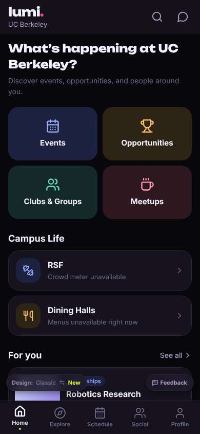
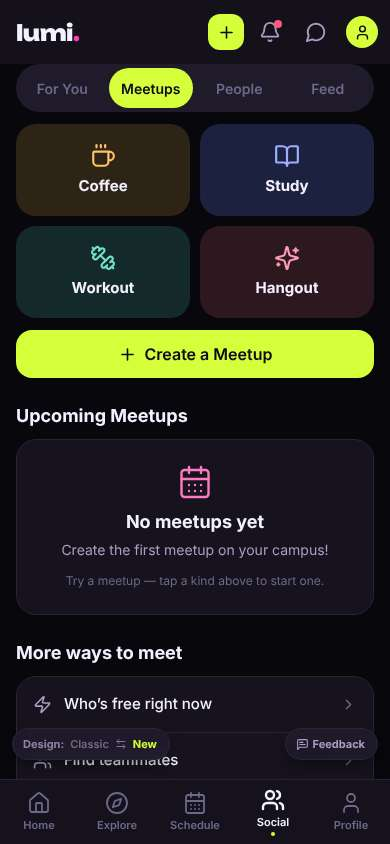
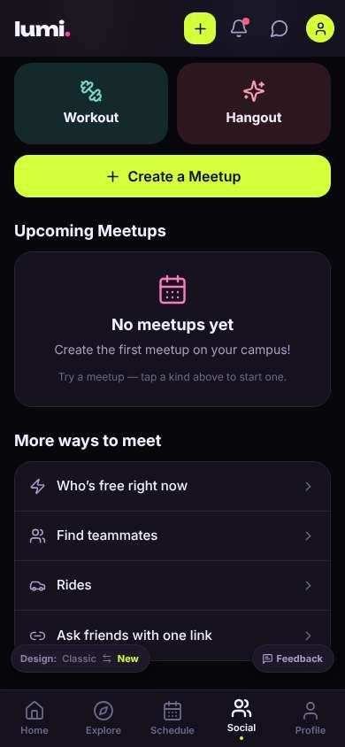
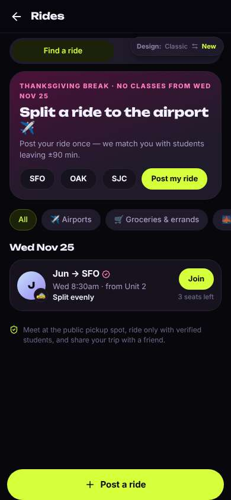
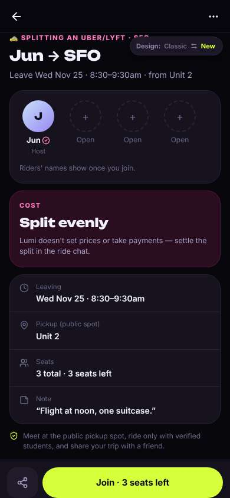
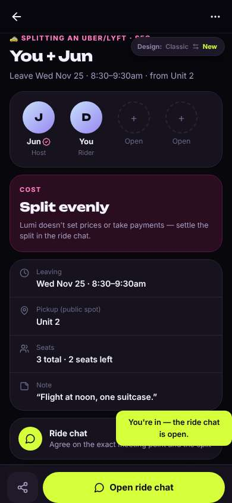
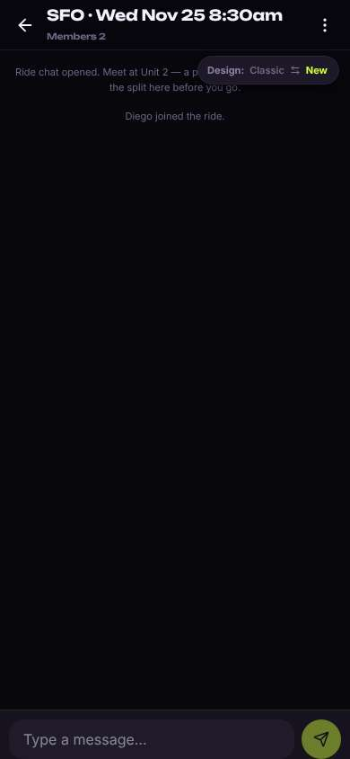

# ux-sim run `sched-20261104-1915-diego-ride-sfo-thanksgiving`

> **AI simulation — hypotheses, not measured user behaviour.** One simulated persona; nothing here is a rate or a measurement of real students.

| | |
|---|---|
| Persona | **Diego**, 21 — Junior (transfer from Laney College) · phone 390×844 · prefers en · tech medium (`diego-transfer-commuter`) |
| Scenario | **Share a ride to SFO for Thanksgiving** — You fly out of SFO the Wednesday before Thanksgiving (Nov 25) in the morning. Find other students to split a ride to the airport with — join one, or post yours so others can find you. (`ride-sfo-thanksgiving`) |
| Target | local · http://localhost:40587 · worktree commit `b1c9c98b2b5a` |
| Outcome | **success** · ended by persona |
| Account | fresh real account `diego.vingzy4e@berkeley.edu` (Diego, Civil Engineering, born 2005; sample: false) · peers seeded: Jun |
| Goal check (fixed, by harness) | met at step 11 after 5 action(s) — evidence: joined someone's SFO ride — _During the run the persona posted an SFO ride on Nov 25, or joined/requested someone's SFO ride (server-side)._ |
| Persona's reason | “Found Rides under Social, joined Jun's SFO ride on Wed Nov 25 8:30am and the ride chat is set up.” |
| Effort | 6/32 actions · objective frustration 1.00/4 · 0 confused note(s) · ~40s simulated |
| Drop-off risk | **low** _(AI hypothesis, persona agent)_ — It actually solved a real commuter problem fast; the Thanksgiving banner shows it gets my situation. Only the buried Rides entry would slow me next time. · basis: steps 4, 6, 11, 13 |

Known environment limits (not UX findings)

- Dining menus and RSF gym crowd levels need live campus sources (the local stack runs with CAMPUS_LIVE=0) — empty or missing data there is not a UX bug.
- AI features (Ask Lumi, AI profile draft on /start, conversation starters) need an OpenAI key; none is configured locally.
- Course catalog is the built-in sample list (~210 courses, e.g. MATH 1A; no cached catalog — run `local-stack catalog fetch` once (about 5 minutes) to test with the real Berkeley schedule). Live has the imported current-term Berkeley schedule (e.g. MATH 51) — course-name findings on timetable/class screens are marked environment-limited.
- Campus events, free food, internships, hackathons and scholarships are a read-only snapshot of live (1281 real items, 120 events this week, taken 2026-11-04 19:15 UTC) plus the CSV calendar. Nothing new appears during the run; Q&A and reviews are empty.
- No e-mail is sent: the sign-up / sign-in code is shown on screen in the hint (live sends a real e-mail).
- Real-time updates (SSE) work locally; other people never reply unless the stack was started with --autoreply.
- Signed in as a brand-new real (non-sample, e-mail-verified) account made for this run. Other students exist only if the scenario seeds peers (local fixtures); sample profiles are hidden from real accounts, as on live.

## Friction

| # | step | type | sev | persona says | screen | element | env-limited | evidence |
|---|---|---|---|---|---|---|---|---|
| f1 | 0 | Hard to find | 2 | “OK, where's rides? Events, opportunities, clubs, meetups... nothing says ride or carpool. Meetups maybe?” _wish: a Rides / carpool entry on home_ | `/` | Meetups | no | [shot](shots/000-start.jpg) [marked](shots/000-start-som.jpg) |
| f2 | 4 | Hard to find | 2 | “There it is — Rides. Buried at the bottom of Social > Meetups though.” _wish: Rides should be on home, not the last row of Social_ | `/meet/meetups` | Rides | no | [shot](shots/004-scroll.jpg) [marked](shots/004-scroll-som.jpg) |
| f3 | 6 | Bug | 1 | “The Design Classic/New pill is sitting on top of the My rides tab, can't even read it.” _wish: don't cover the tab_ | `/rides` | My rides | no | [shot](shots/006-click.jpg) [marked](shots/006-click-som.jpg) |
| f4 | 11 | Unclear wording | 1 | “I'm in. Toast says chat is open but it isn't — minor, the button's right there.” _wish: say 'ride chat is ready' not 'open'_ | `/rides/:id` | Open ride chat | no | [shot](shots/011-click.jpg) [marked](shots/011-click-som.jpg) |

Severity: 1 = Minor — noticed it, cosmetic or a small annoyance; did not slow me down. · 2 = Moderate — slowed me down or made me hesitate; I recovered on my own. · 3 = Major — real confusion, a wrong path or many extra steps; I nearly gave up or only got through by guessing. · 4 = Blocker — I could not continue, gave up, or would stop using the app here.

## Timeline

| step | what | screen | ms | signals / notes | shot |
|---|---|---|---|---|---|
| 0 | start | `/` | 1542 | _neutral_: “OK, where's rides? Events, opportunities, clubs, meetups... nothing says ride or carpool. Meetups maybe?” → f1 |  |
| 2 | click “Meetups” | `/meet/meetups` | 985 | expects: “list of meetups, maybe including rides” (0.4) **mismatch**: Meetups is coffee/study/workout/hangout, no rides, empty list ⚑ mismatch _neutral_: “No ride kind here. But I see 'More ways to meet' below, let me scroll.” |  |
| 4 | scroll down | `/meet/meetups` | 1321 | _curious_: “There it is — Rides. Buried at the bottom of Social > Meetups though.” → f2 |  |
| 6 | click “Rides” | `/rides` | 840 | expects: “list of ride shares, maybe SFO ones” (0.6) as expected _delighted_: “Nice, it already knows it's Thanksgiving and there's a ride to SFO Wed morning. That's exactly my day.” _neutral_: “The Design Classic/New pill is sitting on top of the My rides tab, can't even read it.” → f3 |  |
| 9 | click “J 🚕 Jun → SFO Wed 8:30am · from Unit 2 ” | `/rides/:id` | 860 | expects: “ride details or join Jun's ride” (0.6) as expected _delighted_: “Everything I need on one screen. Unit 2 is a BART ride + walk for me but fine. Joining.” |  |
| 11 | click “Join · 3 seats left” | `/rides/:id` | 861 | expects: “I'm added to Jun's ride and a ride chat opens” (0.7) **mismatch**: Joined (You + Jun, 2 seats left); toast says the ride chat is open but I'm still on the ride page, with an Open ride chat button ⚑ mismatch _neutral_: “I'm in. Toast says chat is open but it isn't — minor, the button's right there.” → f4 |  |
| 13 | click “Open ride chat” | `/chats/:id` | 846 | expects: “group chat with Jun” (0.8) as expected _delighted_: “Good. Chat's there, I'll message Jun later. Done in under a minute.” |  |
| 15 | finish | `/chats/:id` |  |  |  |

## Automatic checks (harness, not persona)

| screen | tap targets < 44px | sideways overflow | broken images |
|---|---|---|---|
| `/` | 3 (See all 62×21, Feedback 93×32, Switch to the classic design 158×32) | — | — |
| `/meet/meetups` | 10 (Create 36×36, Notifications 40×40, Messages 40×40, Me 32×32, For You 85×40) | — | — |
| `/rides` | 12 (Back 40×40, Find a ride 173×36, My rides 173×36, SFO 60×36, OAK 63×36) | — | — |
| `/rides/:id` | 3 (Back 40×40, More 40×40, Switch to the classic design 158×32) | — | — |
| `/chats/:id` | 3 (Back 40×40, Menu 40×40, Switch to the classic design 158×32) | — | — |

## Timing (harness)

- Full page load (navigation timing): 384 ms
