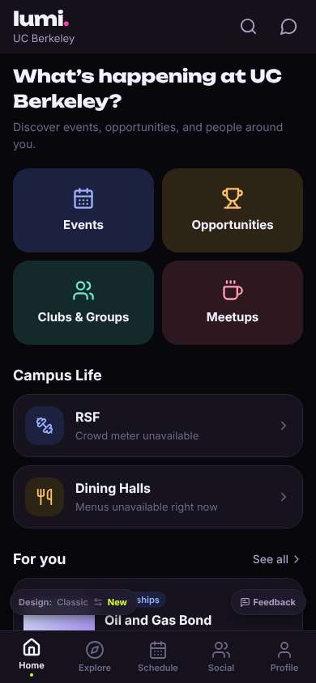
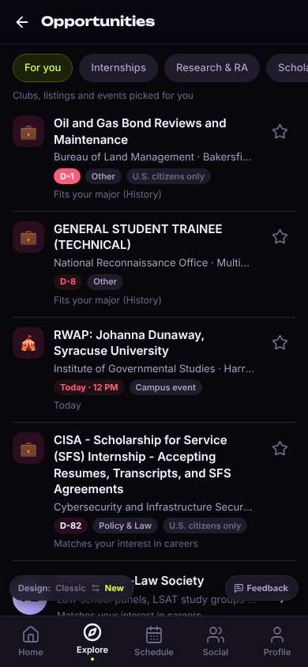
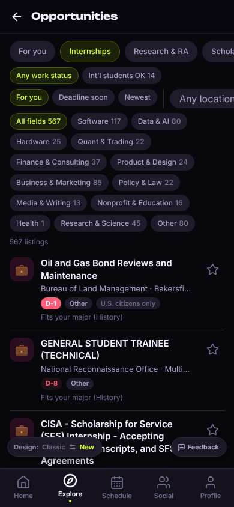
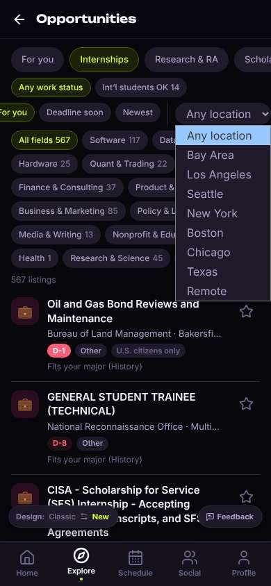
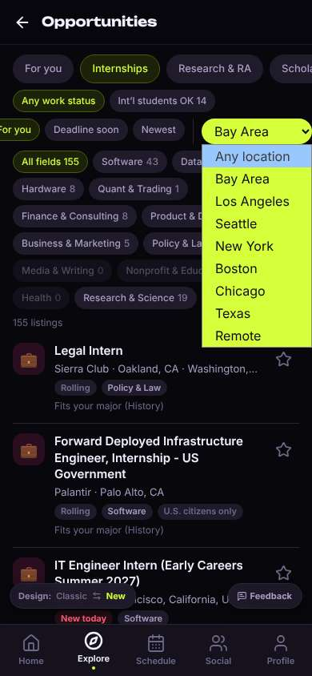
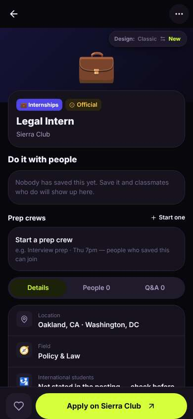
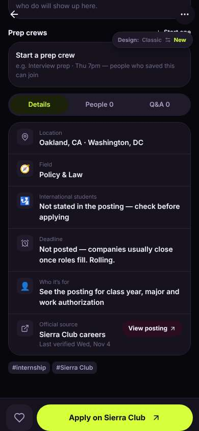
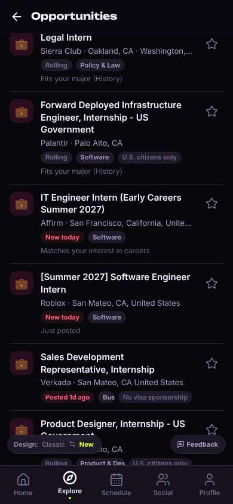
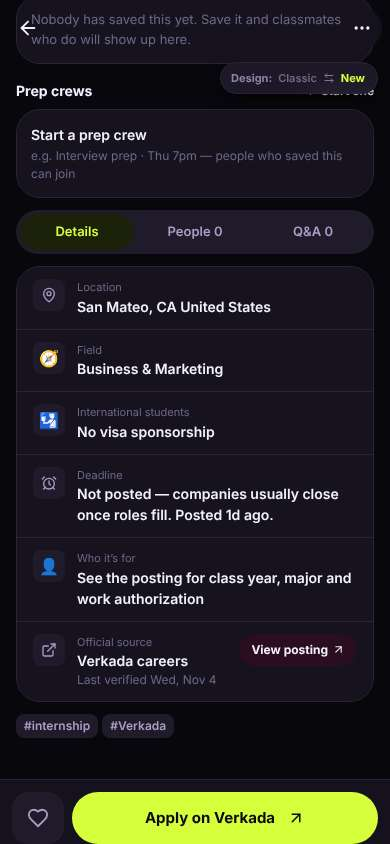

# ux-sim run `sched-20261104-1915-marcus-internship-near-berkeley`

> **AI simulation — hypotheses, not measured user behaviour.** One simulated persona; nothing here is a rate or a measurement of real students.

| | |
|---|---|
| Persona | **Marcus**, 22 — Senior · phone 390×844 · prefers en · tech low (`marcus-senior-lowtech`) |
| Scenario | **Find an internship near Berkeley** — You need a paid internship (summer or part-time) somewhere near Berkeley / the Bay Area. Use the app to find one that looks real and open, and open its details so you know how to apply. (`internship-near-berkeley`) |
| Target | local · http://localhost:37595 · worktree commit `b1c9c98b2b5a` |
| Outcome | **success** · ended by persona |
| Account | fresh real account `marcus.eleyzy4h@berkeley.edu` (Marcus, History, born 2004; sample: false) |
| Goal check (fixed, by harness) | met at step 10 after 5 action(s) — evidence: {"urlMatches":"^/opportunities/[^/?]+"}; {"textMatches":"\\bintern(ship)?s?\\b"} — _An internship listing's detail page is open (reached by the persona — the run starts on /)._ |
| Persona's reason | “Found a Verkada sales internship in San Mateo, posted yesterday and verified today, and I know to hit 'Apply on Verkada'. Wish it said whether it pays.” |
| Effort | 8/36 actions · objective frustration 2.00/4 · 1 confused note(s) · ~140s simulated |
| Drop-off risk | **medium** _(AI hypothesis, persona agent)_ — Location filter and 'Official / Apply on X' made it feel legit and fast, but no pay or job description on any listing means I'd still go to Handshake to actually decide; the prep-crew/social stuff isn't for me. · basis: steps 8, 12, 16 |

Known environment limits (not UX findings)

- Dining menus and RSF gym crowd levels need live campus sources (the local stack runs with CAMPUS_LIVE=0) — empty or missing data there is not a UX bug.
- AI features (Ask Lumi, AI profile draft on /start, conversation starters) need an OpenAI key; none is configured locally.
- Course catalog is the built-in sample list (~210 courses, e.g. MATH 1A; no cached catalog — run `local-stack catalog fetch` once (about 5 minutes) to test with the real Berkeley schedule). Live has the imported current-term Berkeley schedule (e.g. MATH 51) — course-name findings on timetable/class screens are marked environment-limited.
- Campus events, free food, internships, hackathons and scholarships are a read-only snapshot of live (1281 real items, 120 events this week, taken 2026-11-04 19:15 UTC) plus the CSV calendar. Nothing new appears during the run; Q&A and reviews are empty.
- No e-mail is sent: the sign-up / sign-in code is shown on screen in the hint (live sends a real e-mail).
- Real-time updates (SSE) work locally; other people never reply unless the stack was started with --autoreply.
- Signed in as a brand-new real (non-sample, e-mail-verified) account made for this run. Other students exist only if the scenario seeds peers (local fixtures); sample profiles are hidden from real accounts, as on live.

## Friction

| # | step | type | sev | persona says | screen | element | env-limited | evidence |
|---|---|---|---|---|---|---|---|---|
| f1 | 2 | Unclear wording | 2 | “Red 'D-1', 'D-8', 'D-82' tags on every job. Is that a deadline? A grade level? Doesn't say.” _wish: Write 'Due in 1 day' instead of D-1_ | `/explore/opportunities` | 💼 Oil and Gas Bond Reviews and Maintenance Bureau of Land Management · Bakersfield, Calif | no | [shot](shots/002-observe.jpg) [marked](shots/002-observe-som.jpg) |
| f2 | 5 | Confusing UI | 1 | “567 internships, fine. That's a lot of little buttons though. I see 'Any location' — that's what I want, near Berkeley.” _wish: Fewer chips; why are there two 'For you' buttons?_ | `/explore/opportunities` | For you | no | [shot](shots/005-click.jpg) [marked](shots/005-click-som.jpg) |
| f3 | 10 | Confusing UI | 2 | “'Official' and 'Apply on Sierra Club' — OK, that looks legit. But I don't need a 'prep crew', I need to know if it pays. Why is that stuff above the actual job info?” _wish: Put pay, dates and job description at the top; social extras lower_ | `/opportunities/:id` | Start a prep crew e.g. Interview prep · Thu 7pm — people who saved this can join | no | [shot](shots/010-click.jpg) [marked](shots/010-click-som.jpg) |
| f4 | 12 | Missing / empty content | 2 | “'Last verified Nov 4' and a link to Sierra Club careers — fine, I believe it's real. But nothing says if it's paid or what I'd actually do. I'd have to leave the app to find out. Kind of the whole point.” _wish: Show pay (paid/unpaid, hourly rate) and a short description of the job_ | `/opportunities/:id` | Official source Sierra Club careers Last verified Wed, Nov 4 View posting | no | [shot](shots/012-scroll.jpg) [marked](shots/012-scroll-som.jpg) |

Severity: 1 = Minor — noticed it, cosmetic or a small annoyance; did not slow me down. · 2 = Moderate — slowed me down or made me hesitate; I recovered on my own. · 3 = Major — real confusion, a wrong path or many extra steps; I nearly gave up or only got through by guessing. · 4 = Blocker — I could not continue, gave up, or would stop using the app here.

## Timeline

| step | what | screen | ms | signals / notes | shot |
|---|---|---|---|---|---|
| 0 | start | `/` | 1860 |  |  |
| 1 | click “Opportunities” | `/explore/opportunities` | 927 | expects: “a list of jobs and internships” (0.7) as expected |  |
| 2 | observe | `/explore/opportunities` |  | _neutral_: “OK, this is the job part. But 'Oil and Gas Bond Reviews' in Bakersfield 'fits my major (History)'? That's a stretch. And what's D-1, D-8 — red tags, no idea.” _neutral_: “Red 'D-1', 'D-8', 'D-82' tags on every job. Is that a deadline? A grade level? Doesn't say.” → f1 |  |
| 5 | click “Internships” | `/explore/opportunities` | 867 | expects: “only internships listed” (0.8) as expected _neutral_: “567 internships, fine. That's a lot of little buttons though. I see 'Any location' — that's what I want, near Berkeley.” → f2 |  |
| 7 | click “Location” | `/explore/opportunities` | 861 | expects: “a list of places to pick from, like Bay Area” (0.6) |  |
| 8 | select “Location” | `/explore/opportunities` | 826 | expects: “list narrows to Bay Area internships” (0.6) as expected _curious_: “Now we're talking. Sierra Club in Oakland, that's a real organization and close by. Doesn't say if it's paid though.” |  |
| 10 | click “💼 Legal Intern Sierra Club · Oakland, C” | `/opportunities/:id` | 852 | expects: “details page: pay, what you do, how to apply” (0.7) **mismatch**: Details page has 'Official' badge and big 'Apply on Sierra Club' button, but the top half is social stuff (Do it with people, Prep crews) and no pay shown yet ⚑ mismatch _neutral_: “'Official' and 'Apply on Sierra Club' — OK, that looks legit. But I don't need a 'prep crew', I need to know if it pays. Why is that stuff above the actual job info?” → f3 |  |
| 12 | scroll down | `/opportunities/:id` | 1316 | expects: “pay and description below” (0.5) **mismatch**: Bottom of page: location, field, 'Rolling' deadline, 'see the posting' for who it's for, official source verified today. No pay, no job description. ⚑ mismatch _frustrated_: “'Last verified Nov 4' and a link to Sierra Club careers — fine, I believe it's real. But nothing says if it's paid or what I'd actually do. I'd have to leave the app to find out. Kind of the whole point.” → f4 |  |
| 14 | back | `/explore/opportunities` | 1136 | expects: “back to Bay Area internship list” (0.7) as expected ⚑ backtrack _neutral_: “Good, it kept Bay Area. Mostly software stuff, not for a History guy. That Verkada sales internship in San Mateo — a company like that pays interns, I'd think. Let me look.” |  |
| 16 | click “💼 Sales Development Representative, Int” | `/opportunities/:id` | 860 | expects: “Verkada internship details, maybe pay” (0.5) **mismatch**: Same layout: San Mateo, Business & Marketing, posted 1d ago, verified today, 'Apply on Verkada' button — again no pay listed ⚑ mismatch _neutral_: “Same deal, no pay listed. But it's a real company, posted yesterday, checked today, and there's a button that says exactly where I apply. A sales internship at a tech company is paid, I'm pretty sure. I'll save this one and apply on their site.” |  |
| 18 | finish | `/opportunities/:id` |  |  |  |

## Automatic checks (harness, not persona)

| screen | tap targets < 44px | sideways overflow | broken images |
|---|---|---|---|
| `/` | 5 (See all 62×21, Save 36×36, Save 36×36, Feedback 93×32, Switch to the classic design 158×32) | — | — |
| `/explore/opportunities` | 30 (See all 62×21, Feedback 93×32, Switch to the classic design 158×32) | — | — |
| `/opportunities/:id` | 8 (Back 40×40, More 40×40, Sierra Club 68×20, Start one 70×18, Details 114×36) | — | — |

## Timing (harness)

- Full page load (navigation timing): 617 ms
