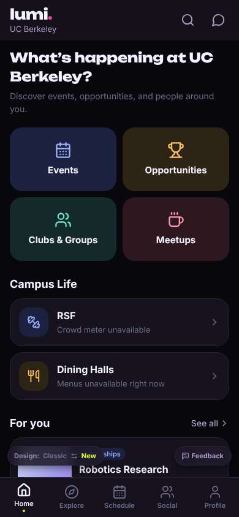
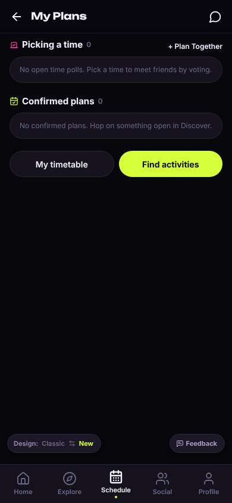
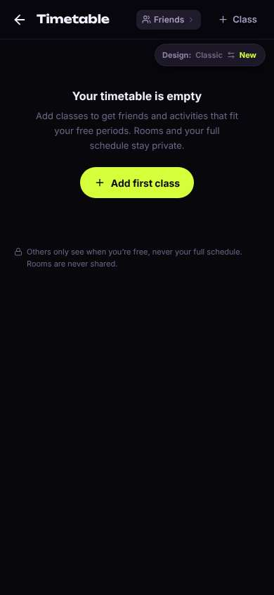
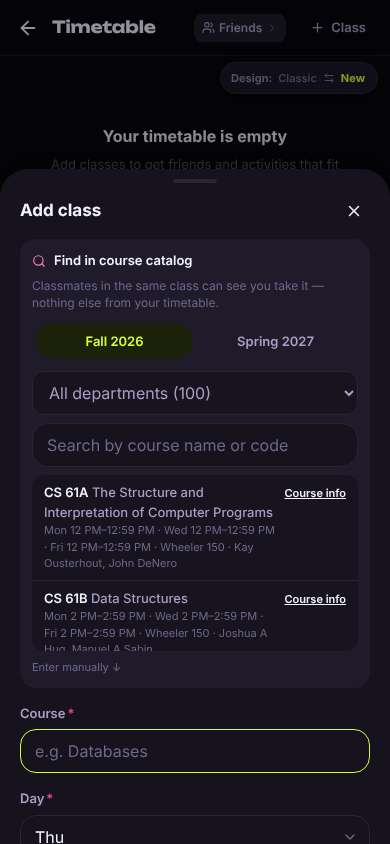
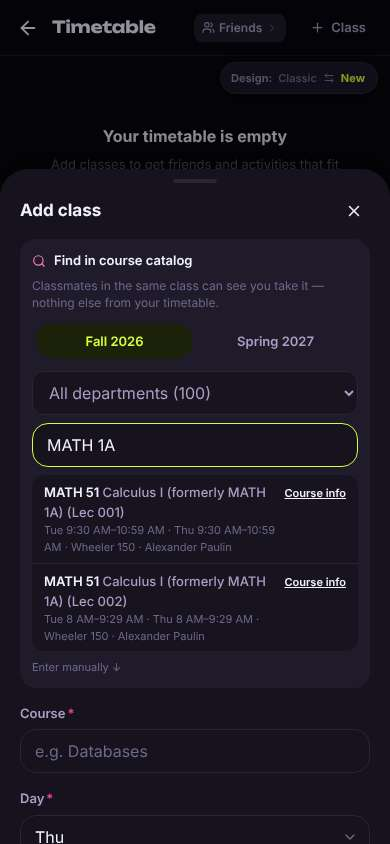
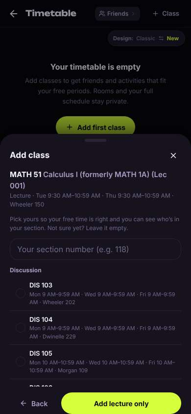
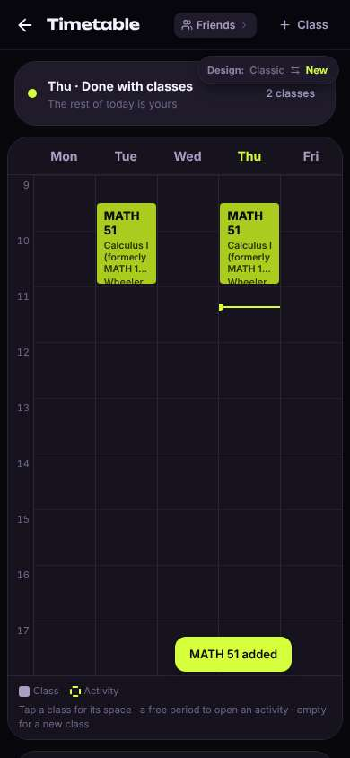
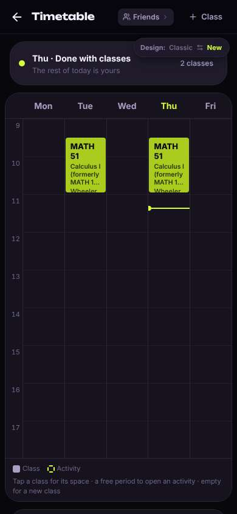

# ux-sim run `sched-20261105-1915-diego-timetable-add-classes`

> **AI simulation — hypotheses, not measured user behaviour.** One simulated persona; nothing here is a rate or a measurement of real students.

| | |
|---|---|
| Persona | **Diego**, 21 — Junior (transfer from Laney College) · phone 390×844 · prefers en · tech medium (`diego-transfer-commuter`) |
| Scenario | **Put my classes into my timetable** — You want the app to know your schedule so it can show who's free when you are. Add your calculus class — Calculus I, which you know as MATH 1A — to your timetable in the app. (`timetable-add-classes`) |
| Target | local · http://localhost:37829 · worktree commit `9add077e78df` |
| Outcome | **success** · ended by persona |
| Account | fresh real account `diego.ssesl89g@berkeley.edu` (Diego, Civil Engineering, born 2005; sample: false) |
| Goal check (fixed, by harness) | met at step 11 after 6 action(s) — evidence: Calculus I is in my saved timetable — _The persona's own timetable (server-side) gained Calculus I (MATH 51 / MATH 1A) during the run._ |
| Persona's reason | “Found Calc I under its new number MATH 51 and it's on my timetable Tue/Thu 9:30. Took like a minute.” |
| Effort | 6/32 actions · objective frustration 1.00/4 · 0 confused note(s) · ~63s simulated |
| Drop-off risk | **medium** _(AI hypothesis, persona agent)_ — Adding the class was fast, but I still haven't seen any actual study partners or 'who's free' yet — if that's empty next time, I'm out. · basis: steps 9, 11 |

Known environment limits (not UX findings)

- Dining menus and RSF gym crowd levels need live campus sources (the local stack runs with CAMPUS_LIVE=0) — empty or missing data there is not a UX bug.
- AI features (Ask Lumi, AI profile draft on /start, conversation starters) need an OpenAI key; none is configured locally.
- Course catalog is the real Berkeley Class Schedule (6619 courses, Fall 2026 + Spring 2027), fetched 2026-11-05 with the worker's adapter. Seat counts and very recent changes may differ from live.
- Campus events, free food, internships, hackathons and scholarships are a read-only snapshot of live (1282 real items, 122 events this week, taken 2026-11-05 19:15 UTC) plus the CSV calendar. Nothing new appears during the run; Q&A and reviews are empty.
- No e-mail is sent: the sign-up / sign-in code is shown on screen in the hint (live sends a real e-mail).
- Real-time updates (SSE) work locally; other people never reply unless the stack was started with --autoreply.
- Signed in as a brand-new real (non-sample, e-mail-verified) account made for this run. Other students exist only if the scenario seeds peers (local fixtures); sample profiles are hidden from real accounts, as on live.

## Friction

| # | step | type | sev | persona says | screen | element | env-limited | evidence |
|---|---|---|---|---|---|---|---|---|
| f1 | 1 | Confusing UI | 1 | “OK, it's plans, not my classes. There's a 'My timetable' button though, fine.” _wish: Schedule tab should show my class timetable first_ | `/schedule` | My timetable | no | [shot](shots/001-click.jpg) [marked](shots/001-click-som.jpg) |
| f2 | 9 | Confusing UI | 1 | “Extra step, but it says I can leave it empty. I don't remember my DIS number off the top of my head — lecture only, done.” _wish: let me add the lecture in one tap and pick my section later_ | `/timetable` | Add lecture only | no | [shot](shots/009-click.jpg) [marked](shots/009-click-som.jpg) |
| f3 | 11 | Unclear wording | 1 | “Done, under a minute. It's there Tue/Thu. Though the banner says '2 classes' — it's one class, twice a week.” _wish: count meetings vs. courses clearly, e.g. '1 class today' or '2 sessions'_ | `/timetable` |  | no | [shot](shots/011-click.jpg) [marked](shots/011-click-som.jpg) |

Severity: 1 = Minor — noticed it, cosmetic or a small annoyance; did not slow me down. · 2 = Moderate — slowed me down or made me hesitate; I recovered on my own. · 3 = Major — real confusion, a wrong path or many extra steps; I nearly gave up or only got through by guessing. · 4 = Blocker — I could not continue, gave up, or would stop using the app here.

## Timeline

| step | what | screen | ms | signals / notes | shot |
|---|---|---|---|---|---|
| 0 | start | `/` | 1199 |  |  |
| 1 | click “Schedule” | `/schedule` | 910 | expects: “my timetable, with a way to add classes” (0.8) **mismatch**: Schedule tab opens 'My Plans' (polls, confirmed plans), timetable is a secondary button below ⚑ mismatch _neutral_: “OK, it's plans, not my classes. There's a 'My timetable' button though, fine.” → f1 |  |
| 3 | click “My timetable” | `/timetable` | 844 | expects: “weekly class grid with an add class button” (0.8) as expected _curious_: “Good, clear. And they say others only see when I'm free, nice.” |  |
| 5 | click “Add first class” | `/timetable` | 863 | expects: “search for a course by code like MATH 1A” (0.75) as expected _neutral_: “OK, search box. Typing MATH 1A.” |  |
| 7 | type “Search by course name or code” ← “MATH 1A” | `/timetable` | 860 | expects: “MATH 1A Calculus shows in the list” (0.8) as expected _delighted_: “Oh nice, it's MATH 51 now and it says 'formerly MATH 1A' — I would've been lost otherwise. I'm in the 9:30 one, no way I make 8 AM off BART.” |  |
| 9 | click “MATH 51 Calculus I (formerly MATH 1A) (L” | `/timetable` | 3373 | expects: “Lec 001 gets added to my timetable” (0.65) **mismatch**: Not added yet; asks for a discussion section with a long list of DIS options, plus 'Add lecture only' ⚑ mismatch _neutral_: “Extra step, but it says I can leave it empty. I don't remember my DIS number off the top of my head — lecture only, done.” → f2 |  |
| 11 | click “Add lecture only” | `/timetable` | 845 | expects: “MATH 51 shows on my timetable Tue/Thu 9:30” (0.85) as expected _delighted_: “Done, under a minute. It's there Tue/Thu. Though the banner says '2 classes' — it's one class, twice a week.” → f3 |  |
| 13 | finish | `/timetable` |  |  |  |

## Automatic checks (harness, not persona)

| screen | tap targets < 44px | sideways overflow | broken images |
|---|---|---|---|
| `/` | 5 (See all 62×21, Save 36×36, Save 36×36, Feedback 93×32, Switch to the classic design 158×32) | — | — |
| `/schedule` | 5 (Back 40×40, Messages 40×40, + Plan Together 92×18, Feedback 93×32, Switch to the classic design 158×32) | — | — |
| `/timetable` | 7 (Back 40×40, Friends 92×28, Class 88×36, Switch to the classic design 158×32) | — | — |

## Timing (harness)

- Full page load (navigation timing): 288 ms
- Step 9 `click` took 3373 ms until the network was quiet on `/timetable`
