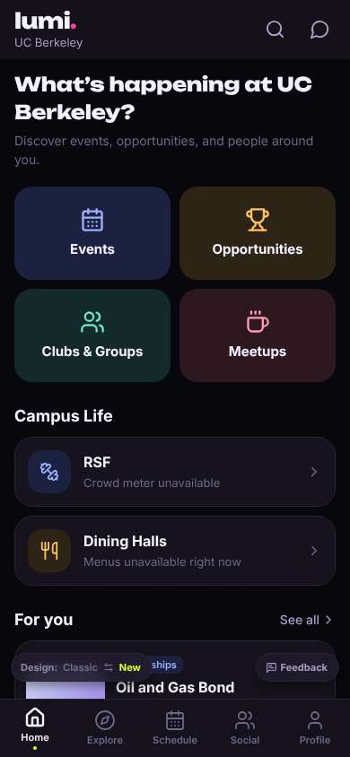
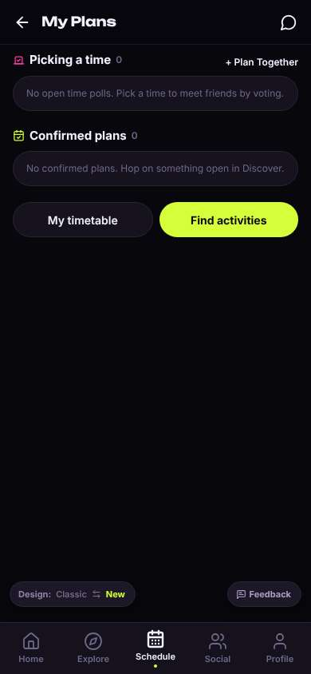
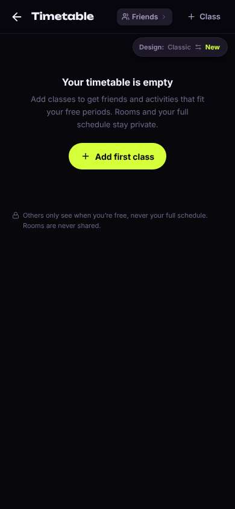
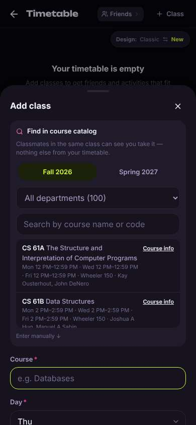
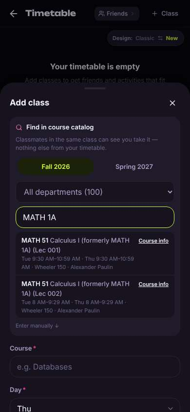
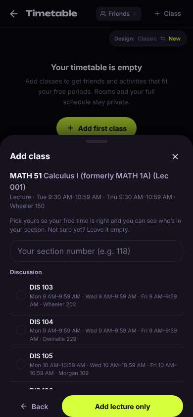
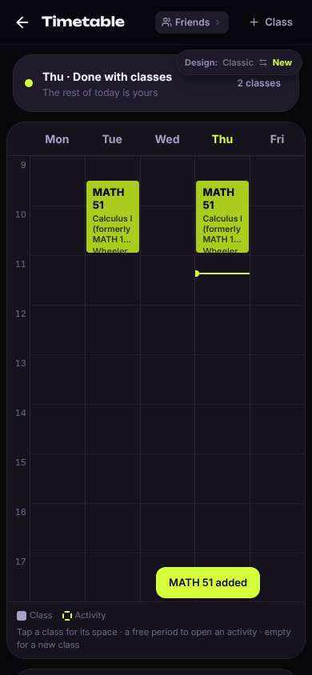
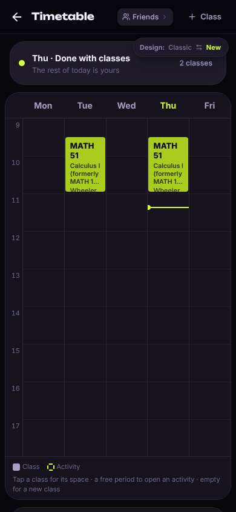

# ux-sim run `sched-20261105-1915-marcus-timetable-add-classes`

> **AI simulation — hypotheses, not measured user behaviour.** One simulated persona; nothing here is a rate or a measurement of real students.

| | |
|---|---|
| Persona | **Marcus**, 22 — Senior · phone 390×844 · prefers en · tech low (`marcus-senior-lowtech`) |
| Scenario | **Put my classes into my timetable** — You want the app to know your schedule so it can show who's free when you are. Add your calculus class — Calculus I, which you know as MATH 1A — to your timetable in the app. (`timetable-add-classes`) |
| Target | local · http://localhost:46173 · worktree commit `9add077e78df` |
| Outcome | **success** · ended by persona |
| Account | fresh real account `marcus.ssesl8od@berkeley.edu` (Marcus, History, born 2004; sample: false) |
| Goal check (fixed, by harness) | met at step 12 after 6 action(s) — evidence: Calculus I is in my saved timetable — _The persona's own timetable (server-side) gained Calculus I (MATH 51 / MATH 1A) during the run._ |
| Persona's reason | “Found Calculus I (it's MATH 51 now, formerly MATH 1A), added the lecture, and it's on my timetable Tue/Thu.” |
| Effort | 6/36 actions · objective frustration 1.00/4 · 0 confused note(s) · ~94s simulated |
| Drop-off risk | **medium** _(AI hypothesis, persona agent)_ — Adding the class was smooth, but I came for internships and the 'Schedule' tab was about meeting friends; I'd only come back if the internship side is as clear. · basis: steps 1, 12 |

Known environment limits (not UX findings)

- Dining menus and RSF gym crowd levels need live campus sources (the local stack runs with CAMPUS_LIVE=0) — empty or missing data there is not a UX bug.
- AI features (Ask Lumi, AI profile draft on /start, conversation starters) need an OpenAI key; none is configured locally.
- Course catalog is the real Berkeley Class Schedule (6619 courses, Fall 2026 + Spring 2027), fetched 2026-11-05 with the worker's adapter. Seat counts and very recent changes may differ from live.
- Campus events, free food, internships, hackathons and scholarships are a read-only snapshot of live (1282 real items, 122 events this week, taken 2026-11-05 19:15 UTC) plus the CSV calendar. Nothing new appears during the run; Q&A and reviews are empty.
- No e-mail is sent: the sign-up / sign-in code is shown on screen in the hint (live sends a real e-mail).
- Real-time updates (SSE) work locally; other people never reply unless the stack was started with --autoreply.
- Signed in as a brand-new real (non-sample, e-mail-verified) account made for this run. Other students exist only if the scenario seeds peers (local fixtures); sample profiles are hidden from real accounts, as on live.

## Friction

| # | step | type | sev | persona says | screen | element | env-limited | evidence |
|---|---|---|---|---|---|---|---|---|
| f1 | 1 | Unclear wording | 1 | “Says Schedule but it's about plans with friends. There's a 'My timetable' button though, that's probably it.” _wish: Schedule tab should open my class timetable or say 'Plans'_ | `/schedule` | Schedule | no | [shot](shots/001-click.jpg) [marked](shots/001-click-som.jpg) |
| f2 | 7 | Confusing UI | 1 | “Two of them, Lec 001 and Lec 002. Same professor. I guess the 9:30 one, I'm not getting up for 8 AM. Hope picking one doesn't sign me up for anything official.” _wish: a plain hint like 'pick the section/time you're in'_ | `/timetable` | MATH 51 Calculus I (formerly MATH 1A) (Lec 001) Tue 9:30 AM–10:59 AM · Thu 9:30 AM–10:59 A | no | [shot](shots/007-type.jpg) [marked](shots/007-type-som.jpg) |
| f3 | 10 | Confusing UI | 1 | “A whole wall of DIS sections. I don't remember my section number offhand. Good that it says 'Not sure yet? Leave it empty' — I'll just add the lecture.” _wish: ask about the section after the class is saved, not before_ | `/timetable` | Your section number (e.g. 118) | no | [shot](shots/010-click.jpg) [marked](shots/010-click-som.jpg) |
| f4 | 12 | Unclear wording | 1 | “It says '2 classes' up top but I only added one. I guess it means two meetings. Small thing.” _wish: say '1 class, 2 meetings' or just count the course once_ | `/timetable` |  | no | [shot](shots/012-click.jpg) [marked](shots/012-click-som.jpg) |

Severity: 1 = Minor — noticed it, cosmetic or a small annoyance; did not slow me down. · 2 = Moderate — slowed me down or made me hesitate; I recovered on my own. · 3 = Major — real confusion, a wrong path or many extra steps; I nearly gave up or only got through by guessing. · 4 = Blocker — I could not continue, gave up, or would stop using the app here.

## Timeline

| step | what | screen | ms | signals / notes | shot |
|---|---|---|---|---|---|
| 0 | start | `/` | 1242 |  |  |
| 1 | click “Schedule” | `/schedule` | 905 | expects: “my class schedule / timetable page” (0.8) **mismatch**: Schedule tab opens 'My Plans' about meeting friends, not my classes; a 'My timetable' button is down the page ⚑ mismatch _neutral_: “Says Schedule but it's about plans with friends. There's a 'My timetable' button though, that's probably it.” → f1 |  |
| 3 | click “My timetable” | `/timetable` | 861 | expects: “a page with my weekly classes where I can add one” (0.8) as expected _curious_: “OK, plain and clear. And it says others only see when I'm free, not my rooms. Good, that's what I'd want to know.” |  |
| 5 | click “Add first class” | `/timetable` | 846 | expects: “a form or search where I type my class” (0.8) as expected _neutral_: “There's a search box. I'll just type MATH 1A in there.” |  |
| 7 | type “Search by course name or code” ← “MATH 1A” | `/timetable` | 873 | expects: “Calculus I shows up in the list” (0.7) as expected _delighted_: “Oh, they renamed it MATH 51. Glad it says 'formerly MATH 1A' or I'd have thought it wasn't there.” _neutral_: “Two of them, Lec 001 and Lec 002. Same professor. I guess the 9:30 one, I'm not getting up for 8 AM. Hope picking one doesn't sign me up for anything official.” → f2 |  |
| 10 | click “MATH 51 Calculus I (formerly MATH 1A) (L” | `/timetable` | 3652 | expects: “the class gets added to my timetable, or the form fills in” (0.6) **mismatch**: Didn't add yet; it asks me to pick a discussion section from a long list, with an 'Add lecture only' button ⚑ mismatch _neutral_: “A whole wall of DIS sections. I don't remember my section number offhand. Good that it says 'Not sure yet? Leave it empty' — I'll just add the lecture.” → f3 |  |
| 12 | click “Add lecture only” | `/timetable` | 842 | expects: “Calculus shows up on my timetable” (0.8) as expected _delighted_: “There it is, Tuesday and Thursday. That was easier than I figured.” _neutral_: “It says '2 classes' up top but I only added one. I guess it means two meetings. Small thing.” → f4 |  |
| 15 | finish | `/timetable` |  |  |  |

## Automatic checks (harness, not persona)

| screen | tap targets < 44px | sideways overflow | broken images |
|---|---|---|---|
| `/` | 5 (See all 62×21, Save 36×36, Save 36×36, Feedback 93×32, Switch to the classic design 158×32) | — | — |
| `/schedule` | 5 (Back 40×40, Messages 40×40, + Plan Together 92×18, Feedback 93×32, Switch to the classic design 158×32) | — | — |
| `/timetable` | 7 (Back 40×40, Friends 92×28, Class 88×36, Switch to the classic design 158×32) | — | — |

## Timing (harness)

- Full page load (navigation timing): 232 ms
- Step 10 `click` took 3652 ms until the network was quiet on `/timetable`
