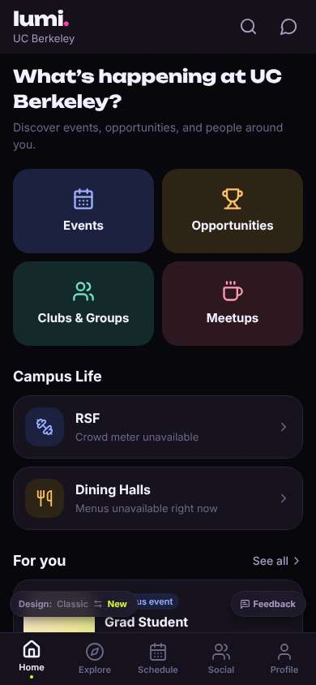
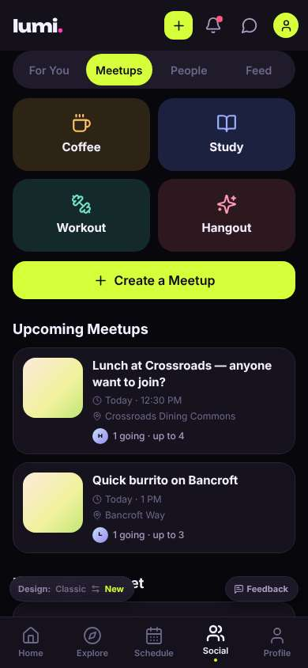
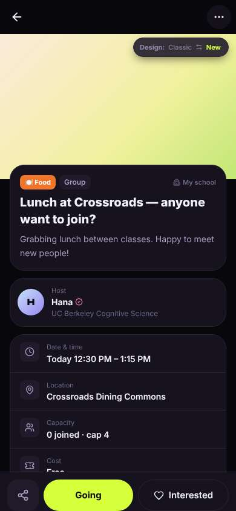
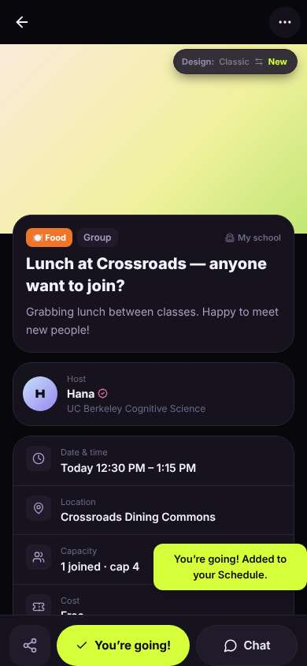
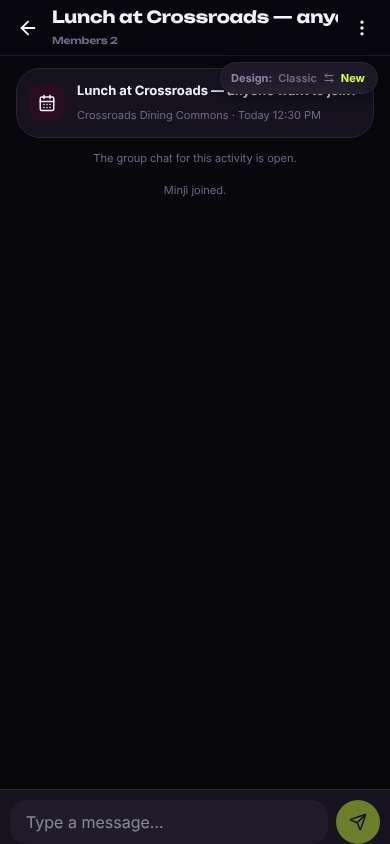
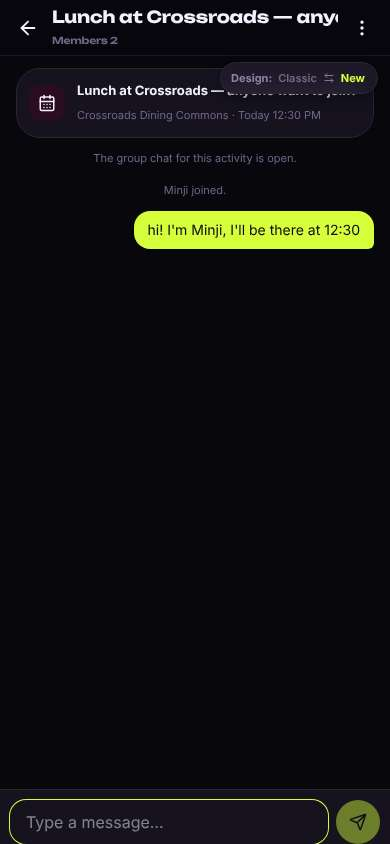

# ux-sim run `sched-20261105-1915-minji-lunch-today`

> **AI simulation — hypotheses, not measured user behaviour.** One simulated persona; nothing here is a rate or a measurement of real students.

| | |
|---|---|
| Persona | **Minji**, 17 — First-year (started college a year early) · phone 390×844 · prefers ko · tech high (`minji-freshman-17`) |
| Scenario | **Find someone to get lunch with today** — It's a weekday and you'd rather not eat lunch alone again. Use the app to find someone (or a group) to get lunch with today, and let them know you're in. (`lunch-today`) |
| Target | local · http://localhost:38795 · worktree commit `9add077e78df` |
| Outcome | **success** · ended by persona |
| Account | fresh real account `minji.odayfepo@berkeley.edu` (Minji, Undeclared, born 2009; sample: false) · peers seeded: Hana, Leo |
| Goal check (fixed, by harness) | met at step 6 after 3 action(s) — evidence: joined or asked to join a peer's lunch plan; joined or asked to join a plan — _During the run the persona's own account joined/requested one of today's lunch plans, posted its own meal plan for today, or messaged in a lunch plan's chat._ |
| Persona's reason | “Found Hana's lunch at Crossroads today, tapped Going and said hi in the group chat. Took like 5 taps.” |
| Effort | 5/40 actions · objective frustration 0.00/4.5 · 1 confused note(s) · ~16s simulated |
| Drop-off risk | **low** _(AI hypothesis, persona agent)_ — Found a same-day lunch fast with no face photos or profile quiz; would come back if Hana actually shows up / replies · basis: steps 1, 6, 10 |

Known environment limits (not UX findings)

- Dining menus and RSF gym crowd levels need live campus sources (the local stack runs with CAMPUS_LIVE=0) — empty or missing data there is not a UX bug.
- AI features (Ask Lumi, AI profile draft on /start, conversation starters) need an OpenAI key; none is configured locally.
- Course catalog is the built-in sample list (~210 courses, e.g. MATH 1A; UX_SIM_CATALOG=builtin). Live has the imported current-term Berkeley schedule (e.g. MATH 51) — course-name findings on timetable/class screens are marked environment-limited.
- Campus events, free food, internships, hackathons and scholarships are a read-only snapshot of live (1282 real items, 122 events this week, taken 2026-11-05 19:15 UTC) plus the CSV calendar. Nothing new appears during the run; Q&A and reviews are empty.
- No e-mail is sent: the sign-up / sign-in code is shown on screen in the hint (live sends a real e-mail).
- Real-time updates (SSE) work locally; other people never reply unless the stack was started with --autoreply.
- Signed in as a brand-new real (non-sample, e-mail-verified) account made for this run. Other students exist only if the scenario seeds peers (local fixtures); sample profiles are hidden from real accounts, as on live.

## Friction

| # | step | type | sev | persona says | screen | element | env-limited | evidence |
|---|---|---|---|---|---|---|---|---|
| f1 | 3 | Confusing UI | 2 | “뭐지, list said '1 going' but here it says '0 joined · cap 4'. is anyone actually coming? and the big lime 'Going' — did I already press it?” _wish: say 'Join lunch' and show the same count everywhere_ | `/activities/:id` | Going | no | [shot](shots/003-click.jpg) [marked](shots/003-click-som.jpg) |
| f2 | 8 | Confusing UI | 1 | “ok chat is here. kinda empty and dark, Hana didn't say anything yet. I'll just say hi” _wish: Design pill shouldn't sit on top of the event card_ | `/chats/:id` | Switch to the classic design | no | [shot](shots/008-click.jpg) [marked](shots/008-click-som.jpg) |
| f3 | 10 | Bug | 1 | “sent! 근데 my smiley disappeared? weird but whatever. no read receipt so idk if Hana saw” _wish: keep emoji, show if host has seen it_ | `/chats/:id` | Type a message… | no | [shot](shots/010-type.jpg) [marked](shots/010-type-som.jpg) |

Severity: 1 = Minor — noticed it, cosmetic or a small annoyance; did not slow me down. · 2 = Moderate — slowed me down or made me hesitate; I recovered on my own. · 3 = Major — real confusion, a wrong path or many extra steps; I nearly gave up or only got through by guessing. · 4 = Blocker — I could not continue, gave up, or would stop using the app here.

## Timeline

| step | what | screen | ms | signals / notes | shot |
|---|---|---|---|---|---|
| 0 | start | `/` | 1091 |  |  |
| 1 | click “Meetups” | `/meet/meetups` | 904 | expects: “list of people meeting up to eat or hang out” (0.6) as expected _delighted_: “오 바로 있네! lunch today at Crossroads, that's literally what I want. no face photos either, nice” |  |
| 3 | click “Lunch at Crossroads — anyone want to joi” | `/activities/:id` | 1251 | expects: “details of the lunch with who's going and a join button” (0.8) as expected _curious_: “Hana seems chill, just an initial not a big face. short text, good” _confused_: “뭐지, list said '1 going' but here it says '0 joined · cap 4'. is anyone actually coming? and the big lime 'Going' — did I already press it?” → f1 |  |
| 6 | click “Going” | `/activities/:id` | 838 | expects: “I join Hana's lunch and it shows I'm going” (0.7) as expected _delighted_: “오 쉽다. one tap and I'm in, and there's a chat. 'Added to your Schedule' is nice” |  |
| 8 | click “Chat” | `/chats/:id` | 854 | expects: “group chat with Hana where I can say hi” (0.75) as expected _neutral_: “ok chat is here. kinda empty and dark, Hana didn't say anything yet. I'll just say hi” → f2 |  |
| 10 | type “Type a message…” ← “hi! I'm Minji, I'll be there at 12:30 🙂” | `/chats/:id` | 895 | expects: “message shows up in chat so Hana knows I'm coming” (0.8) as expected _neutral_: “sent! 근데 my smiley disappeared? weird but whatever. no read receipt so idk if Hana saw” → f3 |  |
| 12 | finish | `/chats/:id` |  |  |  |

## Automatic checks (harness, not persona)

| screen | tap targets < 44px | sideways overflow | broken images |
|---|---|---|---|
| `/` | 5 (See all 62×21, Save 36×36, Save 36×36, Feedback 93×32, Switch to the classic design 158×32) | — | — |
| `/meet/meetups` | 10 (Create 36×36, Notifications 40×40, Messages 40×40, Me 32×32, For You 85×40) | — | — |
| `/activities/:id` | 3 (Back 40×40, More 40×40, Switch to the classic design 158×32) | — | — |
| `/chats/:id` | 3 (Back 40×40, Menu 40×40, Switch to the classic design 158×32) | — | — |

## Timing (harness)

- Full page load (navigation timing): 175 ms
