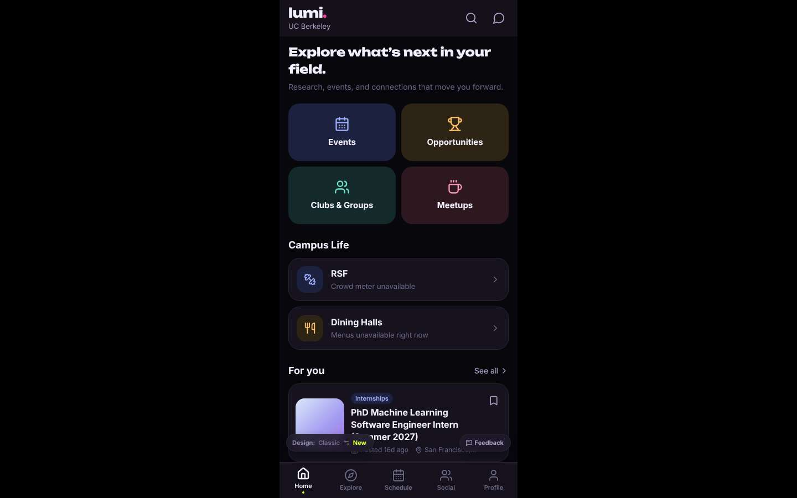
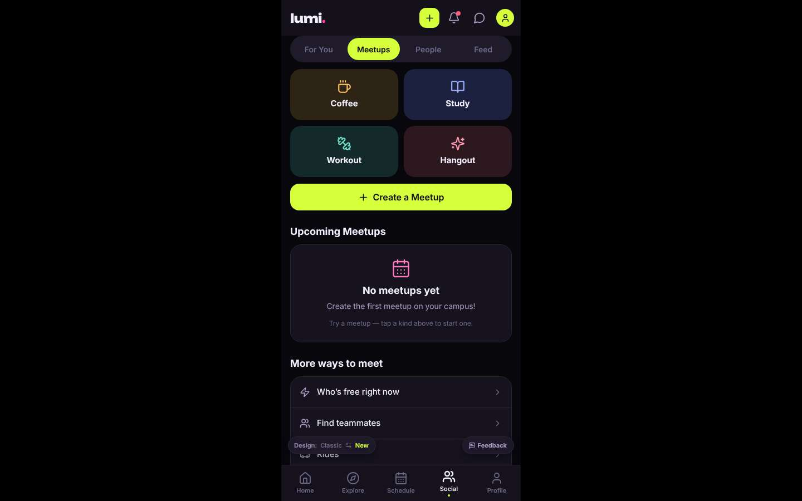
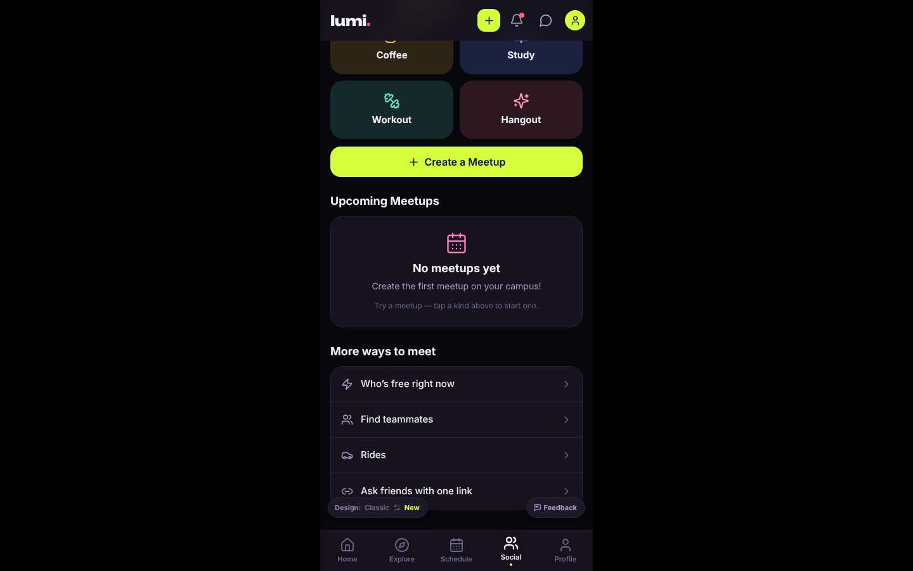
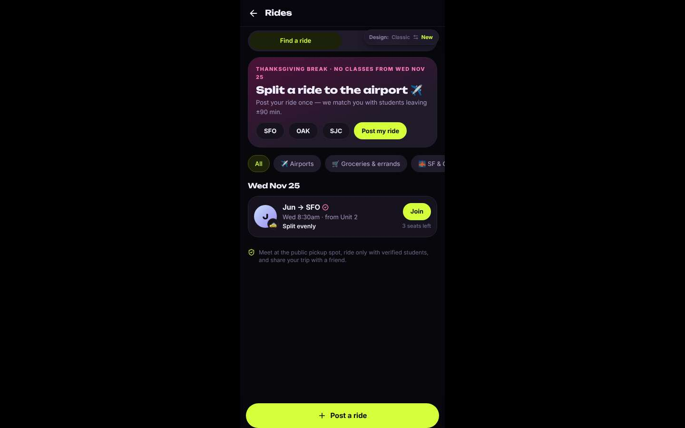
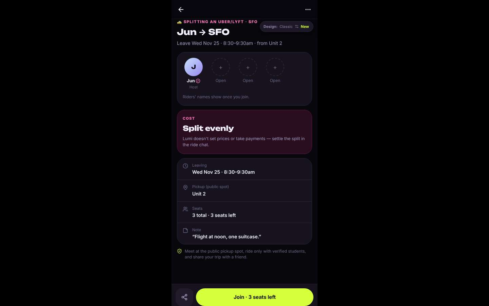
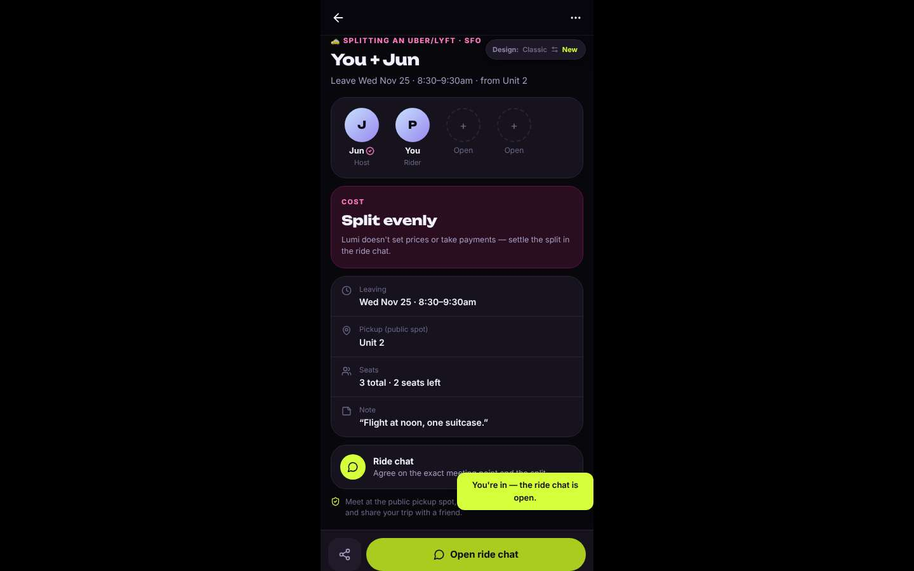
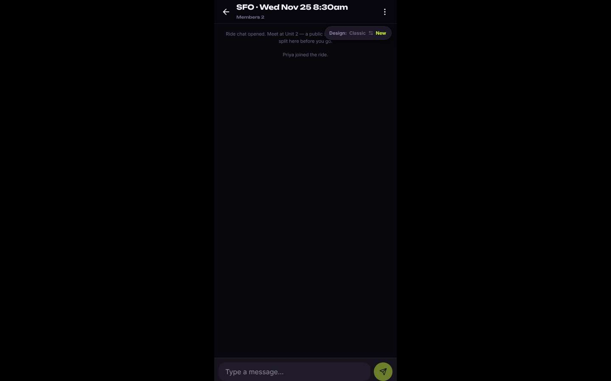
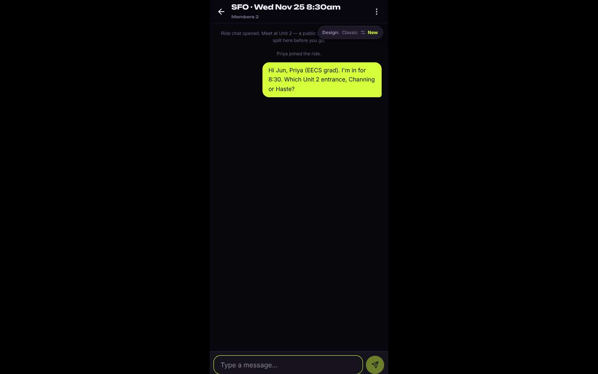

# ux-sim run `sched-20261105-1915-priya-ride-sfo-thanksgiving`

> **AI simulation — hypotheses, not measured user behaviour.** One simulated persona; nothing here is a rate or a measurement of real students.

| | |
|---|---|
| Persona | **Priya**, 26 — Second-year PhD student · desktop 1440×900 · prefers en · tech high (`priya-phd-desktop`) |
| Scenario | **Share a ride to SFO for Thanksgiving** — You fly out of SFO the Wednesday before Thanksgiving (Nov 25) in the morning. Find other students to split a ride to the airport with — join one, or post yours so others can find you. (`ride-sfo-thanksgiving`) |
| Target | local · http://localhost:40127 · worktree commit `9add077e78df` |
| Outcome | **success** · ended by persona |
| Account | fresh real account `priya.vingfep9@berkeley.edu` (Priya, EECS, born 2000; sample: false) · peers seeded: Jun |
| Goal check (fixed, by harness) | met at step 9 after 5 action(s) — evidence: joined someone's SFO ride — _During the run the persona posted an SFO ride on Nov 25, or joined/requested someone's SFO ride (server-side)._ |
| Persona's reason | “Joined Jun's SFO ride on Wed Nov 25, 8:30am, which fits my morning flight, and asked about the pickup point in the ride chat. It took about six clicks.” |
| Effort | 7/40 actions · objective frustration 0.00/5 · 1 confused note(s) · ~69s simulated |
| Drop-off risk | **medium** _(AI hypothesis, persona agent)_ — The rides flow was fast and to the point, but the whole app is a phone column on my laptop, and meetups were empty. I'd come back for rides, maybe not for much else. · basis: steps 0, 2, 5, 9 |

Known environment limits (not UX findings)

- Dining menus and RSF gym crowd levels need live campus sources (the local stack runs with CAMPUS_LIVE=0) — empty or missing data there is not a UX bug.
- AI features (Ask Lumi, AI profile draft on /start, conversation starters) need an OpenAI key; none is configured locally.
- Course catalog is the built-in sample list (~210 courses, e.g. MATH 1A; UX_SIM_CATALOG=builtin). Live has the imported current-term Berkeley schedule (e.g. MATH 51) — course-name findings on timetable/class screens are marked environment-limited.
- Campus events, free food, internships, hackathons and scholarships are a read-only snapshot of live (1282 real items, 122 events this week, taken 2026-11-05 19:15 UTC) plus the CSV calendar. Nothing new appears during the run; Q&A and reviews are empty.
- No e-mail is sent: the sign-up / sign-in code is shown on screen in the hint (live sends a real e-mail).
- Real-time updates (SSE) work locally; other people never reply unless the stack was started with --autoreply.
- Signed in as a brand-new real (non-sample, e-mail-verified) account made for this run. Other students exist only if the scenario seeds peers (local fixtures); sample profiles are hidden from real accounts, as on live.

## Friction

| # | step | type | sev | persona says | screen | element | env-limited | evidence |
|---|---|---|---|---|---|---|---|---|
| f1 | 0 | Confusing UI | 2 | “A 430px phone column in the middle of my 1440 screen, with black bars on both sides. This is a mobile app stretched onto my laptop. Not a great start.” _wish: a real desktop layout that uses the width_ | `/` |  | no | [shot](shots/000-start.jpg) [marked](shots/000-start-som.jpg) |
| f2 | 2 | Hard to find | 1 | “No meetups at all on campus. But there's a 'Rides' entry half hidden behind that floating Design toggle. That's what I want.” _wish: Rides not covered by the floating pill_ | `/meet/meetups` | Rides | no | [shot](shots/002-click.jpg) [marked](shots/002-click-som.jpg) |
| f3 | 7 | Unclear wording | 1 | “This is what I needed. Noon flight, 8:30 departure, matches my morning flight. 'Pickup (public spot): Unit 2' — Unit 2 is a dorm complex, which corner exactly? Minor, the chat can sort it.” _wish: an actual pickup point, e.g. 'Unit 2, Channing Way entrance'_ | `/rides/:id` |  | no | [shot](shots/007-click.jpg) [marked](shots/007-click-som.jpg) |
| f4 | 11 | Bug | 1 | “Works. The floating Design pill is now covering the first system message, third screen in a row it sits on top of content. Sloppy.” _wish: the design toggle not overlapping page content_ | `/chats/:id` | Switch to the classic design | no | [shot](shots/011-click.jpg) [marked](shots/011-click-som.jpg) |

Severity: 1 = Minor — noticed it, cosmetic or a small annoyance; did not slow me down. · 2 = Moderate — slowed me down or made me hesitate; I recovered on my own. · 3 = Major — real confusion, a wrong path or many extra steps; I nearly gave up or only got through by guessing. · 4 = Blocker — I could not continue, gave up, or would stop using the app here.

## Timeline

| step | what | screen | ms | signals / notes | shot |
|---|---|---|---|---|---|
| 0 | start | `/` | 1153 | _frustrated_: “A 430px phone column in the middle of my 1440 screen, with black bars on both sides. This is a mobile app stretched onto my laptop. Not a great start.” → f1 |  |
| 2 | click “Meetups” | `/meet/meetups` | 912 | expects: “list of student meetups, maybe rides/carpools” (0.4) as expected _neutral_: “No meetups at all on campus. But there's a 'Rides' entry half hidden behind that floating Design toggle. That's what I want.” → f2 |  |
| 4 | scroll down | `/meet/meetups` | 1324 |  |  |
| 5 | click “Rides” | `/rides` | 850 | expects: “list of ride shares, hopefully airport rides with a way to post one” (0.7) as expected _curious_: “Fine, this actually knows Thanksgiving break starts Nov 25 and there's already an SFO ride Wednesday morning. Unit 2 is undergrad housing, but I don't care who I split an Uber with. Though the Design pill is sitting on top of the 'My rides' tab.” |  |
| 7 | click “J 🚕 Jun → SFO Wed 8:30am · from Unit 2 ” | `/rides/:id` | 847 | expects: “ride details: exact pickup, flight-time window, cost, who else is in” (0.6) as expected _curious_: “This is what I needed. Noon flight, 8:30 departure, matches my morning flight. 'Pickup (public spot): Unit 2' — Unit 2 is a dorm complex, which corner exactly? Minor, the chat can sort it.” → f3 |  |
| 9 | click “Join · 3 seats left” | `/rides/:id` | 853 | expects: “I'm added to the ride and a ride chat opens or appears” (0.7) as expected _delighted_: “Two clicks from the list to a seat. No profile quiz, no swiping. Good.” |  |
| 11 | click “Open ride chat” | `/chats/:id` | 845 | expects: “ride chat with Jun where I can say which pickup corner” (0.7) as expected _neutral_: “Works. The floating Design pill is now covering the first system message, third screen in a row it sits on top of content. Sloppy.” → f4 |  |
| 13 | type “Type a message…” ← “Hi Jun, Priya (EECS grad). I'm in for 8:30. Which Unit 2 entrance, Channing or Haste?” | `/chats/:id` | 863 | expects: “message posts in the chat” (0.8) as expected _neutral_: “Done. Seat taken, question asked.” |  |
| 15 | finish | `/chats/:id` |  |  |  |

## Timing (harness)

- Full page load (navigation timing): 245 ms
